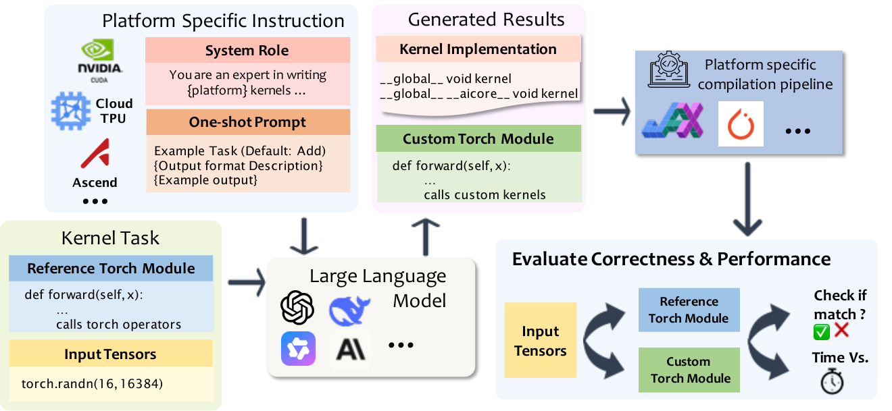

# MultiKernelBench: A Multi-Platform Benchmark for Kernel Generation

## Abstract

The automatic generation of deep learning (DL) kernels using large language models (LLMs) has emerged as a promising approach to reduce the manual effort and hardware-specific expertise required for writing high-performance operator implementations. However, existing benchmarks for evaluating LLMs in this domain suffer from limited hardware support, coarse-grained kernel categorization, and imbalanced task coverage. To address these limitations, we introduce MultiKernelBench, the first comprehensive, multi-platform benchmark for LLM-based DL kernel generation. MultiKernelBench spans 285 tasks across 14 well-defined kernel categories and supports three major hardware platforms: Nvidia GPUs, Huawei NPUs, and Google TPUs. To enable future extensibility, we design a modular backend abstraction layer that decouples platform-specific logic from the core benchmarking infrastructure, allowing easy integration of new hardware platforms. We further propose a simple yet effective category-aware one-shot prompting method that improves generation quality by providing in-category exemplars. Through systematic evaluations of seven state-of-the-art LLMs, we reveal significant variation in task difficulty, poor generalization to platforms with less training exposure, and the effectiveness of targeted prompting strategies. MultiKernelBench is publicly available at this https URL .

# MultiKernelBench: A Multi-Platform Benchmark for Kernel Generation

Zhongzhen Wen

Affiliation: State Key Lab for Novel Software Technology, Nanjing University, Nanjing, China
email: [wenzhongzhen@smail.nju.edu.cn](mailto:wenzhongzhen@smail.nju.edu.cn)
, 
Yinghui Zhang
Affiliation: State Key Lab for Novel Software Technology, Nanjing University, Nanjing, China
email: [zhangyh.halo@smail.nju.edu.cn](mailto:zhangyh.halo@smail.nju.edu.cn)
, 
Zhong Li

Affiliation: State Key Lab for Novel Software Technology, Nanjing University, Nanjing, China
email: [lizhong@nju.edu.cn](mailto:lizhong@nju.edu.cn)
, 
Zhongxin Liu

Affiliation: The State Key Laboratory of Blockchain and Data Security, Zhejiang University, Hangzhou, China
email: [liu_zx@zju.edu.cn](mailto:liu_zx@zju.edu.cn)
, 
Linna Xie

Affiliation: State Key Lab for Novel Software Technology, Nanjing University, Nanjing, China
email: [xieln@smail.nju.edu.cn](mailto:xieln@smail.nju.edu.cn)
 and 
Tian Zhang

Affiliation: State Key Lab for Novel Software Technology, Nanjing University, Nanjing, China
email: [ztluck@nju.edu.cn](mailto:ztluck@nju.edu.cn)

###### Abstract.

The automatic generation of deep learning (DL) kernels using large language models (LLMs) has emerged as a promising approach to reduce the manual effort and hardware-specific expertise required for writing high-performance operator implementations. However, existing benchmarks for evaluating LLMs in this domain suffer from limited hardware support, coarse-grained kernel categorization, and imbalanced task coverage. To address these limitations, we introduce MultiKernelBench, the first comprehensive, multi-platform benchmark for LLM-based DL kernel generation. MultiKernelBench spans 285 tasks across 14 well-defined kernel categories and supports three major hardware platforms: Nvidia GPUs, Huawei NPUs, and Google TPUs. To enable future extensibility, we design a modular backend abstraction layer that decouples platform-specific logic from the core benchmarking infrastructure, allowing easy integration of new hardware platforms. We further propose a simple yet effective category-aware one-shot prompting method that improves generation quality by providing in-category exemplars. Through systematic evaluations of seven state-of-the-art LLMs, we reveal significant variation in task difficulty, poor generalization to platforms with less training exposure, and the effectiveness of targeted prompting strategies. MultiKernelBench is publicly available at <https://github.com/wzzll123/MultiKernelBench>.

###### Keywords:

Benchmark, Deep Learning Kernels, Code Generation

## 1. Introduction

The execution of deep learning (DL) models fundamentally depends on the execution of DL kernels, which are implemented using low-level parallel programming languages such as CUDA for Nvidia GPUs and AscendC for Huawei NPUs. Writing correct and high-performance kernels is a time-consuming process that demands deep hardware-specific expertise.
Recent advances in Large Language Models (LLMs) offer a promising approach for automatically generating such kernels.
Particularly, several kernel benchmarks ([Ouyang et al., 2025](https://arxiv.org/html/2507.17773v2#bib.bib30); [Li et al., 2025a](https://arxiv.org/html/2507.17773v2#bib.bib24)) have been proposed to evaluate the capabilities of LLMs and support future research in this direction.

Research gaps - However, our analysis of existing benchmarks reveals three major limitations of them: (1) Limited platform support. Most existing benchmarks focus solely on Nvidia GPUs, neglecting other widely-used platforms such as Huawei NPUs and Google TPUs. These platforms also require kernel development, and the unique challenges they present remain largely unexplored. Moreover, due to the tightly coupled design of existing benchmarks ([Ouyang et al., 2025](https://arxiv.org/html/2507.17773v2#bib.bib30); [Li et al., 2025a](https://arxiv.org/html/2507.17773v2#bib.bib24))—binding build and evaluation procedures specifically to the Nvidia GPU ecosystem—extending them to support multiple platforms is non-trivial. (2) Lack of detailed categorization. Existing benchmarks either do not categorize kernels at all ([Li et al., 2025a](https://arxiv.org/html/2507.17773v2#bib.bib24)) or use overly coarse categorizations (e.g., three or four levels of complexity) ([Ouyang et al., 2025](https://arxiv.org/html/2507.17773v2#bib.bib30)). This lack of granularity is problematic, as evidenced by the wide variation in LLM-generated kernel performance even within the same level. For example, in our experiment, DeepSeek-V3 achieved a 0% correctness rate on CUDA kernels for the convolution category, while achieving over 80% correctness for the activation category—both classified under the same difficulty level in the existing benchmark ([Ouyang et al., 2025](https://arxiv.org/html/2507.17773v2#bib.bib30)). (3) Imbalanced kernel distribution. While most categories contain a reasonable number of kernels, some categories have very few, and certain important categories, such as optimizer kernels, are missing altogether, resulting in an uneven and insufficient evaluation landscape.

MultiKernelBench – To address these limitations, we introduce MultiKernelBench, a comprehensive, multi-platform benchmark suite for evaluating LLMs in the context of deep learning kernel generation. Unlike prior benchmarks that focus solely on Nvidia GPUs, MultiKernelBench supports diverse hardware platforms—including Nvidia GPUs (CUDA), Huawei NPUs (AscendC), and Google TPUs (Pallas)—enabling a more realistic and broadly applicable evaluation. We categorize DL kernels by their functional characteristics and extend the task set from KernelBench ([Ouyang et al., 2025](https://arxiv.org/html/2507.17773v2#bib.bib30)), adding missing categories and augmenting existing ones. In total, MultiKernelBench includes 285 kernel generation tasks across 14 well-defined categories, supporting fine-grained, platform-agnostic evaluation. To ensure extensibility, we implement a modular backend abstraction layer that cleanly separates platform-specific logic from the core evaluation pipeline. New hardware targets can be added by implementing a unified backend interface for device setup, compilation, execution, and resource management—without altering core logic.

0pt

(a) CUDA Kernel

0pt

(b) Pallas Kernel

0pt

(c) AscendC Kernel

Figure 1. Vector-addition kernels written for three platforms.

Evaluations – We further evaluate a set of LLMs under various settings using MultiKernelBench. We select seven diverse LLMs—including DeepSeek, Qwen, GPT-4o, and Claude—covering a range of scales from 32B to 681B parameters, and spanning both base and reasoning models. To systematically assess kernel generation, we report three key metrics: Compilation@k, Pass@k, and $SpeedUp_{\alpha}@k$, which capture performance from basic compilation success to runtime speedup. We design a unified prompt template compatible across multiple platforms and explore different prompting strategies. In the default setting, we use the add task as a one-shot example to demonstrate basic syntax and formatting. Additionally, we experiment with selecting one-shot examples from the same category as the target tasks, helping LLMs leverage relevant strategies and domain-specific knowledge. Following evaluation, we conduct extensive analysis, including failure diagnosis, category-wise assessments, and speedup case studies. Our experiments reveal several key insights, for example, category-aware one-shot prompting notably improves performance on platforms with limited training exposure, and LLMs occasionally discover meaningful optimizations, such as kernel fusion and exploiting data sparsity.

In summary, the paper makes the following contributions:

- We introduce MultiKernelBench, the first multi-platform benchmark for kernel generation, spanning GPUs, NPUs, and TPUs with 285 tasks in 14 categories.
- We introduce an extensible backend abstraction layer that decouples platform-specific logic from the core evaluation pipeline. New hardware platforms can be added by implementing a unified backend interface, enabling easy integration and maintenance across diverse platforms.
- We propose a simple yet effective *category-aware one-shot* strategy that selects an exemplar kernel from the same category as the target task. This improves LLM performance by providing domain-specific patterns, especially on platforms with limited representation in LLM training data.
- We conduct extensive experiments on MultiKernelBench using seven LLMs under various settings. Our analysis reveals key insights on platform sensitivity, category-wise difficulty, and the benefits of category-aware prompting.

## 2. Background

### 2.1. Hardware for Deep Learning Computing

Larger training datasets and an increased number of model parameters make deep learning models more powerful—but at the cost of significantly higher computational and storage demands. Traditional CPU architectures are no longer sufficient to meet these intensive requirements. To address this challenge, several custom hardware solutions have been developed to accelerate deep learning training and inference. Among them, Nvidia’s GPU, Google’s TPU and Huawei’s NPU stand out as representative hardware, each with distinct architectures and design philosophies.

Nvidia’s GPU (Graphics Processing Unit) was originally developed for graphics rendering. Modern GPUs feature thousands of Arithmetic Logic Units within a single processor, allowing DL workloads to run in parallel with high efficiency. However, they still rely heavily on memory and register access to store intermediate variables during operations like matrix multiplication.
To further accelerate such workloads, Nvidia introduced Tensor Cores ([ten, 2025](https://arxiv.org/html/2507.17773v2#bib.bib10))—specialized hardware units optimized for fast, mixed-precision matrix operations that are critical in DL.

Google’s TPU (Tensor Processing Unit), on the other hand, is purpose-built for deep neural network computations. TPUs consist of thousands of multiply-accumulate units that are directly interconnected to form a large, physical matrix. This architecture eliminates the need for memory access during matrix multiplication, greatly enhancing performance for specific workloads. However, TPUs are less suited for tasks that involve frequent branching or element-wise operations ([tpu, 2025](https://arxiv.org/html/2507.17773v2#bib.bib13)).

Huawei’s NPU (Neural Processing Unit) adopts a heterogeneous architecture that integrates scalar, vector, and cube computing units ([Liao et al., 2021](https://arxiv.org/html/2507.17773v2#bib.bib26); [Zhou et al., 2025](https://arxiv.org/html/2507.17773v2#bib.bib42)). Scalar units manage logical control, vector units handle element-wise and vector-related operations, and cube units specialize in matrix computations. This design enables the three types of units to operate in parallel, significantly improving computational efficiency through specialization and coordination.

### 2.2. Deep Learning Kernels

To harness the power of deep learning accelerators, developers need to write programs using specific languages or libraries tailored for the underlying hardware. These low-level programs—often referred to as kernels—directly implement computational primitives such as matrix multiplication, convolution, and activation functions. Writing efficient kernels requires careful attention to memory hierarchy, parallelism, and hardware-specific features.

CUDA is Nvidia’s parallel computing platform and programming model, which allows developers to write GPU-accelerated code. CUDA exposes the massive parallelism of GPUs by allowing fine-grained control over threads, memory (global, shared, and local), and execution hierarchy (grids and blocks). An example CUDA kernel for vector addition is shown in Figure [1(b)](https://arxiv.org/html/2507.17773v2#S1.F1.sf2). It performs element-wise addition on two input arrays in parallel using thread indices.

AscendC is Huawei’s low-level kernel programming model designed for the Ascend NPU. It offers direct access to the hardware’s heterogeneous compute units—scalar, vector, and cube—and allows precise control over memory transfers and execution queues. An example AscendC kernel for vector addition is shown in Figure [1(c)](https://arxiv.org/html/2507.17773v2#S1.F1.sf3). It uses the AscendC API function `Add` to perform vector addition on a tile using the vector units. The kernel coordinates computation, data movement, memory allocation, and task synchronization through explicit API calls.

Pallas is a high-level kernel programming interface built on top of the JAX ecosystem. It allows users to define custom TPU kernels using a Python syntax, abstracting many complexities of parallel programming. JAX transformations are then applied to lower these simple, high-level descriptions into efficient low-level code. An example Pallas kernel for vector addition is shown in Figure [1(b)](https://arxiv.org/html/2507.17773v2#S1.F1.sf2). The kernel is invoked within a JAX computation using the `pallas_call` higher-order function. Among the three examples, the Pallas kernel is the most concise, reflecting its simplicity and ease of use.

## 3. MultiKernelBench

### 3.1. Benchmark Overview

Figure 2. Framework of MultikernelBench.

Figure [2](https://arxiv.org/html/2507.17773v2#S3.F2) illustrates the overall framework of MultiKernelBench. The benchmark defines kernel tasks using reference PyTorch modules, where the forward method invokes official operators, alongside input tensors that specify the data the kernel must process. Each kernel task, combined with platform-specific instructions that define the system role and provide a one-shot prompt specifying the desired output format, is given to the LLM. The LLM generates two components: a custom kernel implementation for the target platform and custom PyTorch module code that invokes the custom kernel. After generation, the benchmark includes a build pipeline that compiles all LLM-generated outputs into an executable PyTorch module, aiming to match the functionality of the original module while improving performance. Finally, both the generated and reference modules are executed with the same input tensors to verify correctness and evaluate performance.

### 3.2. Input Prompt and Target Output

Input. We design a unified prompt template for kernel generation across multiple platforms. As illustrated in Figure [2](https://arxiv.org/html/2507.17773v2#S3.F2), each prompt consists of two parts: (1) a platform-specific instruction that defines the system role, describes the task, and provides a one-shot example illustrating the required output; and (2) the target kernel task, including the PyTorch module to transform and its input tensors. The second part remains consistent across platforms, while platform-specific differences are primarily reflected in the one-shot example. Each example begins with a kernel task—typically add—followed by a description of the platform-specific format and the output, helping the LLM learn both domain conventions and the required output structure.

Output. For CUDA and Pallas, the expected output is self-contained Python code. In the CUDA case, this includes C++ kernel code embedded as Python strings, with a PyTorch module invoking the kernel via cpp_extension ([cpp, 2025](https://arxiv.org/html/2507.17773v2#bib.bib9)) during its forward function. For Pallas, the output consists of a Python-defined kernel function wrapped with pallas_call, along with JAX and PyTorch integration code that compiles the kernel and exposes it as a PyTorch-compatible module. For AscendC, the output includes structured components such as host code, tiling configuration, device code, and the PyTorch module. This output format is designed to support future compilation, as discussed in Section [3.4](https://arxiv.org/html/2507.17773v2#S3.SS4).

### 3.3. Kernel Tasks

The existing benchmark, KernelBench ([Ouyang et al., 2025](https://arxiv.org/html/2507.17773v2#bib.bib30)), provides a set of 250 kernel tasks designed for evaluating large language models. These tasks are grouped into three difficulty levels and cover a range of topics, including convolutions and matrix multiplication with various input shapes. While KernelBench offers a solid foundation for kernel task evaluation, it exhibits several limitations. First, its classification scheme—based solely on three coarse difficulty levels—lacks the granularity required for more detailed analysis. Second, the benchmark omits several important categories of kernel operations, limiting its comprehensiveness.

To address these shortcomings, we propose a new taxonomy grounded in the functional semantics of kernel operations rather than relying solely on difficulty levels. We followed a systematic procedure to construct a broader and more representative classification of kernel tasks.
(1) Initial Categorization of Existing Tasks: We first categorized the 250 kernel tasks from KernelBench based on computational patterns (such as reductions and matrix multiplications) and functional roles within typical DL pipelines (such as activation functions and normalization layers).
(2) Gap Identification via Kernel Library Review: We then reviewed Pytorch native CUDA kernel library ([ate, 2025](https://arxiv.org/html/2507.17773v2#bib.bib8)), assessing whether each kernel could be mapped to an existing category. Kernels that did not fit were collected as candidates for new categories.
(3) Integration and Refinement: Candidate kernels were systematically categorized, and category definitions were refined through discussions among three kernel developers, each with three years of experience, to ensure completeness and consistency.
(4) Pruning Sparse and Low-Impact Categories: Categories with few representative tasks or limited relevance to common DL scenarios were removed, based on consensus among the three developers. For instance, comparison-related kernels were excluded due to their simplicity and negligible impact on LLM performance evaluation.

This process resulted in a set of 14 functional categories capturing a broad and representative range of kernel operations, including Resize, Reduction, Normalization, and Indexing. Compared to KernelBench, we introduce three new categories—Broadcast, Resize, and Optimizer—to cover previously unrepresented operations, and we expand the Indexing category, which originally included only two tasks, to better reflect real-world usage. New tasks are selected from existing kernel libraries ([ate, 2025](https://arxiv.org/html/2507.17773v2#bib.bib8)), then refined and manually verified to ensure practical relevance and comprehensive coverage. Table [1](https://arxiv.org/html/2507.17773v2#S3.T1) summarizes these categories, along with representative tasks and the number of tasks per category, providing a more fine-grained and functional framework for evaluating LLM performance in DL kernel generation.

Table 1. Categorization and counts of kernels.

| Categories | Representative | #Tasks |
| --- | --- | --- |
| Activation | relu, gelu | 15 |
| Broadcast | bias_add | 10 |
| Convolution | conv2d | 34 |
| Full Architecture | resnet18 | 50 |
| Fusion | fused_matmul_bias | 100 |
| Loss | cross_entropy, mse | 7 |
| Math | multiply | 6 |
| Matrix Multiply | sgemm, bmm | 17 |
| Normalization | batchnorm, layernorm | 8 |
| Optimizer | adam_update, sgd_momentum | 5 |
| Pooling | maxpool2d, avgpool2d | 6 |
| Index | gather, scatter_update | 12 |
| Resize | bilinear_resize | 10 |
| Reduce | reduce_sum, reduce_max | 5 |
| Total |  | 285 |

### 3.4. Platform-Specific Compilation

After generation, MultiKernelBench transforms the LLM-generated text into an executable PyTorch module for further evaluation.

As discussed in Section [3.2](https://arxiv.org/html/2507.17773v2#S3.SS2), the generated output for Pallas and CUDA is already self-contained Python code. The compilation pipeline simply extracts the code from the text and dynamically executes it using exec ([pyt, 2025](https://arxiv.org/html/2507.17773v2#bib.bib7)). The actual build process, such as compiling CUDA source code with nvcc, is handled automatically by utilities like cpp_extension ([cpp, 2025](https://arxiv.org/html/2507.17773v2#bib.bib9)). Additionally, for CUDA, device-side assertions should be enabled for failure analysis.

For AscendC, the build process is more involved. Unlike CUDA and Pallas, AscendC does not provide automatic utilities to compile and bind these components directly from Python. Therefore, we define the AscendC output format to include multiple components, as discussed in Section [3.2](https://arxiv.org/html/2507.17773v2#S3.SS2). MultiKernelBench uses glue scripts to organize these components into the required file structure, execute the AscendC compilation pipeline, and produce an executable PyTorch module.

### 3.5. Evaluation Approach

MultiKernelBench automatically evaluates the quality of generated kernels using three key metrics: compilation success, correctness, and performance.

Compilation Success. MultiKernelBench determines compilation success based on whether exceptions occur during the platform-specific build process, as described in Section [3.4](https://arxiv.org/html/2507.17773v2#S3.SS4). Since CUDA and AscendC use C/C++-like languages, more errors tend to be caught at compile time compared to Pallas, which is Python-based. This metric reflects the minimum requirement for understanding a platform’s syntax and language-specific constraints.

Correctness. To evaluate correctness, MultiKernelBench adopts a similar approach to prior work ([Ouyang et al., 2025](https://arxiv.org/html/2507.17773v2#bib.bib30); [Wu et al., 2024](https://arxiv.org/html/2507.17773v2#bib.bib37)), using randomized testing to verify kernel outputs. It generates $N$ random inputs and feeds them into both the LLM-generated module (producing $output_{llm}$) and a reference module (producing $output_{ref}$). The kernel is considered correct if it satisfies the condition: $|output_{llm}-output_{ref}|<atol+rtol*|output_{ref}|$. Here, atol (absolute tolerance) accounts for fixed small differences, and rtol (relative tolerance) scales with the magnitude of the reference output to handle proportional errors.

We follow prior work in setting the parameters: $N=5$, $atol=1e{-2}$, and $rtol=1e{-2}$. Previous studies ([Ouyang et al., 2025](https://arxiv.org/html/2507.17773v2#bib.bib30)) have observed that, on CUDA, five random tests often yield results consistent with running 100 tests. We reproduced this phenomenon on AscendC and Pallas, confirming that a small number of tests is generally sufficient for correctness evaluation. The relatively large tolerance values also accommodate potential precision-reducing optimizations, such as using BF16 or FP8.

Performance. MultiKernelBench measures performance using platform-specific methods. For CUDA and AscendC, we use synchronization markers ([cud, 2025](https://arxiv.org/html/2507.17773v2#bib.bib12); [npu, 2025](https://arxiv.org/html/2507.17773v2#bib.bib11)) placed before and after kernel execution to compute elapsed time between the two events. For Pallas, however, no such synchronization markers are available in the current interface. Instead, we use debugging tools to measure execution time. To ensure consistency, we conducted experiments on the same machine at different times and confirmed that the timing methods across all three platforms are stable, with controlled variance within a small range.

### 3.6. Extensible Backend Abstraction for Multi-Platform Evaluation

To enable kernel benchmarking across diverse hardware platforms, we introduce a modular backend architecture that cleanly decouples platform-specific logic from the core evaluation pipeline.

Each platform is supported by a dedicated subclass of a unified Backend interface. This interface encapsulates the essential responsibilities of: (1) device initialization and hardware identification, (2) kernel code compilation and execution, (3) correctness verification and performance measurement, and (4) resource cleanup and memory management.

The benchmark framework dynamically loads the appropriate backend at runtime based on the specified platform name. New hardware platforms can be supported by simply implementing and registering a new backend class using the @register_backend(<platform>) decorator—without modifying any core evaluation logic. This plugin-based design ensures that the system remains extensible, maintainable, and easily adaptable to emerging accelerator architectures with minimal engineering effort.

## 4. EXPERIMENT

In this section, we experiment with a set of LLMs configured in various ways and analyze the results. Specifically, we address the following three research questions:

RQ1: How do the evaluated LLMs perform when prompted with the add task as a one-shot example?

RQ2: How does performance vary across different task categories?

RQ3: Can in-category examples improve LLM-generated kernel correctness for platforms with limited training exposure?

### 4.1. Methodology

Table 2. Specifications of hardware used in experiments

| Hardware | FP16 TFLOPS | HBM |
| --- | --- | --- |
| NVIDIA L20 GPU | 59.35 | 48 GB |
| Huawei Ascend 910B2 | 400 | 64 GB |
| Google TPU v2-8 | 180 | 64 GB |

Hardware.  Table [2](https://arxiv.org/html/2507.17773v2#S4.T2) summarizes the specifications of the three hardware platforms used in our experiments: the NVIDIA L20 GPU, Huawei Ascend 910B2, and Google TPU v2-8. These platforms feature diverse architectures and capabilities tailored for large-scale AI workloads. The NVIDIA L20 GPU is based on the Ada Lovelace architecture, offering high performance for both training and inference tasks. The Huawei Ascend 910B2 is a high-performance AI processor built on the Da Vinci architecture, optimized for efficient matrix computation. The Google TPU v2-8 is a custom ASIC specifically designed for deep learning, delivering high throughput for tensor operations and seamlessly integrated into the Google Cloud infrastructure.

Table 3. Studied Large Language Models

| Model | Type | Size | Time |
| --- | --- | --- | --- |
| DeepSeek-V3-0324 | Non-reasoning | 685B | 2025-03-24 |
| Qwen3-235B | Non-reasoning | 235B | 2025-04-29 |
| Qwen2.5-Coder | Non-reasoning | 32B | 2024-11-12 |
| GPT-4o | Non-reasoning | - | 2024-11-20 |
| Claude-Sonnet-4 | Non-reasoning | - | 2025-05-22 |
| DeepSeek-R1-0528 | Reasoning | 685B | 2025-05-28 |
| Qwen3-235B (think) | Reasoning | 235B | 2025-04-29 |

Studied LLMs.  Table [3](https://arxiv.org/html/2507.17773v2#S4.T3) lists the seven large language models used in our experiments. These models differ in scale, design, and functional capabilities, covering a wide spectrum of use cases—from general-purpose language generation to advanced reasoning. DeepSeek-V3-0324 and DeepSeek-R1-0528 are the latest and most powerful open source models in the DeepSeek series, representing state-of-the-art performance in base and reasoning categories, respectively, each with 685B parameters. GPT-4o is one of the most powerful proprietary base models available. Claude-Sonnet-4 is a powerful model for programming, ranking first in programming token usage across models ([ope, 2025](https://arxiv.org/html/2507.17773v2#bib.bib5)). Qwen2.5-Coder is a relatively compact 32B model trained primarily on code, serving as a representative of smaller, domain-specific LLMs. Qwen3-235B ([Yang et al., 2025](https://arxiv.org/html/2507.17773v2#bib.bib38)) uniquely integrates two distinct operating modes—reasoning (“think”) and non-reasoning—within a single 235B-parameter model, enabling a direct comparison of reasoning augmentation on performance in various tasks.

Table 4. 
LLM performance on 285 DL kernel tasks across CUDA, AscendC, and Pallas using add as the one-shot example.
We report compilation success (Comp@k), functional correctness (Pass@k), and speed-up ($SU_{1}$@k) under greedy (N=1) and sampling (N=5) decoding. "Total Pass" counts correct kernels across all platforms.

(a) Greedy Search N=1

<table>
<thead>
<tr>
<th rowspan="2">Models</th>
<th colspan="3">CUDA (%)</th>
<th colspan="3">AscendC (%)</th>
<th colspan="3">Pallas (%)</th>
<th rowspan="2">Total Pass (#)</th></tr>
<tr>
<th>Comp@1</th>
<th>Pass@1</th>
<th>$SU_{1}$@1</th>
<th>Comp@1</th>
<th>Pass@1</th>
<th>$SU_{1}$@1</th>
<th>Comp@1</th>
<th>Pass@1</th>
<th>$SU_{1}$@1</th></tr>
</thead>
<tbody>
<tr>
<td>DeepSeek-V3-0324</td>
<td>74.7</td>
<td>21.4</td>
<td>6.3</td>
<td>10.2</td>
<td>2.5</td>
<td>1.1</td>
<td>70.9</td>
<td>4.6</td>
<td>4.2</td>
<td>81</td></tr>
<tr>
<td>Qwen3-235B</td>
<td>66.3</td>
<td>22.5</td>
<td>5.3</td>
<td>0.7</td>
<td>0.7</td>
<td>0.4</td>
<td>89.8</td>
<td>3.9</td>
<td>1.8</td>
<td>77</td></tr>
<tr>
<td>Qwen2.5-Coder-32B</td>
<td>66.0</td>
<td>15.8</td>
<td>3.5</td>
<td>2.8</td>
<td>1.8</td>
<td>0.7</td>
<td>94.7</td>
<td>4.6</td>
<td>3.2</td>
<td>63</td></tr>
<tr>
<td>GPT-4o</td>
<td>97.5</td>
<td>23.2</td>
<td>5.3</td>
<td>2.5</td>
<td>1.8</td>
<td>0.4</td>
<td>97.2</td>
<td>6.3</td>
<td>2.8</td>
<td>89</td></tr>
<tr>
<td>Claude-Sonnet-4</td>
<td>92.3</td>
<td>47.0</td>
<td>20.4</td>
<td>5.3</td>
<td>2.1</td>
<td>0.4</td>
<td>99.6</td>
<td>8.4</td>
<td>7.7</td>
<td>164</td></tr>
<tr>
<td>DeepSeek-R1-0528</td>
<td>75.4</td>
<td>52.6</td>
<td>26.0</td>
<td>1.4</td>
<td>1.4</td>
<td>0.0</td>
<td>81.4</td>
<td>2.8</td>
<td>1.4</td>
<td>162</td></tr>
<tr>
<td>Qwen3-235B (think)</td>
<td>79.3</td>
<td>44.2</td>
<td>19.3</td>
<td>0.7</td>
<td>0.7</td>
<td>0.0</td>
<td>93.0</td>
<td>7.4</td>
<td>7.0</td>
<td>149</td></tr>
</tbody>
</table>

(b) Sampling Search N=5

<table>
<thead>
<tr>
<th rowspan="2">Models</th>
<th colspan="3">CUDA (%)</th>
<th colspan="3">AscendC (%)</th>
<th colspan="3">Pallas (%)</th>
<th rowspan="2">Total Pass (#)</th></tr>
<tr>
<th>Comp@5</th>
<th>Pass@5</th>
<th>$SU_{1}$@5</th>
<th>Comp@5</th>
<th>Pass@5</th>
<th>$SU_{1}$@5</th>
<th>Comp@5</th>
<th>Pass@5</th>
<th>$SU_{1}$@5</th></tr>
</thead>
<tbody>
<tr>
<td>DeepSeek-V3-0324</td>
<td>98.2</td>
<td>35.1</td>
<td>13.7</td>
<td>7.7</td>
<td>2.8</td>
<td>1.4</td>
<td>97.9</td>
<td>6.0</td>
<td>5.6</td>
<td>125</td></tr>
<tr>
<td>Qwen3-235B</td>
<td>97.2</td>
<td>43.9</td>
<td>13.0</td>
<td>3.9</td>
<td>2.1</td>
<td>1.4</td>
<td>100.0</td>
<td>6.3</td>
<td>4.2</td>
<td>149</td></tr>
<tr>
<td>Qwen2.5-Coder-32B</td>
<td>94.7</td>
<td>31.9</td>
<td>11.9</td>
<td>4.2</td>
<td>2.5</td>
<td>1.1</td>
<td>100.0</td>
<td>5.3</td>
<td>3.9</td>
<td>113</td></tr>
<tr>
<td>GPT-4o</td>
<td>99.6</td>
<td>32.3</td>
<td>12.6</td>
<td>3.2</td>
<td>2.1</td>
<td>0.7</td>
<td>100.0</td>
<td>9.8</td>
<td>8.8</td>
<td>126</td></tr>
<tr>
<td>Claude-Sonnet-4</td>
<td>97.9</td>
<td>55.8</td>
<td>26.0</td>
<td>8.1</td>
<td>3.9</td>
<td>2.1</td>
<td>100.0</td>
<td>10.5</td>
<td>8.8</td>
<td>200</td></tr>
</tbody>
</table>

Reported Metrics. In line with prior work on code generation ([Rozière et al., 2023](https://arxiv.org/html/2507.17773v2#bib.bib31); [Zhu et al., 2025](https://arxiv.org/html/2507.17773v2#bib.bib43); [Kulal et al., 2019](https://arxiv.org/html/2507.17773v2#bib.bib22)), we assess functional correctness using the widely adopted Pass@k metric. Under this metric, $k$ code samples are generated per problem, and a problem is considered solved if at least one sample passes all test cases. Beyond Pass@k, we introduce two complementary metrics specifically designed for the characteristics of DL kernels: Compilation@k and $SpeedUp_{\alpha}@k$. Compilation@k captures the proportion of problems for which at least one of the $k$ generated samples compiles successfully. $SpeedUp_{\alpha}@k$ measures runtime performance by reporting the fraction of problems where at least one sample achieves a speedup of at least $\alpha$ (e.g., 2×) compared to a predefined baseline implementation.

To ensure consistent and reproducible performance measurements, we restrict our evaluation of baseline implementations to PyTorch’s eager mode, excluding TorchDynamo and other compilation modes due to their platform-dependent behavior, which could introduce measurement inconsistencies. We report all metrics (Pass@k, Compilation@k, and $SpeedUp_{\alpha}@k$) for $k=1$ and $k=5$. For $k=1$, we use greedy decoding (temperature $=0.0$) to evaluate the model’s top-predicted solution. For $k=5$, we employ stochastic sampling with temperature $=0.2$ and top-$p=0.95$ to balance diversity and quality in the generated outputs, following established practices in prior code generation benchmarks ([Chen et al., 2021](https://arxiv.org/html/2507.17773v2#bib.bib18); [Cao et al., 2024](https://arxiv.org/html/2507.17773v2#bib.bib17)). Following prior work ([Ouyang et al., 2025](https://arxiv.org/html/2507.17773v2#bib.bib30)), we do not apply stochastic sampling to reasoning models, as they entail significantly higher inference time and computational cost.

### 4.2. RQ1: Performance in Default Setting

Table [4(b)](https://arxiv.org/html/2507.17773v2#S4.T4.st2) presents the overall performance of the selected LLMs across 285 kernel tasks under the default setting, where each task uses the add task as a one-shot example. For each platform, we report three key metrics—Compilation@k, Pass@k, and $SpeedUp_{1}@k$—for all selected models. Additionally, we include the total number of passed kernels for each model to provide a holistic view of overall performance. The best results for each metric are highlighted in bold to indicate the top-performing models. Overall, MultiKernelBench proves highly challenging: even the best-performing model, Claude-Sonnet-4, successfully completes only a subset of tasks (164 out of 855) under greedy decoding. While sampling search improves performance, a majority of tasks remain unsolved, underscoring the benchmark’s difficulty.

Table 5. 
CUDA Kernel Generation Accuracy by Category and Model using add kernels as one-shot exemplars.
Results are shown for three top-performing LLMs. The final column shows the average Pass@1 accuracy across models.

<table>
<thead>
<tr>
<th rowspan="2">Categories</th>
<th colspan="3">DeepSeek-R1 (%)</th>
<th colspan="3">Claude-Sonnet-4 (%)</th>
<th colspan="3">Qwen3-235B (think) (%)</th>
<th rowspan="2">Avg Pass@1 (%)</th></tr>
<tr>
<th>Comp@1</th>
<th>Pass@1</th>
<th>$SU_{1}@1$</th>
<th>Comp@1</th>
<th>Pass@1</th>
<th>$SU_{1}@1$</th>
<th>Comp@1</th>
<th>Pass@1</th>
<th>$SU_{1}@1$</th></tr>
</thead>
<tbody>
<tr>
<th>Activation</th>
<td>86.7</td>
<td>80.0</td>
<td>20.0</td>
<td>100.0</td>
<td>100.0</td>
<td>20.0</td>
<td>93.3</td>
<td>86.7</td>
<td>26.7</td>
<td>88.9</td></tr>
<tr>
<th>Broadcast</th>
<td>90.0</td>
<td>80.0</td>
<td>20.0</td>
<td>100.0</td>
<td>90.0</td>
<td>0.0</td>
<td>100.0</td>
<td>80.0</td>
<td>0.0</td>
<td>83.3</td></tr>
<tr>
<th>Convolution</th>
<td>58.8</td>
<td>32.4</td>
<td>5.9</td>
<td>100.0</td>
<td>0.0</td>
<td>0.0</td>
<td>58.8</td>
<td>8.8</td>
<td>0.0</td>
<td>13.7</td></tr>
<tr>
<th>Full Architecture</th>
<td>64.0</td>
<td>26.0</td>
<td>16.0</td>
<td>94.0</td>
<td>16.0</td>
<td>0.0</td>
<td>74.0</td>
<td>22.0</td>
<td>4.0</td>
<td>21.3</td></tr>
<tr>
<th>Fusion</th>
<td>78.0</td>
<td>59.0</td>
<td>44.0</td>
<td>85.0</td>
<td>50.0</td>
<td>37.0</td>
<td>81.0</td>
<td>49.0</td>
<td>32.0</td>
<td>52.7</td></tr>
<tr>
<th>Loss</th>
<td>100.0</td>
<td>42.9</td>
<td>28.6</td>
<td>85.7</td>
<td>42.9</td>
<td>14.3</td>
<td>100.0</td>
<td>57.1</td>
<td>42.9</td>
<td>47.6</td></tr>
<tr>
<th>Math</th>
<td>50.0</td>
<td>50.0</td>
<td>16.7</td>
<td>100.0</td>
<td>66.7</td>
<td>0.0</td>
<td>66.7</td>
<td>33.3</td>
<td>0.0</td>
<td>50.0</td></tr>
<tr>
<th>Matrix Multiply</th>
<td>88.2</td>
<td>76.5</td>
<td>5.9</td>
<td>100.0</td>
<td>70.6</td>
<td>5.9</td>
<td>94.1</td>
<td>76.5</td>
<td>5.9</td>
<td>74.5</td></tr>
<tr>
<th>Normalization</th>
<td>75.0</td>
<td>75.0</td>
<td>37.5</td>
<td>87.5</td>
<td>87.5</td>
<td>37.5</td>
<td>100.0</td>
<td>62.5</td>
<td>50.0</td>
<td>75.0</td></tr>
<tr>
<th>Optimizer</th>
<td>60.0</td>
<td>40.0</td>
<td>40.0</td>
<td>100.0</td>
<td>100.0</td>
<td>80.0</td>
<td>100.0</td>
<td>60.0</td>
<td>60.0</td>
<td>66.7</td></tr>
<tr>
<th>Pooling</th>
<td>83.3</td>
<td>33.3</td>
<td>0.0</td>
<td>100.0</td>
<td>66.7</td>
<td>50.0</td>
<td>66.7</td>
<td>16.7</td>
<td>0.0</td>
<td>38.9</td></tr>
<tr>
<th>Index</th>
<td>83.3</td>
<td>66.7</td>
<td>16.7</td>
<td>91.7</td>
<td>75.0</td>
<td>33.3</td>
<td>58.3</td>
<td>41.7</td>
<td>25.0</td>
<td>61.1</td></tr>
<tr>
<th>Resize</th>
<td>90.0</td>
<td>50.0</td>
<td>30.0</td>
<td>100.0</td>
<td>40.0</td>
<td>20.0</td>
<td>80.0</td>
<td>50.0</td>
<td>20.0</td>
<td>46.7</td></tr>
<tr>
<th>Reduce</th>
<td>100.0</td>
<td>100.0</td>
<td>20.0</td>
<td>80.0</td>
<td>80.0</td>
<td>0.0</td>
<td>100.0</td>
<td>80.0</td>
<td>20.0</td>
<td>86.7</td></tr>
</tbody>
</table>

Model Performance Comparison. Claude-Sonnet-4, one of the strongest coding models, passes the largest number of tasks overall. The two reasoning models, DeepSeek-R1 and Qwen3-235B (with thinking mode enabled), achieve the second-highest and third-highest number of passed kernels, respectively, highlighting the effectiveness of reinforcement learning in enhancing model capabilities. In contrast, Qwen2.5-Coder-32B generates the fewest correct kernels, suggesting that a smaller parameter count may negatively impact performance. Notably, while DeepSeek-R1 performs well on CUDA kernels, it lags behind non-reasoning models on AscendC and Pallas kernels, recording the lowest Pass@k scores among all seven models for Pallas. This may be attributed to a combination of DeepSeek-R1’s relatively high hallucination rate ([hal, 2025](https://arxiv.org/html/2507.17773v2#bib.bib4)) and limited exposure to AscendC and Pallas code in its training corpus.

Findings: (1) MultiKernelBench is a challenging benchmark for testing LLMs. (2) Reasoning-augmented models tend to perform better overall, while smaller models like Qwen-32B underperform, showing the impact of both reasoning ability and model scale.

Platform Comparison. Model performance varies notably across platforms, primarily reflecting differences in training corpus coverage. On CUDA, GPT-4o achieves the highest Compilation@1 rate (97.5%), indicating strong syntactic alignment with CUDA conventions, while DeepSeek-R1 delivers the best Pass@1 and $SpeedUp_{1}@1$, suggesting superior optimization capabilities for CUDA code. In contrast, performance drops sharply on AscendC and Pallas for most models. DeepSeek-V3 shows the best AscendC result with a modest Pass@1 of 2.5%, while all other models remain below 2.1%. On the Pallas platform, Claude-Sonnet-4 leads with the highest Pass@1 (8.4%) and Pass@5 (10.5%), whereas DeepSeek-R1, despite its strong CUDA performance, ranks lowest with only 2.8% Pass@1. These platform-specific discrepancies indicate that model effectiveness is highly correlated with the presence of relevant examples in the training data; the weaker performance on AscendC and Pallas likely stems from their limited representation in the pretraining corpora of current LLMs.

Findings: Model performance is highly platform-dependent, reflecting differences in training corpus coverage across CUDA, AscendC, and Pallas.

Failure Analysis. On the CUDA platform, compilation errors are relatively uncommon, likely because CUDA is widely documented and has extensive coverage on the internet, despite its C-like syntax and complexity. However, generating functionally correct kernels remains a significant challenge for LLMs. Even Claude-Sonnet-4, the best-performing model, achieves only a 47.0% Pass@1 and 55.8% Pass@5—indicating that many tasks still result in failure. We analyze the failure modes of compiled kernels and find that output mismatch is the dominant runtime error, accounting for 53.0% of failures. Output shape mismatches contribute 16.1%, while CUDA runtime errors account for 15.9%. These results highlight the difficulty LLMs face in reasoning about precise output semantics and data structure alignment, even in well-documented domains like CUDA.

Figure 3. AscendC Compilation Error Example.

Kernels targeting the AscendC platform show the highest rate of compilation errors, mainly due to LLMs’ limited understanding of core AscendC concepts such as SIMD computation, data transfer, and memory management—even with an add kernel as a one-shot example. Notably, 74.8% of compilation failures contain the keyword "no member named," indicating unfamiliarity with AscendC API usage or attempts to avoid hardware-specific coding. As illustrated in Figure [3](https://arxiv.org/html/2507.17773v2#S4.F3), for tasks like softmax, LLM generated code directly calls non-existent functions AscendC::Softmax, resulting in compilation errors. This reflects insufficient AscendC code exposure in the pretraining corpus, limiting the models’ ability to produce valid code for this platform.

Regarding the Pallas platform, although it also suffers from limited publicly available data, it is built on Python, which shifts many of the compilation-like errors typical in C/C++ to runtime errors instead. Despite a relatively high Comp@1, a closer inspection of the top-performing model, Qwen3-235B, reveals a Pass@5 of only 6.3%. Failure logs show that the most common runtime exception is Unexpected Keyword Argument (22.4%), indicating that LLMs often hallucinate non-existent keywords for Pallas APIs. Another frequent failure mode is the error "The Pallas TPU lowering currently supports only blocks of rank >= 1", accounting for 5% of failures. This is likely due to Pallas currently lacking support for scalar values as inputs, outputs, or intermediate computations.

Findings: (1) LLMs struggle with functional correctness, even on well-documented platforms like CUDA. (2) High compilation failure rates on AscendC suggest a limited understanding of platform-specific syntax. (3) Pallas is prone to runtime errors, driven by incorrect API usage.

Table 6. AscendC Kernel Generation Accuracy by Category and Model using add kernels as one-shot exemplars.

<table>
<thead>
<tr>
<th rowspan="2">Categories</th>
<th colspan="3">DeepSeek-V3 (%)</th>
<th colspan="3">Claude-Sonnet-4 (%)</th>
<th colspan="3">Qwen2.5-Coder-32B (%)</th>
<th rowspan="2">Avg Pass@1 (%)</th></tr>
<tr>
<th>Comp@1</th>
<th>Pass@1</th>
<th>$SU_{1}@1$</th>
<th>Comp@1</th>
<th>Pass@1</th>
<th>$SU_{1}@1$</th>
<th>Comp@1</th>
<th>Pass@1</th>
<th>$SU_{1}@1$</th></tr>
</thead>
<tbody>
<tr>
<td>Activation</td>
<td>33.3</td>
<td>33.3</td>
<td>6.7</td>
<td>53.3</td>
<td>40.0</td>
<td>6.7</td>
<td>33.3</td>
<td>33.3</td>
<td>13.3</td>
<td>35.6</td></tr>
<tr>
<td>Broadcast</td>
<td>40.0</td>
<td>20.0</td>
<td>20.0</td>
<td>10.0</td>
<td>0.0</td>
<td>0.0</td>
<td>30.0</td>
<td>0.0</td>
<td>0.0</td>
<td>6.7</td></tr>
<tr>
<td>Others</td>
<td colspan="9">All Pass@1 = 0.0</td>
<td>0.0</td></tr>
</tbody>
</table>

Table 7. Pallas Kernel Generation Accuracy by Category and Model using add kernels as one-shot exemplars.

<table>
<thead>
<tr>
<th rowspan="2">Categories</th>
<th colspan="3">Claude-Sonnet-4 (%)</th>
<th colspan="3">Qwen3-235B (think) (%)</th>
<th colspan="3">GPT-4o (%)</th>
<th rowspan="2">Avg Pass@1 (%)</th></tr>
<tr>
<th>Comp@1</th>
<th>Pass@1</th>
<th>$SU_{1}@1$</th>
<th>Comp@1</th>
<th>Pass@1</th>
<th>$SU_{1}@1$</th>
<th>Comp@1</th>
<th>Pass@1</th>
<th>$SU_{1}@1$</th></tr>
</thead>
<tbody>
<tr>
<th>Activation</th>
<td>100.0</td>
<td>66.7</td>
<td>60.0</td>
<td>100.0</td>
<td>66.7</td>
<td>66.7</td>
<td>93.3</td>
<td>53.3</td>
<td>26.7</td>
<td>62.2</td></tr>
<tr>
<th>Broadcast</th>
<td>100.0</td>
<td>40.0</td>
<td>40.0</td>
<td>90.0</td>
<td>30.0</td>
<td>30.0</td>
<td>100.0</td>
<td>40.0</td>
<td>20.0</td>
<td>36.7</td></tr>
<tr>
<th>Full Architecture</th>
<td>98.0</td>
<td>4.0</td>
<td>4.0</td>
<td>92.0</td>
<td>4.0</td>
<td>4.0</td>
<td>98.0</td>
<td>6.0</td>
<td>2.0</td>
<td>4.7</td></tr>
<tr>
<th>Fusion</th>
<td>100.0</td>
<td>6.0</td>
<td>5.0</td>
<td>91.0</td>
<td>5.0</td>
<td>4.0</td>
<td>96.0</td>
<td>1.0</td>
<td>0.0</td>
<td>4.0</td></tr>
<tr>
<th>Loss</th>
<td>100.0</td>
<td>0.0</td>
<td>0.0</td>
<td>85.7</td>
<td>0.0</td>
<td>0.0</td>
<td>100.0</td>
<td>14.3</td>
<td>14.3</td>
<td>4.8</td></tr>
<tr>
<th>Normalization</th>
<td>100.0</td>
<td>25.0</td>
<td>25.0</td>
<td>100.0</td>
<td>12.5</td>
<td>12.5</td>
<td>100.0</td>
<td>12.5</td>
<td>0.0</td>
<td>16.7</td></tr>
<tr>
<th>Others</th>
<td colspan="9">All Pass@1 = 0.0</td>
<td>0.0</td></tr>
</tbody>
</table>

### 4.3. RQ2: Category-wise Analysis

Table [5](https://arxiv.org/html/2507.17773v2#S4.T5), Table [6](https://arxiv.org/html/2507.17773v2#S4.T6), and Table [7](https://arxiv.org/html/2507.17773v2#S4.T7) present category-wise results for the CUDA, AscendC, and Pallas backends, respectively, using three metrics under greedy decoding: Compilation@1, Pass@1, and $SpeedUp_{1}@1$. Due to space limitations, we report results for the top three performing models only. To reflect task difficulty, we also report the average Pass@1 across these models for each category. Categories in which all models achieved zero Pass@1 were merged, as they indicate tasks where no correct solution was generated.

Category Comparison. For CUDA kernels, the top three models achieve the highest Pass@1 rates in the Activation, Reduce, and Broadcast categories, reaching 88.9%, 86.7%, and 83.3%, respectively. In contrast, the Convolution and Full Architecture categories exhibit significantly lower pass rates—13.7% and 21.3%, respectively—highlighting the increased complexity of these tasks. Notably, prior work ([Ouyang et al., 2025](https://arxiv.org/html/2507.17773v2#bib.bib30)) classifies Convolution and Activation as having comparable difficulty, yet their actual Pass@1 rates diverge markedly (13.7% vs. 88.9%), reinforcing the need for our proposed fine-grained categorization. Pooling tasks also show relatively low performance, with a Pass@1 rate of 38.9%. Overall, this category-wise analysis reveals substantial variation in model performance across different task types.

On the AscendC and Pallas platforms, LLM-generated kernels succeed in only a few categories. Activation remains the easiest category across all three platforms, likely due to its relatively simple mathematical structure. In contrast, tasks like Reduce and Matrix Multiply—while performing well on CUDA—have a Pass@1 of zero on AscendC and Pallas, suggesting platform-specific challenges and differences in kernel generation preferences.

Findings: (1) LLMs show strong performance on simple categories like Activation, but struggle with complex tasks such as Convolution, revealing large variation in task difficulty. (2) High-performing categories on CUDA (e.g., Reduce, Matrix Multiply) fail completely on AscendC and Pallas, indicating platform-specific limitations in generalizing kernel generation.

Speed Up Cases Analysis. Analyzing scenarios where LLM-generated kernels outperform native PyTorch kernels reveals several interesting patterns. We identify three common situations where speed-ups occur:
(1) Simple operators, particularly in the activations category: These operations are extremely lightweight (e.g., around 2µs execution time). In such cases, LLM-generated kernels may be slightly faster than PyTorch’s native implementations, possibly due to measurement noise or reduced internal overhead.
(2) Task-specific optimization: LLMs can occasionally discover more efficient strategies tailored to specific tasks. For instance, as shown in Figure [4](https://arxiv.org/html/2507.17773v2#S4.F4), in diagonal matrix multiplication, the LLM leverages sparsity to skip redundant computations found in general-purpose routines.
(3) Kernel fusion, particularly in fusion tasks: LLM-generated kernels may implicitly combine multiple operations, reducing intermediate memory allocations and data transfers. As illustrated in Figure [5](https://arxiv.org/html/2507.17773v2#S4.F5), for a kernel involving five operations—gemm, max, minus, mean, gelu—the LLM-generated Pallas kernel fuses the latter four, improving performance by minimizing memory bandwidth usage and kernel launch overhead.

Figure 4. Diagonal Matrix Multiplication.

Figure 5. Kernel Fusion Example.

Findings: (1) LLMs occasionally discover task-specific optimizations, such as exploiting sparsity in diagonal matrix multiplication. (2) Kernel fusion in LLM-generated code can lead to significant speed-ups by minimizing memory transfers and launch overhead.

Table 8. AscendC kernel generation accuracy by category and model using *in-category* one-shot examples.
$\Delta$Pass indicates the absolute improvement in Pass@1 over the baseline setting using an add kernel as the one-shot example.
The last row summarizes the relative improvement in overall.

<table>
<thead>
<tr>
<th rowspan="2">Category</th>
<th colspan="4">Claude-Sonnet-4 (%)</th>
<th colspan="4">GPT-4o (%)</th>
<th colspan="4">DeepSeek-V3 (%)</th></tr>
<tr>
<th>Comp@1</th>
<th>Pass@1</th>
<th>$SU_{1}@1$</th>
<th>$\Delta Pass$</th>
<th>Comp@1</th>
<th>Pass@1</th>
<th>$SU_{1}@1$</th>
<th>$\Delta Pass$</th>
<th>Comp@1</th>
<th>Pass@1</th>
<th>$SU_{1}@1$</th>
<th>$\Delta Pass$</th></tr>
</thead>
<tbody>
<tr>
<th>Activation</th>
<td>60.0</td>
<td>60.0</td>
<td>20.0</td>
<td>+20.0</td>
<td>46.7</td>
<td>40.0</td>
<td>13.3</td>
<td>+6.7</td>
<td>40.0</td>
<td>40.0</td>
<td>6.7</td>
<td>+6.7</td></tr>
<tr>
<th>Loss</th>
<td>14.3</td>
<td>14.3</td>
<td>14.3</td>
<td>+14.3</td>
<td>28.6</td>
<td>14.3</td>
<td>14.3</td>
<td>+14.3</td>
<td>0.0</td>
<td>0.0</td>
<td>0.0</td>
<td>+0.0</td></tr>
<tr>
<th>Matrix Multiply</th>
<td>52.9</td>
<td>23.5</td>
<td>0.0</td>
<td>+23.5</td>
<td>82.4</td>
<td>35.3</td>
<td>0.0</td>
<td>+35.3</td>
<td>52.9</td>
<td>23.5</td>
<td>0.</td>
<td>+23.5</td></tr>
<tr>
<th>Normalization</th>
<td>62.5</td>
<td>0.0</td>
<td>0.0</td>
<td>+0.0</td>
<td>12.5</td>
<td>0.0</td>
<td>0.0</td>
<td>+0.0</td>
<td>25.0</td>
<td>0.0</td>
<td>0.0</td>
<td>+0.0</td></tr>
<tr>
<th>Reduce</th>
<td>0.0</td>
<td>0.0</td>
<td>0.0</td>
<td>+0.0</td>
<td>0.0</td>
<td>0.0</td>
<td>0.0</td>
<td>+0.0</td>
<td>0.0</td>
<td>0.0</td>
<td>0.0</td>
<td>+0.0</td></tr>
<tr>
<th>Rel. Improve</th>
<td>↑200.0</td>
<td>↑133.3</td>
<td>↑300.0</td>
<td></td>
<td>↑380.0</td>
<td>↑160.0</td>
<td>↑200.0</td>
<td></td>
<td>↑240.0</td>
<td>↑100.0</td>
<td>↑0.0</td>
<td></td></tr>
</tbody>
</table>

Table 9. Pallas kernel generation accuracy by category and model using *in-category* one-shot examples.

<table>
<thead>
<tr>
<th rowspan="2">Category</th>
<th colspan="4">Qwen3-235B (think) (%)</th>
<th colspan="4">DeepSeek-V3 (%)</th>
<th colspan="4">Qwen3-235B (%)</th></tr>
<tr>
<th>Comp@1</th>
<th>Pass@1</th>
<th>$SU_{1}@1$</th>
<th>$\Delta Pass$</th>
<th>Comp@1</th>
<th>Pass@1</th>
<th>$SU_{1}@1$</th>
<th>$\Delta Pass$</th>
<th>Comp@1</th>
<th>Pass@1</th>
<th>$SU_{1}@1$</th>
<th>$\Delta Pass$</th></tr>
</thead>
<tbody>
<tr>
<th>Activation</th>
<td>100.0</td>
<td>73.3</td>
<td>40.0</td>
<td>+6.6</td>
<td>100.0</td>
<td>86.7</td>
<td>46.7</td>
<td>+33.4</td>
<td>93.3</td>
<td>66.7</td>
<td>40.0</td>
<td>+6.6</td></tr>
<tr>
<th>Loss</th>
<td>100.0</td>
<td>42.9</td>
<td>14.3</td>
<td>+42.9</td>
<td>100.0</td>
<td>14.3</td>
<td>0.0</td>
<td>+14.3</td>
<td>100.0</td>
<td>28.6</td>
<td>0.0</td>
<td>+28.5</td></tr>
<tr>
<th>Matrix Multiply</th>
<td>100.0</td>
<td>41.2</td>
<td>0.0</td>
<td>+41.2</td>
<td>94.1</td>
<td>35.3</td>
<td>0.0</td>
<td>+35.3</td>
<td>100.0</td>
<td>35.3</td>
<td>0.0</td>
<td>+35.3</td></tr>
<tr>
<th>Normalization</th>
<td>100.0</td>
<td>25.0</td>
<td>12.5</td>
<td>+12.5</td>
<td>75.0</td>
<td>12.5</td>
<td>0.0</td>
<td>+0.0</td>
<td>100.0</td>
<td>25.0</td>
<td>12.5</td>
<td>+25.0</td></tr>
<tr>
<th>Reduce</th>
<td>100.0</td>
<td>80.0</td>
<td>40.0</td>
<td>+80.0</td>
<td>100.0</td>
<td>40.0</td>
<td>20.0</td>
<td>+40.0</td>
<td>100.0</td>
<td>20.0</td>
<td>0.0</td>
<td>+20.0</td></tr>
<tr>
<th>Rel. Improve</th>
<td>↑2.0</td>
<td>↑145.5</td>
<td>↑0.0</td>
<td></td>
<td>↑16.7</td>
<td>↑155.6</td>
<td>↑166.7</td>
<td></td>
<td>↑0.0</td>
<td>↑133.3</td>
<td>↑16.7</td>
<td></td></tr>
</tbody>
</table>

### 4.4. RQ3: Category-Aware One Shot

Experiments in RQ1 and RQ2 use add kernels as one-shot examples and demonstrate very low pass rates on the two platforms: AscendC and Pallas. This is likely due to the limited presence of these two languages in the training data of LLMs. We argue that while an add kernel can offer basic syntax and usage patterns, it fails to convey the domain-specific knowledge needed for more complex or specialized tasks. Each category typically requires distinct domain knowledge and coding conventions. For example, on Huawei NPUs, matrix multiplication and general math operations use different computation units and follow different programming paradigms. Therefore, in this research question, we explore whether providing one-shot examples from the same category as the target task can help LLMs better capture category-specific structures and improve kernel generation performance.

For AscendC and Pallas, we refer to official documentation ([pal, 2025](https://arxiv.org/html/2507.17773v2#bib.bib6); [asc, 2025a](https://arxiv.org/html/2507.17773v2#bib.bib2)) and open-source repositories ([asc, 2025b](https://arxiv.org/html/2507.17773v2#bib.bib3)) to collect example implementations. Specifically, we gather one representative example for five categories on each platform: Activation, Loss, Matrix Multiply, Normalization, and Reduce. These categories are chosen because suitable one-shot examples are available, with clear and concise implementations. We use the same prompt template as in RQ1 and RQ2, replacing the add task with a category-specific one-shot example.

Table [8](https://arxiv.org/html/2507.17773v2#S4.T8) and Table [9](https://arxiv.org/html/2507.17773v2#S4.T9) present the results of using this category-aware one-shot strategy. Due to space limitations, we report results only for the top three models with the highest pass rates under this setting. In addition to the standard three metrics per category—Comp@1, Pass@1, and $SU_{1}@1$—we also report improvements over the default (add) setting. For each model, we include an additional column showing the absolute increase in Pass@1 (i.e., new value minus baseline). Additionally, the last row summarizes the average relative improvement for each metric, calculated as the percentage increase over the baseline values.

For AscendC kernels, using category-aware one-shot examples significantly improves both compilation and execution success rates. For example, GPT-4o achieves a 380% relative improvement in compilation success rate and a 160% improvement in correctness (Pass@1) compared to the baseline. At the category level, the most notable gains occur in Matrix Multiply: under the default setting, none of the models could produce correct kernels, but with category-aware one-shot prompting, they begin to generate valid outputs—though still without achieving runtime speedup. These results highlight that in-category examples provide valuable domain knowledge for LLMs, helping them better understand hardware-specific programming patterns and constraints, ultimately improving both compilation and correctness outcomes.

Despite overall progress, LLMs still struggle to generate correct AscendC kernels for certain categories such as Normalization and Reduce. In the case of Reduce, our analysis shows that many generated kernels incorrectly handle 3D input tensors, while the one-shot example only uses a 2D tensor. This highlights a broader limitation in shape-specific reasoning. These observations suggest the need for more fine-grained categorization—potentially based on input tensor shapes—and the development of shape-aware prompting strategies to better guide LLMs in handling such cases accurately.

For Pallas kernels, pass rates improve substantially, with relative gains exceeding 100% compared to the baseline. This indicates that well-chosen in-category examples play a crucial role in guiding LLMs toward correct kernel generation. Unlike AscendC, every category shows improvement on Pallas. This difference may be due to the simplicity of the Pallas language: most example programs are much shorter than their AscendC counterparts and delegate low-level, hardware-specific optimizations to the underlying compiler. These findings suggest that designing high-level domain-specific languages that abstract away low-level implementation details can help LLMs generate correct and efficient code more easily, enhancing the usability of such languages for AI-assisted programming.

Findings: (1) Category-aware one-shot prompting significantly boosts LLM performance on platforms with limited training exposure. (2) On Pallas, all categories see substantial performance gains, likely due to its concise syntax and compiler-managed optimizations.

## 5. Threat to Validity

The first threat to validity lies in the construction of our benchmark, including both the reference implementations and example kernels. To mitigate this, we manually reviewed all added kernels and verified their correctness through compilation and execution tests.
A second threat concerns the generalizability of our findings to other LLMs. To address this, we selected a diverse set of models, ranging from smaller-scale (32B) to very large-scale models (681B), and including both open-source (DeepSeek, Qwen) and proprietary models (GPT-4o).
Another threat is whether our results generalize to other hardware platforms and programming languages. As the landscape of DL accelerators continues to expand—with platforms like AMD (HIP) and more general frameworks like Triton—this is a relevant concern. To facilitate extensibility, our benchmark includes a backend abstraction layer that allows new platforms or languages to be integrated with minimal effort. For instance, supporting Triton requires fewer than 20 lines of additional code. We plan to incorporate such platforms in future work.

## 6. Related work

### 6.1. LLM-based Code Generation

Large Language Models (LLMs) have demonstrated impressive capabilities in generating source code from natural language prompts. General-purpose models such as the DeepSeek series ([Liu et al., 2024a](https://arxiv.org/html/2507.17773v2#bib.bib27); [Liu et al., 2024b](https://arxiv.org/html/2507.17773v2#bib.bib28)), LLaMA series ([Grattafiori et al., 2024](https://arxiv.org/html/2507.17773v2#bib.bib21); [Touvron et al., 2023a](https://arxiv.org/html/2507.17773v2#bib.bib33); [Touvron et al., 2023b](https://arxiv.org/html/2507.17773v2#bib.bib34)), and GPT series ([Brown et al., 2020](https://arxiv.org/html/2507.17773v2#bib.bib16); [Achiam et al., 2023](https://arxiv.org/html/2507.17773v2#bib.bib14)) have all shown strong performance on code generation tasks. These models learn programming patterns, syntax, and problem-solving strategies by training on large-scale datasets that combine code and natural language.

To further enhance code generation capabilities, many approaches apply continual pretraining and code-specific instruction tuning to strong foundation models. For example, Code Llama ([Rozière et al., 2023](https://arxiv.org/html/2507.17773v2#bib.bib31)) and DeepSeek-Coder-V2 ([DeepSeek-AI et al., 2024](https://arxiv.org/html/2507.17773v2#bib.bib19)) are built by further training LLaMA 2 and DeepSeek-V2 respectively, using trillions of additional tokens from public GitHub repositories and related text. Following continual pretraining, instruction tuning is often used to improve task alignment. Models such as WizardCoder ([Luo et al., 2024](https://arxiv.org/html/2507.17773v2#bib.bib29)), Magicoder ([Wei et al., 2024](https://arxiv.org/html/2507.17773v2#bib.bib36)), and DataScope ([Li et al., 2025b](https://arxiv.org/html/2507.17773v2#bib.bib25)) utilize synthetic instruction data tailored for coding tasks, leading to further improvements.

Despite these advances, challenges remain—especially in generating correct code for tasks requiring deep context or domain-specific APIs. Retrieval-augmented generation (RAG) has emerged as a promising direction to address these issues. For instance, RePoCoder ([Zhang et al., 2023](https://arxiv.org/html/2507.17773v2#bib.bib40)) integrates a similarity-based retriever with a pretrained code LLM in an iterative retrieval-generation pipeline to support repository-level code completion. Similarly, the Repository-Level Prompt Generator ([Shrivastava et al., 2023](https://arxiv.org/html/2507.17773v2#bib.bib32)) generates example-specific prompts by selecting useful code snippets to inject domain knowledge into the prompt. DocPrompting ([Zhou et al., 2023](https://arxiv.org/html/2507.17773v2#bib.bib41)) enhances code generation by retrieving relevant documentation snippets.

### 6.2. Benchmarks for Code Generation

Evaluating code generation models requires diverse and rigorous benchmarks that assess both functional correctness and code quality across varying levels of abstraction. At the function level, datasets like HumanEval ([Chen et al., 2021](https://arxiv.org/html/2507.17773v2#bib.bib18)) and MBPP ([Austin et al., 2021](https://arxiv.org/html/2507.17773v2#bib.bib15)) pioneered this space by verifying the correctness of generated code using unit tests. These benchmarks remain widely used for evaluating LLM performance on short, self-contained programming problems. To explore more complex generation scenarios, later benchmarks expanded to higher levels of granularity: ClassEval ([Du et al., 2024](https://arxiv.org/html/2507.17773v2#bib.bib20)) evaluates generation at the class level, while DevEval ([Li et al., 2024](https://arxiv.org/html/2507.17773v2#bib.bib23)) and RepoEval ([Zhang et al., 2023](https://arxiv.org/html/2507.17773v2#bib.bib40)) assess model performance on repository-level tasks, including long-context reasoning and multi-file consistency.

While most early benchmarks focus on general-purpose coding tasks—such as algorithm design—more recent efforts have shifted toward domain-specific or library-intensive code generation. For example, ODEX ([Wang et al., 2023](https://arxiv.org/html/2507.17773v2#bib.bib35)) and TorchDataEval ([Zan et al., 2022](https://arxiv.org/html/2507.17773v2#bib.bib39)) evaluate a model’s ability to use specialized libraries for scientific computing or data loading. DOMAINEVAL ([Zhu et al., 2025](https://arxiv.org/html/2507.17773v2#bib.bib43)) introduces an automated benchmark construction pipeline that targets domain-specific tasks such as cryptography and systems programming. Similarly, BigCodeBench ([Zhuo et al., 2025](https://arxiv.org/html/2507.17773v2#bib.bib44)) evaluates models on high-level, multi-step tasks like data analysis and web development, which require the integration of diverse APIs and function calls, resembling real-world software engineering.

A particularly challenging and high-impact domain involves generating hardware-efficient kernels, where models must not only produce functionally correct code but also achieve high runtime performance. Benchmarks like KernelBench ([Ouyang et al., 2025](https://arxiv.org/html/2507.17773v2#bib.bib30)) and TritonBench ([Li et al., 2025a](https://arxiv.org/html/2507.17773v2#bib.bib24)) focus on this task: KernelBench includes 250 kernel tasks and uses the fast@p metric to jointly assess correctness and speedup; TritonBench assesses 184 real-world Triton operators with a focus on functional and performance profiling on NVIDIA GPUs. However, both are constrained to the NVIDIA ecosystem, overlooking other important platforms. To address this, MultiKernelBench introduces a more comprehensive, platform-agnostic evaluation framework by supporting multiple backends.

## 7. Conclusion

As demand grows for efficient DL kernel development across a diverse range of hardware platforms, leveraging LLM for automatic kernel generation has become increasingly vital. Yet, current benchmarks lack the breadth, granularity, and extensibility needed for rigorous evaluation. In this work, we present *MultiKernelBench*, the first comprehensive, multi-platform benchmark suite for DL kernel generation. It spans GPUs, NPUs, and TPUs, and includes 285 tasks across 14 functional categories. Through experiments with seven diverse LLMs, we observe substantial performance variability across both platforms and kernel categories. Notably, we show that a simple, category-aware prompting strategy significantly improves generation performance on AscendC and Pallas. Overall, MultiKernelBench offers a realistic and extensible foundation for benchmarking and advancing LLMs in DL system programming, facilitating future research in kernel generation and optimization.

## References

- asc (2025a)

  2025a.
  *Introduction to AscendC*.

  <https://www.hiascend.com/document/detail/zh/canncommercial/81RC1/developmentguide/opdevg/Ascendcopdevg/atlas_ascendc_10_0001.html>
- asc (2025b)

  2025b.
  *Introduction to AscendC*.

  <https://gitee.com/ascend/samples>
- hal (2025)

  2025.
  *Leaderboard Comparing LLM Performance at Producing Hallucinations*.

  <https://github.com/vectara/hallucination-leaderboard>
- ope (2025)

  2025.
  *LLM Rankings*.

  <https://openrouter.ai/rankings/programming>
- pal (2025)

  2025.
  *Pallas: a JAX kernel language*.

  <https://docs.jax.dev/en/latest/pallas/index.html>
- pyt (2025)

  2025.
  *Python Built-in Function exec*.

  <https://docs.python.org/3/library/functions.html#exec>
- ate (2025)

  2025.
  *PyTorch ATen CUDA Codebase*.

  <https://github.com/pytorch/pytorch/tree/main/aten/src/ATen/native/cuda>
- cpp (2025)

  2025.
  *Pytorch Cpp Extension*.

  <https://docs.pytorch.org/docs/stable/cpp_extension.html>
- ten (2025)

  2025.
  *Tensor Cores*.

  <https://www.nvidia.com/en-us/data-center/tensor-cores/>
- npu (2025)

  2025.
  *torch npu APIs*.

  <https://www.hiascend.com/doc_center/source/zh/canncommercial/63RC2/modeldevpt/ptmigr/ptmigr_0193.html>
- cud (2025)

  2025.
  *torch.cuda.Event*.

  <https://docs.pytorch.org/docs/stable/generated/torch.cuda.Event.html>
- tpu (2025)

  2025.
  *TPU architecture*.

  <https://cloud.google.com/tpu/docs/system-architecture-tpu-vm>
- Achiam et al. (2023)

  Josh Achiam, Steven Adler, Sandhini Agarwal, Lama Ahmad, Ilge Akkaya, Florencia Leoni Aleman, Diogo Almeida, Janko Altenschmidt, Sam Altman, Shyamal Anadkat, et al. 2023.
  Gpt-4 technical report.
  *arXiv preprint arXiv:2303.08774* (2023).
- Austin et al. (2021)

  Jacob Austin, Augustus Odena, Maxwell Nye, Maarten Bosma, Henryk Michalewski, David Dohan, Ellen Jiang, Carrie Cai, Michael Terry, Quoc Le, and Charles Sutton. 2021.
  Program Synthesis with Large Language Models.
  arXiv:2108.07732 [cs.PL]
  <https://arxiv.org/abs/2108.07732>
- Brown et al. (2020)

  Tom Brown, Benjamin Mann, Nick Ryder, Melanie Subbiah, Jared D Kaplan, Prafulla Dhariwal, Arvind Neelakantan, Pranav Shyam, Girish Sastry, Amanda Askell, Sandhini Agarwal, Ariel Herbert-Voss, Gretchen Krueger, Tom Henighan, Rewon Child, Aditya Ramesh, Daniel Ziegler, Jeffrey Wu, Clemens Winter, Chris Hesse, Mark Chen, Eric Sigler, Mateusz Litwin, Scott Gray, Benjamin Chess, Jack Clark, Christopher Berner, Sam McCandlish, Alec Radford, Ilya Sutskever, and
  Dario Amodei. 2020.
  Language Models are Few-Shot Learners. In *Advances in Neural Information Processing Systems*, H. Larochelle, M. Ranzato, R. Hadsell, M.F. Balcan, and H. Lin (Eds.), Vol. 33. Curran Associates, Inc., 1877–1901.

  <https://proceedings.neurips.cc/paper_files/paper/2020/file/1457c0d6bfcb4967418bfb8ac142f64a-Paper.pdf>
- Cao et al. (2024)

  Jialun Cao, Zhiyong Chen, Jiarong Wu, Shing-Chi Cheung, and Chang Xu. 2024.
  JavaBench: A Benchmark of Object-Oriented Code Generation for Evaluating Large Language Models. In *Proceedings of the 39th IEEE/ACM International Conference on Automated Software Engineering* (Sacramento, CA, USA) *(ASE ’24)*. Association for Computing Machinery, New York, NY, USA, 870–882.

  [doi:10.1145/3691620.3695470](https://doi.org/10.1145/3691620.3695470)
- Chen et al. (2021)

  Mark Chen, Jerry Tworek, Heewoo Jun, Qiming Yuan, Henrique Ponde de Oliveira Pinto, Jared Kaplan, Harri Edwards, Yuri Burda, Nicholas Joseph, Greg Brockman, Alex Ray, Raul Puri, Gretchen Krueger, Michael Petrov, Heidy Khlaaf, Girish Sastry, Pamela Mishkin, Brooke Chan, Scott Gray, Nick Ryder, Mikhail Pavlov, Alethea Power, Lukasz Kaiser, Mohammad Bavarian, Clemens Winter, Philippe Tillet, Felipe Petroski Such, Dave Cummings, Matthias Plappert, Fotios Chantzis,
  Elizabeth Barnes, Ariel Herbert-Voss, William Hebgen Guss, Alex Nichol, Alex Paino, Nikolas Tezak, Jie Tang, Igor Babuschkin, Suchir Balaji, Shantanu Jain, William Saunders, Christopher Hesse, Andrew N. Carr, Jan Leike, Josh Achiam, Vedant Misra, Evan Morikawa, Alec Radford, Matthew Knight, Miles Brundage, Mira Murati, Katie Mayer, Peter Welinder, Bob McGrew, Dario Amodei, Sam McCandlish, Ilya Sutskever, and Wojciech Zaremba. 2021.
  Evaluating Large Language Models Trained on Code.
  arXiv:2107.03374 [cs.LG]
  <https://arxiv.org/abs/2107.03374>
- DeepSeek-AI et al. (2024)

  DeepSeek-AI, Qihao Zhu, Daya Guo, Zhihong Shao, Dejian Yang, Peiyi Wang, Runxin Xu, Y. Wu, Yukun Li, Huazuo Gao, Shirong Ma, Wangding Zeng, Xiao Bi, Zihui Gu, Hanwei Xu, Damai Dai, Kai Dong, Liyue Zhang, Yishi Piao, Zhibin Gou, Zhenda Xie, Zhewen Hao, Bingxuan Wang, Junxiao Song, Deli Chen, Xin Xie, Kang Guan, Yuxiang You, Aixin Liu, Qiushi Du, Wenjun Gao, Xuan Lu, Qinyu Chen, Yaohui Wang,
  Chengqi Deng, Jiashi Li, Chenggang Zhao, Chong Ruan, Fuli Luo, and Wenfeng Liang. 2024.
  DeepSeek-Coder-V2: Breaking the Barrier of Closed-Source Models in Code Intelligence.
  arXiv:2406.11931 [cs.SE]
  <https://arxiv.org/abs/2406.11931>
- Du et al. (2024)

  Xueying Du, Mingwei Liu, Kaixin Wang, Hanlin Wang, Junwei Liu, Yixuan Chen, Jiayi Feng, Chaofeng Sha, Xin Peng, and Yiling Lou. 2024.
  Evaluating Large Language Models in Class-Level Code Generation. In *Proceedings of the IEEE/ACM 46th International Conference on Software Engineering* (Lisbon, Portugal) *(ICSE ’24)*. Association for Computing Machinery, New York, NY, USA, Article 81, 13 pages.

  [doi:10.1145/3597503.3639219](https://doi.org/10.1145/3597503.3639219)
- Grattafiori et al. (2024)

  Aaron Grattafiori, Abhimanyu Dubey, Abhinav Jauhri, Abhinav Pandey, Abhishek Kadian, Ahmad Al-Dahle, Aiesha Letman, Akhil Mathur, Alan Schelten, Alex Vaughan, et al. 2024.
  The llama 3 herd of models.
  *arXiv preprint arXiv:2407.21783* (2024).
- Kulal et al. (2019)

  Sumith Kulal, Panupong Pasupat, Kartik Chandra, Mina Lee, Oded Padon, Alex Aiken, and Percy S Liang. 2019.
  SPoC: Search-based Pseudocode to Code. In *Advances in Neural Information Processing Systems*, H. Wallach, H. Larochelle, A. Beygelzimer, F. d'Alché-Buc, E. Fox, and R. Garnett (Eds.), Vol. 32. Curran Associates, Inc.

  <https://proceedings.neurips.cc/paper_files/paper/2019/file/7298332f04ac004a0ca44cc69ecf6f6b-Paper.pdf>
- Li et al. (2024)

  Jia Li, Ge Li, Yunfei Zhao, Yongmin Li, Huanyu Liu, Hao Zhu, Lecheng Wang, Kaibo Liu, Zheng Fang, Lanshen Wang, Jiazheng Ding, Xuanming Zhang, Yuqi Zhu, Yihong Dong, Zhi Jin, Binhua Li, Fei Huang, Yongbin Li, Bin Gu, and Mengfei Yang. 2024.
  DevEval: A Manually-Annotated Code Generation Benchmark Aligned with Real-World Code Repositories. In *Findings of the Association for Computational Linguistics: ACL 2024*, Lun-Wei Ku, Andre Martins, and Vivek Srikumar (Eds.). Association for Computational Linguistics, Bangkok, Thailand, 3603–3614.
  [doi:10.18653/v1/2024.findings-acl.214](https://doi.org/10.18653/v1/2024.findings-acl.214)
- Li et al. (2025a)

  Jianling Li, Shangzhan Li, Zhenye Gao, Qi Shi, Yuxuan Li, Zefan Wang, Jiacheng Huang, Haojie Wang, Jianrong Wang, Xu Han, Zhiyuan Liu, and Maosong Sun. 2025a.
  TritonBench: Benchmarking Large Language Model Capabilities for Generating Triton Operators.
  arXiv:2502.14752 [cs.CL]
  <https://arxiv.org/abs/2502.14752>
- Li et al. (2025b)

  Zongjie Li, Daoyuan Wu, Shuai Wang, and Zhendong Su. 2025b.
  API-Guided Dataset Synthesis to Finetune Large Code Models.
  *Proc. ACM Program. Lang.* 9, OOPSLA1, Article 108 (April 2025), 30 pages.
  [doi:10.1145/3720449](https://doi.org/10.1145/3720449)
- Liao et al. (2021)

  Heng Liao, Jiajin Tu, Jing Xia, Hu Liu, Xiping Zhou, Honghui Yuan, and Yuxing Hu. 2021.
  Ascend: a Scalable and Unified Architecture for Ubiquitous Deep Neural Network Computing : Industry Track Paper. In *2021 IEEE International Symposium on High-Performance Computer Architecture (HPCA)*. 789–801.
  [doi:10.1109/HPCA51647.2021.00071](https://doi.org/10.1109/HPCA51647.2021.00071)
- Liu et al. (2024a)

  Aixin Liu, Bei Feng, Bin Wang, Bingxuan Wang, Bo Liu, Chenggang Zhao, Chengqi Dengr, Chong Ruan, Damai Dai, Daya Guo, et al. 2024a.
  Deepseek-v2: A strong, economical, and efficient mixture-of-experts language model.
  *arXiv preprint arXiv:2405.04434* (2024).
- Liu et al. (2024b)

  Aixin Liu, Bei Feng, Bing Xue, Bingxuan Wang, Bochao Wu, Chengda Lu, Chenggang Zhao, Chengqi Deng, Chenyu Zhang, Chong Ruan, et al. 2024b.
  Deepseek-v3 technical report.
  *arXiv preprint arXiv:2412.19437* (2024).
- Luo et al. (2024)

  Ziyang Luo, Can Xu, Pu Zhao, Qingfeng Sun, Xiubo Geng, Wenxiang Hu, Chongyang Tao, Jing Ma, Qingwei Lin, and Daxin Jiang. 2024.
  WizardCoder: Empowering Code Large Language Models with Evol-Instruct. In *The Twelfth International Conference on Learning Representations*.

  <https://openreview.net/forum?id=UnUwSIgK5W>
- Ouyang et al. (2025)

  Anne Ouyang, Simon Guo, Simran Arora, Alex L Zhang, William Hu, Christopher Ré, and Azalia Mirhoseini. 2025.
  Kernelbench: Can llms write efficient gpu kernels?
  *arXiv preprint arXiv:2502.10517* (2025).
- Rozière et al. (2023)

  Baptiste Rozière, Jonas Gehring, Fabian Gloeckle, Sten Sootla, Itai Gat, Xiaoqing Ellen Tan, Yossi Adi, Jingyu Liu, Tal Remez, Jérémy Rapin, Artyom Kozhevnikov, Ivan Evtimov, Joanna Bitton, Manish Bhatt, Cristian Canton-Ferrer, Aaron Grattafiori, Wenhan Xiong, Alexandre Défossez, Jade Copet, Faisal Azhar, Hugo Touvron, Louis Martin, Nicolas Usunier, Thomas Scialom, and Gabriel Synnaeve. 2023.
  Code Llama: Open Foundation Models for Code.
  *CoRR* abs/2308.12950 (2023).
  arXiv:2308.12950
  [doi:10.48550/ARXIV.2308.12950](https://doi.org/10.48550/ARXIV.2308.12950)
- Shrivastava et al. (2023)

  Disha Shrivastava, Hugo Larochelle, and Daniel Tarlow. 2023.
  Repository-Level Prompt Generation for Large Language Models of Code. In *Proceedings of the 40th International Conference on Machine Learning* *(Proceedings of Machine Learning Research, Vol. 202)*, Andreas Krause, Emma Brunskill, Kyunghyun Cho, Barbara Engelhardt, Sivan Sabato, and Jonathan Scarlett (Eds.). PMLR, 31693–31715.

  <https://proceedings.mlr.press/v202/shrivastava23a.html>
- Touvron et al. (2023a)

  Hugo Touvron, Thibaut Lavril, Gautier Izacard, Xavier Martinet, Marie-Anne Lachaux, Timothée Lacroix, Baptiste Rozière, Naman Goyal, Eric Hambro, Faisal Azhar, Aurelien Rodriguez, Armand Joulin, Edouard Grave, and Guillaume Lample. 2023a.
  LLaMA: Open and Efficient Foundation Language Models.
  arXiv:2302.13971 [cs.CL]
  <https://arxiv.org/abs/2302.13971>
- Touvron et al. (2023b)

  Hugo Touvron, Louis Martin, Kevin Stone, Peter Albert, Amjad Almahairi, Yasmine Babaei, Nikolay Bashlykov, Soumya Batra, Prajjwal Bhargava, Shruti Bhosale, Dan Bikel, Lukas Blecher, Cristian Canton Ferrer, Moya Chen, Guillem Cucurull, David Esiobu, Jude Fernandes, Jeremy Fu, Wenyin Fu, Brian Fuller, Cynthia Gao, Vedanuj Goswami, Naman Goyal, Anthony Hartshorn, Saghar Hosseini, Rui Hou, Hakan Inan, Marcin Kardas, Viktor Kerkez, Madian Khabsa,
  Isabel Kloumann, Artem Korenev, Punit Singh Koura, Marie-Anne Lachaux, Thibaut Lavril, Jenya Lee, Diana Liskovich, Yinghai Lu, Yuning Mao, Xavier Martinet, Todor Mihaylov, Pushkar Mishra, Igor Molybog, Yixin Nie, Andrew Poulton, Jeremy Reizenstein, Rashi Rungta, Kalyan Saladi, Alan Schelten, Ruan Silva, Eric Michael Smith, Ranjan Subramanian, Xiaoqing Ellen Tan, Binh Tang, Ross Taylor, Adina Williams, Jian Xiang Kuan, Puxin Xu, Zheng Yan, Iliyan Zarov, Yuchen
  Zhang, Angela Fan, Melanie Kambadur, Sharan Narang, Aurelien Rodriguez, Robert Stojnic, Sergey Edunov, and Thomas Scialom. 2023b.
  Llama 2: Open Foundation and Fine-Tuned Chat Models.
  arXiv:2307.09288 [cs.CL]
  <https://arxiv.org/abs/2307.09288>
- Wang et al. (2023)

  Zhiruo Wang, Shuyan Zhou, Daniel Fried, and Graham Neubig. 2023.
  Execution-Based Evaluation for Open-Domain Code Generation. In *Findings of the Association for Computational Linguistics: EMNLP 2023*, Houda Bouamor, Juan Pino, and Kalika Bali (Eds.). Association for Computational Linguistics, Singapore, 1271–1290.
  [doi:10.18653/v1/2023.findings-emnlp.89](https://doi.org/10.18653/v1/2023.findings-emnlp.89)
- Wei et al. (2024)

  Yuxiang Wei, Zhe Wang, Jiawei Liu, Yifeng Ding, and Lingming Zhang. 2024.
  Magicoder: Empowering Code Generation with OSS-Instruct. In *Proceedings of the 41st International Conference on Machine Learning* *(Proceedings of Machine Learning Research, Vol. 235)*, Ruslan Salakhutdinov, Zico Kolter, Katherine Heller, Adrian Weller, Nuria Oliver, Jonathan Scarlett, and Felix Berkenkamp (Eds.). PMLR, 52632–52657.

  <https://proceedings.mlr.press/v235/wei24h.html>
- Wu et al. (2024)

  Mengdi Wu, Xinhao Cheng, Oded Padon, and Zhihao Jia. 2024.
  A Multi-Level Superoptimizer for Tensor Programs.
  *CoRR* abs/2405.05751 (2024).
  arXiv:2405.05751
  [doi:10.48550/ARXIV.2405.05751](https://doi.org/10.48550/ARXIV.2405.05751)
- Yang et al. (2025)

  An Yang, Anfeng Li, Baosong Yang, Beichen Zhang, Binyuan Hui, Bo Zheng, Bowen Yu, Chang Gao, Chengen Huang, Chenxu Lv, Chujie Zheng, Dayiheng Liu, Fan Zhou, Fei Huang, Feng Hu, Hao Ge, Haoran Wei, Huan Lin, Jialong Tang, Jian Yang, Jianhong Tu, Jianwei Zhang, Jian Yang, Jiaxi Yang, Jingren Zhou, Jingren Zhou, Junyang Lin, Kai Dang, Keqin Bao, Kexin Yang, Le Yu, Lianghao Deng, Mei Li, Mingfeng
  Xue, Mingze Li, Pei Zhang, Peng Wang, Qin Zhu, Rui Men, Ruize Gao, Shixuan Liu, Shuang Luo, Tianhao Li, Tianyi Tang, Wenbiao Yin, Xingzhang Ren, Xinyu Wang, Xinyu Zhang, Xuancheng Ren, Yang Fan, Yang Su, Yichang Zhang, Yinger Zhang, Yu Wan, Yuqiong Liu, Zekun Wang, Zeyu Cui, Zhenru Zhang, Zhipeng Zhou, and Zihan Qiu. 2025.
  Qwen3 Technical Report.
  *CoRR* abs/2505.09388 (2025).
  arXiv:2505.09388
  [doi:10.48550/ARXIV.2505.09388](https://doi.org/10.48550/ARXIV.2505.09388)
- Zan et al. (2022)

  Daoguang Zan, Bei Chen, Zeqi Lin, Bei Guan, Wang Yongji, and Jian-Guang Lou. 2022.
  When Language Model Meets Private Library. In *Findings of the Association for Computational Linguistics: EMNLP 2022*, Yoav Goldberg, Zornitsa Kozareva, and Yue Zhang (Eds.). Association for Computational Linguistics, Abu Dhabi, United Arab Emirates, 277–288.
  [doi:10.18653/v1/2022.findings-emnlp.21](https://doi.org/10.18653/v1/2022.findings-emnlp.21)
- Zhang et al. (2023)

  Fengji Zhang, Bei Chen, Yue Zhang, Jacky Keung, Jin Liu, Daoguang Zan, Yi Mao, Jian-Guang Lou, and Weizhu Chen. 2023.
  RepoCoder: Repository-Level Code Completion Through Iterative Retrieval and Generation. In *Proceedings of the 2023 Conference on Empirical Methods in Natural Language Processing*. 2471–2484.
- Zhou et al. (2023)

  Shuyan Zhou, Uri Alon, Frank F. Xu, Zhengbao Jiang, and Graham Neubig. 2023.
  DocPrompting: Generating Code by Retrieving the Docs. In *The Eleventh International Conference on Learning Representations*.

  <https://openreview.net/forum?id=ZTCxT2t2Ru>
- Zhou et al. (2025)

  Yuhang Zhou, Zhibin Wang, Guyue Liu, Shipeng Li, Xi Lin, Zibo Wang, Yongzhong Wang, Fuchun Wei, Jingyi Zhang, Zhiheng Hu, Yanlin Liu, Chunsheng Li, Ziyang Zhang, Yaoyuan Wang, Bin Zhou, Wanchun Dou, Guihai Chen, and Chen Tian. 2025.
  Squeezing Operator Performance Potential for the Ascend Architecture. In *Proceedings of the 30th ACM International Conference on Architectural Support for Programming Languages and Operating Systems, Volume 2* (Rotterdam, Netherlands) *(ASPLOS ’25)*. Association for Computing Machinery, New York, NY, USA, 1156–1171.

  [doi:10.1145/3676641.3716243](https://doi.org/10.1145/3676641.3716243)
- Zhu et al. (2025)

  Qiming Zhu, Jialun Cao, Yaojie Lu, Hongyu Lin, Xianpei Han, Le Sun, and Shing-Chi Cheung. 2025.
  DOMAINEVAL: An Auto-Constructed Benchmark for Multi-Domain Code Generation. In *AAAI-25, Sponsored by the Association for the Advancement of Artificial Intelligence, February 25 - March 4, 2025, Philadelphia, PA, USA*, Toby Walsh, Julie Shah, and Zico Kolter (Eds.). AAAI Press, 26148–26156.
  [doi:10.1609/AAAI.V39I24.34811](https://doi.org/10.1609/AAAI.V39I24.34811)
- Zhuo et al. (2025)

  Terry Yue Zhuo, Vu Minh Chien, Jenny Chim, Han Hu, Wenhao Yu, Ratnadira Widyasari, Imam Nur Bani Yusuf, Haolan Zhan, Junda He, Indraneil Paul, Simon Brunner, Chen GONG, James Hoang, Armel Randy Zebaze, Xiaoheng Hong, Wen-Ding Li, Jean Kaddour, Ming Xu, Zhihan Zhang, Prateek Yadav, Naman Jain, Alex Gu, Zhoujun Cheng, Jiawei Liu, Qian Liu, Zijian Wang, David Lo, Binyuan Hui, Niklas Muennighoff, Daniel Fried, Xiaoning Du, Harm de
  Vries, and Leandro Von Werra. 2025.
  BigCodeBench: Benchmarking Code Generation with Diverse Function Calls and Complex Instructions. In *The Thirteenth International Conference on Learning Representations*.

  <https://openreview.net/forum?id=YrycTjllL0>
