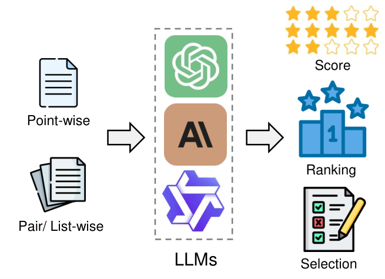
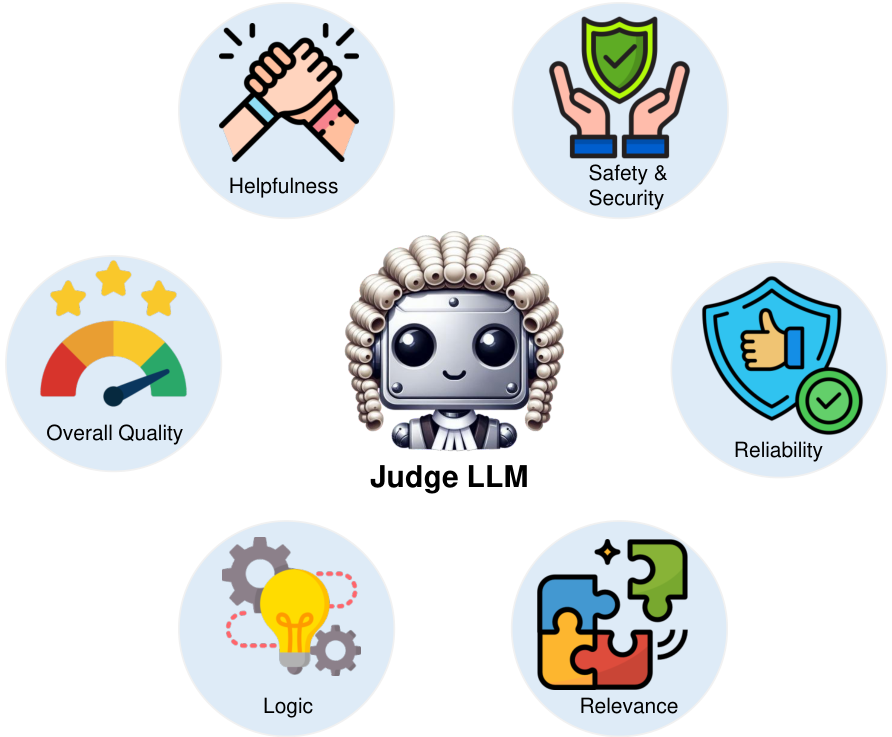
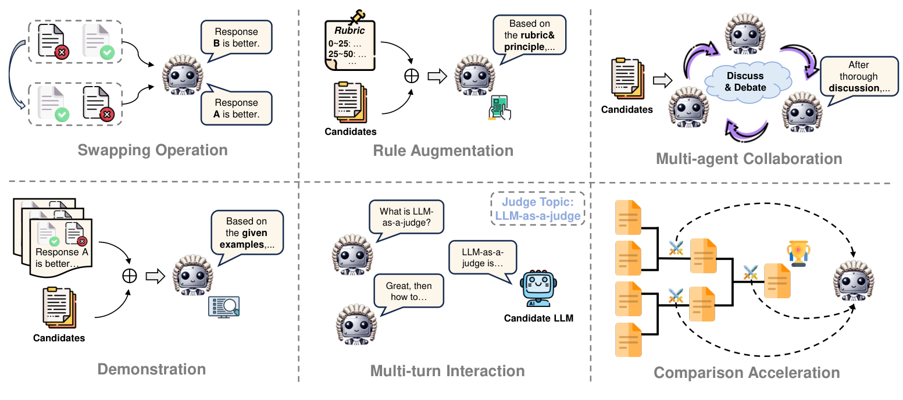
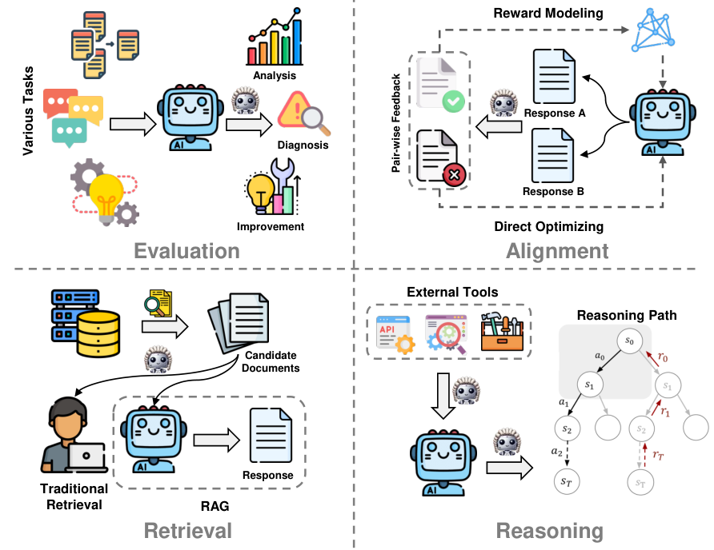

# From Generation to Judgment: Opportunities and Challenges of LLM-as-a-judge

Dawei Li
Affiliation: Arizona State University
  
Bohan Jiang
Affiliation: Arizona State University
  
Liangjie Huang
Affiliation: University of Illinois Chicago
  
Alimohammad Beigi
Affiliation: Arizona State University
  
Chengshuai Zhao
Affiliation: Arizona State University
  
Zhen Tan
Affiliation: Arizona State University
  
Amrita Bhattacharjee
Affiliation: Arizona State University
  
Yuxuan Jiang
Affiliation: University of Maryland, Baltimore County
  
Canyu Chen
Affiliation: Northwestern University
  
Tianhao Wu
Affiliation: University of California, Berkeley
  
Kai Shu
Affiliation: Emory University
  
Lu Cheng
Affiliation: University of Illinois Chicago
  
Huan Liu
Affiliation: Arizona State University

###### Abstract

Assessment and evaluation have long been critical challenges in artificial intelligence (AI) and natural language processing (NLP). Traditional methods, usually matching-based or small model-based, often fall short in open-ended and dynamic scenarios. Recent advancements in Large Language Models (LLMs) inspire the “LLM-as-a-judge” paradigm, where LLMs are leveraged to perform scoring, ranking, or selection for various machine learning evaluation scenarios. This paper presents a comprehensive survey of LLM-based judgment and assessment, offering an in-depth overview to review this evolving field. We first provide the definition from both input and output perspectives. Then we introduce a systematic taxonomy to explore LLM-as-a-judge along three dimensions: what to judge, how to judge, and how to benchmark. Finally, we also highlight key challenges and promising future directions for this emerging area11
1
More resources on LLM-as-a-judge are on the website: <https://llm-as-a-judge.github.io>22
2
We have released and will maintain a paper list about LLM-as-a-judge at: <https://github.com/llm-as-a-judge/Awesome-LLM-as-a-judge>.

## 1 Introduction

Automatic model assessment and evaluation have long been essential yet challenging tasks in machine learning (ML) and natural language processing (NLP) [Sai et al. (2022)](https://arxiv.org/html/2411.16594v7#bib.bib248); [Chang et al. (2024)](https://arxiv.org/html/2411.16594v7#bib.bib37).
Traditional static metrics [Tan et al. (2022)](https://arxiv.org/html/2411.16594v7#bib.bib274); [Li et al. (2024i)](https://arxiv.org/html/2411.16594v7#bib.bib154) like BLEU [Papineni et al. (2002)](https://arxiv.org/html/2411.16594v7#bib.bib218) and ROUGE [Lin (2004)](https://arxiv.org/html/2411.16594v7#bib.bib175) measure quality by calculating lexical overlap between output and reference texts. While computationally efficient, these metrics perform poorly in dynamic and open-ended scenarios [Liu et al. (2016)](https://arxiv.org/html/2411.16594v7#bib.bib180); [Reiter (2018)](https://arxiv.org/html/2411.16594v7#bib.bib242).
With the rise of deep learning, small language model-based metrics like BERTScore [Zhang et al. (2020)](https://arxiv.org/html/2411.16594v7#bib.bib376) and BARTScore [Yuan et al. (2021)](https://arxiv.org/html/2411.16594v7#bib.bib361) have emerged. However, these metrics still face challenges in capturing nuanced attributes like fairness [Sun et al. (2022)](https://arxiv.org/html/2411.16594v7#bib.bib269) and helpfulness [Zhu et al. (2024a)](https://arxiv.org/html/2411.16594v7#bib.bib399).

Recently, the advancements of large language models (LLMs) [Zhao et al. (2025a)](https://arxiv.org/html/2411.16594v7#bib.bib383) such as GPT-4 [Achiam et al. (2023)](https://arxiv.org/html/2411.16594v7#bib.bib2) and o1 [Jaech et al. (2024)](https://arxiv.org/html/2411.16594v7#bib.bib109), have led to striking improvements in various applications, leveraging substantial prior knowledge in vast training corpora. This progress has motivated researchers to propose the concept of “LLM-as-a-judge” [Zheng et al. (2023)](https://arxiv.org/html/2411.16594v7#bib.bib390); [Wang et al. (2023c)](https://arxiv.org/html/2411.16594v7#bib.bib293); [Liu et al. (2023b)](https://arxiv.org/html/2411.16594v7#bib.bib185); [Chiang and Lee (2023b)](https://arxiv.org/html/2411.16594v7#bib.bib55), where LLMs are used to assess the candidate outputs by assigning scores, producing rankings, or selecting the best options, based on various input formats (e.g., point- and pair-wise), given context and instruction.
The strong capability of LLMs combined with well-designed assessment pipelines [Li et al. (2023b)](https://arxiv.org/html/2411.16594v7#bib.bib158); [Bai et al. (2023a)](https://arxiv.org/html/2411.16594v7#bib.bib19) leads to fine-grained and human-like judgment for various evaluation applications, addressing the previous limitations.

Beyond evaluation, LLMs-as-a-judge has been adopted across the lifecycle for next generations of LLM developments and applications.
LLMs-as-a-judge is often used as a scalable way to provide supervisions for key development steps like alignment [Lee et al. (2023)](https://arxiv.org/html/2411.16594v7#bib.bib141), retrieval [Li et al. (2024c)](https://arxiv.org/html/2411.16594v7#bib.bib147), and reasoning [Liang et al. (2023)](https://arxiv.org/html/2411.16594v7#bib.bib170).
LLM-as-a-judge also empowers LLMs with a series of advanced capabilities such as self-evolution [Sun et al. (2024)](https://arxiv.org/html/2411.16594v7#bib.bib271), active retrieval [Li et al. (2024c)](https://arxiv.org/html/2411.16594v7#bib.bib147), and decision-making [Yang et al. (2023)](https://arxiv.org/html/2411.16594v7#bib.bib343), driving their elevations from generative models to intelligent agents [Zhuge et al. (2024)](https://arxiv.org/html/2411.16594v7#bib.bib406).
However, as the field develops rapidly, challenges like bias and vulnerability [Koo et al. (2023)](https://arxiv.org/html/2411.16594v7#bib.bib133); [Park et al. (2024)](https://arxiv.org/html/2411.16594v7#bib.bib219); [Fu et al. (2024)](https://arxiv.org/html/2411.16594v7#bib.bib77); [Huang et al. (2024a)](https://arxiv.org/html/2411.16594v7#bib.bib103) are emerging. Therefore, a systematic review of both techniques and limitations is crucial for facilitating this field.

This survey delves into the details of LLM-as-a-judge, aiming to provide a systematic overview of LLM-based judgment systems. We start by formally defining LLM-as-a-judge with its diverse input and output formats (Section [2](https://arxiv.org/html/2411.16594v7#S2)). Next, we propose an in-depth and comprehensive taxonomy to address the three key questions (Section [3](https://arxiv.org/html/2411.16594v7#S3), [4](https://arxiv.org/html/2411.16594v7#S4) [6](https://arxiv.org/html/2411.16594v7#S6)):

- Attribute: What to judge? We outline six subtle attributes that are uniquely assessed by LLM-as-a-judge, including helpfulness, safety & security, reliability, relevance, logical, and overall quality.
- Methodology: How to judge? We explore ten tuning and prompting methods for LLM-as-a-judge, including manual labeling, synthetic feedback, supervised fine-tuning, preference learning, swapping operation, rule augmentation, multi-agent collaboration, demonstration, multi-turn interaction, and comparison acceleration.
- Benchmark: How to evaluate LLM-as-a-judge? We categorize existing benchmarks for LLM-as-a-judge into four types: for general performance, bias quantification, challenging tasks, and domain-specific performance.

Finally, we discuss challenges and potential future directions for LLM-as-a-judge in Section [7](https://arxiv.org/html/2411.16594v7#S7).

Differences from Existing Surveys. Existing concurrent surveys investigate LLM for the evaluation of natural language generation (NLG) [Gao et al. (2024)](https://arxiv.org/html/2411.16594v7#bib.bib79); [Li et al. (2024o)](https://arxiv.org/html/2411.16594v7#bib.bib166); [Gu et al. (2024)](https://arxiv.org/html/2411.16594v7#bib.bib84).
However, LLM-as-a-judge has been applied across a broader range of scenarios beyond evaluation, as we discussed, necessitating a systematic survey to categorize and summarize its various applications.

## 2 Preliminary

In this section, we provide a detailed definition of LLM-as-a-judge, discussing the various input and output formats as shown in Figure [1](https://arxiv.org/html/2411.16594v7#S2.F1).

Figure 1: Overview of I/O formats of LLM-as-a-judge.

### 2.1 Input

Given a judge LLM $J$, the assessment process can be formulated as: $R=J(C_{1},...C_{n}).$
Here $C_{i}$ is the $i_{th}$ candidate to be judged and $R$ is the judging result. We categorize two input formats based on the different candidate numbers $n$.

Point-Wise: When $n=1$, it becomes a point-wise judgment where the LLMs judges will solely focus on one candidate sample [Gao et al. (2023)](https://arxiv.org/html/2411.16594v7#bib.bib80).

Pair/ List-Wise: When $n\geq 2$, it becomes a pair-wise ($n=2$) or list-wise ($n>2$) judgment where multiple candidate samples are provided together for the LLM judges to compare and make a comprehensive assessment [Zheng et al. (2023)](https://arxiv.org/html/2411.16594v7#bib.bib390).

### 2.2 Output

In this section, we discuss three kinds of output of the judgment based on the different formats of $R$.

Score: When each candidate sample is assigned a continuous or discrete score: $R=\{C_{1}:S_{1},...,C_{n}:S_{n}\}$, it becomes a score-based judgment. This is the most widely adopted protocol, leveraging LLMs to generate scores for quantitative comparisons [Li et al. (2024a)](https://arxiv.org/html/2411.16594v7#bib.bib145) or attribute detection [Xie et al. (2024a)](https://arxiv.org/html/2411.16594v7#bib.bib330).

Ranking: In ranking-based judgment, the output is a ranking of each candidate sample, represented as $R=\{C_{i}>...>C_{j}\}$. This comparative approach is useful in scenarios where establishing a rank order among candidates is required [Li et al. (2023b)](https://arxiv.org/html/2411.16594v7#bib.bib158); [Liu et al. (2024b)](https://arxiv.org/html/2411.16594v7#bib.bib187).

Selection: In selection-based judgment, the output involves selecting one or more optimal candidates, represented as $R=\{C_{i},...,C_{j}\}>\{C_{1},...C_{n}\}$. This method is particularly crucial in decision-making [Yao et al. (2023a)](https://arxiv.org/html/2411.16594v7#bib.bib346) or content-filtering [Li et al. (2024c)](https://arxiv.org/html/2411.16594v7#bib.bib147) contexts.

## 3 Attribute

In this section, we categorize current research in LLM-as-a-judge from attribute perspectives. Figure [2](https://arxiv.org/html/2411.16594v7#S3.F2) gives an overview summarization of what aspects can be assessed by the LLM judges.

Figure 2: Overview of different judging aspects.

### 3.1 Helpfulness

Helpfulness is a critical criterion to measure the utility and informativeness of a generated response.
Due to the high cost of manually assessing helpfulness in training data, recent studies have explored leveraging LLMs to label helpfulness and to generate or filter alignment data [Bai et al. (2022)](https://arxiv.org/html/2411.16594v7#bib.bib17); [Lee et al. (2023)](https://arxiv.org/html/2411.16594v7#bib.bib141); [Guo et al. (2024)](https://arxiv.org/html/2411.16594v7#bib.bib87); [Zhang et al. (2025d)](https://arxiv.org/html/2411.16594v7#bib.bib377).
Beyond alignment tuning, helpfulness assessment using LLM-as-a-judge also plays a vital role in automatic model evaluation [Zheng et al. (2023)](https://arxiv.org/html/2411.16594v7#bib.bib390); [Lin et al. (2023)](https://arxiv.org/html/2411.16594v7#bib.bib174); [Li et al. (2024e)](https://arxiv.org/html/2411.16594v7#bib.bib149); [Zhang et al. (2025a)](https://arxiv.org/html/2411.16594v7#bib.bib367).

### 3.2 Safety & Security

Safety and security are essential to ensure that models do not generate harmful content or respond inappropriately to malicious inputs.
Current studies have validated that LLMs can be effectively used for model safety assessment, either as off-the-shelf models guided by policy instructions [Bai et al. (2022)](https://arxiv.org/html/2411.16594v7#bib.bib17); [Phute et al. (2023)](https://arxiv.org/html/2411.16594v7#bib.bib224); [Li et al. ()](https://arxiv.org/html/2411.16594v7#bib.bib164); [Ye et al. (2024b)](https://arxiv.org/html/2411.16594v7#bib.bib350); [Wang et al. (2024l)](https://arxiv.org/html/2411.16594v7#bib.bib309); [Eiras et al. (2025)](https://arxiv.org/html/2411.16594v7#bib.bib69); [Chen and Goldfarb-Tarrant (2025)](https://arxiv.org/html/2411.16594v7#bib.bib41); [Rodriguez et al. (2025)](https://arxiv.org/html/2411.16594v7#bib.bib243); [Hengle et al. (2025)](https://arxiv.org/html/2411.16594v7#bib.bib93), or as lightweight models fine-tuned on safety-specific datasets [Inan et al. (2023)](https://arxiv.org/html/2411.16594v7#bib.bib107); [Zhang et al. (2024f)](https://arxiv.org/html/2411.16594v7#bib.bib374); [Xie et al. (2024a)](https://arxiv.org/html/2411.16594v7#bib.bib330).
Besides, LLM-as-a-judge has been widely adopted to detect and purify adversarial and toxic prompts designed with malicious intent [Cantini et al. (2025)](https://arxiv.org/html/2411.16594v7#bib.bib32); [Mu et al. (2025)](https://arxiv.org/html/2411.16594v7#bib.bib206); [Armstrong et al. (2025)](https://arxiv.org/html/2411.16594v7#bib.bib12).

### 3.3 Reliability

Reliability is a crucial attribute for LLMs, enabling them to generate faithful content while presenting uncertainty or acknowledging missing knowledge about certain topics.
Regarding sentence-level faithfulness assessment, existing researches leverage LLM-as-a-judge to either instruct the powerful LLMs (e.g., GPT-4) directly [Cheng et al. (2023)](https://arxiv.org/html/2411.16594v7#bib.bib52); [Gekhman et al. (2023)](https://arxiv.org/html/2411.16594v7#bib.bib81); [Luo et al. (2024a)](https://arxiv.org/html/2411.16594v7#bib.bib199); [Hsu et al. (2024)](https://arxiv.org/html/2411.16594v7#bib.bib96) or train specific reliability judges [Wang et al. (2024a)](https://arxiv.org/html/2411.16594v7#bib.bib288).
Several works adopt LLM judges for long-form and fine-grained faithfulness evaluation [Tan et al. (2024a)](https://arxiv.org/html/2411.16594v7#bib.bib272); [Bai et al. (2024)](https://arxiv.org/html/2411.16594v7#bib.bib18); [Wu et al. (2025)](https://arxiv.org/html/2411.16594v7#bib.bib322), using external retrieval bases [Min et al. (2023)](https://arxiv.org/html/2411.16594v7#bib.bib203); [Cao et al. (2025b)](https://arxiv.org/html/2411.16594v7#bib.bib34); [Loru et al. (2025)](https://arxiv.org/html/2411.16594v7#bib.bib195) or search engines [Wei et al. (2024b)](https://arxiv.org/html/2411.16594v7#bib.bib315).
 [Jing et al. (2024)](https://arxiv.org/html/2411.16594v7#bib.bib118); [Pu et al. (2025)](https://arxiv.org/html/2411.16594v7#bib.bib231) further expand this assessment to the multimodal area.
Besides evaluation, there are also many works that adopt LLM-as-a-judge to improve the reliability of the generated content, either by external verifiers [Xie et al. (2024b)](https://arxiv.org/html/2411.16594v7#bib.bib332) or synthetic alignment datasets [Zhang et al. (2024g)](https://arxiv.org/html/2411.16594v7#bib.bib378); [Wen et al. (2024)](https://arxiv.org/html/2411.16594v7#bib.bib318).
For uncertainty judgment, [Xu et al. (2024d)](https://arxiv.org/html/2411.16594v7#bib.bib340) propose SaySelf, a training framework that teaches LLMs to express more fine-grained confidence estimates with self-consistency prompting and group-based calibration training.

### 3.4 Relevance

Relevance assessment with LLM-as-a-judge has been explored and validated to be a more refined and effective manner across various tasks [Chiang and Lee (2023a)](https://arxiv.org/html/2411.16594v7#bib.bib54); [Arabzadeh and Clarke (2025a)](https://arxiv.org/html/2411.16594v7#bib.bib9).
In conversation evaluation, both [Lin and Chen (2023a)](https://arxiv.org/html/2411.16594v7#bib.bib176) and [Abbasiantaeb et al. (2024)](https://arxiv.org/html/2411.16594v7#bib.bib1) propose to replace expensive human annotation with LLM judgment in relevance assessment.
In retrieval-augmented generation (RAG) scenarios, there are also many works that utilize LLMs to determine which demonstrations [Li and Qiu (2023a)](https://arxiv.org/html/2411.16594v7#bib.bib161) or documents [Li et al. (2024c)](https://arxiv.org/html/2411.16594v7#bib.bib147) are most relevant for solving the current problem.
Recently, LLM-as-a-judge has also been used in multimodal applications for cross-modality relevance judgment [Lee et al. (2024b)](https://arxiv.org/html/2411.16594v7#bib.bib143); [Chen et al. (2024g)](https://arxiv.org/html/2411.16594v7#bib.bib51); [Yang and Lin (2024)](https://arxiv.org/html/2411.16594v7#bib.bib344); [Chen et al. (2024a)](https://arxiv.org/html/2411.16594v7#bib.bib39); [Lu et al. (2024b)](https://arxiv.org/html/2411.16594v7#bib.bib198); [Luo et al. (2024b)](https://arxiv.org/html/2411.16594v7#bib.bib200); [Lin et al. (2025)](https://arxiv.org/html/2411.16594v7#bib.bib178).
Additionally, LLM-as-a-judge has also been explored in many traditional retrieval applications for relevance assessment [Zhao et al. (2023a)](https://arxiv.org/html/2411.16594v7#bib.bib384); [Alaofi et al. (2024)](https://arxiv.org/html/2411.16594v7#bib.bib5); [Dietz et al. (2025)](https://arxiv.org/html/2411.16594v7#bib.bib62); [Arabzadeh and Clarke (2025b)](https://arxiv.org/html/2411.16594v7#bib.bib10); [Balog et al. (2025)](https://arxiv.org/html/2411.16594v7#bib.bib21), such as search [Thomas et al. (2024)](https://arxiv.org/html/2411.16594v7#bib.bib279); [Sebastian and Hoppe (2025)](https://arxiv.org/html/2411.16594v7#bib.bib253), retrieval [Ma et al. (2024)](https://arxiv.org/html/2411.16594v7#bib.bib201); [Dey et al. (2025)](https://arxiv.org/html/2411.16594v7#bib.bib60), recommendation [Hou et al. (2024)](https://arxiv.org/html/2411.16594v7#bib.bib95); [Zhang et al. (2024h)](https://arxiv.org/html/2411.16594v7#bib.bib379).

### 3.5 Logic

In agentic LLMs, assessing the logical correctness of candidate actions or steps is crucial for LLMs’ planning, reasoning and decision-making, which further releases their great potential at inference-time.
While some works leverage metrics or external tools for this feasibility assessment [Huang et al. (2023a)](https://arxiv.org/html/2411.16594v7#bib.bib104); [Yuan et al. ()](https://arxiv.org/html/2411.16594v7#bib.bib358), many others leverage LLMs’ feedback as the signal [Lightman et al. ()](https://arxiv.org/html/2411.16594v7#bib.bib173); [Kawabata and Sugawara (2024)](https://arxiv.org/html/2411.16594v7#bib.bib123) to perform planning and searching in complex reasoning spaces [Hao et al. (2023)](https://arxiv.org/html/2411.16594v7#bib.bib89); [Yao et al. (2023a)](https://arxiv.org/html/2411.16594v7#bib.bib346); [Besta et al. (2024)](https://arxiv.org/html/2411.16594v7#bib.bib27).
In multi-agent collaboration systems, both [Liang et al. (2023)](https://arxiv.org/html/2411.16594v7#bib.bib170) and [Li et al. (2024b)](https://arxiv.org/html/2411.16594v7#bib.bib146) propose to leverage the judge LLM to select the most feasible solutions among multiple candidates’ responses.
Besides, other works adopt LLM judges to perform logical assessment in API selection [Zhao et al. (2024b)](https://arxiv.org/html/2411.16594v7#bib.bib387), tool using [Yang et al. (2023)](https://arxiv.org/html/2411.16594v7#bib.bib343) and LLM routing [Ong et al. (2024)](https://arxiv.org/html/2411.16594v7#bib.bib214).

### 3.6 Overall Quality

As previously mentioned, LLM-as-a-judge can be employed to perform multi-aspect and fine-grained assessments. However, in many cases, a general assessment is still required to represent the candidates’ overall quality.
One straightforward approach to obtain this overall score is based on the aspect-specific scores, either by averaging them [Lin et al. (2023)](https://arxiv.org/html/2411.16594v7#bib.bib174) or referring them to generate an overall judgment [Yu et al. (2024c)](https://arxiv.org/html/2411.16594v7#bib.bib356).
Moreover, in many traditional NLP tasks [Lu et al. (2024a)](https://arxiv.org/html/2411.16594v7#bib.bib197); [Jiang et al. (2024)](https://arxiv.org/html/2411.16594v7#bib.bib116); [Ho et al. (2025)](https://arxiv.org/html/2411.16594v7#bib.bib94); [Shibata and Miyamura (2025)](https://arxiv.org/html/2411.16594v7#bib.bib260); [Kartáč et al. (2025)](https://arxiv.org/html/2411.16594v7#bib.bib122) like summarization [Gao et al. (2023)](https://arxiv.org/html/2411.16594v7#bib.bib80); [Jain et al. (2023a)](https://arxiv.org/html/2411.16594v7#bib.bib110); [Chen et al. (2023)](https://arxiv.org/html/2411.16594v7#bib.bib50); [Kumar et al. (2024a)](https://arxiv.org/html/2411.16594v7#bib.bib136); [Qi et al. (2025)](https://arxiv.org/html/2411.16594v7#bib.bib232); [Barnes et al. (2025)](https://arxiv.org/html/2411.16594v7#bib.bib24); [Altemeyer et al. (2025)](https://arxiv.org/html/2411.16594v7#bib.bib7); [Jeong et al. (2025)](https://arxiv.org/html/2411.16594v7#bib.bib113); [Calderon et al. (2025)](https://arxiv.org/html/2411.16594v7#bib.bib31) and machine translation [Kocmi and Federmann (2023)](https://arxiv.org/html/2411.16594v7#bib.bib132); [Huang et al. (2024b)](https://arxiv.org/html/2411.16594v7#bib.bib105); [Piergentili et al. (2025)](https://arxiv.org/html/2411.16594v7#bib.bib225); [Wang et al. (2025d)](https://arxiv.org/html/2411.16594v7#bib.bib304), the evaluation dimensions are less diverse compared to more open-ended, long-form generation tasks. As a result, LLM-as-a-judge is often prompted directly to produce an overall judgment in these tasks.

## 4 Methodology

In this section, we present commonly adopted methods and tricks to improve LLMs’ judging capabilities, splitting them into tuning (Section [4.1](https://arxiv.org/html/2411.16594v7#S4.SS1)) and prompting strategies (Section [4.2](https://arxiv.org/html/2411.16594v7#S4.SS2)).

### 4.1 Tuning

To enhance the judging capabilities of a general LLM, various tuning techniques have been employed in different studies. In this section, we discuss these tuning approaches for LLM-as-a-judge from two perspectives: data sources (Section [4.1.1](https://arxiv.org/html/2411.16594v7#S4.SS1.SSS1)) and training techniques (Section [4.1.2](https://arxiv.org/html/2411.16594v7#S4.SS1.SSS2)).

#### 4.1.1 Data Source

##### Manually-labeled Data:

To train a LLM judge with human-like criteria, one intuitive method is to collect manually-labeled judgments.
Previous works have leveraged and integrated existing sources annotated by humans, including instruction tuning datasets [Lee et al. (2024a)](https://arxiv.org/html/2411.16594v7#bib.bib142); [Wang et al. (2024k)](https://arxiv.org/html/2411.16594v7#bib.bib307) and traditional NLP datasets [Vu et al. (2024)](https://arxiv.org/html/2411.16594v7#bib.bib287), for tuning LLM judges.
Other works collect manually-labeled datasets with fine-grained judgment feedback.
These fine-grained feedbacks can be rationales behind judgment results [Xu et al. (2023a)](https://arxiv.org/html/2411.16594v7#bib.bib341), multi-aspect judgment formats [Liu et al. (2024a)](https://arxiv.org/html/2411.16594v7#bib.bib181) and fine-grained judgment labels [Yue et al. (2023)](https://arxiv.org/html/2411.16594v7#bib.bib363), all of which facilitate the LLM judges to produce more detailed and context-rich judging results.
Notably, [Ke et al. (2024)](https://arxiv.org/html/2411.16594v7#bib.bib124) first prompt GPT-4 to generate judgment and then manually verify and revise the outputs to ensure high-quality annotations.

##### Synthetic Feedback:

While manually labeled feedback is high-quality and accurately reflects human judgment preferences, it is limited in both scale and coverage. To address it, researchers have also explored synthetic feedback as a data source for LLM judges’ tuning.
Some rely on the LLM judges themselves to generate the synthetic feedback.
It involves instructing the LLM to self-evaluate and improve its judgments [Wu et al. (2024a)](https://arxiv.org/html/2411.16594v7#bib.bib323), or by generating corrupted instructions and corresponding responses as negative samples for Directed Preference Optimization (DPO) training [Wang et al. (2024h)](https://arxiv.org/html/2411.16594v7#bib.bib301).
Besides, other powerful and stronger LLMs are also introduced for feedback synthesis.
For example, GPT-4 has been widely leveraged to synthesize judging evidence [Wang et al. (2024a)](https://arxiv.org/html/2411.16594v7#bib.bib288), erroneous responses [Park et al. (2024)](https://arxiv.org/html/2411.16594v7#bib.bib219), rationale and feedback [Li et al. (2024e)](https://arxiv.org/html/2411.16594v7#bib.bib149); [Kim et al. (2024b)](https://arxiv.org/html/2411.16594v7#bib.bib130); [Xiong et al. (2024)](https://arxiv.org/html/2411.16594v7#bib.bib334), and judgment labels [Zhu et al. (2023)](https://arxiv.org/html/2411.16594v7#bib.bib402); [Xie et al. (2024a)](https://arxiv.org/html/2411.16594v7#bib.bib330).

#### 4.1.2 Tuning Techniques

##### Supervised Fine-tuning:

Supervised fine-tuning (SFT) is the most widely used approach for training LLM judges [Hu et al. (2025a)](https://arxiv.org/html/2411.16594v7#bib.bib99), enabling them to learn from pairwise [Li et al. (2024e)](https://arxiv.org/html/2411.16594v7#bib.bib149); [Wang et al. (2023b)](https://arxiv.org/html/2411.16594v7#bib.bib292); [Zhu et al. (2023)](https://arxiv.org/html/2411.16594v7#bib.bib402); [Wang et al. (2024k)](https://arxiv.org/html/2411.16594v7#bib.bib307); [Pombal et al. (2025b)](https://arxiv.org/html/2411.16594v7#bib.bib227); [Salinas et al. (2025)](https://arxiv.org/html/2411.16594v7#bib.bib249) or pointwise [Wang et al. (2023b)](https://arxiv.org/html/2411.16594v7#bib.bib292); [Yue et al. (2023)](https://arxiv.org/html/2411.16594v7#bib.bib363); [Xie et al. (2024a)](https://arxiv.org/html/2411.16594v7#bib.bib330); [Lee et al. (2024a)](https://arxiv.org/html/2411.16594v7#bib.bib142); [Chiang et al. (2025)](https://arxiv.org/html/2411.16594v7#bib.bib56) judgment data.
Among many tricks applied in SFT, multi-task training and weight merging are introduced to enhance the robustness and generalization of LLM judges [Kim et al. (2024b)](https://arxiv.org/html/2411.16594v7#bib.bib130); [Vu et al. (2024)](https://arxiv.org/html/2411.16594v7#bib.bib287); [Saad-Falcon et al. (2024b)](https://arxiv.org/html/2411.16594v7#bib.bib245).
Other works try to enrich the original training set with augmented or self-generated samples.
[Ke et al. (2024)](https://arxiv.org/html/2411.16594v7#bib.bib124) augment pairwise training data by swapping the order of two generated texts and exchanging the corresponding content in critiques.
[Xu et al. (2023a)](https://arxiv.org/html/2411.16594v7#bib.bib341) further fine-tune their INSTRUCTSCORE model on self-generated outputs to align diagnostic reports better with human judgment.
Additionally, [Liu et al. (2024a)](https://arxiv.org/html/2411.16594v7#bib.bib181) propose a two-stage SFT process: an initial phase of vanilla instruction tuning for evaluation diversity, followed by additional tuning with auxiliary aspects to enrich the model’s evaluative depth.

Figure 3: Overview of prompting strategies for LLM-as-a-judge.

##### Reinforcement Learning:

Reinforcement learning from human preference is closely tied to judgment and evaluation tasks, particularly those involving comparison and ranking. Rather than directly adopt or augment preference learning datasets for SFT, several studies apply preference learning techniques to enhance LLMs’ judging capabilities.
One straightforward way is to treat the off-topic responses as inferior samples and apply DPO [Wang et al. (2024a)](https://arxiv.org/html/2411.16594v7#bib.bib288); [Yu et al. (2025)](https://arxiv.org/html/2411.16594v7#bib.bib353); [Rad et al. (2025)](https://arxiv.org/html/2411.16594v7#bib.bib237).
Besides, [Wu et al. (2024a)](https://arxiv.org/html/2411.16594v7#bib.bib323) propose meta-rewarding, which leverages the policy LLMs to judge the quality of their own judgment and produce pairwise signals for enhancing the LLMs’ judging capability.
This concept is also adopted by [Wang et al. (2024h)](https://arxiv.org/html/2411.16594v7#bib.bib301), who propose self-taught evaluators that use corrupted instructions to generate suboptimal responses as inferior examples for preference learning.
Moreover, [Hu et al. (2024b)](https://arxiv.org/html/2411.16594v7#bib.bib102) introduce rating-guided DPO, in which the rating difference between two responses is considered in preferences modeling.
Different from RLHF- and DPO-based approaches, several recent works leverage reinforcement learning with verifiable reward (RLVR) [Guo et al. (2025)](https://arxiv.org/html/2411.16594v7#bib.bib86) to train LLM judges by rewarding reasoning trajectories that lead to correct judgments [Saha et al. (2025)](https://arxiv.org/html/2411.16594v7#bib.bib247); [Liu et al. (2025e)](https://arxiv.org/html/2411.16594v7#bib.bib192); [Zhou et al. (2025)](https://arxiv.org/html/2411.16594v7#bib.bib398).

### 4.2 Prompting

Designing appropriate prompting strategies and pipelines at the inference stage could improve judgment accuracy and mitigate bias. We summarize existing prompting strategies for LLM-as-a-judge into six categories (see Figure [3](https://arxiv.org/html/2411.16594v7#S4.F3)).

#### 4.2.1 Swapping Operation

Previous studies have demonstrated that LLM-based judges are sensitive to the positions of candidates, and the ranking results of candidate responses can be easily manipulated by merely altering their order in the context [Wang et al. (2023d)](https://arxiv.org/html/2411.16594v7#bib.bib296). To mitigate this positional bias and establish a more fair LLM judging system, [Zheng et al. (2023)](https://arxiv.org/html/2411.16594v7#bib.bib390) propose a swapping operation, which involves invoking the judge LLM twice, swapping the order of the two candidates in each instance. If the two results are inconsistent, it is labeled a “tie”, indicating that the LLM is unable to confidently distinguish the quality of the candidates.
This swapping operation technique has also been widely adopted in pairwise feedback synthesis to produce more accurate reward signals [Lee et al. (2023)](https://arxiv.org/html/2411.16594v7#bib.bib141); [Sun et al. (2024)](https://arxiv.org/html/2411.16594v7#bib.bib271); [Lee et al. (2024a)](https://arxiv.org/html/2411.16594v7#bib.bib142).

#### 4.2.2 Rule Augmentation

Rule-augmented prompting involves embedding a set of principles, references, and evaluation rubrics directly within the prompt for LLM judges.
This approach is commonly employed in LLM-based evaluations, where LLM judges are guided to assess specific aspects [Lahoti et al. (2023)](https://arxiv.org/html/2411.16594v7#bib.bib138); [Li et al. (2024e)](https://arxiv.org/html/2411.16594v7#bib.bib149); [Bai et al. (2023a)](https://arxiv.org/html/2411.16594v7#bib.bib19); [Yu et al. (2024c)](https://arxiv.org/html/2411.16594v7#bib.bib356); [Qian et al. (2024)](https://arxiv.org/html/2411.16594v7#bib.bib233); [Dong et al. (2024)](https://arxiv.org/html/2411.16594v7#bib.bib67); [Wei et al. (2025)](https://arxiv.org/html/2411.16594v7#bib.bib316); [Xie et al. (2025b)](https://arxiv.org/html/2411.16594v7#bib.bib331) and provided with detailed rubrics and criteria [Gao et al. (2023)](https://arxiv.org/html/2411.16594v7#bib.bib80); [Kim et al. ()](https://arxiv.org/html/2411.16594v7#bib.bib129); [Wang et al. (2024g)](https://arxiv.org/html/2411.16594v7#bib.bib300); [Murugadoss et al. (2024)](https://arxiv.org/html/2411.16594v7#bib.bib207); [Li et al. (2024m)](https://arxiv.org/html/2411.16594v7#bib.bib160); [Li et al. (2024h)](https://arxiv.org/html/2411.16594v7#bib.bib153); [Hu et al. (2024a)](https://arxiv.org/html/2411.16594v7#bib.bib100); [Liu et al. (2024d)](https://arxiv.org/html/2411.16594v7#bib.bib190); [Li et al. (2025b)](https://arxiv.org/html/2411.16594v7#bib.bib152); [Fan et al. (2025)](https://arxiv.org/html/2411.16594v7#bib.bib72) to ensure accurate judgments.
Following this concept, studies in alignment [Bai et al. (2022)](https://arxiv.org/html/2411.16594v7#bib.bib17); [Lee et al. (2023)](https://arxiv.org/html/2411.16594v7#bib.bib141); [Lee et al. (2024a)](https://arxiv.org/html/2411.16594v7#bib.bib142); [Guo et al. (2024)](https://arxiv.org/html/2411.16594v7#bib.bib87); [Sun et al. (2024)](https://arxiv.org/html/2411.16594v7#bib.bib271); [Beigi et al. (2024)](https://arxiv.org/html/2411.16594v7#bib.bib25) enhance this principle-driven prompting by incorporating more detailed explanations [Hu et al. ()](https://arxiv.org/html/2411.16594v7#bib.bib98) for each aspect of the principle or rubric.
Apart from these human-written rules, some works [Liu et al. (2024c)](https://arxiv.org/html/2411.16594v7#bib.bib189); [Zhang et al. (2024f)](https://arxiv.org/html/2411.16594v7#bib.bib374); [Xu et al. (2025b)](https://arxiv.org/html/2411.16594v7#bib.bib336); [Wen et al. (2025)](https://arxiv.org/html/2411.16594v7#bib.bib317); [Zhou et al. (2024a)](https://arxiv.org/html/2411.16594v7#bib.bib392) embed the self-generated or automaticaly-searched scoring criteria and principles as a part of their instruction.

#### 4.2.3 Multi-agent Collaboration

Accessing results from a single LLM judge may not be reliable due to inherent biases in LLMs [Wang et al. (2023d)](https://arxiv.org/html/2411.16594v7#bib.bib296); [Liusie et al. (2024)](https://arxiv.org/html/2411.16594v7#bib.bib193); [Ohi et al. (2024)](https://arxiv.org/html/2411.16594v7#bib.bib212). To address this limitation, [Li et al. (2023b)](https://arxiv.org/html/2411.16594v7#bib.bib158); [Chen et al. (2024c)](https://arxiv.org/html/2411.16594v7#bib.bib42); [Ning et al. (2024)](https://arxiv.org/html/2411.16594v7#bib.bib211) introduce the Peer Rank (PR) algorithm, which produces the final ranking based on each LLM judge’s output. Building on this, several architectures and techniques for multi-agent LLMs emerge, including mixture-of-agent [Zhang et al. (2023)](https://arxiv.org/html/2411.16594v7#bib.bib381); [Xu et al. (2023b)](https://arxiv.org/html/2411.16594v7#bib.bib342); [Beigi et al. (2024)](https://arxiv.org/html/2411.16594v7#bib.bib25); [Cao et al. (2025a)](https://arxiv.org/html/2411.16594v7#bib.bib33), role play [Wu et al. (2023)](https://arxiv.org/html/2411.16594v7#bib.bib321); [Li et al. (2024n)](https://arxiv.org/html/2411.16594v7#bib.bib163); [Patel et al. (2024)](https://arxiv.org/html/2411.16594v7#bib.bib222), debating [Chan et al. (2023)](https://arxiv.org/html/2411.16594v7#bib.bib35); [Zhang et al. (2024e)](https://arxiv.org/html/2411.16594v7#bib.bib372); [Bandi and Harrasse (2024)](https://arxiv.org/html/2411.16594v7#bib.bib22); [Kenton et al. (2024)](https://arxiv.org/html/2411.16594v7#bib.bib125), voting & aggregation [Zhu et al. (2024c)](https://arxiv.org/html/2411.16594v7#bib.bib401); [Verga et al. (2024)](https://arxiv.org/html/2411.16594v7#bib.bib286); [Li et al. (2025c)](https://arxiv.org/html/2411.16594v7#bib.bib165); [Guerdan et al. (2025)](https://arxiv.org/html/2411.16594v7#bib.bib85); [Rahmani et al. (2024)](https://arxiv.org/html/2411.16594v7#bib.bib239) and cascaded selection [Jung et al. (2024)](https://arxiv.org/html/2411.16594v7#bib.bib120); [Badshah and Sajjad (2025)](https://arxiv.org/html/2411.16594v7#bib.bib16). Additionally, others apply multi-agent collaboration for alignment data synthesis, leveraging multiple LLM judges to refine responses [Arif et al. (2024)](https://arxiv.org/html/2411.16594v7#bib.bib11) or provide more accurate feedback [Li et al. (2024j)](https://arxiv.org/html/2411.16594v7#bib.bib156).

#### 4.2.4 Demonstration

In-context samples or demonstrations [Brown et al. (2020)](https://arxiv.org/html/2411.16594v7#bib.bib30); [Dong et al. (2023)](https://arxiv.org/html/2411.16594v7#bib.bib66); [Agarwal et al. ()](https://arxiv.org/html/2411.16594v7#bib.bib3) provide concrete examples for LLMs to follow and have been shown to be a crucial factor in the success of in-context learning for LLMs. Several studies have introduced human assessment results as demonstrations for LLMs-as-judges, aiming to help LLMs learn evaluation standards from a few illustrative examples [Jain et al. (2023b)](https://arxiv.org/html/2411.16594v7#bib.bib111); [Kotonya et al. (2023)](https://arxiv.org/html/2411.16594v7#bib.bib134).
To improve the robustness of LLM evaluations, [Hasanbeig et al. (2023)](https://arxiv.org/html/2411.16594v7#bib.bib90) propose ALLURE, an approach that iteratively incorporates demonstrations of significant deviations to enhance the evaluator’s robustness. Additionally, [Song et al. (2024b)](https://arxiv.org/html/2411.16594v7#bib.bib265) borrow the insights from many-shot in-context learning and apply it in LLM-as-a-judge applications.

#### 4.2.5 Multi-turn Interaction

A single response may not provide enough information for an LLM judge to thoroughly and fairly assess each candidate. To address this limitation, multi-turn interactions are proposed to offer a more comprehensive evaluation.
Typically, the process begins with an initial query or topic, followed by dynamically interacting between the LLM judge and candidate models [Bai et al. (2023b)](https://arxiv.org/html/2411.16594v7#bib.bib20); [Yu et al. (2024c)](https://arxiv.org/html/2411.16594v7#bib.bib356); [Pombal et al. (2025a)](https://arxiv.org/html/2411.16594v7#bib.bib226).
Besides, some approaches facilitate debates among candidates in a multi-round manner, allowing their true knowledge and performance to be fully revealed and evaluated [Zhao et al. (2024c)](https://arxiv.org/html/2411.16594v7#bib.bib388); [Moniri et al. (2024)](https://arxiv.org/html/2411.16594v7#bib.bib205).

#### 4.2.6 Comparison Acceleration

Among various input formats in LLM-as-a-judge, pair-wise comparison is the most common approach for model comparison in evaluation or producing pair-wise feedback for training. However, when multiple candidates need to be ranked, this method can be quite time-consuming [Zhai et al. (2024)](https://arxiv.org/html/2411.16594v7#bib.bib366). To mitigate the computational overhead, [Zhai et al. (2024)](https://arxiv.org/html/2411.16594v7#bib.bib366) propose a ranked pairing method in which all candidates are compared against an intermediate baseline response. In addition, [Lee et al. (2024a)](https://arxiv.org/html/2411.16594v7#bib.bib142); [Liu et al. (2025d)](https://arxiv.org/html/2411.16594v7#bib.bib186) utilize a tournament-based approach [Liu et al. (2023a)](https://arxiv.org/html/2411.16594v7#bib.bib184); [Zhao et al. (2023b)](https://arxiv.org/html/2411.16594v7#bib.bib389) for rejection sampling during inference to speed up the pair-wise comparison.

## 5 Application

We introduce four applications which LLM-as-a-judge can be applied: evaluation (Section [5.1](https://arxiv.org/html/2411.16594v7#S5.SS1)), alignment (Section [5.2](https://arxiv.org/html/2411.16594v7#S5.SS2)), retrieval (Section [5.3](https://arxiv.org/html/2411.16594v7#S5.SS3)), and reasoning (Section [5.4](https://arxiv.org/html/2411.16594v7#S5.SS4)). Due to the space limitation, we provide a more detailed version in Appendix [C](https://arxiv.org/html/2411.16594v7#A3).

### 5.1 Evaluation

LLM judges are initially proposed for and widely adopted in various evaluation scenarios. For open-ended generation, LLM judges assess the quality of outputs like dialogues, summaries, and creative writing, ensuring contextual relevance, coherence, and safety [Badshah and Sajjad (2024)](https://arxiv.org/html/2411.16594v7#bib.bib15); [Kumar et al. (2024b)](https://arxiv.org/html/2411.16594v7#bib.bib137); [Zeng et al. ()](https://arxiv.org/html/2411.16594v7#bib.bib365); [Jones et al. (2024)](https://arxiv.org/html/2411.16594v7#bib.bib119). For reasoning tasks, they judge intermediate steps and final answers [He et al. (2023)](https://arxiv.org/html/2411.16594v7#bib.bib91); [Parmar et al. (2024)](https://arxiv.org/html/2411.16594v7#bib.bib220); [Xia et al. (2024)](https://arxiv.org/html/2411.16594v7#bib.bib327) in areas such as math [Xia et al. (2024)](https://arxiv.org/html/2411.16594v7#bib.bib327), logic [Parmar et al. (2024)](https://arxiv.org/html/2411.16594v7#bib.bib220), and temporal reasoning [Fatemi et al. (2024)](https://arxiv.org/html/2411.16594v7#bib.bib73). There are also some emerging areas where LLM judges are applied to domains once dominated by humans, including social intelligence [Zhou et al. (2023)](https://arxiv.org/html/2411.16594v7#bib.bib397), multimodal tasks [Chen et al. ()](https://arxiv.org/html/2411.16594v7#bib.bib38) and multilingual generation [Fu and Liu (2025)](https://arxiv.org/html/2411.16594v7#bib.bib78).

### 5.2 Alignment

Model alignment also benefits from the automatic LLM-as-a-judge to produce and filter data at scale. Typically, larger and powerful LLMs are usually used as judges to align smaller models, providing synthetic preference data. This includes methods like multi-agent collaboration [Arif et al. (2024)](https://arxiv.org/html/2411.16594v7#bib.bib11) and specialized tasks such as code alignment [Weyssow et al. (2024)](https://arxiv.org/html/2411.16594v7#bib.bib319). Additionally, self-judging methods have LLMs rank or critique their own outputs to generate preference data without external teachers. To improve the judging capability of the policy model, techniques such as meta-rewarding [Wu et al. (2024a)](https://arxiv.org/html/2411.16594v7#bib.bib323), Judge Augmented Supervised Fine-Tuning (JSFT) [Lee et al. (2024a)](https://arxiv.org/html/2411.16594v7#bib.bib142), and self-evaluation [Zhang et al. (2024g)](https://arxiv.org/html/2411.16594v7#bib.bib378) have been proposed. Apart from pairwise data, some other studies also use LLM-as-a-judge to judge and filter synthetic SFT data for instruction tuning [Liang et al. (2024c)](https://arxiv.org/html/2411.16594v7#bib.bib171); [Yasunaga et al. (2024)](https://arxiv.org/html/2411.16594v7#bib.bib348).

### 5.3 Retrieval

LLM judges can assist with both traditional retrieval tasks and retrieval-augmented generation (RAG). For traditional retrieval, LLM-as-a-judge ranks documents by relevance [Zhuang et al. (2024a)](https://arxiv.org/html/2411.16594v7#bib.bib404) without task-specific data [Ma et al. (2023)](https://arxiv.org/html/2411.16594v7#bib.bib202), using permutation-based [Sun et al. (2023)](https://arxiv.org/html/2411.16594v7#bib.bib270), pairwise [Qin et al. (2024)](https://arxiv.org/html/2411.16594v7#bib.bib234), and listwise [Zhuang et al. (2024b)](https://arxiv.org/html/2411.16594v7#bib.bib405) approaches to improve reranking for complex queries and domain-specific search tasks. For RAG, LLM judges guide how external knowledge is fetched and used during generation, ensuring coherence, accuracy, and relevance. This includes frameworks like Memory-of-Thought [Li and Qiu (2023b)](https://arxiv.org/html/2411.16594v7#bib.bib162), Self-Retrieval [Tang et al. (2024a)](https://arxiv.org/html/2411.16594v7#bib.bib275), and Self-RAG [Asai et al. ()](https://arxiv.org/html/2411.16594v7#bib.bib13), where the judge selects or filters retrieved content, particularly in specialized fields such as biomedicine [Li et al. (2024c)](https://arxiv.org/html/2411.16594v7#bib.bib147).

### 5.4 Reasoning

Reasoning is a critical capability of LLMs for complex and dynamic problem-solving. LLM judges can aid reasoning tasks by improving reasoning path selection and external tool use. Reasoning path selection involves identifying the correct trajectory for the LLM’s reasoning process, where LLM-as-a-judge are adopted to evaluate intermediate reasoning steps [Lahoti et al. (2023)](https://arxiv.org/html/2411.16594v7#bib.bib138), perform trajectory-level selection [Musolesi (2024)](https://arxiv.org/html/2411.16594v7#bib.bib208), and act as a process reward model for reasoning state scoring [Lightman et al. (2023)](https://arxiv.org/html/2411.16594v7#bib.bib172) or a fine-grained critic to provide verbal feedback [Ankner et al. (2024)](https://arxiv.org/html/2411.16594v7#bib.bib8). For external tool use, LLM judges help AI systems decide which external tools, modules, or agents to activate at each step of reasoning, acting as controllers that coordinate tool choice [Sha et al. (2023)](https://arxiv.org/html/2411.16594v7#bib.bib257), agent communication [Ong et al. (2024)](https://arxiv.org/html/2411.16594v7#bib.bib214), and message flow management [Liang et al. (2023)](https://arxiv.org/html/2411.16594v7#bib.bib170) to ensure accurate and coherent problem solving.

## 6 Benchmark: Judging LLM-as-a-judge

We categorize benchmarks for evaluating LLMs-as-judges into four groups: general performance (Section [6.1](https://arxiv.org/html/2411.16594v7#S6.SS1)), bias quantification (Section [6.2](https://arxiv.org/html/2411.16594v7#S6.SS2)), challenging task performance (Section [6.3](https://arxiv.org/html/2411.16594v7#S6.SS3)), and domain-specific performance (Section [6.4](https://arxiv.org/html/2411.16594v7#S6.SS4)).

### 6.1 General Performance

Benchmarks focusing on general performance aim to evaluate the overall competence of LLMs in various tasks.
One direct way to benchmark LLM judges’ performance is to calculate the alignment between LLM prediction and the manual judgment result, using various metrics like Cohen’s kappa, Discernment Score, and normalized accuracy [Li et al. (2023a)](https://arxiv.org/html/2411.16594v7#bib.bib155); [Tan et al. (2024b)](https://arxiv.org/html/2411.16594v7#bib.bib273); [Wang et al. (2024j)](https://arxiv.org/html/2411.16594v7#bib.bib306); [Lambert et al. (2024)](https://arxiv.org/html/2411.16594v7#bib.bib139); [Penfever et al. (2024)](https://arxiv.org/html/2411.16594v7#bib.bib223); [Qu et al. (2025)](https://arxiv.org/html/2411.16594v7#bib.bib235); [Xu et al. (2025a)](https://arxiv.org/html/2411.16594v7#bib.bib335); [Chang et al. (2025)](https://arxiv.org/html/2411.16594v7#bib.bib36); [Hu et al. (2025b)](https://arxiv.org/html/2411.16594v7#bib.bib101); [Calderon et al. (2025)](https://arxiv.org/html/2411.16594v7#bib.bib31); [Elangovan et al. (2024)](https://arxiv.org/html/2411.16594v7#bib.bib70); [Schroeder and Wood-Doughty (2024)](https://arxiv.org/html/2411.16594v7#bib.bib252); [Gera et al. (2024)](https://arxiv.org/html/2411.16594v7#bib.bib82).
Moreover, several studies build LLM leaderboards using LLM-as-a-judge and assess their validity by comparing model rankings with those from established benchmarks and leaderboards, such as Chatbot Arena [Zheng et al. (2023)](https://arxiv.org/html/2411.16594v7#bib.bib390)) [Zheng et al. (2023)](https://arxiv.org/html/2411.16594v7#bib.bib390); [Dubois et al. (2024)](https://arxiv.org/html/2411.16594v7#bib.bib68); [Li et al. (2024l)](https://arxiv.org/html/2411.16594v7#bib.bib159); [Zhao et al. (2024c)](https://arxiv.org/html/2411.16594v7#bib.bib388); [Chi et al. (2025)](https://arxiv.org/html/2411.16594v7#bib.bib53).

### 6.2 Bias Quantification

Quantifying and mitigating bias in LLM judgments is critical to ensuring fairness and reliability [Xie et al. (2025a)](https://arxiv.org/html/2411.16594v7#bib.bib328). Typical benchmarks include EvalBiasBench [Park et al. (2024)](https://arxiv.org/html/2411.16594v7#bib.bib219) and CALM [Ye et al. (2024a)](https://arxiv.org/html/2411.16594v7#bib.bib349), focus explicitly on quantifying biases, including those emerging from alignment and robustness under adversarial conditions. Besides, [Shi et al. (2024)](https://arxiv.org/html/2411.16594v7#bib.bib258) adopt metrics such as position bias and percent agreement in question-answering tasks.
Recently, [Tripathi et al. (2025)](https://arxiv.org/html/2411.16594v7#bib.bib283) examine the influence of protocol choice (pairwise and pointwise) on the bias degree of LLM judges.

### 6.3 Challenging Task Performance

Benchmarks designed for difficult tasks push the boundaries of LLM evaluation. For example, Arena-Hard [Li et al. (2024l)](https://arxiv.org/html/2411.16594v7#bib.bib159) and JudgeBench [Tan et al. (2024b)](https://arxiv.org/html/2411.16594v7#bib.bib273) select harder questions based on LLMs’ performance for conversational QA and various reasoning tasks, respectively. CALM [Ye et al. (2024a)](https://arxiv.org/html/2411.16594v7#bib.bib349) explores alignment and challenging scenarios, using metrics like separability and agreement to evaluate performance in manually identified hard datasets.

### 6.4 Domain-Specific Performance

Domain-specific benchmarks provide task-focused evaluations to assess LLMs’ effectiveness in specialized contexts. Concretely, [Raju et al. (2024)](https://arxiv.org/html/2411.16594v7#bib.bib241) measure separability and agreement across tasks in specific domains such as coding, medical, finance, law and mathematics. CodeJudge-Eval [Zhao et al. (2024a)](https://arxiv.org/html/2411.16594v7#bib.bib386) specifically evaluates LLMs for judging code generation with execution-focused metrics such as accuracy and F1 score.
This idea has also been adopted by several following works in code summarization and generation evaluation [Wu et al. (2024b)](https://arxiv.org/html/2411.16594v7#bib.bib324); [Yang et al. (2024)](https://arxiv.org/html/2411.16594v7#bib.bib345); [Tong and Zhang (2024)](https://arxiv.org/html/2411.16594v7#bib.bib281).
Besides, there are also domain-specific benchmarks focusing on LLMs’ assessing capabilities in multimodal [Chen et al. (2024a)](https://arxiv.org/html/2411.16594v7#bib.bib39), multilingual [Son et al. (2024b)](https://arxiv.org/html/2411.16594v7#bib.bib263); [Son et al. (2024a)](https://arxiv.org/html/2411.16594v7#bib.bib262), instruction following [Murugadoss et al. (2024)](https://arxiv.org/html/2411.16594v7#bib.bib207) and LLM agent [Lù et al. (2025)](https://arxiv.org/html/2411.16594v7#bib.bib196).

## 7 Challenges & Future Works

### 7.1 Bias & Vulnerability

The use of LLMs-as-a-judge inherently introduces significant challenges related to bias and vulnerability, which significantly compromise fairness and reliability when LLMs are deployed for diverse judging tasks.
Among the various types of bias, some are consistent across all LLM judges, for example, a tendency to prefer longer [Koo et al. (2023)](https://arxiv.org/html/2411.16594v7#bib.bib133); [Dubois et al. (2024)](https://arxiv.org/html/2411.16594v7#bib.bib68); [Domhan and Zhu (2025)](https://arxiv.org/html/2411.16594v7#bib.bib65); [Yuan et al. (2024a)](https://arxiv.org/html/2411.16594v7#bib.bib359), authoritative-looking [Stephan et al. (2024)](https://arxiv.org/html/2411.16594v7#bib.bib267); [Chen et al. (2024b)](https://arxiv.org/html/2411.16594v7#bib.bib40) and well-formatted [Chen et al. (2024b)](https://arxiv.org/html/2411.16594v7#bib.bib40) responses.
In addition, other biases stem from individual judges’ own preferences or knowledge, such as egocentric bias [Liu et al. (2023c)](https://arxiv.org/html/2411.16594v7#bib.bib188); [Wataoka et al. (2024)](https://arxiv.org/html/2411.16594v7#bib.bib311); [Panickssery et al. (2024)](https://arxiv.org/html/2411.16594v7#bib.bib217); [Chen et al. (2025c)](https://arxiv.org/html/2411.16594v7#bib.bib46) and preference leakage [Li et al. (2025a)](https://arxiv.org/html/2411.16594v7#bib.bib144); [Goel et al. (2025)](https://arxiv.org/html/2411.16594v7#bib.bib83); [Naseh and Mireshghallah (2025)](https://arxiv.org/html/2411.16594v7#bib.bib210).
LLM judges are also susceptible to adversarial manipulations. Techniques like prompt injection attacks [Shi et al. (2024)](https://arxiv.org/html/2411.16594v7#bib.bib258); [BENCHMARK ()](https://arxiv.org/html/2411.16594v7#bib.bib26); [Banerjee et al. (2024)](https://arxiv.org/html/2411.16594v7#bib.bib23); [Tong et al. (2025)](https://arxiv.org/html/2411.16594v7#bib.bib280) and adversarial phrases [Liusie et al. (2023)](https://arxiv.org/html/2411.16594v7#bib.bib194); [Raina et al. (2024)](https://arxiv.org/html/2411.16594v7#bib.bib240); [Doddapaneni et al. (2024b)](https://arxiv.org/html/2411.16594v7#bib.bib64) can drastically influence LLMs’ judgment, thus raising concerns about the reliability of LLM judges in high-stakes scenarios [Shi et al. (2024)](https://arxiv.org/html/2411.16594v7#bib.bib258); [Raina et al. (2024)](https://arxiv.org/html/2411.16594v7#bib.bib240).

Future Direction. Existing studies have already explored approaches, such as providing more detailed evaluation principles [Zheng et al. (2023)](https://arxiv.org/html/2411.16594v7#bib.bib390); [Zhu et al. (2023)](https://arxiv.org/html/2411.16594v7#bib.bib402); [Liusie et al. (2023)](https://arxiv.org/html/2411.16594v7#bib.bib194); [Krumdick et al. (2025)](https://arxiv.org/html/2411.16594v7#bib.bib135) and eliminating spurious features through calibration [Li et al. (2024d)](https://arxiv.org/html/2411.16594v7#bib.bib148); [Raina et al. (2024)](https://arxiv.org/html/2411.16594v7#bib.bib240); [Zhou et al. (2024b)](https://arxiv.org/html/2411.16594v7#bib.bib393); [Liu et al. (2024c)](https://arxiv.org/html/2411.16594v7#bib.bib189); [Chen et al. (2025a)](https://arxiv.org/html/2411.16594v7#bib.bib44); [Wang et al. (2025c)](https://arxiv.org/html/2411.16594v7#bib.bib302); [van den Burg et al. (2025)](https://arxiv.org/html/2411.16594v7#bib.bib285), to mitigate LLM judges’ bias. Future work could focus more on analyzing and understanding the root causes of these biases. For example, why would LLMs prefer their own generation [Panickssery et al. (2024)](https://arxiv.org/html/2411.16594v7#bib.bib217)?

### 7.2 Scaling Judgment at Inference Time.

Motivated by recent inference-time scaling (ITS) studies in LLMs [Snell et al. (2024)](https://arxiv.org/html/2411.16594v7#bib.bib261); [Zhang et al. (2025b)](https://arxiv.org/html/2411.16594v7#bib.bib373), several works have begun to explore how to scale LLMs’ judgment capabilities at inference time [Saha et al. (2025)](https://arxiv.org/html/2411.16594v7#bib.bib247); [Liu et al. (2025e)](https://arxiv.org/html/2411.16594v7#bib.bib192); [Zhou et al. (2025)](https://arxiv.org/html/2411.16594v7#bib.bib398). By expanding the reasoning process in judgment tasks and incorporating advanced behaviors such as reflection and exploration, both the accuracy and fairness [Chen et al. (2025c)](https://arxiv.org/html/2411.16594v7#bib.bib46); [Wang et al. (2025a)](https://arxiv.org/html/2411.16594v7#bib.bib297) of judge LLMs have seen significant improvements. A straightforward approach to scaling judge LLMs is to employ Large Reasoning Models (LRMs) that generate judgments via long CoT reasoning [Chen et al. (2025b)](https://arxiv.org/html/2411.16594v7#bib.bib45). Additionally, traditional sampling and search strategies, such as self-consistency, best-of-N, and Monte Carlo Tree Search (MCTS), have been used to more thoroughly explore the space of possible judgment trajectories [Wang et al. (2025f)](https://arxiv.org/html/2411.16594v7#bib.bib308); [Kalra and Tang (2025)](https://arxiv.org/html/2411.16594v7#bib.bib121). Other methods leverage golden labels as supervision, applying rule-based reinforcement learning [Chen et al. (2025b)](https://arxiv.org/html/2411.16594v7#bib.bib45); [Liu et al. (2025e)](https://arxiv.org/html/2411.16594v7#bib.bib192); [Whitehouse et al. (2025)](https://arxiv.org/html/2411.16594v7#bib.bib320); [Chen et al. (2025d)](https://arxiv.org/html/2411.16594v7#bib.bib48); [Shi and Jin (2025)](https://arxiv.org/html/2411.16594v7#bib.bib259), DPO [Saha et al. (2025)](https://arxiv.org/html/2411.16594v7#bib.bib247) or distillation [Zhao et al. (2025b)](https://arxiv.org/html/2411.16594v7#bib.bib385) to train LLMs to serve as more effective judges.

Future Directions. While LLM-as-a-judge approaches benefit from ITS techniques, it is also important to recognize the associated challenges. These include efficiency bottlenecks [Sui et al. (2025)](https://arxiv.org/html/2411.16594v7#bib.bib268), performance degradation from over-thinking [Chen et al. (2024e)](https://arxiv.org/html/2411.16594v7#bib.bib47), and increased vulnerability of long CoTs to adversarial attack [Jiang et al. (2025)](https://arxiv.org/html/2411.16594v7#bib.bib115). Future research could investigate these limitations and develop mitigation strategies, paving the way for more efficient, accurate, and robust judge LLMs enhanced by ITS.

### 7.3 Dynamic & Complex Judging Strategy

Compared with earlier static and straightforward approaches that directly prompt LLMs for judgment [Zheng et al. (2023)](https://arxiv.org/html/2411.16594v7#bib.bib390), more dynamic and complex judgment pipelines have been proposed recently to address various limitations, improving the robustness and effectiveness of LLM-as-a-judge.
One approach is to follow the concept of “LLM-as-a-examiner”, where the system dynamically and interactively generates both questions and judgments based on the candidate LLMs’ performance [Yu et al. (2024c)](https://arxiv.org/html/2411.16594v7#bib.bib356); [Bai et al. (2023a)](https://arxiv.org/html/2411.16594v7#bib.bib19); [Pombal et al. (2025a)](https://arxiv.org/html/2411.16594v7#bib.bib226); [Dammu et al. (2025)](https://arxiv.org/html/2411.16594v7#bib.bib59); [Khalili and Smyth (2025)](https://arxiv.org/html/2411.16594v7#bib.bib126); [Wang et al. (2024i)](https://arxiv.org/html/2411.16594v7#bib.bib303); [Kim et al. (2024a)](https://arxiv.org/html/2411.16594v7#bib.bib127); [Zhang et al. (2025e)](https://arxiv.org/html/2411.16594v7#bib.bib382).
Other works focus on making judgments based on multiple candidate LLMs’ battling and debating [Moniri et al. (2024)](https://arxiv.org/html/2411.16594v7#bib.bib205); [Zhao et al. (2024c)](https://arxiv.org/html/2411.16594v7#bib.bib388).
Additionally, building complex judgment agents is another popular research area [Li et al. (2023b)](https://arxiv.org/html/2411.16594v7#bib.bib158); [Chan et al. (2023)](https://arxiv.org/html/2411.16594v7#bib.bib35); [Zhuge et al. (2024)](https://arxiv.org/html/2411.16594v7#bib.bib406), which typically involves multi-agent collaboration with well-designed planning systems.

Future Direction. One promising direction for future research is to equip LLMs with human-like and agentic judgment capabilities [Yuan et al. (2024a)](https://arxiv.org/html/2411.16594v7#bib.bib359); [Liang et al. (2024b)](https://arxiv.org/html/2411.16594v7#bib.bib169); [Li et al. (2024p)](https://arxiv.org/html/2411.16594v7#bib.bib167); [Saha et al. (2024)](https://arxiv.org/html/2411.16594v7#bib.bib246); [Zhang et al. (2024b)](https://arxiv.org/html/2411.16594v7#bib.bib369); [Wang et al. (2025e)](https://arxiv.org/html/2411.16594v7#bib.bib305); [Song et al. (2025)](https://arxiv.org/html/2411.16594v7#bib.bib266), such as anchoring, comparing, and meta-judgment. Another intriguing avenue would be to develop an adaptive difficulty assessment system [Hu (2024)](https://arxiv.org/html/2411.16594v7#bib.bib97); [Patel et al. (2025)](https://arxiv.org/html/2411.16594v7#bib.bib221), dynamically adjusting problems’ difficulties based on candidates’ performance.

### 7.4 Human-LLMs Co-judgement

As mentioned earlier, the biases and vulnerabilities in LLM-as-a-judge can be addressed through human-in-the-loop for further intervention and proofreading. However, only a few studies have focused on this direction [Wang et al. (2023d)](https://arxiv.org/html/2411.16594v7#bib.bib296); [Faggioli et al. (2023)](https://arxiv.org/html/2411.16594v7#bib.bib71); [Pradeep et al. (2025)](https://arxiv.org/html/2411.16594v7#bib.bib229).

Future Direction. As data selection [Xie et al. (2023)](https://arxiv.org/html/2411.16594v7#bib.bib329); [Albalak et al. (2024)](https://arxiv.org/html/2411.16594v7#bib.bib6) becomes an increasingly popular research area for improving the efficiency of LLMs’ training and inference, it also holds the potential for enhancing LLMs-based evaluation. LLM-as-a-judge can draw insights from data selection to enable judge LLMs to serve as a critical sample selector, choosing a small subset of samples based on specific criteria (e.g., difficulty) for human annotators to conduct evaluation.

Due to the space limitation, we put the application of LLM-as-a-judge, paper collection for our taxonomy, tuning techniques and benchmark for LLM-as-a-judge in Appendix [5](https://arxiv.org/html/2411.16594v7#S5), [D](https://arxiv.org/html/2411.16594v7#A4), [E](https://arxiv.org/html/2411.16594v7#A5) and [F](https://arxiv.org/html/2411.16594v7#A6).

## 8 Conclusion

This survey explores the intricacies of LLM-as-a-judge. We begin by categorizing existing LLM-based judgment methods based on input and output formats. Then, we propose a comprehensive taxonomy for LLM-as-a-judge, encompassing judging attributes, methodologies and benchmarks. After this, a detailed and thoughtful analysis of current challenges and future directions of LLM-as-a-judge is proposed, aiming to provide more resources and insights for future works in this emerging area.

## Limitations

This work aims to provide a comprehensive survey of the LLM-as-a-judge paradigm. Due to space constraints, we focus on three core aspects in the main paper: judging attributes, methods, and benchmarks. Applications of LLM-as-a-judge and a detailed list of related papers are included in the appendix. Additionally, as discussed in Section [7.1](https://arxiv.org/html/2411.16594v7#S7.SS1), LLM-as-a-judge carries inherent limitations and biases. The substantial computational resources required for deploying LLMs may also pose challenges in resource-constrained scenarios.

## Acknowledgment

This material is based upon work supported by the U.S. Department of Homeland Security under Grant Award Number 17STQAC00001-08-00. The views and conclusions contained in this document are those of the authors and should not be interpreted as necessarily representing the official policies, either expressed or implied, of the U.S. Department of Homeland Security. Lu Cheng is supported by the National Science Foundation (NSF) Grant #2312862, NSF CAREER #2440542, NSF-Simons SkAI Institute, National Institutes of Health (NIH) #R01AG091762, Google Research Scholar Award, and a Cisco gift grant.

## References

- Abbasiantaeb et al. (2024)

  Zahra Abbasiantaeb, Chuan Meng, Leif Azzopardi, and Mohammad Aliannejadi. 2024.
  [Can we use large language models to fill relevance judgment holes?](https://arxiv.org/abs/2405.05600)
  *ArXiv preprint*, abs/2405.05600.
- Achiam et al. (2023)

  Josh Achiam, Steven Adler, Sandhini Agarwal, Lama Ahmad, Ilge Akkaya, Florencia Leoni Aleman, Diogo Almeida, Janko Altenschmidt, Sam Altman, Shyamal Anadkat, and 1 others. 2023.
  [Gpt-4 technical report](https://arxiv.org/abs/2303.08774).
  *ArXiv preprint*, abs/2303.08774.
- (3)

  Rishabh Agarwal, Avi Singh, Lei M Zhang, Bernd Bohnet, Luis Rosias, Stephanie CY Chan, Biao Zhang, Aleksandra Faust, and Hugo Larochelle.
  Many-shot in-context learning.
  In *ICML 2024 Workshop on In-Context Learning*.
- Ahn et al. (2024)

  Daechul Ahn, Yura Choi, San Kim, Youngjae Yu, Dongyeop Kang, and Jonghyun Choi. 2024.
  [i-srt: Aligning large multimodal models for videos by iterative self-retrospective judgment](https://arxiv.org/abs/2406.11280).
  *ArXiv preprint*, abs/2406.11280.
- Alaofi et al. (2024)

  Marwah Alaofi, Negar Arabzadeh, Charles LA Clarke, and Mark Sanderson. 2024.
  Generative information retrieval evaluation.
  In *Information Access in the Era of Generative AI*, pages 135–159. Springer.
- Albalak et al. (2024)

  Alon Albalak, Yanai Elazar, Sang Michael Xie, Shayne Longpre, Nathan Lambert, Xinyi Wang, Niklas Muennighoff, Bairu Hou, Liangming Pan, Haewon Jeong, and 1 others. 2024.
  [A survey on data selection for language models](https://arxiv.org/abs/2402.16827).
  *ArXiv preprint*, abs/2402.16827.
- Altemeyer et al. (2025)

  Moritz Altemeyer, Steffen Eger, Johannes Daxenberger, Tim Altendorf, Philipp Cimiano, and Benjamin Schiller. 2025.
  Argument summarization and its evaluation in the era of large language models.
  *arXiv preprint arXiv:2503.00847*.
- Ankner et al. (2024)

  Zachary Ankner, Mansheej Paul, Brandon Cui, Jonathan D Chang, and Prithviraj Ammanabrolu. 2024.
  Critique-out-loud reward models.
  *arXiv preprint arXiv:2408.11791*.
- Arabzadeh and Clarke (2025a)

  Negar Arabzadeh and Charles LA Clarke. 2025a.
  Benchmarking llm-based relevance judgment methods.
  *arXiv preprint arXiv:2504.12558*.
- Arabzadeh and Clarke (2025b)

  Negar Arabzadeh and Charles LA Clarke. 2025b.
  A human-ai comparative analysis of prompt sensitivity in llm-based relevance judgment.
  *arXiv preprint arXiv:2504.12408*.
- Arif et al. (2024)

  Samee Arif, Sualeha Farid, Abdul Hameed Azeemi, Awais Athar, and Agha Ali Raza. 2024.
  [The fellowship of the llms: Multi-agent workflows for synthetic preference optimization dataset generation](https://arxiv.org/abs/2408.08688).
  *ArXiv preprint*, abs/2408.08688.
- Armstrong et al. (2025)

  Stuart Armstrong, Matija Franklin, Connor Stevens, and Rebecca Gorman. 2025.
  Defense against the dark prompts: Mitigating best-of-n jailbreaking with prompt evaluation.
  *arXiv preprint arXiv:2502.00580*.
- (13)

  Akari Asai, Zeqiu Wu, Yizhong Wang, Avirup Sil, and Hannaneh Hajishirzi.
  Self-rag: Learning to retrieve, generate, and critique through self-reflection.
  In *The Twelfth International Conference on Learning Representations*.
- Asai et al. (2024)

  Akari Asai, Zeqiu Wu, Yizhong Wang, Avirup Sil, and Hannaneh Hajishirzi. 2024.
  [Self-RAG: Learning to retrieve, generate, and critique through self-reflection](https://openreview.net/forum?id=hSyW5go0v8).
  In *The Twelfth International Conference on Learning Representations*.
- Badshah and Sajjad (2024)

  Sher Badshah and Hassan Sajjad. 2024.
  [Reference-guided verdict: Llms-as-judges in automatic evaluation of free-form text](https://arxiv.org/abs/2408.09235).
  *ArXiv preprint*, abs/2408.09235.
- Badshah and Sajjad (2025)

  Sher Badshah and Hassan Sajjad. 2025.
  Dafe: Llm-based evaluation through dynamic arbitration for free-form question-answering.
  *arXiv preprint arXiv:2503.08542*.
- Bai et al. (2022)

  Yuntao Bai, Saurav Kadavath, Sandipan Kundu, Amanda Askell, Jackson Kernion, Andy Jones, Anna Chen, Anna Goldie, Azalia Mirhoseini, Cameron McKinnon, and 1 others. 2022.
  [Constitutional ai: Harmlessness from ai feedback](https://arxiv.org/abs/2212.08073).
  *ArXiv preprint*, abs/2212.08073.
- Bai et al. (2024)

  Yushi Bai, Shangqing Tu, Jiajie Zhang, Hao Peng, Xiaozhi Wang, Xin Lv, Shulin Cao, Jiazheng Xu, Lei Hou, Yuxiao Dong, and 1 others. 2024.
  Longbench v2: Towards deeper understanding and reasoning on realistic long-context multitasks.
  *arXiv preprint arXiv:2412.15204*.
- Bai et al. (2023a)

  Yushi Bai, Jiahao Ying, Yixin Cao, Xin Lv, Yuze He, Xiaozhi Wang, Jifan Yu, Kaisheng Zeng, Yijia Xiao, Haozhe Lyu, Jiayin Zhang, Juanzi Li, and Lei Hou. 2023a.
  [Benchmarking foundation models with language-model-as-an-examiner](http://papers.nips.cc/paper_files/paper/2023/hash/f64e55d03e2fe61aa4114e49cb654acb-Abstract-Datasets_and_Benchmarks.html).
  In *Advances in Neural Information Processing Systems 36: Annual Conference on Neural Information Processing Systems 2023, NeurIPS 2023, New Orleans, LA, USA, December 10 - 16, 2023*.
- Bai et al. (2023b)

  Yushi Bai, Jiahao Ying, Yixin Cao, Xin Lv, Yuze He, Xiaozhi Wang, Jifan Yu, Kaisheng Zeng, Yijia Xiao, Haozhe Lyu, Jiayin Zhang, Juanzi Li, and Lei Hou. 2023b.
  [Benchmarking foundation models with language-model-as-an-examiner](http://papers.nips.cc/paper_files/paper/2023/hash/f64e55d03e2fe61aa4114e49cb654acb-Abstract-Datasets_and_Benchmarks.html).
  In *Advances in Neural Information Processing Systems 36: Annual Conference on Neural Information Processing Systems 2023, NeurIPS 2023, New Orleans, LA, USA, December 10 - 16, 2023*.
- Balog et al. (2025)

  Krisztian Balog, Donald Metzler, and Zhen Qin. 2025.
  Rankers, judges, and assistants: Towards understanding the interplay of llms in information retrieval evaluation.
  *arXiv preprint arXiv:2503.19092*.
- Bandi and Harrasse (2024)

  Chaithanya Bandi and Abir Harrasse. 2024.
  Adversarial multi-agent evaluation of large language models through iterative debates.
  *arXiv preprint arXiv:2410.04663*.
- Banerjee et al. (2024)

  Sourav Banerjee, Ayushi Agarwal, and Eishkaran Singh. 2024.
  [The vulnerability of language model benchmarks: Do they accurately reflect true llm performance?](https://api.semanticscholar.org/CorpusID:274515161)
- Barnes et al. (2025)

  Jeremy Barnes, Naiara Perez, Alba Bonet-Jover, and Begoña Altuna. 2025.
  Summarization metrics for spanish and basque: Do automatic scores and llm-judges correlate with humans?
  *arXiv preprint arXiv:2503.17039*.
- Beigi et al. (2024)

  Alimohammad Beigi, Bohan Jiang, Dawei Li, Tharindu Kumarage, Zhen Tan, Pouya Shaeri, and Huan Liu. 2024.
  [Lrq-fact: Llm-generated relevant questions for multimodal fact-checking](https://arxiv.org/abs/2410.04616).
  *ArXiv preprint*, abs/2410.04616.
- (26)

  JUDGE BENCHMARK.
  Jailjudge: Acomprehensive jailbreak judge benchmark with multi-agent enhanced explanation evaluation framework.
- Besta et al. (2024)

  Maciej Besta, Nils Blach, Ales Kubicek, Robert Gerstenberger, Michal Podstawski, Lukas Gianinazzi, Joanna Gajda, Tomasz Lehmann, Hubert Niewiadomski, Piotr Nyczyk, and Torsten Hoefler. 2024.
  [Graph of thoughts: Solving elaborate problems with large language models](https://doi.org/10.1609/AAAI.V38I16.29720).
  In *Thirty-Eighth AAAI Conference on Artificial Intelligence, AAAI 2024, Thirty-Sixth Conference on Innovative Applications of Artificial Intelligence, IAAI 2024, Fourteenth Symposium on Educational Advances in Artificial Intelligence, EAAI 2014, February 20-27, 2024, Vancouver, Canada*, pages 17682–17690. AAAI Press.
- Bi et al. (2023)

  Zhen Bi, Ningyu Zhang, Yida Xue, Yixin Ou, Daxiong Ji, Guozhou Zheng, and Huajun Chen. 2023.
  [Oceangpt: A large language model for ocean science tasks](https://arxiv.org/abs/2310.02031).
  *ArXiv preprint*, abs/2310.02031.
- Brake and Schaaf (2024)

  Nathan Brake and Thomas Schaaf. 2024.
  Comparing two model designs for clinical note generation; is an llm a useful evaluator of consistency?
  In *Findings of the Association for Computational Linguistics: NAACL 2024*, pages 352–363.
- Brown et al. (2020)

  Tom B. Brown, Benjamin Mann, Nick Ryder, Melanie Subbiah, Jared Kaplan, Prafulla Dhariwal, Arvind Neelakantan, Pranav Shyam, Girish Sastry, Amanda Askell, Sandhini Agarwal, Ariel Herbert-Voss, Gretchen Krueger, Tom Henighan, Rewon Child, Aditya Ramesh, Daniel M. Ziegler, Jeffrey Wu, Clemens Winter, and 12 others. 2020.
  [Language models are few-shot learners](https://proceedings.neurips.cc/paper/2020/hash/1457c0d6bfcb4967418bfb8ac142f64a-Abstract.html).
  In *Advances in Neural Information Processing Systems 33: Annual Conference on Neural Information Processing Systems 2020, NeurIPS 2020, December 6-12, 2020, virtual*.
- Calderon et al. (2025)

  Nitay Calderon, Roi Reichart, and Rotem Dror. 2025.
  The alternative annotator test for llm-as-a-judge: How to statistically justify replacing human annotators with llms.
  *arXiv preprint arXiv:2501.10970*.
- Cantini et al. (2025)

  Riccardo Cantini, Alessio Orsino, Massimo Ruggiero, and Domenico Talia. 2025.
  Benchmarking adversarial robustness to bias elicitation in large language models: Scalable automated assessment with llm-as-a-judge.
  *arXiv preprint arXiv:2504.07887*.
- Cao et al. (2025a)

  Hongliu Cao, Ilias Driouich, Robin Singh, and Eoin Thomas. 2025a.
  Multi-agent llm judge: automatic personalized llm judge design for evaluating natural language generation applications.
  *arXiv preprint arXiv:2504.02867*.
- Cao et al. (2025b)

  Meng Cao, Pengfei Hu, Yingyao Wang, Jihao Gu, Haoran Tang, Haoze Zhao, Jiahua Dong, Wangbo Yu, Ge Zhang, Ian Reid, and 1 others. 2025b.
  Video simpleqa: Towards factuality evaluation in large video language models.
  *arXiv preprint arXiv:2503.18923*.
- Chan et al. (2023)

  Chi-Min Chan, Weize Chen, Yusheng Su, Jianxuan Yu, Wei Xue, Shanghang Zhang, Jie Fu, and Zhiyuan Liu. 2023.
  Chateval: Towards better llm-based evaluators through multi-agent debate.
  In *The Twelfth International Conference on Learning Representations*.
- Chang et al. (2025)

  Jiayi Chang, Mingqi Gao, Xinyu Hu, and Xiaojun Wan. 2025.
  Exploring the multilingual nlg evaluation abilities of llm-based evaluators.
  *arXiv preprint arXiv:2503.04360*.
- Chang et al. (2024)

  Yupeng Chang, Xu Wang, Jindong Wang, Yuan Wu, Linyi Yang, Kaijie Zhu, Hao Chen, Xiaoyuan Yi, Cunxiang Wang, Yidong Wang, and 1 others. 2024.
  A survey on evaluation of large language models.
  *ACM Transactions on Intelligent Systems and Technology*, 15(3):1–45.
- (38)

  Dongping Chen, Ruoxi Chen, Shilin Zhang, Yaochen Wang, Yinuo Liu, Huichi Zhou, Qihui Zhang, Yao Wan, Pan Zhou, and Lichao Sun.
  Mllm-as-a-judge: Assessing multimodal llm-as-a-judge with vision-language benchmark.
  In *Forty-first International Conference on Machine Learning*.
- Chen et al. (2024a)

  Dongping Chen, Ruoxi Chen, Shilin Zhang, Yaochen Wang, Yinuo Liu, Huichi Zhou, Qihui Zhang, Yao Wan, Pan Zhou, and Lichao Sun. 2024a.
  [MLLM-as-a-judge: Assessing multimodal LLM-as-a-judge with vision-language benchmark](https://openreview.net/forum?id=dbFEFHAD79).
  In *Forty-first International Conference on Machine Learning*.
- Chen et al. (2024b)

  Guiming Hardy Chen, Shunian Chen, Ziche Liu, Feng Jiang, and Benyou Wang. 2024b.
  [Humans or llms as the judge? a study on judgement biases](https://arxiv.org/abs/2402.10669).
  *ArXiv preprint*, abs/2402.10669.
- Chen and Goldfarb-Tarrant (2025)

  Hongyu Chen and Seraphina Goldfarb-Tarrant. 2025.
  Safer or luckier? llms as safety evaluators are not robust to artifacts.
  *arXiv preprint arXiv:2503.09347*.
- Chen et al. (2024c)

  Junjie Chen, Weihang Su, Zhumin Chu, Haitao Li, Qinyao Ai, Yiqun Liu, Min Zhang, and Shaoping Ma. 2024c.
  An automatic and cost-efficient peer-review framework for language generation evaluation.
  *arXiv preprint arXiv:2410.12265*.
- Chen et al. (2024d)

  Kai Chen, Yanze Li, Wenhua Zhang, Yanxin Liu, Pengxiang Li, Ruiyuan Gao, Lanqing Hong, Meng Tian, Xinhai Zhao, Zhenguo Li, and 1 others. 2024d.
  [Automated evaluation of large vision-language models on self-driving corner cases](https://arxiv.org/abs/2404.10595).
  *ArXiv preprint*, abs/2404.10595.
- Chen et al. (2025a)

  Meilin Chen, Jian Tian, Liang Ma, Di Xie, Weijie Chen, and Jiang Zhu. 2025a.
  Unbiased evaluation of large language models from a causal perspective.
  *arXiv preprint arXiv:2502.06655*.
- Chen et al. (2025b)

  Nuo Chen, Zhiyuan Hu, Qingyun Zou, Jiaying Wu, Qian Wang, Bryan Hooi, and Bingsheng He. 2025b.
  Judgelrm: Large reasoning models as a judge.
  *arXiv preprint arXiv:2504.00050*.
- Chen et al. (2025c)

  Wei-Lin Chen, Zhepei Wei, Xinyu Zhu, Shi Feng, and Yu Meng. 2025c.
  Do llm evaluators prefer themselves for a reason?
  *arXiv preprint arXiv:2504.03846*.
- Chen et al. (2024e)

  Xingyu Chen, Jiahao Xu, Tian Liang, Zhiwei He, Jianhui Pang, Dian Yu, Linfeng Song, Qiuzhi Liu, Mengfei Zhou, Zhuosheng Zhang, and 1 others. 2024e.
  Do not think that much for 2+ 3=? on the overthinking of o1-like llms.
  *arXiv preprint arXiv:2412.21187*.
- Chen et al. (2025d)

  Xiusi Chen, Gaotang Li, Ziqi Wang, Bowen Jin, Cheng Qian, Yu Wang, Hongru Wang, Yu Zhang, Denghui Zhang, Tong Zhang, and 1 others. 2025d.
  Rm-r1: Reward modeling as reasoning.
  *arXiv preprint arXiv:2505.02387*.
- Chen et al. (2024f)

  Yen-Shan Chen, Jing Jin, Peng-Ting Kuo, Chao-Wei Huang, and Yun-Nung Chen. 2024f.
  [Llms are biased evaluators but not biased for retrieval augmented generation](https://arxiv.org/abs/2410.20833).
  *ArXiv preprint*, abs/2410.20833.
- Chen et al. (2023)

  Yi Chen, Rui Wang, Haiyun Jiang, Shuming Shi, and Ruifeng Xu. 2023.
  Exploring the use of large language models for reference-free text quality evaluation: An empirical study.
  In *Findings of the Association for Computational Linguistics: IJCNLP-AACL 2023 (Findings)*, pages 361–374.
- Chen et al. (2024g)

  Zhaorun Chen, Yichao Du, Zichen Wen, Yiyang Zhou, Chenhang Cui, Zhenzhen Weng, Haoqin Tu, Chaoqi Wang, Zhengwei Tong, Qinglan Huang, and 1 others. 2024g.
  [Mj-bench: Is your multimodal reward model really a good judge for text-to-image generation?](https://arxiv.org/abs/2407.04842)
  *ArXiv preprint*, abs/2407.04842.
- Cheng et al. (2023)

  Qinyuan Cheng, Tianxiang Sun, Wenwei Zhang, Siyin Wang, Xiangyang Liu, Mozhi Zhang, Junliang He, Mianqiu Huang, Zhangyue Yin, Kai Chen, and 1 others. 2023.
  [Evaluating hallucinations in chinese large language models](https://arxiv.org/abs/2310.03368).
  *ArXiv preprint*, abs/2310.03368.
- Chi et al. (2025)

  Wayne Chi, Valerie Chen, Anastasios Nikolas Angelopoulos, Wei-Lin Chiang, Aditya Mittal, Naman Jain, Tianjun Zhang, Ion Stoica, Chris Donahue, and Ameet Talwalkar. 2025.
  Copilot arena: A platform for code llm evaluation in the wild.
  *arXiv preprint arXiv:2502.09328*.
- Chiang and Lee (2023a)

  Cheng-Han Chiang and Hung-yi Lee. 2023a.
  [Can large language models be an alternative to human evaluations?](https://doi.org/10.18653/v1/2023.acl-long.870)
  In *Proceedings of the 61st Annual Meeting of the Association for Computational Linguistics (Volume 1: Long Papers)*, pages 15607–15631, Toronto, Canada. Association for Computational Linguistics.
- Chiang and Lee (2023b)

  Cheng-Han Chiang and Hung-yi Lee. 2023b.
  A closer look into automatic evaluation using large language models.
  *arXiv preprint arXiv:2310.05657*.
- Chiang et al. (2025)

  Cheng-Han Chiang, Hung-yi Lee, and Michal Lukasik. 2025.
  Tract: Regression-aware fine-tuning meets chain-of-thought reasoning for llm-as-a-judge.
  *arXiv preprint arXiv:2503.04381*.
- Chuang et al. (2025)

  Marianne Chuang, Gabriel Chuang, Cheryl Chuang, and John Chuang. 2025.
  Judging it, washing it: Scoring and greenwashing corporate climate disclosures using large language models.
  *arXiv preprint arXiv:2502.15094*.
- Creswell et al. (2023)

  Antonia Creswell, Murray Shanahan, and Irina Higgins. 2023.
  [Selection-inference: Exploiting large language models for interpretable logical reasoning](https://openreview.net/pdf?id=3Pf3Wg6o-A4).
  In *The Eleventh International Conference on Learning Representations, ICLR 2023, Kigali, Rwanda, May 1-5, 2023*. OpenReview.net.
- Dammu et al. (2025)

  Preetam Prabhu Srikar Dammu, Himanshu Naidu, and Chirag Shah. 2025.
  Dynamic-kgqa: A scalable framework for generating adaptive question answering datasets.
  *arXiv preprint arXiv:2503.05049*.
- Dey et al. (2025)

  Soumik Dey, Hansi Wu, and Binbin Li. 2025.
  To judge or not to judge: Using llm judgements for advertiser keyphrase relevance at ebay.
  *arXiv preprint arXiv:2505.04209*.
- Dhole et al. (2024)

  Kaustubh D. Dhole, Kai Shu, and Eugene Agichtein. 2024.
  [Conqret: Benchmarking fine-grained evaluation of retrieval augmented argumentation with llm judges](https://api.semanticscholar.org/CorpusID:274581651).
- Dietz et al. (2025)

  Laura Dietz, Oleg Zendel, Peter Bailey, Charles Clarke, Ellese Cotterill, Jeff Dalton, Faegheh Hasibi, Mark Sanderson, and Nick Craswell. 2025.
  Llm-evaluation tropes: Perspectives on the validity of llm-evaluations.
  *arXiv preprint arXiv:2504.19076*.
- Doddapaneni et al. (2024a)

  Sumanth Doddapaneni, Mohammed Safi Ur Rahman Khan, Dilip Venkatesh, Raj Dabre, Anoop Kunchukuttan, and Mitesh M Khapra. 2024a.
  Cross-lingual auto evaluation for assessing multilingual llms.
  *arXiv preprint arXiv:2410.13394*.
- Doddapaneni et al. (2024b)

  Sumanth Doddapaneni, Mohammed Safi Ur Rahman Khan, Sshubam Verma, and Mitesh M Khapra. 2024b.
  [Finding blind spots in evaluator llms with interpretable checklists](https://arxiv.org/abs/2406.13439).
  *ArXiv preprint*, abs/2406.13439.
- Domhan and Zhu (2025)

  Tobias Domhan and Dawei Zhu. 2025.
  Same evaluation, more tokens: On the effect of input length for machine translation evaluation using large language models.
  *arXiv preprint arXiv:2505.01761*.
- Dong et al. (2023)

  Qingxiu Dong, Lei Li, Damai Dai, Ce Zheng, Zhiyong Wu, Baobao Chang, Xu Sun, Jingjing Xu, and Zhifang Sui. 2023.
  [A survey on in-context learning](https://arxiv.org/abs/2301.00234).
  *ArXiv preprint*, abs/2301.00234.
- Dong et al. (2024)

  Yijiang River Dong, Tiancheng Hu, and Nigel Collier. 2024.
  [Can llm be a personalized judge?](https://arxiv.org/abs/2406.11657)
  *ArXiv preprint*, abs/2406.11657.
- Dubois et al. (2024)

  Yann Dubois, Balázs Galambosi, Percy Liang, and Tatsunori B Hashimoto. 2024.
  Length-controlled alpacaeval: A simple way to debias automatic evaluators.
  *arXiv preprint arXiv:2404.04475*.
- Eiras et al. (2025)

  Francisco Eiras, Eliott Zemour, Eric Lin, and Vaikkunth Mugunthan. 2025.
  Know thy judge: On the robustness meta-evaluation of llm safety judges.
  *arXiv preprint arXiv:2503.04474*.
- Elangovan et al. (2024)

  Aparna Elangovan, Lei Xu, Jongwoo Ko, Mahsa Elyasi, Ling Liu, Sravan Bodapati, and Dan Roth. 2024.
  Beyond correlation: The impact of human uncertainty in measuring the effectiveness of automatic evaluation and llm-as-a-judge.
  *arXiv preprint arXiv:2410.03775*.
- Faggioli et al. (2023)

  Guglielmo Faggioli, Laura Dietz, Charles LA Clarke, Gianluca Demartini, Matthias Hagen, Claudia Hauff, Noriko Kando, Evangelos Kanoulas, Martin Potthast, Benno Stein, and 1 others. 2023.
  Perspectives on large language models for relevance judgment.
  In *Proceedings of the 2023 ACM SIGIR International Conference on Theory of Information Retrieval*, pages 39–50.
- Fan et al. (2025)

  Zhiyuan Fan, Weinong Wang, Xing Wu, and Debing Zhang. 2025.
  Sedareval: Automated evaluation using self-adaptive rubrics.
  *arXiv preprint arXiv:2501.15595*.
- Fatemi et al. (2024)

  Bahare Fatemi, Mehran Kazemi, Anton Tsitsulin, Karishma Malkan, Jinyeong Yim, John Palowitch, Sungyong Seo, Jonathan Halcrow, and Bryan Perozzi. 2024.
  [Test of time: A benchmark for evaluating llms on temporal reasoning](https://arxiv.org/abs/2406.09170).
  *ArXiv preprint*, abs/2406.09170.
- Fei et al. (2023)

  Zhiwei Fei, Xiaoyu Shen, Dawei Zhu, Fengzhe Zhou, Zhuo Han, Songyang Zhang, Kai Chen, Zongwen Shen, and Jidong Ge. 2023.
  [Lawbench: Benchmarking legal knowledge of large language models](https://arxiv.org/abs/2309.16289).
  *ArXiv preprint*, abs/2309.16289.
- Feng et al. (2025)

  Tao Feng, Yihang Sun, and Jiaxuan You. 2025.
  Grapheval: A lightweight graph-based llm framework for idea evaluation.
  *arXiv preprint arXiv:2503.12600*.
- Feng et al. (2024)

  Zhaopeng Feng, Jiayuan Su, Jiamei Zheng, Jiahan Ren, Yan Zhang, Jian Wu, Hongwei Wang, and Zuozhu Liu. 2024.
  M-mad: Multidimensional multi-agent debate for advanced machine translation evaluation.
  *arXiv preprint arXiv:2412.20127*.
- Fu et al. (2024)

  Jinlan Fu, See Kiong Ng, Zhengbao Jiang, and Pengfei Liu. 2024.
  Gptscore: Evaluate as you desire.
  In *Proceedings of the 2024 Conference of the North American Chapter of the Association for Computational Linguistics: Human Language Technologies (Volume 1: Long Papers)*, pages 6556–6576.
- Fu and Liu (2025)

  Xiyan Fu and Wei Liu. 2025.
  How reliable is multilingual llm-as-a-judge?
  *arXiv preprint arXiv:2505.12201*.
- Gao et al. (2024)

  Mingqi Gao, Xinyu Hu, Jie Ruan, Xiao Pu, and Xiaojun Wan. 2024.
  [Llm-based nlg evaluation: Current status and challenges](https://arxiv.org/abs/2402.01383).
  *ArXiv preprint*, abs/2402.01383.
- Gao et al. (2023)

  Mingqi Gao, Jie Ruan, Renliang Sun, Xunjian Yin, Shiping Yang, and Xiaojun Wan. 2023.
  [Human-like summarization evaluation with chatgpt](https://arxiv.org/abs/2304.02554).
  *ArXiv preprint*, abs/2304.02554.
- Gekhman et al. (2023)

  Zorik Gekhman, Jonathan Herzig, Roee Aharoni, Chen Elkind, and Idan Szpektor. 2023.
  Trueteacher: Learning factual consistency evaluation with large language models.
  In *Proceedings of the 2023 Conference on Empirical Methods in Natural Language Processing*, pages 2053–2070.
- Gera et al. (2024)

  Ariel Gera, Odellia Boni, Yotam Perlitz, Roy Bar-Haim, Lilach Eden, and Asaf Yehudai. 2024.
  Justrank: Benchmarking llm judges for system ranking.
  *arXiv preprint arXiv:2412.09569*.
- Goel et al. (2025)

  Shashwat Goel, Joschka Struber, Ilze Amanda Auzina, Karuna K Chandra, Ponnurangam Kumaraguru, Douwe Kiela, Ameya Prabhu, Matthias Bethge, and Jonas Geiping. 2025.
  Great models think alike and this undermines ai oversight.
  *arXiv preprint arXiv:2502.04313*.
- Gu et al. (2024)

  Jiawei Gu, Xuhui Jiang, Zhichao Shi, Hexiang Tan, Xuehao Zhai, Chengjin Xu, Wei Li, Yinghan Shen, Shengjie Ma, Honghao Liu, and 1 others. 2024.
  A survey on llm-as-a-judge.
  *arXiv preprint arXiv:2411.15594*.
- Guerdan et al. (2025)

  Luke Guerdan, Solon Barocas, Kenneth Holstein, Hanna Wallach, Zhiwei Steven Wu, and Alexandra Chouldechova. 2025.
  Validating llm-as-a-judge systems in the absence of gold labels.
  *arXiv preprint arXiv:2503.05965*.
- Guo et al. (2025)

  Daya Guo, Dejian Yang, Haowei Zhang, Junxiao Song, Ruoyu Zhang, Runxin Xu, Qihao Zhu, Shirong Ma, Peiyi Wang, Xiao Bi, and 1 others. 2025.
  Deepseek-r1: Incentivizing reasoning capability in llms via reinforcement learning.
  *arXiv preprint arXiv:2501.12948*.
- Guo et al. (2024)

  Shangmin Guo, Biao Zhang, Tianlin Liu, Tianqi Liu, Misha Khalman, Felipe Llinares, Alexandre Rame, Thomas Mesnard, Yao Zhao, Bilal Piot, and 1 others. 2024.
  [Direct language model alignment from online ai feedback](https://arxiv.org/abs/2402.04792).
  *ArXiv preprint*, abs/2402.04792.
- Hada et al. (2024)

  Rishav Hada, Varun Gumma, Adrian de Wynter, Harshita Diddee, Mohamed Ahmed, Monojit Choudhury, Kalika Bali, and Sunayana Sitaram. 2024.
  Are large language model-based evaluators the solution to scaling up multilingual evaluation?
  In *Findings of the Association for Computational Linguistics: EACL 2024*, pages 1051–1070.
- Hao et al. (2023)

  Shibo Hao, Yi Gu, Haodi Ma, Joshua Hong, Zhen Wang, Daisy Wang, and Zhiting Hu. 2023.
  [Reasoning with language model is planning with world model](https://doi.org/10.18653/v1/2023.emnlp-main.507).
  In *Proceedings of the 2023 Conference on Empirical Methods in Natural Language Processing*, pages 8154–8173, Singapore. Association for Computational Linguistics.
- Hasanbeig et al. (2023)

  Hosein Hasanbeig, Hiteshi Sharma, Leo Betthauser, Felipe Vieira Frujeri, and Ida Momennejad. 2023.
  Allure: auditing and improving llm-based evaluation of text using iterative in-context-learning.
  *arXiv e-prints*, pages arXiv–2309.
- He et al. (2023)

  Hangfeng He, Hongming Zhang, and Dan Roth. 2023.
  Socreval: Large language models with the socratic method for reference-free reasoning evaluation.
  *arXiv preprint arXiv:2310.00074*.
- He et al. (2025)

  Junda He, Jieke Shi, Terry Yue Zhuo, Christoph Treude, Jiamou Sun, Zhenchang Xing, Xiaoning Du, and David Lo. 2025.
  From code to courtroom: Llms as the new software judges.
  *arXiv preprint arXiv:2503.02246*.
- Hengle et al. (2025)

  Amey Hengle, Aswini Kumar, Anil Bandhakavi, and Tanmoy Chakraborty. 2025.
  Cseval: Towards automated, multi-dimensional, and reference-free counterspeech evaluation using auto-calibrated llms.
  *arXiv preprint arXiv:2501.17581*.
- Ho et al. (2025)

  Xanh Ho, Jiahao Huang, Florian Boudin, and Akiko Aizawa. 2025.
  Llm-as-a-judge: Reassessing the performance of llms in extractive qa.
  *arXiv preprint arXiv:2504.11972*.
- Hou et al. (2024)

  Yupeng Hou, Junjie Zhang, Zihan Lin, Hongyu Lu, Ruobing Xie, Julian McAuley, and Wayne Xin Zhao. 2024.
  Large language models are zero-shot rankers for recommender systems.
  In *European Conference on Information Retrieval*, pages 364–381.
- Hsu et al. (2024)

  Aliyah R Hsu, James Zhu, Zhichao Wang, Bin Bi, Shubham Mehrotra, Shiva K Pentyala, Katherine Tan, Xiang-Bo Mao, Roshanak Omrani, Sougata Chaudhuri, and 1 others. 2024.
  Rate, explain and cite (rec): Enhanced explanation and attribution in automatic evaluation by large language models.
  *arXiv preprint arXiv:2411.02448*.
- Hu (2024)

  Aaron Hu. 2024.
  [Developing an ai-based psychometric system for assessing learning difficulties and adaptive system to overcome: A qualitative and conceptual framework](https://arxiv.org/abs/2403.06284).
  *ArXiv preprint*, abs/2403.06284.
- (98)

  Lijie Hu, Chenyang Ren, Zhengyu Hu, Hongbin Lin, Cheng-Long Wang, Zhen Tan, Weimin Lyu, Jingfeng Zhang, Hui Xiong, and Di Wang.
  Editable concept bottleneck models.
  In *Forty-second International Conference on Machine Learning*.
- Hu et al. (2025a)

  Renjun Hu, Yi Cheng, Libin Meng, Jiaxin Xia, Yi Zong, Xing Shi, and Wei Lin. 2025a.
  Training an llm-as-a-judge model: Pipeline, insights, and practical lessons.
  *arXiv preprint arXiv:2502.02988*.
- Hu et al. (2024a)

  Xinyu Hu, Mingqi Gao, Sen Hu, Yang Zhang, Yicheng Chen, Teng Xu, and Xiaojun Wan. 2024a.
  Are llm-based evaluators confusing nlg quality criteria?
  *arXiv preprint arXiv:2402.12055*.
- Hu et al. (2025b)

  Xinyu Hu, Mingqi Gao, Li Lin, Zhenghan Yu, and Xiaojun Wan. 2025b.
  A dual-perspective nlg meta-evaluation framework with automatic benchmark and better interpretability.
  *arXiv preprint arXiv:2502.12052*.
- Hu et al. (2024b)

  Xinyu Hu, Li Lin, Mingqi Gao, Xunjian Yin, and Xiaojun Wan. 2024b.
  [Themis: A reference-free nlg evaluation language model with flexibility and interpretability](https://arxiv.org/abs/2406.18365).
  *ArXiv preprint*, abs/2406.18365.
- Huang et al. (2024a)

  Hui Huang, Yingqi Qu, Hongli Zhou, Jing Liu, Muyun Yang, Bing Xu, and Tiejun Zhao. 2024a.
  On the limitations of fine-tuned judge models for llm evaluation.
  *arXiv preprint arXiv:2403.02839*.
- Huang et al. (2023a)

  Jiaxin Huang, Shixiang Gu, Le Hou, Yuexin Wu, Xuezhi Wang, Hongkun Yu, and Jiawei Han. 2023a.
  [Large language models can self-improve](https://doi.org/10.18653/v1/2023.emnlp-main.67).
  In *Proceedings of the 2023 Conference on Empirical Methods in Natural Language Processing*, pages 1051–1068, Singapore. Association for Computational Linguistics.
- Huang et al. (2024b)

  Xu Huang, Zhirui Zhang, Xiang Geng, Yichao Du, Jiajun Chen, and Shujian Huang. 2024b.
  [Lost in the source language: How large language models evaluate the quality of machine translation](https://api.semanticscholar.org/CorpusID:266977491).
  In *Annual Meeting of the Association for Computational Linguistics*.
- Huang et al. (2023b)

  Yue Huang, Qihui Zhang, Lichao Sun, and 1 others. 2023b.
  [Trustgpt: A benchmark for trustworthy and responsible large language models](https://arxiv.org/abs/2306.11507).
  *ArXiv preprint*, abs/2306.11507.
- Inan et al. (2023)

  Hakan Inan, Kartikeya Upasani, Jianfeng Chi, Rashi Rungta, Krithika Iyer, Yuning Mao, Michael Tontchev, Qing Hu, Brian Fuller, Davide Testuggine, and 1 others. 2023.
  [Llama guard: Llm-based input-output safeguard for human-ai conversations](https://arxiv.org/abs/2312.06674).
  *ArXiv preprint*, abs/2312.06674.
- Isaza-Giraldo et al. (2024)

  Andrés Isaza-Giraldo, Paulo Bala, Pedro F Campos, and Lucas Pereira. 2024.
  Prompt-gaming: A pilot study on llm-evaluating agent in a meaningful energy game.
  In *Extended Abstracts of the CHI Conference on Human Factors in Computing Systems*, pages 1–12.
- Jaech et al. (2024)

  Aaron Jaech, Adam Kalai, Adam Lerer, Adam Richardson, Ahmed El-Kishky, Aiden Low, Alec Helyar, Aleksander Madry, Alex Beutel, Alex Carney, and 1 others. 2024.
  Openai o1 system card.
  *arXiv preprint arXiv:2412.16720*.
- Jain et al. (2023a)

  Sameer Jain, Vaishakh Keshava, Swarnashree Mysore Sathyendra, Patrick Fernandes, Pengfei Liu, Graham Neubig, and Chunting Zhou. 2023a.
  [Multi-dimensional evaluation of text summarization with in-context learning](https://doi.org/10.18653/v1/2023.findings-acl.537).
  In *Findings of the Association for Computational Linguistics: ACL 2023*, pages 8487–8495, Toronto, Canada. Association for Computational Linguistics.
- Jain et al. (2023b)

  Sameer Jain, Vaishakh Keshava, Swarnashree Mysore Sathyendra, Patrick Fernandes, Pengfei Liu, Graham Neubig, and Chunting Zhou. 2023b.
  [Multi-dimensional evaluation of text summarization with in-context learning](https://doi.org/10.18653/v1/2023.findings-acl.537).
  In *Findings of the Association for Computational Linguistics: ACL 2023*, pages 8487–8495, Toronto, Canada. Association for Computational Linguistics.
- Jeong et al. (2024)

  Minbyul Jeong, Jiwoong Sohn, Mujeen Sung, and Jaewoo Kang. 2024.
  Improving medical reasoning through retrieval and self-reflection with retrieval-augmented large language models.
  *Bioinformatics*, 40(Supplement_1):i119–i129.
- Jeong et al. (2025)

  Yeonseok Jeong, Minsoo Kim, Seung-won Hwang, and Byung-Hak Kim. 2025.
  Agent-as-judge for factual summarization of long narratives.
  *arXiv preprint arXiv:2501.09993*.
- Ji et al. (2023)

  Ziwei Ji, Tiezheng Yu, Yan Xu, Nayeon Lee, Etsuko Ishii, and Pascale Fung. 2023.
  Towards mitigating llm hallucination via self reflection.
  In *Findings of the Association for Computational Linguistics: EMNLP 2023*, pages 1827–1843.
- Jiang et al. (2025)

  Fengqing Jiang, Zhangchen Xu, Yuetai Li, Luyao Niu, Zhen Xiang, Bo Li, Bill Yuchen Lin, and Radha Poovendran. 2025.
  Safechain: Safety of language models with long chain-of-thought reasoning capabilities.
  *arXiv preprint arXiv:2502.12025*.
- Jiang et al. (2024)

  Pengcheng Jiang, Jiacheng Lin, Zifeng Wang, Jimeng Sun, and Jiawei Han. 2024.
  Genres: Rethinking evaluation for generative relation extraction in the era of large language models.
  In *Proceedings of the 2024 Conference of the North American Chapter of the Association for Computational Linguistics: Human Language Technologies (Volume 1: Long Papers)*, pages 2820–2837.
- Jin et al. (2024)

  Zhuoran Jin, Hongbang Yuan, Tianyi Men, Pengfei Cao, Yubo Chen, Kang Liu, and Jun Zhao. 2024.
  Rag-rewardbench: Benchmarking reward models in retrieval augmented generation for preference alignment.
  *arXiv preprint arXiv:2412.13746*.
- Jing et al. (2024)

  Liqiang Jing, Ruosen Li, Yunmo Chen, and Xinya Du. 2024.
  Faithscore: Fine-grained evaluations of hallucinations in large vision-language models.
  In *Findings of the Association for Computational Linguistics: EMNLP 2024*, pages 5042–5063.
- Jones et al. (2024)

  Jaylen Jones, Lingbo Mo, Eric Fosler-Lussier, and Huan Sun. 2024.
  A multi-aspect framework for counter narrative evaluation using large language models.
  In *Proceedings of the 2024 Conference of the North American Chapter of the Association for Computational Linguistics: Human Language Technologies (Volume 2: Short Papers)*, pages 147–168.
- Jung et al. (2024)

  Jaehun Jung, Faeze Brahman, and Yejin Choi. 2024.
  [Trust or escalate: Llm judges with provable guarantees for human agreement](https://arxiv.org/abs/2407.18370).
  *ArXiv preprint*, abs/2407.18370.
- Kalra and Tang (2025)

  Nimit Kalra and Leonard Tang. 2025.
  Verdict: A library for scaling judge-time compute.
  *arXiv preprint arXiv:2502.18018*.
- Kartáč et al. (2025)

  Ivan Kartáč, Mateusz Lango, and Ondřej Dušek. 2025.
  Openlgauge: An explainable metric for nlg evaluation with open-weights llms.
  *arXiv preprint arXiv:2503.11858*.
- Kawabata and Sugawara (2024)

  Akira Kawabata and Saku Sugawara. 2024.
  Rationale-aware answer verification by pairwise self-evaluation.
  In *Proceedings of the 2024 Conference on Empirical Methods in Natural Language Processing*, pages 16178–16196.
- Ke et al. (2024)

  Pei Ke, Bosi Wen, Andrew Feng, Xiao Liu, Xuanyu Lei, Jiale Cheng, Shengyuan Wang, Aohan Zeng, Yuxiao Dong, Hongning Wang, and 1 others. 2024.
  Critiquellm: Towards an informative critique generation model for evaluation of large language model generation.
  In *Proceedings of the 62nd Annual Meeting of the Association for Computational Linguistics (Volume 1: Long Papers)*, pages 13034–13054.
- Kenton et al. (2024)

  Zachary Kenton, Noah Siegel, János Kramár, Jonah Brown-Cohen, Samuel Albanie, Jannis Bulian, Rishabh Agarwal, David Lindner, Yunhao Tang, Noah Goodman, and 1 others. 2024.
  On scalable oversight with weak llms judging strong llms.
  *Advances in Neural Information Processing Systems*, 37:75229–75276.
- Khalili and Smyth (2025)

  Boshra Khalili and Andrew W Smyth. 2025.
  Autodrive-qa-automated generation of multiple-choice questions for autonomous driving datasets using large vision-language models.
  *arXiv preprint arXiv:2503.15778*.
- Kim et al. (2024a)

  Eunsu Kim, Juyoung Suk, Seungone Kim, Niklas Muennighoff, Dongkwan Kim, and Alice Oh. 2024a.
  Llm-as-an-interviewer: Beyond static testing through dynamic llm evaluation.
  *arXiv preprint arXiv:2412.10424*.
- Kim et al. (2025)

  Heegyu Kim, Taeyang Jeon, Seungtaek Choi, Ji Hoon Hong, Dong Won Jeon, Ga-Yeon Baek, Gyeong-Won Kwak, Dong-Hee Lee, Jisu Bae, Chihoon Lee, and 1 others. 2025.
  Towards fully-automated materials discovery via large-scale synthesis dataset and expert-level llm-as-a-judge.
  *arXiv preprint arXiv:2502.16457*.
- (129)

  Seungone Kim, Jamin Shin, Yejin Cho, Joel Jang, Shayne Longpre, Hwaran Lee, Sangdoo Yun, Seongjin Shin, Sungdong Kim, James Thorne, and 1 others.
  Prometheus: Inducing fine-grained evaluation capability in language models.
  In *The Twelfth International Conference on Learning Representations*.
- Kim et al. (2024b)

  Seungone Kim, Juyoung Suk, Shayne Longpre, Bill Yuchen Lin, Jamin Shin, Sean Welleck, Graham Neubig, Moontae Lee, Kyungjae Lee, and Minjoon Seo. 2024b.
  [Prometheus 2: An open source language model specialized in evaluating other language models](https://arxiv.org/abs/2405.01535).
  *ArXiv preprint*, abs/2405.01535.
- Kirtani et al. (2025)

  Chhavi Kirtani, Madhav Krishan Garg, Tejash Prasad, Tanmay Singhal, Murari Mandal, and Dhruv Kumar. 2025.
  Revieweval: An evaluation framework for ai-generated reviews.
  *arXiv preprint arXiv:2502.11736*.
- Kocmi and Federmann (2023)

  Tom Kocmi and Christian Federmann. 2023.
  [Large language models are state-of-the-art evaluators of translation quality](https://aclanthology.org/2023.eamt-1.19).
  In *Proceedings of the 24th Annual Conference of the European Association for Machine Translation*, pages 193–203, Tampere, Finland. European Association for Machine Translation.
- Koo et al. (2023)

  Ryan Koo, Minhwa Lee, Vipul Raheja, Jong Inn Park, Zae Myung Kim, and Dongyeop Kang. 2023.
  [Benchmarking cognitive biases in large language models as evaluators](https://arxiv.org/abs/2309.17012).
  *ArXiv preprint*, abs/2309.17012.
- Kotonya et al. (2023)

  Neema Kotonya, Saran Krishnasamy, Joel Tetreault, and Alejandro Jaimes. 2023.
  [Little giants: Exploring the potential of small LLMs as evaluation metrics in summarization in the Eval4NLP 2023 shared task](https://doi.org/10.18653/v1/2023.eval4nlp-1.17).
  In *Proceedings of the 4th Workshop on Evaluation and Comparison of NLP Systems*, pages 202–218, Bali, Indonesia. Association for Computational Linguistics.
- Krumdick et al. (2025)

  Michael Krumdick, Charles Lovering, Varshini Reddy, Seth Ebner, and Chris Tanner. 2025.
  No free labels: Limitations of llm-as-a-judge without human grounding.
  *arXiv preprint arXiv:2503.05061*.
- Kumar et al. (2024a)

  Abhishek Kumar, Sonia Haiduc, Partha Pratim Das, and Partha Pratim Chakrabarti. 2024a.
  Llms as evaluators: A novel approach to evaluate bug report summarization.
  *arXiv preprint arXiv:2409.00630*.
- Kumar et al. (2024b)

  Shachi H Kumar, Saurav Sahay, Sahisnu Mazumder, Eda Okur, Ramesh Manuvinakurike, Nicole Beckage, Hsuan Su, Hung-yi Lee, and Lama Nachman. 2024b.
  [Decoding biases: Automated methods and llm judges for gender bias detection in language models](https://arxiv.org/abs/2408.03907).
  *ArXiv preprint*, abs/2408.03907.
- Lahoti et al. (2023)

  Preethi Lahoti, Nicholas Blumm, Xiao Ma, Raghavendra Kotikalapudi, Sahitya Potluri, Qijun Tan, Hansa Srinivasan, Ben Packer, Ahmad Beirami, Alex Beutel, and Jilin Chen. 2023.
  [Improving diversity of demographic representation in large language models via collective-critiques and self-voting](https://doi.org/10.18653/v1/2023.emnlp-main.643).
  In *Proceedings of the 2023 Conference on Empirical Methods in Natural Language Processing*, pages 10383–10405, Singapore. Association for Computational Linguistics.
- Lambert et al. (2024)

  Nathan Lambert, Valentina Pyatkin, Jacob Morrison, LJ Miranda, Bill Yuchen Lin, Khyathi Chandu, Nouha Dziri, Sachin Kumar, Tom Zick, Yejin Choi, and 1 others. 2024.
  Rewardbench: Evaluating reward models for language modeling.
  *arXiv preprint arXiv:2403.13787*.
- (140)

  Tian Lan, Wenwei Zhang, Chen Xu, Heyan Huang, Dahua Lin, Kai Chen, and Xian-Ling Mao.
  Criticeval: Evaluating large-scale language model as critic.
  In *The Thirty-eighth Annual Conference on Neural Information Processing Systems*.
- Lee et al. (2023)

  Harrison Lee, Samrat Phatale, Hassan Mansoor, Thomas Mesnard, Johan Ferret, Kellie Lu, Colton Bishop, Ethan Hall, Victor Carbune, Abhinav Rastogi, and 1 others. 2023.
  [Rlaif: Scaling reinforcement learning from human feedback with ai feedback](https://arxiv.org/abs/2309.00267).
  *ArXiv preprint*, abs/2309.00267.
- Lee et al. (2024a)

  Sangkyu Lee, Sungdong Kim, Ashkan Yousefpour, Minjoon Seo, Kang Min Yoo, and Youngjae Yu. 2024a.
  [Aligning large language models by on-policy self-judgment](https://arxiv.org/abs/2402.11253).
  *ArXiv preprint*, abs/2402.11253.
- Lee et al. (2024b)

  Yebin Lee, Imseong Park, and Myungjoo Kang. 2024b.
  Fleur: An explainable reference-free evaluation metric for image captioning using a large multimodal model.
  *arXiv preprint arXiv:2406.06004*.
- Li et al. (2025a)

  Dawei Li, Renliang Sun, Yue Huang, Ming Zhong, Bohan Jiang, Jiawei Han, Xiangliang Zhang, Wei Wang, and Huan Liu. 2025a.
  Preference leakage: A contamination problem in llm-as-a-judge.
  *arXiv preprint arXiv:2502.01534*.
- Li et al. (2024a)

  Dawei Li, Zhen Tan, and Huan Liu. 2024a.
  [Exploring large language models for feature selection: A data-centric perspective](https://arxiv.org/abs/2408.12025).
  *ArXiv preprint*, abs/2408.12025.
- Li et al. (2024b)

  Dawei Li, Zhen Tan, Peijia Qian, Yifan Li, Kumar Satvik Chaudhary, Lijie Hu, and Jiayi Shen. 2024b.
  [Smoa: Improving multi-agent large language models with sparse mixture-of-agents](https://arxiv.org/abs/2411.03284).
  *ArXiv preprint*, abs/2411.03284.
- Li et al. (2024c)

  Dawei Li, Shu Yang, Zhen Tan, Jae Young Baik, Sunkwon Yun, Joseph Lee, Aaron Chacko, Bojian Hou, Duy Duong-Tran, Ying Ding, and 1 others. 2024c.
  [Dalk: Dynamic co-augmentation of llms and kg to answer alzheimer’s disease questions with scientific literature](https://arxiv.org/abs/2405.04819).
  *ArXiv preprint*, abs/2405.04819.
- Li et al. (2024d)

  Haitao Li, Junjie Chen, Qingyao Ai, Zhumin Chu, Yujia Zhou, Qian Dong, and Yiqun Liu. 2024d.
  [Calibraeval: Calibrating prediction distribution to mitigate selection bias in llms-as-judges](https://arxiv.org/abs/2410.15393).
  *ArXiv preprint*, abs/2410.15393.
- Li et al. (2024e)

  Junlong Li, Shichao Sun, Weizhe Yuan, Run-Ze Fan, hai zhao, and Pengfei Liu. 2024e.
  [Generative judge for evaluating alignment](https://openreview.net/forum?id=gtkFw6sZGS).
  In *The Twelfth International Conference on Learning Representations*.
- Li et al. (2024f)

  Lei Li, Yuancheng Wei, Zhihui Xie, Xuqing Yang, Yifan Song, Peiyi Wang, Chenxin An, Tianyu Liu, Sujian Li, Bill Yuchen Lin, and 1 others. 2024f.
  Vlrewardbench: A challenging benchmark for vision-language generative reward models.
  *arXiv preprint arXiv:2411.17451*.
- Li et al. (2024g)

  Lijun Li, Bowen Dong, Ruohui Wang, Xuhao Hu, Wangmeng Zuo, Dahua Lin, Yu Qiao, and Jing Shao. 2024g.
  [Salad-bench: A hierarchical and comprehensive safety benchmark for large language models](https://arxiv.org/abs/2402.05044).
  *ArXiv preprint*, abs/2402.05044.
- Li et al. (2025b)

  Mingxuan Li, Hanchen Li, and Chenhao Tan. 2025b.
  Hypoeval: Hypothesis-guided evaluation for natural language generation.
  *arXiv preprint arXiv:2504.07174*.
- Li et al. (2024h)

  Minzhi Li, Zhengyuan Liu, Shumin Deng, Shafiq Joty, Nancy F Chen, and Min-Yen Kan. 2024h.
  Decompose and aggregate: A step-by-step interpretable evaluation framework.
  *arXiv preprint arXiv:2405.15329*.
- Li et al. (2024i)

  Pingzhi Li, Xiaolong Jin, Zhen Tan, Yu Cheng, and Tianlong Chen. 2024i.
  Quantmoe-bench: Examining post-training quantization for mixture-of-experts.
  *arXiv preprint arXiv:2406.08155*.
- Li et al. (2023a)

  Qintong Li, Leyang Cui, Lingpeng Kong, and Wei Bi. 2023a.
  Exploring the reliability of large language models as customized evaluators for diverse nlp tasks.
  *arXiv preprint arXiv:2310.19740*.
- Li et al. (2024j)

  Renhao Li, Minghuan Tan, Derek F Wong, and Min Yang. 2024j.
  [Coevol: Constructing better responses for instruction finetuning through multi-agent cooperation](https://arxiv.org/abs/2406.07054).
  *ArXiv preprint*, abs/2406.07054.
- Li et al. (2024k)

  Ruosen Li, Ruochen Li, Barry Wang, and Xinya Du. 2024k.
  Iqa-eval: Automatic evaluation of human-model interactive question answering.
  *Advances in Neural Information Processing Systems*, 37:109894–109921.
- Li et al. (2023b)

  Ruosen Li, Teerth Patel, and Xinya Du. 2023b.
  [Prd: Peer rank and discussion improve large language model based evaluations](https://arxiv.org/abs/2307.02762).
  *ArXiv preprint*, abs/2307.02762.
- Li et al. (2024l)

  Tianle Li, Wei-Lin Chiang, Evan Frick, Lisa Dunlap, Tianhao Wu, Banghua Zhu, Joseph E Gonzalez, and Ion Stoica. 2024l.
  [From crowdsourced data to high-quality benchmarks: Arena-hard and benchbuilder pipeline](https://arxiv.org/abs/2406.11939).
  *ArXiv preprint*, abs/2406.11939.
- Li et al. (2024m)

  Xiaomin Li, Mingye Gao, Zhiwei Zhang, Chang Yue, and Hong Hu. 2024m.
  Rule-based data selection for large language models.
  *arXiv preprint arXiv:2410.04715*.
- Li and Qiu (2023a)

  Xiaonan Li and Xipeng Qiu. 2023a.
  [MoT: Memory-of-thought enables ChatGPT to self-improve](https://doi.org/10.18653/v1/2023.emnlp-main.392).
  In *Proceedings of the 2023 Conference on Empirical Methods in Natural Language Processing*, pages 6354–6374, Singapore. Association for Computational Linguistics.
- Li and Qiu (2023b)

  Xiaonan Li and Xipeng Qiu. 2023b.
  Mot: Memory-of-thought enables chatgpt to self-improve.
  In *Proceedings of the 2023 Conference on Empirical Methods in Natural Language Processing*, pages 6354–6374.
- Li et al. (2024n)

  Yu Li, Shenyu Zhang, Rui Wu, Xiutian Huang, Yongrui Chen, Wenhao Xu, Guilin Qi, and Dehai Min. 2024n.
  Mateval: A multi-agent discussion framework for advancing open-ended text evaluation.
  In *International Conference on Database Systems for Advanced Applications*, pages 415–426. Springer.
- (164)

  Yuhui Li, Fangyun Wei, Jinjing Zhao, Chao Zhang, and Hongyang Zhang.
  Rain: Your language models can align themselves without finetuning.
  In *The Twelfth International Conference on Learning Representations*.
- Li et al. (2025c)

  Yuran Li, Jama Hussein Mohamud, Chongren Sun, Di Wu, and Benoit Boulet. 2025c.
  Leveraging llms as meta-judges: A multi-agent framework for evaluating llm judgments.
  *arXiv preprint arXiv:2504.17087*.
- Li et al. (2024o)

  Zhen Li, Xiaohan Xu, Tao Shen, Can Xu, Jia-Chen Gu, Yuxuan Lai, Chongyang Tao, and Shuai Ma. 2024o.
  Leveraging large language models for nlg evaluation: Advances and challenges.
- Li et al. (2024p)

  Zongjie Li, Chaozheng Wang, Pingchuan Ma, Daoyuan Wu, Shuai Wang, Cuiyun Gao, and Yang Liu. 2024p.
  Split and merge: Aligning position biases in llm-based evaluators.
  In *Proceedings of the 2024 Conference on Empirical Methods in Natural Language Processing*, pages 11084–11108.
- Liang et al. (2024a)

  Jingcong Liang, Rong Ye, Meng Han, Ruofei Lai, Xinyu Zhang, Xuanjing Huang, and Zhongyu Wei. 2024a.
  Debatrix: Multi-dimensinal debate judge with iterative chronological analysis based on llm.
  *arXiv preprint arXiv:2403.08010*.
- Liang et al. (2024b)

  Sirui Liang, Baoli Zhang, Jun Zhao, and Kang Liu. 2024b.
  Abseval: An agent-based framework for script evaluation.
  In *Proceedings of the 2024 Conference on Empirical Methods in Natural Language Processing*, pages 12418–12434.
- Liang et al. (2023)

  Tian Liang, Zhiwei He, Wenxiang Jiao, Xing Wang, Yan Wang, Rui Wang, Yujiu Yang, Zhaopeng Tu, and Shuming Shi. 2023.
  [Encouraging divergent thinking in large language models through multi-agent debate](https://arxiv.org/abs/2305.19118).
  *ArXiv preprint*, abs/2305.19118.
- Liang et al. (2024c)

  Yiming Liang, Ge Zhang, Xingwei Qu, Tianyu Zheng, Jiawei Guo, Xinrun Du, Zhenzhu Yang, Jiaheng Liu, Chenghua Lin, Lei Ma, and 1 others. 2024c.
  [I-sheep: Self-alignment of llm from scratch through an iterative self-enhancement paradigm](https://arxiv.org/abs/2408.08072).
  *ArXiv preprint*, abs/2408.08072.
- Lightman et al. (2023)

  Hunter Lightman, Vineet Kosaraju, Yura Burda, Harri Edwards, Bowen Baker, Teddy Lee, Jan Leike, John Schulman, Ilya Sutskever, and Karl Cobbe. 2023.
  Let’s verify step by step.
  *arXiv preprint arXiv:2305.20050*.
- (173)

  Hunter Lightman, Vineet Kosaraju, Yuri Burda, Harrison Edwards, Bowen Baker, Teddy Lee, Jan Leike, John Schulman, Ilya Sutskever, and Karl Cobbe.
  Let’s verify step by step.
  In *The Twelfth International Conference on Learning Representations*.
- Lin et al. (2023)

  Bill Yuchen Lin, Abhilasha Ravichander, Ximing Lu, Nouha Dziri, Melanie Sclar, Khyathi Chandu, Chandra Bhagavatula, and Yejin Choi. 2023.
  The unlocking spell on base llms: Rethinking alignment via in-context learning.
  In *The Twelfth International Conference on Learning Representations*.
- Lin (2004)

  Chin-Yew Lin. 2004.
  [ROUGE: A package for automatic evaluation of summaries](https://aclanthology.org/W04-1013).
  In *Text Summarization Branches Out*, pages 74–81, Barcelona, Spain. Association for Computational Linguistics.
- Lin and Chen (2023a)

  Yen-Ting Lin and Yun-Nung Chen. 2023a.
  [LLM-eval: Unified multi-dimensional automatic evaluation for open-domain conversations with large language models](https://doi.org/10.18653/v1/2023.nlp4convai-1.5).
  In *Proceedings of the 5th Workshop on NLP for Conversational AI (NLP4ConvAI 2023)*, pages 47–58, Toronto, Canada. Association for Computational Linguistics.
- Lin and Chen (2023b)

  Yen-Ting Lin and Yun-Nung Chen. 2023b.
  [LLM-eval: Unified multi-dimensional automatic evaluation for open-domain conversations with large language models](https://doi.org/10.18653/v1/2023.nlp4convai-1.5).
  In *Proceedings of the 5th Workshop on NLP for Conversational AI (NLP4ConvAI 2023)*, pages 47–58, Toronto, Canada. Association for Computational Linguistics.
- Lin et al. (2025)

  Zhiqiu Lin, Deepak Pathak, Baiqi Li, Jiayao Li, Xide Xia, Graham Neubig, Pengchuan Zhang, and Deva Ramanan. 2025.
  Evaluating text-to-visual generation with image-to-text generation.
  In *European Conference on Computer Vision*, pages 366–384. Springer.
- Liu et al. (2025a)

  Beiming Liu, Zhizhuo Cui, Siteng Hu, Xiaohua Li, Haifeng Lin, and Zhengxin Zhang. 2025a.
  Llm evaluation based on aerospace manufacturing expertise: Automated generation and multi-model question answering.
  *arXiv preprint arXiv:2501.17183*.
- Liu et al. (2016)

  Chia-Wei Liu, Ryan Lowe, Iulian Serban, Mike Noseworthy, Laurent Charlin, and Joelle Pineau. 2016.
  [How NOT to evaluate your dialogue system: An empirical study of unsupervised evaluation metrics for dialogue response generation](https://doi.org/10.18653/v1/D16-1230).
  In *Proceedings of the 2016 Conference on Empirical Methods in Natural Language Processing*, pages 2122–2132, Austin, Texas. Association for Computational Linguistics.
- Liu et al. (2024a)

  Minqian Liu, Ying Shen, Zhiyang Xu, Yixin Cao, Eunah Cho, Vaibhav Kumar, Reza Ghanadan, and Lifu Huang. 2024a.
  [X-eval: Generalizable multi-aspect text evaluation via augmented instruction tuning with auxiliary evaluation aspects](https://aclanthology.org/2024.naacl-long.473).
  In *Proceedings of the 2024 Conference of the North American Chapter of the Association for Computational Linguistics: Human Language Technologies (Volume 1: Long Papers)*, pages 8560–8579, Mexico City, Mexico. Association for Computational Linguistics.
- Liu et al. (2025b)

  Rundong Liu, Andre Frade, Amal Vaidya, Maxime Labonne, Marcus Kaiser, Bismayan Chakrabarti, Jonathan Budd, and Sean Moran. 2025b.
  On iterative evaluation and enhancement of code quality using gpt-4o.
  *arXiv preprint arXiv:2502.07399*.
- Liu et al. (2025c)

  Shuliang Liu, Xinze Li, Zhenghao Liu, Yukun Yan, Cheng Yang, Zheni Zeng, Zhiyuan Liu, Maosong Sun, and Ge Yu. 2025c.
  Judge as a judge: Improving the evaluation of retrieval-augmented generation through the judge-consistency of large language models.
  *arXiv preprint arXiv:2502.18817*.
- Liu et al. (2023a)

  Tianqi Liu, Yao Zhao, Rishabh Joshi, Misha Khalman, Mohammad Saleh, Peter J Liu, and Jialu Liu. 2023a.
  [Statistical rejection sampling improves preference optimization](https://arxiv.org/abs/2309.06657).
  *ArXiv preprint*, abs/2309.06657.
- Liu et al. (2023b)

  Yang Liu, Dan Iter, Yichong Xu, Shuohang Wang, Ruochen Xu, and Chenguang Zhu. 2023b.
  [G-eval: NLG evaluation using gpt-4 with better human alignment](https://doi.org/10.18653/v1/2023.emnlp-main.153).
  In *Proceedings of the 2023 Conference on Empirical Methods in Natural Language Processing*, pages 2511–2522, Singapore. Association for Computational Linguistics.
- Liu et al. (2025d)

  Yantao Liu, Zijun Yao, Rui Min, Yixin Cao, Lei Hou, and Juanzi Li. 2025d.
  Pairwise rm: Perform best-of-n sampling with knockout tournament.
  *arXiv preprint arXiv:2501.13007*.
- Liu et al. (2024b)

  Yinhong Liu, Han Zhou, Zhijiang Guo, Ehsan Shareghi, Ivan Vulić, Anna Korhonen, and Nigel Collier. 2024b.
  Aligning with human judgement: The role of pairwise preference in large language model evaluators.
  *arXiv preprint arXiv:2403.16950*.
- Liu et al. (2023c)

  Yiqi Liu, Nafise Sadat Moosavi, and Chenghua Lin. 2023c.
  [Llms as narcissistic evaluators: When ego inflates evaluation scores](https://arxiv.org/abs/2311.09766).
  *ArXiv preprint*, abs/2311.09766.
- Liu et al. (2024c)

  Yuxuan Liu, Tianchi Yang, Shaohan Huang, Zihan Zhang, Haizhen Huang, Furu Wei, Weiwei Deng, Feng Sun, and Qi Zhang. 2024c.
  [Calibrating LLM-based evaluator](https://aclanthology.org/2024.lrec-main.237).
  In *Proceedings of the 2024 Joint International Conference on Computational Linguistics, Language Resources and Evaluation (LREC-COLING 2024)*, pages 2638–2656, Torino, Italia. ELRA and ICCL.
- Liu et al. (2024d)

  Yuxuan Liu, Tianchi Yang, Shaohan Huang, Zihan Zhang, Haizhen Huang, Furu Wei, Weiwei Deng, Feng Sun, and Qi Zhang. 2024d.
  Hd-eval: Aligning large language model evaluators through hierarchical criteria decomposition.
  *arXiv preprint arXiv:2402.15754*.
- Liu et al. (2024e)

  Zijun Liu, Boqun Kou, Peng Li, Ming Yan, Ji Zhang, Fei Huang, and Yang Liu. 2024e.
  [Meta ranking: Less capable language models are capable for single response judgement](https://arxiv.org/abs/2402.12146).
  *ArXiv preprint*, abs/2402.12146.
- Liu et al. (2025e)

  Zijun Liu, Peiyi Wang, Runxin Xu, Shirong Ma, Chong Ruan, Peng Li, Yang Liu, and Yu Wu. 2025e.
  Inference-time scaling for generalist reward modeling.
  *arXiv preprint arXiv:2504.02495*.
- Liusie et al. (2024)

  Adian Liusie, Potsawee Manakul, and Mark Gales. 2024.
  [LLM comparative assessment: Zero-shot NLG evaluation through pairwise comparisons using large language models](https://aclanthology.org/2024.eacl-long.8).
  In *Proceedings of the 18th Conference of the European Chapter of the Association for Computational Linguistics (Volume 1: Long Papers)*, pages 139–151, St. Julian’s, Malta. Association for Computational Linguistics.
- Liusie et al. (2023)

  Adian Liusie, Potsawee Manakul, and Mark JF Gales. 2023.
  [Zero-shot nlg evaluation through pairware comparisons with llms](https://arxiv.org/abs/2307.07889).
  *ArXiv preprint*, abs/2307.07889.
- Loru et al. (2025)

  Edoardo Loru, Jacopo Nudo, Niccolò Di Marco, Matteo Cinelli, and Walter Quattrociocchi. 2025.
  Decoding ai judgment: How llms assess news credibility and bias.
  *arXiv preprint arXiv:2502.04426*.
- Lù et al. (2025)

  Xing Han Lù, Amirhossein Kazemnejad, Nicholas Meade, Arkil Patel, Dongchan Shin, Alejandra Zambrano, Karolina Stańczak, Peter Shaw, Christopher J Pal, and Siva Reddy. 2025.
  Agentrewardbench: Evaluating automatic evaluations of web agent trajectories.
  *arXiv preprint arXiv:2504.08942*.
- Lu et al. (2024a)

  Yi-Fan Lu, Xian-Ling Mao, Tian Lan, Heyan Huang, Chen Xu, and Xiaoyan Gao. 2024a.
  Beyond exact match: Semantically reassessing event extraction by large language models.
  *arXiv preprint arXiv:2410.09418*.
- Lu et al. (2024b)

  Yujie Lu, Xianjun Yang, Xiujun Li, Xin Eric Wang, and William Yang Wang. 2024b.
  Llmscore: Unveiling the power of large language models in text-to-image synthesis evaluation.
  *Advances in Neural Information Processing Systems*, 36.
- Luo et al. (2024a)

  Wen Luo, Tianshu Shen, Wei Li, Guangyue Peng, Richeng Xuan, Houfeng Wang, and Xi Yang. 2024a.
  [Halludial: A large-scale benchmark for automatic dialogue-level hallucination evaluation](https://arxiv.org/abs/2406.07070).
  *ArXiv preprint*, abs/2406.07070.
- Luo et al. (2024b)

  Ziyang Luo, Haoning Wu, Dongxu Li, Jing Ma, Mohan Kankanhalli, and Junnan Li. 2024b.
  Videoautoarena: An automated arena for evaluating large multimodal models in video analysis through user simulation.
  *arXiv preprint arXiv:2411.13281*.
- Ma et al. (2024)

  Shengjie Ma, Chong Chen, Qi Chu, and Jiaxin Mao. 2024.
  [Leveraging large language models for relevance judgments in legal case retrieval](https://arxiv.org/abs/2403.18405).
  *ArXiv preprint*, abs/2403.18405.
- Ma et al. (2023)

  Xueguang Ma, Xinyu Zhang, Ronak Pradeep, and Jimmy Lin. 2023.
  [Zero-shot listwise document reranking with a large language model](https://arxiv.org/abs/2305.02156).
  *ArXiv preprint*, abs/2305.02156.
- Min et al. (2023)

  Sewon Min, Kalpesh Krishna, Xinxi Lyu, Mike Lewis, Wen-tau Yih, Pang Koh, Mohit Iyyer, Luke Zettlemoyer, and Hannaneh Hajishirzi. 2023.
  [FActScore: Fine-grained atomic evaluation of factual precision in long form text generation](https://doi.org/10.18653/v1/2023.emnlp-main.741).
  In *Proceedings of the 2023 Conference on Empirical Methods in Natural Language Processing*, pages 12076–12100, Singapore. Association for Computational Linguistics.
- Mondorf and Plank (2024)

  Philipp Mondorf and Barbara Plank. 2024.
  [Beyond accuracy: Evaluating the reasoning behavior of large language models–a survey](https://arxiv.org/abs/2404.01869).
  *ArXiv preprint*, abs/2404.01869.
- Moniri et al. (2024)

  Behrad Moniri, Hamed Hassani, and Edgar Dobriban. 2024.
  [Evaluating the performance of large language models via debates](https://arxiv.org/abs/2406.11044).
  *ArXiv preprint*, abs/2406.11044.
- Mu et al. (2025)

  Wenhan Mu, Ling Xu, Shuren Pei, Le Mi, and Huichi Zhou. 2025.
  Evaluate-and-purify: Fortifying code language models against adversarial attacks using llm-as-a-judge.
  *arXiv preprint arXiv:2504.19730*.
- Murugadoss et al. (2024)

  Bhuvanashree Murugadoss, Christian Poelitz, Ian Drosos, Vu Le, Nick McKenna, Carina Suzana Negreanu, Chris Parnin, and Advait Sarkar. 2024.
  [Evaluating the evaluator: Measuring llms’ adherence to task evaluation instructions](https://arxiv.org/abs/2408.08781).
  *ArXiv preprint*, abs/2408.08781.
- Musolesi (2024)

  Mirco Musolesi. 2024.
  Creative beam search: Llm-as-a-judge for improving response generation.
  ICCC.
- Nan et al. (2024)

  Linyong Nan, Ellen Zhang, Weijin Zou, Yilun Zhao, Wenfei Zhou, and Arman Cohan. 2024.
  [On evaluating the integration of reasoning and action in LLM agents with database question answering](https://aclanthology.org/2024.findings-naacl.284).
  In *Findings of the Association for Computational Linguistics: NAACL 2024*, pages 4556–4579, Mexico City, Mexico. Association for Computational Linguistics.
- Naseh and Mireshghallah (2025)

  Ali Naseh and Niloofar Mireshghallah. 2025.
  Synthetic data can mislead evaluations: Membership inference as machine text detection.
  *arXiv preprint arXiv:2501.11786*.
- Ning et al. (2024)

  Kun-Peng Ning, Shuo Yang, Yuyang Liu, Jia-Yu Yao, Zhenhui Liu, Yu Wang, Ming Pang, and Li Yuan. 2024.
  Pico: Peer review in llms based on the consistency optimization.
- Ohi et al. (2024)

  Masanari Ohi, Masahiro Kaneko, Ryuto Koike, Mengsay Loem, and Naoaki Okazaki. 2024.
  Likelihood-based mitigation of evaluation bias in large language models.
  *arXiv preprint arXiv:2402.15987*.
- Olson et al. (2024)

  Matthew Lyle Olson, Neale Ratzlaff, Musashi Hinck, Shao-yen Tseng, and Vasudev Lal. 2024.
  Steering large language models to evaluate and amplify creativity.
  *arXiv preprint arXiv:2412.06060*.
- Ong et al. (2024)

  Isaac Ong, Amjad Almahairi, Vincent Wu, Wei-Lin Chiang, Tianhao Wu, Joseph E Gonzalez, M Waleed Kadous, and Ion Stoica. 2024.
  [Routellm: Learning to route llms with preference data](https://arxiv.org/abs/2406.18665).
  *ArXiv preprint*, abs/2406.18665.
- Ouyang et al. (2022)

  Long Ouyang, Jeffrey Wu, Xu Jiang, Diogo Almeida, Carroll L. Wainwright, Pamela Mishkin, Chong Zhang, Sandhini Agarwal, Katarina Slama, Alex Ray, John Schulman, Jacob Hilton, Fraser Kelton, Luke Miller, Maddie Simens, Amanda Askell, Peter Welinder, Paul F. Christiano, Jan Leike, and Ryan Lowe. 2022.
  [Training language models to follow instructions with human feedback](http://papers.nips.cc/paper_files/paper/2022/hash/b1efde53be364a73914f58805a001731-Abstract-Conference.html).
  In *Advances in Neural Information Processing Systems 35: Annual Conference on Neural Information Processing Systems 2022, NeurIPS 2022, New Orleans, LA, USA, November 28 - December 9, 2022*.
- Pace et al. (2024)

  Alizée Pace, Jonathan Mallinson, Eric Malmi, Sebastian Krause, and Aliaksei Severyn. 2024.
  [West-of-n: Synthetic preference generation for improved reward modeling](https://arxiv.org/abs/2401.12086).
  *ArXiv preprint*, abs/2401.12086.
- Panickssery et al. (2024)

  Arjun Panickssery, Samuel Bowman, and Shi Feng. 2024.
  Llm evaluators recognize and favor their own generations.
  *Advances in Neural Information Processing Systems*, 37:68772–68802.
- Papineni et al. (2002)

  Kishore Papineni, Salim Roukos, Todd Ward, and Wei-Jing Zhu. 2002.
  [Bleu: a method for automatic evaluation of machine translation](https://doi.org/10.3115/1073083.1073135).
  In *Proceedings of the 40th Annual Meeting of the Association for Computational Linguistics*, pages 311–318, Philadelphia, Pennsylvania, USA. Association for Computational Linguistics.
- Park et al. (2024)

  Junsoo Park, Seungyeon Jwa, Meiying Ren, Daeyoung Kim, and Sanghyuk Choi. 2024.
  [Offsetbias: Leveraging debiased data for tuning evaluators](https://arxiv.org/abs/2407.06551).
  *ArXiv preprint*, abs/2407.06551.
- Parmar et al. (2024)

  Mihir Parmar, Nisarg Patel, Neeraj Varshney, Mutsumi Nakamura, Man Luo, Santosh Mashetty, Arindam Mitra, and Chitta Baral. 2024.
  Logicbench: Towards systematic evaluation of logical reasoning ability of large language models.
  In *Proceedings of the 62nd Annual Meeting of the Association for Computational Linguistics (Volume 1: Long Papers)*, pages 13679–13707.
- Patel et al. (2025)

  Arkil Patel, Siva Reddy, and Dzmitry Bahdanau. 2025.
  How to get your llm to generate challenging problems for evaluation.
  *arXiv preprint arXiv:2502.14678*.
- Patel et al. (2024)

  Bhrij Patel, Souradip Chakraborty, Wesley A Suttle, Mengdi Wang, Amrit Singh Bedi, and Dinesh Manocha. 2024.
  Aime: Ai system optimization via multiple llm evaluators.
  *arXiv preprint arXiv:2410.03131*.
- Penfever et al. (2024)

  John Penfever and 1 others. 2024.
  [Style over substance: Failure modes of llm judges in alignment benchmarking](https://arxiv.org/abs/2410.17578).
  *ArXiv preprint*, abs/2410.17578.
- Phute et al. (2023)

  Mansi Phute, Alec Helbling, Matthew Daniel Hull, ShengYun Peng, Sebastian Szyller, Cory Cornelius, and Duen Horng Chau. 2023.
  Llm self defense: By self examination, llms know they are being tricked.
  In *The Second Tiny Papers Track at ICLR 2024*.
- Piergentili et al. (2025)

  Andrea Piergentili, Beatrice Savoldi, Matteo Negri, and Luisa Bentivogli. 2025.
  An llm-as-a-judge approach for scalable gender-neutral translation evaluation.
  *arXiv preprint arXiv:2504.11934*.
- Pombal et al. (2025a)

  José Pombal, Nuno M Guerreiro, Ricardo Rei, and André FT Martins. 2025a.
  Zero-shot benchmarking: A framework for flexible and scalable automatic evaluation of language models.
  *arXiv preprint arXiv:2504.01001*.
- Pombal et al. (2025b)

  José Pombal, Dongkeun Yoon, Patrick Fernandes, Ian Wu, Seungone Kim, Ricardo Rei, Graham Neubig, and André FT Martins. 2025b.
  M-prometheus: A suite of open multilingual llm judges.
  *arXiv preprint arXiv:2504.04953*.
- Post (2018)

  Matt Post. 2018.
  [A call for clarity in reporting BLEU scores](https://doi.org/10.18653/v1/W18-6319).
  In *Proceedings of the Third Conference on Machine Translation: Research Papers*, pages 186–191, Brussels, Belgium. Association for Computational Linguistics.
- Pradeep et al. (2025)

  Ronak Pradeep, Nandan Thakur, Shivani Upadhyay, Daniel Campos, Nick Craswell, and Jimmy Lin. 2025.
  The great nugget recall: Automating fact extraction and rag evaluation with large language models.
  *arXiv preprint arXiv:2504.15068*.
- Prasad et al. (2025)

  Archiki Prasad, Elias Stengel-Eskin, Justin Chih-Yao Chen, Zaid Khan, and Mohit Bansal. 2025.
  Learning to generate unit tests for automated debugging.
  *arXiv preprint arXiv:2502.01619*.
- Pu et al. (2025)

  Shu Pu, Yaochen Wang, Dongping Chen, Yuhang Chen, Guohao Wang, Qi Qin, Zhongyi Zhang, Zhiyuan Zhang, Zetong Zhou, Shuang Gong, and 1 others. 2025.
  Judge anything: Mllm as a judge across any modality.
  *arXiv preprint arXiv:2503.17489*.
- Qi et al. (2025)

  Siya Qi, Rui Cao, Yulan He, and Zheng Yuan. 2025.
  Evaluating llms’ assessment of mixed-context hallucination through the lens of summarization.
  *arXiv preprint arXiv:2503.01670*.
- Qian et al. (2024)

  Shenbin Qian, Archchana Sindhujan, Minnie Kabra, Diptesh Kanojia, Constantin Orašan, Tharindu Ranasinghe, and Fred Blain. 2024.
  What do large language models need for machine translation evaluation?
  In *Proceedings of the 2024 Conference on Empirical Methods in Natural Language Processing*, pages 3660–3674.
- Qin et al. (2024)

  Zhen Qin, Rolf Jagerman, Kai Hui, Honglei Zhuang, Junru Wu, Le Yan, Jiaming Shen, Tianqi Liu, Jialu Liu, Donald Metzler, Xuanhui Wang, and Michael Bendersky. 2024.
  [Large language models are effective text rankers with pairwise ranking prompting](https://aclanthology.org/2024.findings-naacl.97).
  In *Findings of the Association for Computational Linguistics: NAACL 2024*, pages 1504–1518, Mexico City, Mexico. Association for Computational Linguistics.
- Qu et al. (2025)

  Huaizhi Qu, Inyoung Choi, Zhen Tan, Song Wang, Sukwon Yun, Qi Long, Faizan Siddiqui, Kwonjoon Lee, and Tianlong Chen. 2025.
  Efficient map estimation of llm judgment performance with prior transfer.
  *arXiv preprint arXiv:2504.12589*.
- Rackauckas et al. (2024)

  Zackary Rackauckas, Arthur Câmara, and Jakub Zavrel. 2024.
  [Evaluating rag-fusion with ragelo: an automated elo-based framework](https://arxiv.org/abs/2406.14783).
  *ArXiv preprint*, abs/2406.14783.
- Rad et al. (2025)

  Melissa Kazemi Rad, Huy Nghiem, Andy Luo, Sahil Wadhwa, Mohammad Sorower, and Stephen Rawls. 2025.
  Refining input guardrails: Enhancing llm-as-a-judge efficiency through chain-of-thought fine-tuning and alignment.
  *arXiv preprint arXiv:2501.13080*.
- Rafailov et al. (2023)

  Rafael Rafailov, Archit Sharma, Eric Mitchell, Christopher D. Manning, Stefano Ermon, and Chelsea Finn. 2023.
  [Direct preference optimization: Your language model is secretly a reward model](http://papers.nips.cc/paper_files/paper/2023/hash/a85b405ed65c6477a4fe8302b5e06ce7-Abstract-Conference.html).
  In *Advances in Neural Information Processing Systems 36: Annual Conference on Neural Information Processing Systems 2023, NeurIPS 2023, New Orleans, LA, USA, December 10 - 16, 2023*.
- Rahmani et al. (2024)

  Hossein A Rahmani, Emine Yilmaz, Nick Craswell, and Bhaskar Mitra. 2024.
  Judgeblender: Ensembling judgments for automatic relevance assessment.
  *arXiv preprint arXiv:2412.13268*.
- Raina et al. (2024)

  Vyas Raina, Adian Liusie, and Mark Gales. 2024.
  [Is llm-as-a-judge robust? investigating universal adversarial attacks on zero-shot llm assessment](https://arxiv.org/abs/2402.14016).
  *ArXiv preprint*, abs/2402.14016.
- Raju et al. (2024)

  Ravi Raju, Swayambhoo Jain, Bo Li, Jonathan Li, and Urmish Thakkar. 2024.
  [Constructing domain-specific evaluation sets for llm-as-a-judge](https://arxiv.org/abs/2408.08808).
  *ArXiv preprint*, abs/2408.08808.
- Reiter (2018)

  Ehud Reiter. 2018.
  [A structured review of the validity of BLEU](https://doi.org/10.1162/coli_a_00322).
  *Computational Linguistics*, 44(3):393–401.
- Rodriguez et al. (2025)

  David Rodriguez, William Seymour, Jose M Del Alamo, and Jose Such. 2025.
  Towards safer chatbots: A framework for policy compliance evaluation of custom gpts.
  *arXiv preprint arXiv:2502.01436*.
- Saad-Falcon et al. (2024a)

  Jon Saad-Falcon, Omar Khattab, Christopher Potts, and Matei Zaharia. 2024a.
  Ares: An automated evaluation framework for retrieval-augmented generation systems.
  In *Proceedings of the 2024 Conference of the North American Chapter of the Association for Computational Linguistics: Human Language Technologies (Volume 1: Long Papers)*, pages 338–354.
- Saad-Falcon et al. (2024b)

  Jon Saad-Falcon, Rajan Vivek, William Berrios, Nandita Shankar Naik, Matija Franklin, Bertie Vidgen, Amanpreet Singh, Douwe Kiela, and Shikib Mehri. 2024b.
  Lmunit: Fine-grained evaluation with natural language unit tests.
  *arXiv preprint arXiv:2412.13091*.
- Saha et al. (2024)

  Swarnadeep Saha, Omer Levy, Asli Celikyilmaz, Mohit Bansal, Jason Weston, and Xian Li. 2024.
  Branch-solve-merge improves large language model evaluation and generation.
  In *Proceedings of the 2024 Conference of the North American Chapter of the Association for Computational Linguistics: Human Language Technologies (Volume 1: Long Papers)*, pages 8345–8363.
- Saha et al. (2025)

  Swarnadeep Saha, Xian Li, Marjan Ghazvininejad, Jason Weston, and Tianlu Wang. 2025.
  Learning to plan & reason for evaluation with thinking-llm-as-a-judge.
  *arXiv preprint arXiv:2501.18099*.
- Sai et al. (2022)

  Ananya B Sai, Akash Kumar Mohankumar, and Mitesh M Khapra. 2022.
  A survey of evaluation metrics used for nlg systems.
  *ACM Computing Surveys (CSUR)*, 55(2):1–39.
- Salinas et al. (2025)

  David Salinas, Omar Swelam, and Frank Hutter. 2025.
  Tuning llm judge design decisions for 1/1000 of the cost.
  *arXiv e-prints*, pages arXiv–2501.
- Sawicki et al. (2025)

  Piotr Sawicki, Marek Grześ, Dan Brown, and Fabrício Góes. 2025.
  Can large language models outperform non-experts in poetry evaluation? a comparative study using the consensual assessment technique.
  *arXiv preprint arXiv:2502.19064*.
- Scherrer et al. (2023)

  Nino Scherrer, Claudia Shi, Amir Feder, and David M. Blei. 2023.
  [Evaluating the moral beliefs encoded in llms](http://papers.nips.cc/paper_files/paper/2023/hash/a2cf225ba392627529efef14dc857e22-Abstract-Conference.html).
  In *Advances in Neural Information Processing Systems 36: Annual Conference on Neural Information Processing Systems 2023, NeurIPS 2023, New Orleans, LA, USA, December 10 - 16, 2023*.
- Schroeder and Wood-Doughty (2024)

  Kayla Schroeder and Zach Wood-Doughty. 2024.
  Can you trust llm judgments? reliability of llm-as-a-judge.
  *arXiv preprint arXiv:2412.12509*.
- Sebastian and Hoppe (2025)

  Ratan J Sebastian and Anett Hoppe. 2025.
  Validating llm-generated relevance labels for educational resource search.
  *arXiv preprint arXiv:2504.12732*.
- Sengupta et al. (2024)

  Saptarshi Sengupta, Kristal Curtis, Akshay Mallipeddi, Abhinav Mathur, Joseph Ross, and Liang Gou. 2024.
  [Mag-v: A multi-agent framework for synthetic data generation and verification](https://api.semanticscholar.org/CorpusID:274581478).
- Seo et al. (2025)

  Kwangwook Seo, Donguk Kwon, and Dongha Lee. 2025.
  Mt-raig: Novel benchmark and evaluation framework for retrieval-augmented insight generation over multiple tables.
  *arXiv preprint arXiv:2502.11735*.
- Setlur et al. (2024)

  Amrith Setlur, Chirag Nagpal, Adam Fisch, Xinyang Geng, Jacob Eisenstein, Rishabh Agarwal, Alekh Agarwal, Jonathan Berant, and Aviral Kumar. 2024.
  Rewarding progress: Scaling automated process verifiers for llm reasoning.
  *arXiv preprint arXiv:2410.08146*.
- Sha et al. (2023)

  Hao Sha, Yao Mu, Yuxuan Jiang, Li Chen, Chenfeng Xu, Ping Luo, Shengbo Eben Li, Masayoshi Tomizuka, Wei Zhan, and Mingyu Ding. 2023.
  [Languagempc: Large language models as decision makers for autonomous driving](https://arxiv.org/abs/2310.03026).
  *ArXiv preprint*, abs/2310.03026.
- Shi et al. (2024)

  Jiawen Shi, Zenghui Yuan, Yinuo Liu, Yue Huang, Pan Zhou, Lichao Sun, and Neil Zhenqiang Gong. 2024.
  [Optimization-based prompt injection attack to llm-as-a-judge](https://arxiv.org/abs/2403.17710).
  *ArXiv preprint*, abs/2403.17710.
- Shi and Jin (2025)

  Wenlei Shi and Xing Jin. 2025.
  Heimdall: test-time scaling on the generative verification.
  *arXiv preprint arXiv:2504.10337*.
- Shibata and Miyamura (2025)

  Takumi Shibata and Yuichi Miyamura. 2025.
  Lces: Zero-shot automated essay scoring via pairwise comparisons using large language models.
  *arXiv preprint arXiv:2505.08498*.
- Snell et al. (2024)

  Charlie Snell, Jaehoon Lee, Kelvin Xu, and Aviral Kumar. 2024.
  Scaling llm test-time compute optimally can be more effective than scaling model parameters.
  *arXiv preprint arXiv:2408.03314*.
- Son et al. (2024a)

  Guijin Son, Hyunwoo Ko, Hoyoung Lee, Yewon Kim, and Seunghyeok Hong. 2024a.
  [Llm-as-a-judge & reward model: What they can and cannot do](https://arxiv.org/abs/2409.11239).
  *ArXiv preprint*, abs/2409.11239.
- Son et al. (2024b)

  Guijin Son and 1 others. 2024b.
  [Mm-eval: A multilingual meta-evaluation benchmark for llm-as-a-judge and reward models](https://arxiv.org/abs/2410.17578).
  *ArXiv preprint*, abs/2410.17578.
- Song et al. (2024a)

  Hwanjun Song, Hang Su, Igor Shalyminov, Jason Cai, and Saab Mansour. 2024a.
  Finesure: Fine-grained summarization evaluation using llms.
  In *Proceedings of the 62nd Annual Meeting of the Association for Computational Linguistics (Volume 1: Long Papers)*, pages 906–922.
- Song et al. (2024b)

  Mingyang Song, Mao Zheng, and Xuan Luo. 2024b.
  [Can many-shot in-context learning help long-context llm judges? see more, judge better!](https://arxiv.org/abs/2406.11629)
  *ArXiv preprint*, abs/2406.11629.
- Song et al. (2025)

  Mingyang Song, Mao Zheng, and Xuan Luo. 2025.
  Grp: Goal-reversed prompting for zero-shot evaluation with llms.
  *arXiv preprint arXiv:2503.06139*.
- Stephan et al. (2024)

  Andreas Stephan, Dawei Zhu, Matthias Aßenmacher, Xiaoyu Shen, and Benjamin Roth. 2024.
  [From calculation to adjudication: Examining llm judges on mathematical reasoning tasks](https://arxiv.org/abs/2409.04168).
  *ArXiv preprint*, abs/2409.04168.
- Sui et al. (2025)

  Yang Sui, Yu-Neng Chuang, Guanchu Wang, Jiamu Zhang, Tianyi Zhang, Jiayi Yuan, Hongyi Liu, Andrew Wen, Shaochen Zhong, Hanjie Chen, and 1 others. 2025.
  Stop overthinking: A survey on efficient reasoning for large language models.
  *arXiv preprint arXiv:2503.16419*.
- Sun et al. (2022)

  Tianxiang Sun, Junliang He, Xipeng Qiu, and Xuan-Jing Huang. 2022.
  Bertscore is unfair: On social bias in language model-based metrics for text generation.
  In *Proceedings of the 2022 Conference on Empirical Methods in Natural Language Processing*, pages 3726–3739.
- Sun et al. (2023)

  Weiwei Sun, Lingyong Yan, Xinyu Ma, Shuaiqiang Wang, Pengjie Ren, Zhumin Chen, Dawei Yin, and Zhaochun Ren. 2023.
  [Is ChatGPT good at search? investigating large language models as re-ranking agents](https://doi.org/10.18653/v1/2023.emnlp-main.923).
  In *Proceedings of the 2023 Conference on Empirical Methods in Natural Language Processing*, pages 14918–14937, Singapore. Association for Computational Linguistics.
- Sun et al. (2024)

  Zhiqing Sun, Yikang Shen, Hongxin Zhang, Qinhong Zhou, Zhenfang Chen, David Daniel Cox, Yiming Yang, and Chuang Gan. 2024.
  Salmon: Self-alignment with instructable reward models.
  In *The Twelfth International Conference on Learning Representations*.
- Tan et al. (2024a)

  Haochen Tan, Zhijiang Guo, Zhan Shi, Lu Xu, Zhili Liu, Yunlong Feng, Xiaoguang Li, Yasheng Wang, Lifeng Shang, Qun Liu, and 1 others. 2024a.
  Proxyqa: An alternative framework for evaluating long-form text generation with large language models.
  *arXiv preprint arXiv:2401.15042*.
- Tan et al. (2024b)

  Sijun Tan and 1 others. 2024b.
  [Judgebench: A benchmark for evaluating llm-based judges](https://arxiv.org/abs/2410.12784).
  *ArXiv preprint*, abs/2410.12784.
- Tan et al. (2022)

  Zhen Tan, Kaize Ding, Ruocheng Guo, and Huan Liu. 2022.
  Supervised graph contrastive learning for few-shot node classification.
  In *Joint European Conference on Machine Learning and Knowledge Discovery in Databases*, pages 394–411. Springer.
- Tang et al. (2024a)

  Qiaoyu Tang, Jiawei Chen, Bowen Yu, Yaojie Lu, Cheng Fu, Haiyang Yu, Hongyu Lin, Fei Huang, Ben He, Xianpei Han, and 1 others. 2024a.
  [Self-retrieval: Building an information retrieval system with one large language model](https://arxiv.org/abs/2403.00801).
  *ArXiv preprint*, abs/2403.00801.
- Tang et al. (2024b)

  Raphael Tang, Crystina Zhang, Xueguang Ma, Jimmy Lin, and Ferhan Ture. 2024b.
  [Found in the middle: Permutation self-consistency improves listwise ranking in large language models](https://aclanthology.org/2024.naacl-long.129).
  In *Proceedings of the 2024 Conference of the North American Chapter of the Association for Computational Linguistics: Human Language Technologies (Volume 1: Long Papers)*, pages 2327–2340, Mexico City, Mexico. Association for Computational Linguistics.
- Thakur et al. (2024)

  Aman Singh Thakur, Kartik Choudhary, Venkat Srinik Ramayapally, Sankaran Vaidyanathan, and Dieuwke Hupkes. 2024.
  [Judging the judges: Evaluating alignment and vulnerabilities in llms-as-judges](https://arxiv.org/abs/2406.12624).
  *ArXiv preprint*, abs/2406.12624.
- Thomas et al. (2023)

  Paul Thomas, Seth Spielman, Nick Craswell, and Bhaskar Mitra. 2023.
  [Large language models can accurately predict searcher preferences, 2023](https://arxiv.org/abs/2309.10621).
  *ArXiv preprint*, abs/2309.10621.
- Thomas et al. (2024)

  Paul Thomas, Seth Spielman, Nick Craswell, and Bhaskar Mitra. 2024.
  Large language models can accurately predict searcher preferences.
  In *Proceedings of the 47th International ACM SIGIR Conference on Research and Development in Information Retrieval*, pages 1930–1940.
- Tong et al. (2025)

  Terry Tong, Fei Wang, Zhe Zhao, and Muhao Chen. 2025.
  Badjudge: Backdoor vulnerabilities of llm-as-a-judge.
  In *The Thirteenth International Conference on Learning Representations*.
- Tong and Zhang (2024)

  Weixi Tong and Tianyi Zhang. 2024.
  Codejudge: Evaluating code generation with large language models.
  In *Proceedings of the 2024 Conference on Empirical Methods in Natural Language Processing*, pages 20032–20051.
- Tong et al. (2024)

  Yongqi Tong, Sizhe Wang, Dawei Li, Yifan Wang, Simeng Han, Zi Lin, Chengsong Huang, Jiaxin Huang, and Jingbo Shang. 2024.
  [Optimizing language model’s reasoning abilities with weak supervision](https://arxiv.org/abs/2405.04086).
  *ArXiv preprint*, abs/2405.04086.
- Tripathi et al. (2025)

  Tuhina Tripathi, Manya Wadhwa, Greg Durrett, and Scott Niekum. 2025.
  Pairwise or pointwise? evaluating feedback protocols for bias in llm-based evaluation.
  *arXiv preprint arXiv:2504.14716*.
- Tseng et al. (2024)

  En-Qi Tseng, Pei-Cing Huang, Chan Hsu, Peng-Yi Wu, Chan-Tung Ku, and Yihuang Kang. 2024.
  Codev: An automated grading framework leveraging large language models for consistent and constructive feedback.
  In *2024 IEEE International Conference on Big Data (BigData)*, pages 5442–5449. IEEE.
- van den Burg et al. (2025)

  Gerrit JJ van den Burg, Gen Suzuki, Wei Liu, and Murat Sensoy. 2025.
  Aligning black-box language models with human judgments.
  *arXiv preprint arXiv:2502.04997*.
- Verga et al. (2024)

  Pat Verga, Sebastian Hofstatter, Sophia Althammer, Yixuan Su, Aleksandra Piktus, Arkady Arkhangorodsky, Minjie Xu, Naomi White, and Patrick Lewis. 2024.
  Replacing judges with juries: Evaluating llm generations with a panel of diverse models.
  *arXiv preprint arXiv:2404.18796*.
- Vu et al. (2024)

  Tu Vu, Kalpesh Krishna, Salaheddin Alzubi, Chris Tar, Manaal Faruqui, and Yun-Hsuan Sung. 2024.
  [Foundational autoraters: Taming large language models for better automatic evaluation](https://arxiv.org/abs/2407.10817).
  *ArXiv preprint*, abs/2407.10817.
- Wang et al. (2024a)

  Binjie Wang, Steffi Chern, Ethan Chern, and Pengfei Liu. 2024a.
  [Halu-j: Critique-based hallucination judge](https://arxiv.org/abs/2407.12943).
  *ArXiv preprint*, abs/2407.12943.
- Wang et al. (2023a)

  Boshi Wang, Xiang Yue, and Huan Sun. 2023a.
  [Can ChatGPT defend its belief in truth? evaluating LLM reasoning via debate](https://doi.org/10.18653/v1/2023.findings-emnlp.795).
  In *Findings of the Association for Computational Linguistics: EMNLP 2023*, pages 11865–11881, Singapore. Association for Computational Linguistics.
- Wang et al. (2024b)

  Chengrui Wang, Qingqing Long, Xiao Meng, Xunxin Cai, Chengjun Wu, Zhen Meng, Xuezhi Wang, and Yuanchun Zhou. 2024b.
  [Biorag: A rag-llm framework for biological question reasoning](https://arxiv.org/abs/2408.01107).
  *ArXiv preprint*, abs/2408.01107.
- Wang et al. (2024c)

  Chihang Wang, Yuxin Dong, Zhenhong Zhang, Ruotong Wang, Shuo Wang, and Jiajing Chen. 2024c.
  Automated genre-aware article scoring and feedback using large language models.
  *arXiv preprint arXiv:2410.14165*.
- Wang et al. (2023b)

  Danqing Wang, Kevin Yang, Hanlin Zhu, Xiaomeng Yang, Andrew Cohen, Lei Li, and Yuandong Tian. 2023b.
  [Learning personalized story evaluation](https://arxiv.org/abs/2310.03304).
  *ArXiv preprint*, abs/2310.03304.
- Wang et al. (2023c)

  Jiaan Wang, Yunlong Liang, Fandong Meng, Zengkui Sun, Haoxiang Shi, Zhixu Li, Jinan Xu, Jianfeng Qu, and Jie Zhou. 2023c.
  Is chatgpt a good nlg evaluator? a preliminary study.
  In *Proceedings of the 4th New Frontiers in Summarization Workshop*, pages 1–11.
- Wang et al. (2024d)

  Lei Wang, Chen Ma, Xueyang Feng, Zeyu Zhang, Hao Yang, Jingsen Zhang, Zhiyuan Chen, Jiakai Tang, Xu Chen, Yankai Lin, and 1 others. 2024d.
  A survey on large language model based autonomous agents.
  *Frontiers of Computer Science*, 18(6):186345.
- Wang et al. (2024e)

  Peifeng Wang, Austin Xu, Yilun Zhou, Caiming Xiong, and Shafiq Joty. 2024e.
  [Direct judgement preference optimization](https://arxiv.org/abs/2409.14664).
  *ArXiv preprint*, abs/2409.14664.
- Wang et al. (2023d)

  Peiyi Wang, Lei Li, Liang Chen, Zefan Cai, Dawei Zhu, Binghuai Lin, Yunbo Cao, Qi Liu, Tianyu Liu, and Zhifang Sui. 2023d.
  [Large language models are not fair evaluators](https://arxiv.org/abs/2305.17926).
  *ArXiv preprint*, abs/2305.17926.
- Wang et al. (2025a)

  Qian Wang, Zhanzhi Lou, Zhenheng Tang, Nuo Chen, Xuandong Zhao, Wenxuan Zhang, Dawn Song, and Bingsheng He. 2025a.
  Assessing judging bias in large reasoning models: An empirical study.
  *arXiv preprint arXiv:2504.09946*.
- Wang et al. (2025b)

  Ruiqi Wang, Jiyu Guo, Cuiyun Gao, Guodong Fan, Chun Yong Chong, and Xin Xia. 2025b.
  Can llms replace human evaluators? an empirical study of llm-as-a-judge in software engineering.
  *arXiv preprint arXiv:2502.06193*.
- Wang et al. (2024f)

  Sizhe Wang, Yongqi Tong, Hengyuan Zhang, Dawei Li, Xin Zhang, and Tianlong Chen. 2024f.
  Bpo: Towards balanced preference optimization between knowledge breadth and depth in alignment.
  *arXiv preprint arXiv:2411.10914*.
- Wang et al. (2024g)

  Song Wang, Peng Wang, Tong Zhou, Yushun Dong, Zhen Tan, and Jundong Li. 2024g.
  [Ceb: Compositional evaluation benchmark for fairness in large language models](https://arxiv.org/abs/2407.02408).
  *ArXiv preprint*, abs/2407.02408.
- Wang et al. (2024h)

  Tianlu Wang, Ilia Kulikov, Olga Golovneva, Ping Yu, Weizhe Yuan, Jane Dwivedi-Yu, Richard Yuanzhe Pang, Maryam Fazel-Zarandi, Jason Weston, and Xian Li. 2024h.
  [Self-taught evaluators](https://arxiv.org/abs/2408.02666).
  *ArXiv preprint*, abs/2408.02666.
- Wang et al. (2025c)

  Victor Wang, Michael JQ Zhang, and Eunsol Choi. 2025c.
  Improving llm-as-a-judge inference with the judgment distribution.
  *arXiv preprint arXiv:2503.03064*.
- Wang et al. (2024i)

  Wanying Wang, Zeyu Ma, Pengfei Liu, and Mingang Chen. 2024i.
  Revisiting benchmark and assessment: An agent-based exploratory dynamic evaluation framework for llms.
  *arXiv preprint arXiv:2410.11507*.
- Wang et al. (2025d)

  Xiao Wang, Daniil Larionov, Siwei Wu, Yiqi Liu, Steffen Eger, Nafise Sadat Moosavi, and Chenghua Lin. 2025d.
  Contrastscore: Towards higher quality, less biased, more efficient evaluation metrics with contrastive evaluation.
  *arXiv preprint arXiv:2504.02106*.
- Wang et al. (2025e)

  Xinchen Wang, Pengfei Gao, Chao Peng, Ruida Hu, and Cuiyun Gao. 2025e.
  Codevisionary: An agent-based framework for evaluating large language models in code generation.
  *arXiv preprint arXiv:2504.13472*.
- Wang et al. (2024j)

  Yicheng Wang, Jiayi Yuan, Yu-Neng Chuang, Zhuoer Wang, Yingchi Liu, Mark Cusick, Param Kulkarni, Zhengping Ji, Yasser Ibrahim, and Xia Hu. 2024j.
  [Dhp benchmark: Are llms good nlg evaluators?](https://arxiv.org/abs/2408.13704)
  *ArXiv preprint*, abs/2408.13704.
- Wang et al. (2024k)

  Yidong Wang, Zhuohao Yu, Wenjin Yao, Zhengran Zeng, Linyi Yang, Cunxiang Wang, Hao Chen, Chaoya Jiang, Rui Xie, Jindong Wang, Xing Xie, Wei Ye, Shikun Zhang, and Yue Zhang. 2024k.
  [PandaLM: An automatic evaluation benchmark for LLM instruction tuning optimization](https://openreview.net/forum?id=5Nn2BLV7SB).
  In *The Twelfth International Conference on Learning Representations*.
- Wang et al. (2025f)

  Yutong Wang, Pengliang Ji, Chaoqun Yang, Kaixin Li, Ming Hu, Jiaoyang Li, and Guillaume Sartoretti. 2025f.
  Mcts-judge: Test-time scaling in llm-as-a-judge for code correctness evaluation.
  *arXiv preprint arXiv:2502.12468*.
- Wang et al. (2024l)

  Yuxia Wang, Haonan Li, Xudong Han, Preslav Nakov, and Timothy Baldwin. 2024l.
  [Do-not-answer: Evaluating safeguards in LLMs](https://aclanthology.org/2024.findings-eacl.61).
  In *Findings of the Association for Computational Linguistics: EACL 2024*, pages 896–911, St. Julian’s, Malta. Association for Computational Linguistics.
- Wang et al. (2024m)

  Ziyu Wang, Hao Li, Di Huang, and Amir M Rahmani. 2024m.
  [Healthq: Unveiling questioning capabilities of llm chains in healthcare conversations](https://arxiv.org/abs/2409.19487).
  *ArXiv preprint*, abs/2409.19487.
- Wataoka et al. (2024)

  Koki Wataoka, Tsubasa Takahashi, and Ryokan Ri. 2024.
  [Self-preference bias in llm-as-a-judge](https://arxiv.org/abs/2410.21819).
  *ArXiv preprint*, abs/2410.21819.
- Wei et al. (2024a)

  Hui Wei, Shenghua He, Tian Xia, Andy Wong, Jingyang Lin, and Mei Han. 2024a.
  [Systematic evaluation of llm-as-a-judge in llm alignment tasks: Explainable metrics and diverse prompt templates](https://arxiv.org/abs/2408.13006).
  *ArXiv preprint*, abs/2408.13006.
- Wei et al. (2022a)

  Jason Wei, Maarten Bosma, Vincent Y. Zhao, Kelvin Guu, Adams Wei Yu, Brian Lester, Nan Du, Andrew M. Dai, and Quoc V. Le. 2022a.
  [Finetuned language models are zero-shot learners](https://openreview.net/forum?id=gEZrGCozdqR).
  In *The Tenth International Conference on Learning Representations, ICLR 2022, Virtual Event, April 25-29, 2022*. OpenReview.net.
- Wei et al. (2022b)

  Jason Wei, Xuezhi Wang, Dale Schuurmans, Maarten Bosma, Brian Ichter, Fei Xia, Ed H. Chi, Quoc V. Le, and Denny Zhou. 2022b.
  [Chain-of-thought prompting elicits reasoning in large language models](http://papers.nips.cc/paper_files/paper/2022/hash/9d5609613524ecf4f15af0f7b31abca4-Abstract-Conference.html).
  In *Advances in Neural Information Processing Systems 35: Annual Conference on Neural Information Processing Systems 2022, NeurIPS 2022, New Orleans, LA, USA, November 28 - December 9, 2022*.
- Wei et al. (2024b)

  Jerry Wei, Chengrun Yang, Xinying Song, Yifeng Lu, Nathan Hu, Dustin Tran, Daiyi Peng, Ruibo Liu, Da Huang, Cosmo Du, and 1 others. 2024b.
  [Long-form factuality in large language models](https://arxiv.org/abs/2403.18802).
  *ArXiv preprint*, abs/2403.18802.
- Wei et al. (2025)

  Tianjun Wei, Wei Wen, Ruizhi Qiao, Xing Sun, and Jianghong Ma. 2025.
  Rocketeval: Efficient automated llm evaluation via grading checklist.
  *arXiv preprint arXiv:2503.05142*.
- Wen et al. (2025)

  Bosi Wen, Pei Ke, Yufei Sun, Cunxiang Wang, Xiaotao Gu, Jinfeng Zhou, Jie Tang, Hongning Wang, and Minlie Huang. 2025.
  Hpss: Heuristic prompting strategy search for llm evaluators.
  *arXiv preprint arXiv:2502.13031*.
- Wen et al. (2024)

  Xueru Wen, Xinyu Lu, Xinyan Guan, Yaojie Lu, Hongyu Lin, Ben He, Xianpei Han, and Le Sun. 2024.
  On-policy fine-grained knowledge feedback for hallucination mitigation.
  *arXiv preprint arXiv:2406.12221*.
- Weyssow et al. (2024)

  Martin Weyssow, Aton Kamanda, and Houari Sahraoui. 2024.
  Codeultrafeedback: An llm-as-a-judge dataset for aligning large language models to coding preferences.
  *arXiv preprint arXiv:2403.09032*.
- Whitehouse et al. (2025)

  Chenxi Whitehouse, Tianlu Wang, Ping Yu, Xian Li, Jason Weston, Ilia Kulikov, and Swarnadeep Saha. 2025.
  [J1: Incentivizing thinking in llm-as-a-judge via reinforcement learning](https://arxiv.org/abs/2505.10320).
  *Preprint*, arXiv:2505.10320.
- Wu et al. (2023)

  Ning Wu, Ming Gong, Linjun Shou, Shining Liang, and Daxin Jiang. 2023.
  Large language models are diverse role-players for summarization evaluation.
  In *CCF International Conference on Natural Language Processing and Chinese Computing*, pages 695–707. Springer.
- Wu et al. (2025)

  Siwei Wu, Yizhi Li, Xingwei Qu, Rishi Ravikumar, Yucheng Li, Tyler Loakman, Shanghaoran Quan, Xiaoyong Wei, Riza Batista-Navarro, and Chenghua Lin. 2025.
  Longeval: A comprehensive analysis of long-text generation through a plan-based paradigm.
  *arXiv preprint arXiv:2502.19103*.
- Wu et al. (2024a)

  Tianhao Wu, Weizhe Yuan, Olga Golovneva, Jing Xu, Yuandong Tian, Jiantao Jiao, Jason Weston, and Sainbayar Sukhbaatar. 2024a.
  [Meta-rewarding language models: Self-improving alignment with llm-as-a-meta-judge](https://arxiv.org/abs/2407.19594).
  *ArXiv preprint*, abs/2407.19594.
- Wu et al. (2024b)

  Yang Wu, Yao Wan, Zhaoyang Chu, Wenting Zhao, Ye Liu, Hongyu Zhang, Xuanhua Shi, and Philip S. Yu. 2024b.
  [Can large language models serve as evaluators for code summarization?](https://api.semanticscholar.org/CorpusID:274437466)
- Wu et al. (2024c)

  Yang Wu, Yao Wan, Zhaoyang Chu, Wenting Zhao, Ye Liu, Hongyu Zhang, Xuanhua Shi, and Philip S Yu. 2024c.
  Can large language models serve as evaluators for code summarization?
  *arXiv preprint arXiv:2412.01333*.
- Xi et al. (2023)

  Zhiheng Xi, Wenxiang Chen, Xin Guo, Wei He, Yiwen Ding, Boyang Hong, Ming Zhang, Junzhe Wang, Senjie Jin, Enyu Zhou, and 1 others. 2023.
  The rise and potential of large language model based agents: A survey.
  *arXiv preprint arXiv:2309.07864*.
- Xia et al. (2024)

  Shijie Xia, Xuefeng Li, Yixin Liu, Tongshuang Wu, and Pengfei Liu. 2024.
  [Evaluating mathematical reasoning beyond accuracy](https://arxiv.org/abs/2404.05692).
  *ArXiv preprint*, abs/2404.05692.
- Xie et al. (2025a)

  Qiujie Xie, Qingqiu Li, Zhuohao Yu, Yuejie Zhang, Yue Zhang, and Linyi Yang. 2025a.
  An empirical analysis of uncertainty in large language model evaluations.
  *arXiv preprint arXiv:2502.10709*.
- Xie et al. (2023)

  Sang Michael Xie, Shibani Santurkar, Tengyu Ma, and Percy Liang. 2023.
  [Data selection for language models via importance resampling](http://papers.nips.cc/paper_files/paper/2023/hash/6b9aa8f418bde2840d5f4ab7a02f663b-Abstract-Conference.html).
  In *Advances in Neural Information Processing Systems 36: Annual Conference on Neural Information Processing Systems 2023, NeurIPS 2023, New Orleans, LA, USA, December 10 - 16, 2023*.
- Xie et al. (2024a)

  Tinghao Xie, Xiangyu Qi, Yi Zeng, Yangsibo Huang, Udari Madhushani Sehwag, Kaixuan Huang, Luxi He, Boyi Wei, Dacheng Li, Ying Sheng, and 1 others. 2024a.
  [Sorry-bench: Systematically evaluating large language model safety refusal behaviors](https://arxiv.org/abs/2406.14598).
  *ArXiv preprint*, abs/2406.14598.
- Xie et al. (2025b)

  Wenwen Xie, Gray Gwizdz, and Dongji Feng. 2025b.
  Prompting a weighting mechanism into llm-as-a-judge in two-step: A case study.
  *arXiv preprint arXiv:2502.13396*.
- Xie et al. (2024b)

  Yiqing Xie, Wenxuan Zhou, Pradyot Prakash, Di Jin, Yuning Mao, Quintin Fettes, Arya Talebzadeh, Sinong Wang, Han Fang, Carolyn Rose, and 1 others. 2024b.
  Improving model factuality with fine-grained critique-based evaluator.
  *arXiv preprint arXiv:2410.18359*.
- Xie et al. (2024c)

  Yuxi Xie, Kenji Kawaguchi, Yiran Zhao, James Xu Zhao, Min-Yen Kan, Junxian He, and Michael Xie. 2024c.
  Self-evaluation guided beam search for reasoning.
  *Advances in Neural Information Processing Systems*, 36.
- Xiong et al. (2024)

  Tianyi Xiong, Xiyao Wang, Dong Guo, Qinghao Ye, Haoqi Fan, Quanquan Gu, Heng Huang, and Chunyuan Li. 2024.
  [Llava-critic: Learning to evaluate multimodal models](https://arxiv.org/abs/2410.02712).
  *ArXiv preprint*, abs/2410.02712.
- Xu et al. (2025a)

  Austin Xu, Srijan Bansal, Yifei Ming, Semih Yavuz, and Shafiq Joty. 2025a.
  Does context matter? contextualjudgebench for evaluating llm-based judges in contextual settings.
  *arXiv preprint arXiv:2503.15620*.
- Xu et al. (2025b)

  Kaishuai Xu, Tiezheng Yu, Wenjun Hou, Yi Cheng, Liangyou Li, Xin Jiang, Lifeng Shang, Qun Liu, and Wenjie Li. 2025b.
  Learning to align multi-faceted evaluation: A unified and robust framework.
  *arXiv preprint arXiv:2502.18874*.
- Xu et al. (2024a)

  Ruoxi Xu, Hongyu Lin, Xianpei Han, Le Sun, and Yingfei Sun. 2024a.
  [Academically intelligent llms are not necessarily socially intelligent](https://arxiv.org/abs/2403.06591).
  *ArXiv preprint*, abs/2403.06591.
- Xu et al. (2024b)

  Shengwei Xu, Yuxuan Lu, Grant Schoenebeck, and Yuqing Kong. 2024b.
  [Benchmarking llms’ judgments with no gold standard](https://api.semanticscholar.org/CorpusID:273963033).
- Xu et al. (2024c)

  Shuying Xu, Junjie Hu, and Ming Jiang. 2024c.
  Large language models are active critics in nlg evaluation.
  *arXiv preprint arXiv:2410.10724*.
- Xu et al. (2024d)

  Tianyang Xu, Shujin Wu, Shizhe Diao, Xiaoze Liu, Xingyao Wang, Yangyi Chen, and Jing Gao. 2024d.
  [Sayself: Teaching llms to express confidence with self-reflective rationales](https://arxiv.org/abs/2405.20974).
  *ArXiv preprint*, abs/2405.20974.
- Xu et al. (2023a)

  Wenda Xu, Danqing Wang, Liangming Pan, Zhenqiao Song, Markus Freitag, William Wang, and Lei Li. 2023a.
  [INSTRUCTSCORE: Towards explainable text generation evaluation with automatic feedback](https://doi.org/10.18653/v1/2023.emnlp-main.365).
  In *Proceedings of the 2023 Conference on Empirical Methods in Natural Language Processing*, pages 5967–5994, Singapore. Association for Computational Linguistics.
- Xu et al. (2023b)

  Zhenran Xu, Senbao Shi, Baotian Hu, Jindi Yu, Dongfang Li, Min Zhang, and Yuxiang Wu. 2023b.
  Towards reasoning in large language models via multi-agent peer review collaboration.
  *arXiv preprint arXiv:2311.08152*.
- Yang et al. (2023)

  Hui Yang, Sifu Yue, and Yunzhong He. 2023.
  [Auto-gpt for online decision making: Benchmarks and additional opinions](https://arxiv.org/abs/2306.02224).
  *ArXiv preprint*, abs/2306.02224.
- Yang and Lin (2024)

  Jheng-Hong Yang and Jimmy Lin. 2024.
  [Toward automatic relevance judgment using vision–language models for image–text retrieval evaluation](https://arxiv.org/abs/2408.01363).
  *ArXiv preprint*, abs/2408.01363.
- Yang et al. (2024)

  Jian Yang, Jiaxi Yang, Ke Jin, Yibo Miao, Lei Zhang, Liqun Yang, Zeyu Cui, Yichang Zhang, Binyuan Hui, and Junyang Lin. 2024.
  [Evaluating and aligning codellms on human preference](https://api.semanticscholar.org/CorpusID:274581236).
- Yao et al. (2023a)

  Shunyu Yao, Dian Yu, Jeffrey Zhao, Izhak Shafran, Tom Griffiths, Yuan Cao, and Karthik Narasimhan. 2023a.
  [Tree of thoughts: Deliberate problem solving with large language models](http://papers.nips.cc/paper_files/paper/2023/hash/271db9922b8d1f4dd7aaef84ed5ac703-Abstract-Conference.html).
  In *Advances in Neural Information Processing Systems 36: Annual Conference on Neural Information Processing Systems 2023, NeurIPS 2023, New Orleans, LA, USA, December 10 - 16, 2023*.
- Yao et al. (2023b)

  Shunyu Yao, Jeffrey Zhao, Dian Yu, Nan Du, Izhak Shafran, Karthik R. Narasimhan, and Yuan Cao. 2023b.
  [React: Synergizing reasoning and acting in language models](https://openreview.net/pdf?id=WE_vluYUL-X).
  In *The Eleventh International Conference on Learning Representations, ICLR 2023, Kigali, Rwanda, May 1-5, 2023*. OpenReview.net.
- Yasunaga et al. (2024)

  Michihiro Yasunaga, Leonid Shamis, Chunting Zhou, Andrew Cohen, Jason Weston, Luke Zettlemoyer, and Marjan Ghazvininejad. 2024.
  Alma: Alignment with minimal annotation.
  *arXiv preprint arXiv:2412.04305*.
- Ye et al. (2024a)

  Jiayi Ye, Yanbo Wang, Yue Huang, Dongping Chen, Qihui Zhang, Nuno Moniz, Tian Gao, Werner Geyer, Chao Huang, Pin-Yu Chen, and 1 others. 2024a.
  [Justice or prejudice? quantifying biases in llm-as-a-judge](https://arxiv.org/abs/2410.02736).
  *ArXiv preprint*, abs/2410.02736.
- Ye et al. (2024b)

  Seonghyeon Ye, Doyoung Kim, Sungdong Kim, Hyeonbin Hwang, Seungone Kim, Yongrae Jo, James Thorne, Juho Kim, and Minjoon Seo. 2024b.
  [FLASK: Fine-grained language model evaluation based on alignment skill sets](https://openreview.net/forum?id=3OfPKwAqPf).
  In *ICLR 2024 Workshop on Large Language Model (LLM) Agents*.
- Ye et al. (2025)

  Zihuiwen Ye, Luckeciano Carvalho Melo, Younesse Kaddar, Phil Blunsom, Sam Staton, and Yarin Gal. 2025.
  Uncertainty-aware step-wise verification with generative reward models.
  *arXiv preprint arXiv:2502.11250*.
- Yi et al. (2024)

  Seungjun Yi, Jaeyoung Lim, and Juyong Yoon. 2024.
  Protocollm: Automatic evaluation framework of llms on domain-specific scientific protocol formulation tasks.
  *arXiv preprint arXiv:2410.04601*.
- Yu et al. (2025)

  Jiachen Yu, Shaoning Sun, Xiaohui Hu, Jiaxu Yan, Kaidong Yu, and Xuelong Li. 2025.
  Improve llm-as-a-judge ability as a general ability.
  *arXiv preprint arXiv:2502.11689*.
- Yu et al. (2024a)

  Qingchen Yu, Zifan Zheng, Shichao Song, Zhiyu Li, Feiyu Xiong, Bo Tang, and Ding Chen. 2024a.
  xfinder: Robust and pinpoint answer extraction for large language models.
  *arXiv preprint arXiv:2405.11874*.
- Yu et al. (2024b)

  Yue Yu, Zhengxing Chen, Aston Zhang, Liang Tan, Chenguang Zhu, Richard Yuanzhe Pang, Yundi Qian, Xuewei Wang, Suchin Gururangan, Chao Zhang, and 1 others. 2024b.
  Self-generated critiques boost reward modeling for language models.
  *arXiv preprint arXiv:2411.16646*.
- Yu et al. (2024c)

  Zhuohao Yu, Chang Gao, Wenjin Yao, Yidong Wang, Wei Ye, Jindong Wang, Xing Xie, Yue Zhang, and Shikun Zhang. 2024c.
  [Kieval: A knowledge-grounded interactive evaluation framework for large language models](https://arxiv.org/abs/2402.15043).
  *ArXiv preprint*, abs/2402.15043.
- (357)

  Zhuohao Yu, Weizheng Gu, Yidong Wang, Xingru Jiang, Zhengran Zeng, Jindong Wang, Wei Ye, and Shikun Zhang.
  Reasoning through execution: Unifying process and outcome rewards for code generation.
- (358)

  Lifan Yuan, Ganqu Cui, Hanbin Wang, Ning Ding, Xingyao Wang, Jia Deng, Boji Shan, Huimin Chen, Ruobing Xie, Yankai Lin, and 1 others.
  Advancing llm reasoning generalists with preference trees.
  In *AI for Math Workshop@ ICML 2024*.
- Yuan et al. (2024a)

  Peiwen Yuan, Shaoxiong Feng, Yiwei Li, Xinglin Wang, Boyuan Pan, Heda Wang, and Kan Li. 2024a.
  [Batcheval: Towards human-like text evaluation](https://arxiv.org/abs/2401.00437).
  *ArXiv preprint*, abs/2401.00437.
- Yuan et al. (2024b)

  Tongxin Yuan, Zhiwei He, Lingzhong Dong, Yiming Wang, Ruijie Zhao, Tian Xia, Lizhen Xu, Binglin Zhou, Fangqi Li, Zhuosheng Zhang, and 1 others. 2024b.
  [R-judge: Benchmarking safety risk awareness for llm agents](https://arxiv.org/abs/2401.10019).
  *ArXiv preprint*, abs/2401.10019.
- Yuan et al. (2021)

  Weizhe Yuan, Graham Neubig, and Pengfei Liu. 2021.
  [Bartscore: Evaluating generated text as text generation](https://proceedings.neurips.cc/paper/2021/hash/e4d2b6e6fdeca3e60e0f1a62fee3d9dd-Abstract.html).
  In *Advances in Neural Information Processing Systems 34: Annual Conference on Neural Information Processing Systems 2021, NeurIPS 2021, December 6-14, 2021, virtual*, pages 27263–27277.
- Yuan et al. (2024c)

  Weizhe Yuan, Richard Yuanzhe Pang, Kyunghyun Cho, Sainbayar Sukhbaatar, Jing Xu, and Jason Weston. 2024c.
  [Self-rewarding language models](https://arxiv.org/abs/2401.10020).
  *ArXiv preprint*, abs/2401.10020.
- Yue et al. (2023)

  Xiang Yue, Boshi Wang, Ziru Chen, Kai Zhang, Yu Su, and Huan Sun. 2023.
  [Automatic evaluation of attribution by large language models](https://doi.org/10.18653/v1/2023.findings-emnlp.307).
  In *Findings of the Association for Computational Linguistics: EMNLP 2023*, pages 4615–4635, Singapore. Association for Computational Linguistics.
- Zeng et al. (2024)

  Yuwei Zeng, Yao Mu, and Lin Shao. 2024.
  [Learning reward for robot skills using large language models via self-alignment](https://arxiv.org/abs/2405.07162).
  *ArXiv preprint*, abs/2405.07162.
- (365)

  Zhiyuan Zeng, Jiatong Yu, Tianyu Gao, Yu Meng, Tanya Goyal, and Danqi Chen.
  Evaluating large language models at evaluating instruction following.
  In *The Twelfth International Conference on Learning Representations*.
- Zhai et al. (2024)

  Yuanzhao Zhai, Zhuo Zhang, Kele Xu, Hanyang Peng, Yue Yu, Dawei Feng, Cheng Yang, Bo Ding, and Huaimin Wang. 2024.
  [Online self-preferring language models](https://arxiv.org/abs/2405.14103).
  *ArXiv preprint*, abs/2405.14103.
- Zhang et al. (2025a)

  Bang Zhang, Ruotian Ma, Qingxuan Jiang, Peisong Wang, Jiaqi Chen, Zheng Xie, Xingyu Chen, Yue Wang, Fanghua Ye, Jian Li, and 1 others. 2025a.
  Sentient agent as a judge: Evaluating higher-order social cognition in large language models.
  *arXiv preprint arXiv:2505.02847*.
- Zhang et al. (2024a)

  Chen Zhang, Luis Fernando D’Haro, Yiming Chen, Malu Zhang, and Haizhou Li. 2024a.
  [A comprehensive analysis of the effectiveness of large language models as automatic dialogue evaluators](https://doi.org/10.1609/AAAI.V38I17.29923).
  In *Thirty-Eighth AAAI Conference on Artificial Intelligence, AAAI 2024, Thirty-Sixth Conference on Innovative Applications of Artificial Intelligence, IAAI 2024, Fourteenth Symposium on Educational Advances in Artificial Intelligence, EAAI 2014, February 20-27, 2024, Vancouver, Canada*, pages 19515–19524. AAAI Press.
- Zhang et al. (2024b)

  Fan Zhang, Shulin Tian, Ziqi Huang, Yu Qiao, and Ziwei Liu. 2024b.
  Evaluation agent: Efficient and promptable evaluation framework for visual generative models.
  *arXiv preprint arXiv:2412.09645*.
- Zhang et al. (2024c)

  Hengran Zhang, Ruqing Zhang, Jiafeng Guo, Maarten de Rijke, Yixing Fan, and Xueqi Cheng. 2024c.
  Are large language models good at utility judgments?
  In *Proceedings of the 47th International ACM SIGIR Conference on Research and Development in Information Retrieval*, pages 1941–1951.
- Zhang et al. (2024d)

  Lunjun Zhang, Arian Hosseini, Hritik Bansal, Mehran Kazemi, Aviral Kumar, and Rishabh Agarwal. 2024d.
  Generative verifiers: Reward modeling as next-token prediction.
  *arXiv preprint arXiv:2408.15240*.
- Zhang et al. (2024e)

  Mingqing Zhang, Haisong Gong, Qiang Liu, Shu Wu, and Liang Wang. 2024e.
  [Breaking event rumor detection via stance-separated multi-agent debate](https://api.semanticscholar.org/CorpusID:274581322).
- Zhang et al. (2025b)

  Qiyuan Zhang, Fuyuan Lyu, Zexu Sun, Lei Wang, Weixu Zhang, Zhihan Guo, Yufei Wang, Irwin King, Xue Liu, and Chen Ma. 2025b.
  What, how, where, and how well? a survey on test-time scaling in large language models.
  *arXiv preprint arXiv:2503.24235*.
- Zhang et al. (2024f)

  Qiyuan Zhang, Yufei Wang, Tiezheng Yu, Yuxin Jiang, Chuhan Wu, Liangyou Li, Yasheng Wang, Xin Jiang, Lifeng Shang, Ruiming Tang, and 1 others. 2024f.
  [Reviseval: Improving llm-as-a-judge via response-adapted references](https://arxiv.org/abs/2410.05193).
  *ArXiv preprint*, abs/2410.05193.
- Zhang et al. (2025c)

  Shimao Zhang, Xiao Liu, Xin Zhang, Junxiao Liu, Zheheng Luo, Shujian Huang, and Yeyun Gong. 2025c.
  Process-based self-rewarding language models.
  *arXiv preprint arXiv:2503.03746*.
- Zhang et al. (2020)

  Tianyi Zhang, Varsha Kishore, Felix Wu, Kilian Q. Weinberger, and Yoav Artzi. 2020.
  [Bertscore: Evaluating text generation with BERT](https://openreview.net/forum?id=SkeHuCVFDr).
  In *8th International Conference on Learning Representations, ICLR 2020, Addis Ababa, Ethiopia, April 26-30, 2020*. OpenReview.net.
- Zhang et al. (2025d)

  Xiaotian Zhang, Ruizhe Chen, Yang Feng, and Zuozhu Liu. 2025d.
  Persona-judge: Personalized alignment of large language models via token-level self-judgment.
  *arXiv preprint arXiv:2504.12663*.
- Zhang et al. (2024g)

  Xiaoying Zhang, Baolin Peng, Ye Tian, Jingyan Zhou, Lifeng Jin, Linfeng Song, Haitao Mi, and Helen Meng. 2024g.
  [Self-alignment for factuality: Mitigating hallucinations in llms via self-evaluation](https://arxiv.org/abs/2402.09267).
  *ArXiv preprint*, abs/2402.09267.
- Zhang et al. (2024h)

  Xiaoyu Zhang, Yishan Li, Jiayin Wang, Bowen Sun, Weizhi Ma, Peijie Sun, and Min Zhang. 2024h.
  Large language models as evaluators for recommendation explanations.
  In *Proceedings of the 18th ACM Conference on Recommender Systems*, pages 33–42.
- Zhang et al. (2024i)

  Xiechi Zhang, Shunfan Zheng, Linlin Wang, Gerard De Melo, Zhu Cao, Xiaoling Wang, and Liang He. 2024i.
  Ace-m3: Automatic capability evaluator for multimodal medical models.
  *arXiv preprint arXiv:2412.11453*.
- Zhang et al. (2023)

  Xinghua Zhang, Bowen Yu, Haiyang Yu, Yangyu Lv, Tingwen Liu, Fei Huang, Hongbo Xu, and Yongbin Li. 2023.
  [Wider and deeper llm networks are fairer llm evaluators](https://arxiv.org/abs/2308.01862).
  *ArXiv preprint*, abs/2308.01862.
- Zhang et al. (2025e)

  Yueheng Zhang, Xiaoyuan Liu, Yiyou Sun, Atheer Alharbi, Hend Alzahrani, Basel Alomair, and Dawn Song. 2025e.
  Can llms design good questions based on context?
  *arXiv preprint arXiv:2501.03491*.
- Zhao et al. (2025a)

  Chengshuai Zhao, Zhen Tan, Pingchuan Ma, Dawei Li, Bohan Jiang, Yancheng Wang, Yingzhen Yang, and Huan Liu. 2025a.
  Is chain-of-thought reasoning of llms a mirage? a data distribution lens.
  *arXiv preprint arXiv:2508.01191*.
- Zhao et al. (2023a)

  Fuheng Zhao, Lawrence Lim, Ishtiyaque Ahmad, Divyakant Agrawal, and Amr El Abbadi. 2023a.
  Llm-sql-solver: Can llms determine sql equivalence?
  *arXiv preprint arXiv:2312.10321*.
- Zhao et al. (2025b)

  Jian Zhao, Runze Liu, Kaiyan Zhang, Zhimu Zhou, Junqi Gao, Dong Li, Jiafei Lyu, Zhouyi Qian, Biqing Qi, Xiu Li, and 1 others. 2025b.
  Genprm: Scaling test-time compute of process reward models via generative reasoning.
  *arXiv preprint arXiv:2504.00891*.
- Zhao et al. (2024a)

  John Zhao and 1 others. 2024a.
  [Codejudge-eval: A benchmark for evaluating code generation](https://arxiv.org/abs/2401.10019).
  *ArXiv preprint*, abs/2401.10019.
- Zhao et al. (2024b)

  Lirui Zhao, Yue Yang, Kaipeng Zhang, Wenqi Shao, Yuxin Zhang, Yu Qiao, Ping Luo, and Rongrong Ji. 2024b.
  Diffagent: Fast and accurate text-to-image api selection with large language model.
  In *Proceedings of the IEEE/CVF Conference on Computer Vision and Pattern Recognition*, pages 6390–6399.
- Zhao et al. (2024c)

  Ruochen Zhao, Wenxuan Zhang, Yew Ken Chia, Deli Zhao, and Lidong Bing. 2024c.
  [Auto arena of llms: Automating llm evaluations with agent peer-battles and committee discussions](https://arxiv.org/abs/2405.20267).
  *ArXiv preprint*, abs/2405.20267.
- Zhao et al. (2023b)

  Yao Zhao, Rishabh Joshi, Tianqi Liu, Misha Khalman, Mohammad Saleh, and Peter J Liu. 2023b.
  [Slic-hf: Sequence likelihood calibration with human feedback](https://arxiv.org/abs/2305.10425).
  *ArXiv preprint*, abs/2305.10425.
- Zheng et al. (2023)

  Lianmin Zheng, Wei-Lin Chiang, Ying Sheng, Siyuan Zhuang, Zhanghao Wu, Yonghao Zhuang, Zi Lin, Zhuohan Li, Dacheng Li, Eric P. Xing, Hao Zhang, Joseph E. Gonzalez, and Ion Stoica. 2023.
  [Judging llm-as-a-judge with mt-bench and chatbot arena](http://papers.nips.cc/paper_files/paper/2023/hash/91f18a1287b398d378ef22505bf41832-Abstract-Datasets_and_Benchmarks.html).
  In *Advances in Neural Information Processing Systems 36: Annual Conference on Neural Information Processing Systems 2023, NeurIPS 2023, New Orleans, LA, USA, December 10 - 16, 2023*.
- Zheng et al. (2025)

  Shunfan Zheng, Xiechi Zhang, Gerard de Melo, Xiaoling Wang, and Linlin Wang. 2025.
  Hierarchical divide-and-conquer for fine-grained alignment in llm-based medical evaluation.
  *arXiv preprint arXiv:2501.06741*.
- Zhou et al. (2024a)

  Han Zhou, Xingchen Wan, Yinhong Liu, Nigel Collier, Ivan Vulić, and Anna Korhonen. 2024a.
  Fairer preferences elicit improved human-aligned large language model judgments.
  *arXiv preprint arXiv:2406.11370*.
- Zhou et al. (2024b)

  Hongli Zhou, Hui Huang, Yunfei Long, Bing Xu, Conghui Zhu, Hailong Cao, Muyun Yang, and Tiejun Zhao. 2024b.
  [Mitigating the bias of large language model evaluation](https://arxiv.org/abs/2409.16788).
  *ArXiv preprint*, abs/2409.16788.
- Zhou et al. (2024c)

  Lexin Zhou, Youmna Farag, and Andreas Vlachos. 2024c.
  An llm feature-based framework for dialogue constructiveness assessment.
  In *Proceedings of the 2024 Conference on Empirical Methods in Natural Language Processing*, pages 5389–5409.
- Zhou et al. (2024d)

  Pei Zhou, Jay Pujara, Xiang Ren, Xinyun Chen, Heng-Tze Cheng, Quoc V Le, Ed H Chi, Denny Zhou, Swaroop Mishra, and Huaixiu Steven Zheng. 2024d.
  [Self-discover: Large language models self-compose reasoning structures](https://arxiv.org/abs/2402.03620).
  *ArXiv preprint*, abs/2402.03620.
- Zhou et al. (2024e)

  Ruiyang Zhou, Lu Chen, and Kai Yu. 2024e.
  Is llm a reliable reviewer? a comprehensive evaluation of llm on automatic paper reviewing tasks.
  In *Proceedings of the 2024 Joint International Conference on Computational Linguistics, Language Resources and Evaluation (LREC-COLING 2024)*, pages 9340–9351.
- Zhou et al. (2023)

  Xuhui Zhou, Hao Zhu, Leena Mathur, Ruohong Zhang, Haofei Yu, Zhengyang Qi, Louis-Philippe Morency, Yonatan Bisk, Daniel Fried, Graham Neubig, and 1 others. 2023.
  [Sotopia: Interactive evaluation for social intelligence in language agents](https://arxiv.org/abs/2310.11667).
  *ArXiv preprint*, abs/2310.11667.
- Zhou et al. (2025)

  Yilun Zhou, Austin Xu, Peifeng Wang, Caiming Xiong, and Shafiq Joty. 2025.
  Evaluating judges as evaluators: The jetts benchmark of llm-as-judges as test-time scaling evaluators.
  *arXiv preprint arXiv:2504.15253*.
- Zhu et al. (2024a)

  Banghua Zhu, Evan Frick, Tianhao Wu, Hanlin Zhu, Karthik Ganesan, Wei-Lin Chiang, Jian Zhang, and Jiantao Jiao. 2024a.
  Starling-7b: Improving helpfulness and harmlessness with rlaif.
  In *First Conference on Language Modeling*.
- Zhu et al. (2024b)

  Hanwei Zhu, Haoning Wu, Yixuan Li, Zicheng Zhang, Baoliang Chen, Lingyu Zhu, Yuming Fang, Guangtao Zhai, Weisi Lin, and Shiqi Wang. 2024b.
  Adaptive image quality assessment via teaching large multimodal model to compare.
  *arXiv preprint arXiv:2405.19298*.
- Zhu et al. (2024c)

  Kaijie Zhu, Jindong Wang, Qinlin Zhao, Ruochen Xu, and Xing Xie. 2024c.
  Dynamic evaluation of large language models by meta probing agents.
  In *Forty-first International Conference on Machine Learning*.
- Zhu et al. (2023)

  Lianghui Zhu, Xinggang Wang, and Xinlong Wang. 2023.
  [Judgelm: Fine-tuned large language models are scalable judges](https://arxiv.org/abs/2310.17631).
  *ArXiv preprint*, abs/2310.17631.
- Zhu et al. (2025)

  Minjun Zhu, Yixuan Weng, Linyi Yang, and Yue Zhang. 2025.
  Deepreview: Improving llm-based paper review with human-like deep thinking process.
  *arXiv preprint arXiv:2503.08569*.
- Zhuang et al. (2024a)

  Honglei Zhuang, Zhen Qin, Kai Hui, Junru Wu, Le Yan, Xuanhui Wang, and Michael Bendersky. 2024a.
  [Beyond yes and no: Improving zero-shot LLM rankers via scoring fine-grained relevance labels](https://aclanthology.org/2024.naacl-short.31).
  In *Proceedings of the 2024 Conference of the North American Chapter of the Association for Computational Linguistics: Human Language Technologies (Volume 2: Short Papers)*, pages 358–370, Mexico City, Mexico. Association for Computational Linguistics.
- Zhuang et al. (2024b)

  Shengyao Zhuang, Honglei Zhuang, Bevan Koopman, and Guido Zuccon. 2024b.
  A setwise approach for effective and highly efficient zero-shot ranking with large language models.
  In *Proceedings of the 47th International ACM SIGIR Conference on Research and Development in Information Retrieval*, pages 38–47.
- Zhuge et al. (2024)

  Mingchen Zhuge, Changsheng Zhao, Dylan Ashley, Wenyi Wang, Dmitrii Khizbullin, Yunyang Xiong, Zechun Liu, Ernie Chang, Raghuraman Krishnamoorthi, Yuandong Tian, and 1 others. 2024.
  [Agent-as-a-judge: Evaluate agents with agents](https://arxiv.org/abs/2410.10934).
  *ArXiv preprint*, abs/2410.10934.
- Zhuo (2024)

  Terry Yue Zhuo. 2024.
  Ice-score: Instructing large language models to evaluate code.
  In *Findings of the Association for Computational Linguistics: EACL 2024*, pages 2232–2242.

## Appendix A Attribute Definition

We provide a detailed definition for each judgment attribute in Table [1](https://arxiv.org/html/2411.16594v7#A1.T1).

| Attribute | Definition |
| --- | --- |
| Helpfulness | Helpfulness is a critical criterion to measure the utility and informativeness of a generated response. |
| Safety & Security | Safety & security refer to whether the model avoids generating and is not affected by harmful, toxic, biased, or adversarial content. |
| Reliability | Reliability is the degree to which a response is faithful to verifiable sources and appropriately calibrated in expressing uncertainty. |
| Relevance | Relevance is a metric to measure how well a response aligns with the user query, topic, or task context. |
| Logic | Logic refers to the internal coherence and correctness of reasoning steps within a response, independent of factual accuracy. |
| Overall Quality | Overall quality is a holistic assessment of a response’s merit, typically integrating multiple dimensions into one comprehensive score. |

Table 1: Common judgment attributes and their definitions.

## Appendix B Prompting Methods Categories

Based on each prompting strategy’s target, we categorize them into following four group: (1) bias reduction, which involves reducing bias caused by candidate output position or reliance on a single LLM judge (swapping operations, multi-agent collaboration); (2) boosting instruction-following, which helps the LLM judge learn clear judging criteria and principles from rules or demonstrations (rule augmentation, in-context demonstration); (3) enhancing evaluation depth, which enables a better understanding of model capabilities (multi-turn interaction); and (4) improving evaluation efficiency, which refers to reducing the computational budget required during judgment (comparison acceleration).

## Appendix C Application with More Details

Figure 4: Overview of application and scenario for LLM-as-a-judge.

### C.1 Evaluation

LLM-as-a-judge is first proposed for evaluation. It enables human-like evaluations rather than overlap-based matching [Post (2018)](https://arxiv.org/html/2411.16594v7#bib.bib228); [Lin and Chen (2023b)](https://arxiv.org/html/2411.16594v7#bib.bib177). We discuss how LLM-as-a-judge has been utilized to evaluate open-ended generation (Section [C.1.1](https://arxiv.org/html/2411.16594v7#A3.SS1.SSS1)), reasoning (Section [C.1.2](https://arxiv.org/html/2411.16594v7#A3.SS1.SSS2)), and emerging NLP tasks (Section [C.1.3](https://arxiv.org/html/2411.16594v7#A3.SS1.SSS3)).

#### C.1.1 Open-ended Generation Tasks

Open-ended generation includes tasks like dialog response, text summarization, and creative writing, where outputs must be safe, accurate, and contextually relevant with multiple “correct” answers [Badshah and Sajjad (2024)](https://arxiv.org/html/2411.16594v7#bib.bib15); [Kumar et al. (2024b)](https://arxiv.org/html/2411.16594v7#bib.bib137); [Zeng et al. ()](https://arxiv.org/html/2411.16594v7#bib.bib365); [Song et al. (2024a)](https://arxiv.org/html/2411.16594v7#bib.bib264); [Jones et al. (2024)](https://arxiv.org/html/2411.16594v7#bib.bib119). Unlike traditional metrics, LLM-as-a-judge enables nuanced and adaptable evaluation [Zheng et al. (2023)](https://arxiv.org/html/2411.16594v7#bib.bib390). This approach has been used for single-model evaluations and competitive comparisons [Gao et al. (2023)](https://arxiv.org/html/2411.16594v7#bib.bib80); [Wu et al. (2023)](https://arxiv.org/html/2411.16594v7#bib.bib321). While LLMs-as-judges demonstrate human-like judgments, longer outputs risk hallucinations [Wang et al. (2024a)](https://arxiv.org/html/2411.16594v7#bib.bib288); [Cheng et al. (2023)](https://arxiv.org/html/2411.16594v7#bib.bib52). Another concern is biased and unsafe judgements [Yu et al. (2024a)](https://arxiv.org/html/2411.16594v7#bib.bib354); [Li et al. (2024g)](https://arxiv.org/html/2411.16594v7#bib.bib151); [Ye et al. (2024a)](https://arxiv.org/html/2411.16594v7#bib.bib349), though excessive caution may cause overly refusal [Xie et al. (2024a)](https://arxiv.org/html/2411.16594v7#bib.bib330). To address these, researchers have proposed conversational frameworks like self-reflection [Ji et al. (2023)](https://arxiv.org/html/2411.16594v7#bib.bib114) and debating [Moniri et al. (2024)](https://arxiv.org/html/2411.16594v7#bib.bib205).
Besides, multilingual LLM-as-a-judge research has advanced with various methods and benchmarks that address cross-lingual evaluation challenges. Approaches include scoring non-English answers against English references [Doddapaneni et al. (2024a)](https://arxiv.org/html/2411.16594v7#bib.bib63), using multi-agent debate frameworks for fine-grained evaluation [Feng et al. (2024)](https://arxiv.org/html/2411.16594v7#bib.bib76), and developing open-source multilingual judges that outperform English-centric evaluators across 20+ languages [Pombal et al. (2025b)](https://arxiv.org/html/2411.16594v7#bib.bib227). Benchmarks like MM-Eval and PARIKSHA test the consistency and fairness of multilingual LLM judges, showing that evaluators tuned in English often underperform on low-resource languages [Son et al. (2024b)](https://arxiv.org/html/2411.16594v7#bib.bib263).

However, key challenges still remain in LLM-based multilingual judgment. Studies highlight cross-lingual inconsistency, where judges show low agreement across languages, especially for low-resource settings [Fu and Liu (2025)](https://arxiv.org/html/2411.16594v7#bib.bib78). Evaluators may also suffer from factual errors, cultural misrepresentations, and toxic content [Hada et al. (2024)](https://arxiv.org/html/2411.16594v7#bib.bib88). Additionally, dialectal variation further complicates the bias, with weaker alignment between LLM and human toxicity ratings in regional varieties [8]. These issues underscore the need for more culturally sensitive and robust multilingual evaluation methods.

#### C.1.2 Reasoning Tasks

The reasoning abilities of LLMs can be assessed through their intermediate thinking processes and final answers [He et al. (2023)](https://arxiv.org/html/2411.16594v7#bib.bib91); [Parmar et al. (2024)](https://arxiv.org/html/2411.16594v7#bib.bib220); [Mondorf and Plank (2024)](https://arxiv.org/html/2411.16594v7#bib.bib204). For mathematical reasoning, [Xia et al. (2024)](https://arxiv.org/html/2411.16594v7#bib.bib327) introduce a framework using judge LLMs to assess the quality of reasoning steps. Similarly, for temporal reasoning, [Fatemi et al. (2024)](https://arxiv.org/html/2411.16594v7#bib.bib73) create synthetic datasets to evaluate models’ ability to reason about event sequences, causality, and dependencies. To distinguish genuine reasoning ability from pattern memorization, [Wang et al. (2023a)](https://arxiv.org/html/2411.16594v7#bib.bib289) propose a human-in-the-loop framework where LLMs and users adopt opposing positions to reach correct decisions. [Nan et al. (2024)](https://arxiv.org/html/2411.16594v7#bib.bib209) develop a multi-agent framework simulating peer review, leveraging LLMs-as-judges to collaboratively assess reasoning capabilities in data-driven tasks.

#### C.1.3 Emerging Tasks

LLM-as-a-judge is also applied to tasks once exclusive to humans, particularly in context-specific areas. A prominent task is in social intelligence, where models are presented with complex social scenarios requiring the understanding of cultural values, ethical principles, and potential social impacts [Xu et al. (2024a)](https://arxiv.org/html/2411.16594v7#bib.bib337); [Zhou et al. (2023)](https://arxiv.org/html/2411.16594v7#bib.bib397). Research has also extended to evaluating Large Multimodal Models (LMMs) and Large Vision-Language Models (LVLMs) [Zhu et al. (2024b)](https://arxiv.org/html/2411.16594v7#bib.bib400). For example, [Xiong et al. (2024)](https://arxiv.org/html/2411.16594v7#bib.bib334) use LMM-as-a-judge to provide transparent evaluations with rationales, while [Chen et al. (2024d)](https://arxiv.org/html/2411.16594v7#bib.bib43) propose a benchmark for LVLMs in self-driving scenarios, showing that LLM-based evaluations align better with human preferences than LVLM-based ones. Recently, we have seen more customized utilization of LLM-as-a-judge to evaluate emerging tasks such as code understanding and generation [Zhao et al. (2024a)](https://arxiv.org/html/2411.16594v7#bib.bib386); [Zhuo (2024)](https://arxiv.org/html/2411.16594v7#bib.bib407); [Tseng et al. (2024)](https://arxiv.org/html/2411.16594v7#bib.bib284); [Wu et al. (2024c)](https://arxiv.org/html/2411.16594v7#bib.bib325); [He et al. (2025)](https://arxiv.org/html/2411.16594v7#bib.bib92); [Yu et al. ()](https://arxiv.org/html/2411.16594v7#bib.bib357); [Wang et al. (2025b)](https://arxiv.org/html/2411.16594v7#bib.bib298); [Prasad et al. (2025)](https://arxiv.org/html/2411.16594v7#bib.bib230); [Liu et al. (2025b)](https://arxiv.org/html/2411.16594v7#bib.bib182); [Chi et al. (2025)](https://arxiv.org/html/2411.16594v7#bib.bib53), legal knowledge [Fei et al. (2023)](https://arxiv.org/html/2411.16594v7#bib.bib74), game development [Isaza-Giraldo et al. (2024)](https://arxiv.org/html/2411.16594v7#bib.bib108), nature science [Bi et al. (2023)](https://arxiv.org/html/2411.16594v7#bib.bib28); [Chuang et al. (2025)](https://arxiv.org/html/2411.16594v7#bib.bib57); [Kim et al. (2025)](https://arxiv.org/html/2411.16594v7#bib.bib128), manufacture engineering [Liu et al. (2025a)](https://arxiv.org/html/2411.16594v7#bib.bib179), healthcare conversations [Wang et al. (2024m)](https://arxiv.org/html/2411.16594v7#bib.bib310); [Zhang et al. (2024a)](https://arxiv.org/html/2411.16594v7#bib.bib368); [Zhou et al. (2024c)](https://arxiv.org/html/2411.16594v7#bib.bib394), debating judgment [Liang et al. (2024a)](https://arxiv.org/html/2411.16594v7#bib.bib168), RAG [Dhole et al. (2024)](https://arxiv.org/html/2411.16594v7#bib.bib61); [Saad-Falcon et al. (2024a)](https://arxiv.org/html/2411.16594v7#bib.bib244); [Jin et al. (2024)](https://arxiv.org/html/2411.16594v7#bib.bib117); [Liu et al. (2025c)](https://arxiv.org/html/2411.16594v7#bib.bib183); [Seo et al. (2025)](https://arxiv.org/html/2411.16594v7#bib.bib255), biomedical application [Brake and Schaaf (2024)](https://arxiv.org/html/2411.16594v7#bib.bib29); [Zheng et al. (2025)](https://arxiv.org/html/2411.16594v7#bib.bib391); [Zhang et al. (2024i)](https://arxiv.org/html/2411.16594v7#bib.bib380), paper review [Zhou et al. (2024e)](https://arxiv.org/html/2411.16594v7#bib.bib396); [Wang et al. (2024c)](https://arxiv.org/html/2411.16594v7#bib.bib291); [Zhu et al. (2025)](https://arxiv.org/html/2411.16594v7#bib.bib403); [Kirtani et al. (2025)](https://arxiv.org/html/2411.16594v7#bib.bib131), novelty & creativity evaluation [Olson et al. (2024)](https://arxiv.org/html/2411.16594v7#bib.bib213); [Feng et al. (2025)](https://arxiv.org/html/2411.16594v7#bib.bib75); [Sawicki et al. (2025)](https://arxiv.org/html/2411.16594v7#bib.bib250), and human-computer interaction [Li et al. (2024k)](https://arxiv.org/html/2411.16594v7#bib.bib157).

### C.2 Alignment

Alignment tuning is a vital technique to align LLMs with human preferences and values [Wei et al. (2022a)](https://arxiv.org/html/2411.16594v7#bib.bib313); [Ouyang et al. (2022)](https://arxiv.org/html/2411.16594v7#bib.bib215); [Rafailov et al. (2023)](https://arxiv.org/html/2411.16594v7#bib.bib238). In this section, we discuss the use of larger LLMs as judges (Section [C.2.1](https://arxiv.org/html/2411.16594v7#A3.SS2.SSS1)) and self-judging (Section [C.2.2](https://arxiv.org/html/2411.16594v7#A3.SS2.SSS2)) for alignment.

#### C.2.1 Larger Models as Judges

Recently, alignment tuning leverages feedback from larger LLMs to guide smaller models. [Bai et al. (2022)](https://arxiv.org/html/2411.16594v7#bib.bib17) first propose to train reward models with synthetic preferences from pre-trained LLMs.
Following this, there are also some works explore online learning [Guo et al. (2024)](https://arxiv.org/html/2411.16594v7#bib.bib87) and direct preference optimization [Lee et al. (2023)](https://arxiv.org/html/2411.16594v7#bib.bib141) with larger models as judges.
To prevent reward hacking, [Sun et al. (2024)](https://arxiv.org/html/2411.16594v7#bib.bib271) develop an instructable reward model enabling real-time human interventions for alignment. Moreover, multi-agent collaborations employ diverse workflows and LLM debates to improve judgments in alignment tuning [Arif et al. (2024)](https://arxiv.org/html/2411.16594v7#bib.bib11); [Sengupta et al. (2024)](https://arxiv.org/html/2411.16594v7#bib.bib254); [Li et al. (2024j)](https://arxiv.org/html/2411.16594v7#bib.bib156). For code alignment, [Weyssow et al. (2024)](https://arxiv.org/html/2411.16594v7#bib.bib319) create CodeUltraFeedback, a dataset using LLM judges to align smaller code models. [Wang et al. (2024f)](https://arxiv.org/html/2411.16594v7#bib.bib299) introduce BPO, employing GPT-4 as a judge to augment pairwise feedback.

#### C.2.2 Self-Judging

Self-judging utilizes LLMs’ own preference signals for self-improvement.
Some focus on directly judging the preference ranking with the policy LLMs.
 [Yuan et al. (2024c)](https://arxiv.org/html/2411.16594v7#bib.bib362); [Zhang et al. (2025c)](https://arxiv.org/html/2411.16594v7#bib.bib375) first introduce self-rewarding, where LLMs judge their outputs to construct pairwise data.
Following works adopt various methods to improve the judging capabilities, including meta-rewarding [Wu et al. (2024a)](https://arxiv.org/html/2411.16594v7#bib.bib323), Judge-Augmented Supervised Fine-Tuning (JSFT) [Lee et al. (2024a)](https://arxiv.org/html/2411.16594v7#bib.bib142) and self-evaluation [Zhang et al. (2024g)](https://arxiv.org/html/2411.16594v7#bib.bib378).
To guarantee the quality of synthetic pairwise data, [Pace et al. (2024)](https://arxiv.org/html/2411.16594v7#bib.bib216) introduce West-of-N approach while [Tong et al. (2024)](https://arxiv.org/html/2411.16594v7#bib.bib282) apply self-filtering to produce high-quality synthetic data pairs for reasoning tasks.
To reduce computational overhead, [Zhai et al. (2024)](https://arxiv.org/html/2411.16594v7#bib.bib366) propose ranked pairing for self-preferring models. [Liu et al. (2024e)](https://arxiv.org/html/2411.16594v7#bib.bib191) introduce meta-ranking, enabling smaller LLMs to act as judges and combining this method with Kahneman-Tversky optimization for post-SFT alignment. Besides pairwise data, [Liang et al. (2024c)](https://arxiv.org/html/2411.16594v7#bib.bib171) and [Yasunaga et al. (2024)](https://arxiv.org/html/2411.16594v7#bib.bib348) leverage LLM-as-a-judge to filter synthetic instruction tuning data.
Other works adopt self-assessment and self-judgment in specific domains, such as robotics [Zeng et al. (2024)](https://arxiv.org/html/2411.16594v7#bib.bib364); [Yi et al. (2024)](https://arxiv.org/html/2411.16594v7#bib.bib352) and multimodal [Ahn et al. (2024)](https://arxiv.org/html/2411.16594v7#bib.bib4).

### C.3 Retrieval

In traditional retrieval, LLM-as-a-judge ranks documents by relevance with minimal labeled data (Section [C.3.1](https://arxiv.org/html/2411.16594v7#A3.SS3.SSS1)). LLM judges can also enhance the RAG system by dynamically integrating retrieved knowledge into the final response (Section [C.3.2](https://arxiv.org/html/2411.16594v7#A3.SS3.SSS2)).

#### C.3.1 Traditional Retrieval

LLMs enhance document ranking by employing methods like permutation-based ranking [Sun et al. (2023)](https://arxiv.org/html/2411.16594v7#bib.bib270), fine-grained relevance labeling [Zhuang et al. (2024a)](https://arxiv.org/html/2411.16594v7#bib.bib404), and listwise reranking without task-specific training [Ma et al. (2023)](https://arxiv.org/html/2411.16594v7#bib.bib202). Moreover, Setwise [Zhuang et al. (2024b)](https://arxiv.org/html/2411.16594v7#bib.bib405) and Pairwise Ranking Prompting (PRP) [Qin et al. (2024)](https://arxiv.org/html/2411.16594v7#bib.bib234) offer a cost-efficient alternative for complex tasks. [Tang et al. (2024b)](https://arxiv.org/html/2411.16594v7#bib.bib276) introduce a permutation self-consistency technique that averages across multiple orders to obtain order-independent rankings. Domain-specific knowledge retrieval with LLM-as-a-judge includes legal information, recommender systems and searching [Ma et al. (2024)](https://arxiv.org/html/2411.16594v7#bib.bib201); [Hou et al. (2024)](https://arxiv.org/html/2411.16594v7#bib.bib95); [Thomas et al. (2023)](https://arxiv.org/html/2411.16594v7#bib.bib278).

| Benchmark | Definition |
| --- | --- |
| General Performance | Benchmarks that assess the general accuracy performance of LLM judges (e.g., MT-Bench) |
| Bias Quantification | Benchmarks focused on measuring and analyzing biases in LLM judgments (e.g., CALM) |
| Challenging Performance | Benchmarks that test LLM judges on difficult or adversarial tasks designed to probe the limits of their evaluation capabilities (e.g., Arena-Hard) |
| Domain-Specific Performance | Benchmarks that measure LLM judges’ effectiveness in specific domains, such as biomedical, legal, and coding evaluation (e.g., [Raju et al. (2024)](https://arxiv.org/html/2411.16594v7#bib.bib241)) |

Table 2: Categories of benchmarks for evaluating LLM judges.

#### C.3.2 Retrieval-Augmented Generation (RAG)

[Li and Qiu (2023a)](https://arxiv.org/html/2411.16594v7#bib.bib161) propose the Memory-of-Thought (MoT) framework, where LLMs store and recall reasoning to enhance response relevance. [Tang et al. (2024a)](https://arxiv.org/html/2411.16594v7#bib.bib275) introduce Self-Retrieval, an architecture integrating retrieval into document generation, enabling end-to-end IR within a single LLM. Similarly, [Asai et al. (2024)](https://arxiv.org/html/2411.16594v7#bib.bib14) develop SELF-RAG, combining retrieval with self-reflection to enhance response quality. In the domain of Q&A, [Rackauckas et al. (2024)](https://arxiv.org/html/2411.16594v7#bib.bib236) present an LLM-based evaluation framework using synthetic queries to judge RAG agent performance. [Zhang et al. (2024c)](https://arxiv.org/html/2411.16594v7#bib.bib370) study LLMs’ ability to assess relevance versus utility. In the biomedical area, several studies explore the usage of LLM-as-a-judge for active and dynamic retrival [Wang et al. (2024b)](https://arxiv.org/html/2411.16594v7#bib.bib290) or retrieved knowledge filtering [Jeong et al. (2024)](https://arxiv.org/html/2411.16594v7#bib.bib112); [Li et al. (2024c)](https://arxiv.org/html/2411.16594v7#bib.bib147).

### C.4 Reasoning

Reasoning is a critical aspect of LLMs because it directly affects their ability to solve complex problems. Recently, many studies leverage LLM-as-a-judge in reasoning path selection (Section [C.4.1](https://arxiv.org/html/2411.16594v7#A3.SS4.SSS1)) and external source utilization (Section [C.4.2](https://arxiv.org/html/2411.16594v7#A3.SS4.SSS2)).

#### C.4.1 Reasoning Path Selection

While many complex reasoning and cognition structures emerges for LLMs’ reasoning [Yao et al. (2023a)](https://arxiv.org/html/2411.16594v7#bib.bib346); [Hao et al. (2023)](https://arxiv.org/html/2411.16594v7#bib.bib89), one crucial challenge is how to select a reasonable and reliable reasoning path or trajectory for LLMs to reason.
To achieve this, LLM-as-a-judge has been introduced.
Some works adopt the reasoner LLMs to perform self-assessment, alternatively executing reasoning and judging steps to achieve the best result [Lahoti et al. (2023)](https://arxiv.org/html/2411.16594v7#bib.bib138); [Creswell et al. (2023)](https://arxiv.org/html/2411.16594v7#bib.bib58); [Xie et al. (2024c)](https://arxiv.org/html/2411.16594v7#bib.bib333); [Kawabata and Sugawara (2024)](https://arxiv.org/html/2411.16594v7#bib.bib123) or perform sample-level selection among a group of candidates [Musolesi (2024)](https://arxiv.org/html/2411.16594v7#bib.bib208).
Additionally, there are also many work train LLM-based verifiers, leveraging the judge LLM as the process reward model (PRM) to evaluate each state [Lightman et al. ()](https://arxiv.org/html/2411.16594v7#bib.bib173); [Lightman et al. (2023)](https://arxiv.org/html/2411.16594v7#bib.bib172); [Setlur et al. (2024)](https://arxiv.org/html/2411.16594v7#bib.bib256); [Zhang et al. (2024d)](https://arxiv.org/html/2411.16594v7#bib.bib371); [Ye et al. (2025)](https://arxiv.org/html/2411.16594v7#bib.bib351).
Besides, there are also studies train critique-based LLM judges [Xu et al. (2024c)](https://arxiv.org/html/2411.16594v7#bib.bib339); [Ankner et al. (2024)](https://arxiv.org/html/2411.16594v7#bib.bib8); [Yu et al. (2024b)](https://arxiv.org/html/2411.16594v7#bib.bib355); [Wang et al. (2024e)](https://arxiv.org/html/2411.16594v7#bib.bib295); [Lan et al. ()](https://arxiv.org/html/2411.16594v7#bib.bib140); [Xie et al. (2024b)](https://arxiv.org/html/2411.16594v7#bib.bib332) which provide fine-grained verbal feedback to boost the reasoning process.

#### C.4.2 Reasoning with External Source

Selecting an appropriate external source to use is essential in the success of agentic LLM systems [Xi et al. (2023)](https://arxiv.org/html/2411.16594v7#bib.bib326); [Wang et al. (2024d)](https://arxiv.org/html/2411.16594v7#bib.bib294).
Auto-GPT [Yang et al. (2023)](https://arxiv.org/html/2411.16594v7#bib.bib343) is the first to benchmark LLMs’ performance in real-world decision-making scenarios.
Following them, many other works adopt LLM-as-a-judge in various external tool selection applications, including autonomous driving [Sha et al. (2023)](https://arxiv.org/html/2411.16594v7#bib.bib257), reasoning structure selection [Zhou et al. (2024d)](https://arxiv.org/html/2411.16594v7#bib.bib395) and multi-modal area [Zhao et al. (2024b)](https://arxiv.org/html/2411.16594v7#bib.bib387).
In addition to selecting among external tools or APIs, LLM-as-a-judge has also been widely adopted as a controller in multi-agent systems, to selectively activate agents for a given problem [Ong et al. (2024)](https://arxiv.org/html/2411.16594v7#bib.bib214) or to assess and manage message flow among a group of agents [Liang et al. (2023)](https://arxiv.org/html/2411.16594v7#bib.bib170); [Li et al. (2024b)](https://arxiv.org/html/2411.16594v7#bib.bib146).

### C.5 Definition of each LLM-as-a-judge Benchmark Category

We provide the definition of each LLM-as-a-judge benchmark in Table [2](https://arxiv.org/html/2411.16594v7#A3.T2).

## Appendix D Taxonomy

{forest}

Figure 5: Taxonomy of research in LLM-as-a-judge that consists of judging attribution, methodology and application.

## Appendix E Tuning Methods

<table>
<thead>
<tr>
<th>

Method
</th>
<th colspan="4">Data</th>
<th colspan="2">Tuning Method</th>
<th>

Base LLM
</th></tr>
<tr>
<th></th>
<th>

Source
</th>
<th>

Annotator
</th>
<th>

Type
</th>
<th>

Scale
</th>
<th>

Technique
</th>
<th>

Trick
</th>
<th></th></tr>
</thead>
<tbody>
<tr>
<td>

AttrScore <cite><a href="https://arxiv.org/html/2411.16594v7#bib.bib363">Yue et al. (2023)</a></cite>
</td>
<td>

Manual
</td>
<td>

Human
</td>
<td>

QA, NLI, Fact-Checking, Summarization
</td>
<td>

63.8K
</td>
<td>

SFT
</td>
<td>

-
</td>
<td>

Multiple LLMs
</td></tr>
<tr>
<td>

PandaLM <cite><a href="https://arxiv.org/html/2411.16594v7#bib.bib307">Wang et al. (2024k)</a></cite>
</td>
<td>

Manual
</td>
<td>

Human
</td>
<td>

Instruction Following
</td>
<td>

300K
</td>
<td>

SFT
</td>
<td>

-
</td>
<td>

Multiple LLMs
</td></tr>
<tr>
<td>

AUTO-J <cite><a href="https://arxiv.org/html/2411.16594v7#bib.bib149">Li et al. (2024e)</a></cite>
</td>
<td>

Synthetic
</td>
<td>

GPT-4
</td>
<td>

Real-world Scenarios
</td>
<td>

4K
</td>
<td>

SFT
</td>
<td>

-
</td>
<td>

LLaMA-2
</td></tr>
<tr>
<td>

JudgeLM <cite><a href="https://arxiv.org/html/2411.16594v7#bib.bib402">Zhu et al. (2023)</a></cite>
</td>
<td>

Synthetic
</td>
<td>

GPT-4
</td>
<td>

Instruction Following
</td>
<td>

100K
</td>
<td>

SFT
</td>
<td>

-
</td>
<td>

Vicuna
</td></tr>
<tr>
<td>

Self-Judge <cite><a href="https://arxiv.org/html/2411.16594v7#bib.bib142">Lee et al. (2024a)</a></cite>
</td>
<td>

Manual
</td>
<td>

Human
</td>
<td>

Preference Learning
</td>
<td>

65/57K
</td>
<td>

SFT
</td>
<td>

JSFT
</td>
<td>

LLaMA-2
</td></tr>
<tr>
<td>

X-EVAL <cite><a href="https://arxiv.org/html/2411.16594v7#bib.bib181">Liu et al. (2024a)</a></cite>
</td>
<td>

Manual
</td>
<td>

Human
</td>
<td>

Dialogue, Summarization, Data-to-Text
</td>
<td>

55K
</td>
<td>

SFT
</td>
<td>

Two-Stage Instruction Tuning
</td>
<td>

Flan-T5
</td></tr>
<tr>
<td>

FLAMe <cite><a href="https://arxiv.org/html/2411.16594v7#bib.bib287">Vu et al. (2024)</a></cite>
</td>
<td>

Manual
</td>
<td>

Human
</td>
<td>

Various Tasks
</td>
<td>

5M+
</td>
<td>

SFT
</td>
<td>

Multi-task Training
</td>
<td>

PaLM-2
</td></tr>
<tr>
<td>

InstructScore <cite><a href="https://arxiv.org/html/2411.16594v7#bib.bib341">Xu et al. (2023a)</a></cite>
</td>
<td>

Manual&amp; Synthetic
</td>
<td>

Human&amp; GPT-4
</td>
<td>

Various Tasks
</td>
<td>

20K
</td>
<td>

SFT
</td>
<td>

Meta-Feedback
</td>
<td>

LLaMA
</td></tr>
<tr>
<td>

CritiqueLLM <cite><a href="https://arxiv.org/html/2411.16594v7#bib.bib124">Ke et al. (2024)</a></cite>
</td>
<td>

Manual
</td>
<td>

Human
</td>
<td>

Instruction Following, real-world scenarios
</td>
<td>

5K
</td>
<td>

SFT
</td>
<td>

Prompt Simplify, Swapping Augmentation
</td>
<td>

ChatGLM3
</td></tr>
<tr>
<td>

Meta-Rewarding <cite><a href="https://arxiv.org/html/2411.16594v7#bib.bib323">Wu et al. (2024a)</a></cite>
</td>
<td>

Synthetic
</td>
<td>

LLaMA-3
</td>
<td>

Preference Learning
</td>
<td>

20K
</td>
<td>

Preference Learning
</td>
<td>

Meta-Rewarding
</td>
<td>

LLaMA-3
</td></tr>
<tr>
<td>

Self-Taught Evaluator <cite><a href="https://arxiv.org/html/2411.16594v7#bib.bib301">Wang et al. (2024h)</a></cite>
</td>
<td>

Synthetic
</td>
<td>

Mixtral
</td>
<td>

Various Tasks
</td>
<td>

20K
</td>
<td>

Preference Learning
</td>
<td>

Self-Taught
</td>
<td>

LLaMA-3
</td></tr>
<tr>
<td>

HALU-J <cite><a href="https://arxiv.org/html/2411.16594v7#bib.bib288">Wang et al. (2024a)</a></cite>
</td>
<td>

Synthetic
</td>
<td>

GPT-4o
</td>
<td>

Fact Extraction
</td>
<td>

2.6K
</td>
<td>

Preference Learning
</td>
<td>

DPO
</td>
<td>

Mistral
</td></tr>
<tr>
<td>

OffsetBias <cite><a href="https://arxiv.org/html/2411.16594v7#bib.bib219">Park et al. (2024)</a></cite>
</td>
<td>

Synthetic
</td>
<td>

GPT-4, Claude3
</td>
<td>

Preference Learning
</td>
<td>

8.5K
</td>
<td>

SFT
</td>
<td>

Debiasing Augmentation
</td>
<td>

LLaMA-3
</td></tr>
<tr>
<td>

SorryBench <cite><a href="https://arxiv.org/html/2411.16594v7#bib.bib330">Xie et al. (2024a)</a></cite>
</td>
<td>

Synthetic
</td>
<td>

GPT-4
</td>
<td>

Safety
</td>
<td>

2.7K
</td>
<td>

SFT
</td>
<td>

-
</td>
<td>

Multiple LLMs
</td></tr>
<tr>
<td>

LLaVA-Critic <cite><a href="https://arxiv.org/html/2411.16594v7#bib.bib334">Xiong et al. (2024)</a></cite>
</td>
<td>

Synthetic
</td>
<td>

GPT-4o
</td>
<td>

Preference Learning
</td>
<td>

113K
</td>
<td>

Preference Learning
</td>
<td>

DPO
</td>
<td>

LLaVA-v.1.5
</td></tr>
<tr>
<td>

PROME-THEUS2 <cite><a href="https://arxiv.org/html/2411.16594v7#bib.bib130">Kim et al. (2024b)</a></cite>
</td>
<td>

Synthetic
</td>
<td>

GPT-4
</td>
<td>

Preference Learning
</td>
<td>

300K
</td>
<td>

SFT
</td>
<td>

Joint Training, Weight Merging
</td>
<td>

Mistral
</td></tr>
<tr>
<td>

Themis <cite><a href="https://arxiv.org/html/2411.16594v7#bib.bib102">Hu et al. (2024b)</a></cite>
</td>
<td>

Manual &amp; Synthetic
</td>
<td>

Human &amp; GPT-4
</td>
<td>

Various Tasks
</td>
<td>

67K
</td>
<td>

Preference Learning
</td>
<td>

Multi-perspective Consistency Verification, Rating-oriented DPO
</td>
<td>

LLaMA-3
</td></tr>
</tbody>
</table>

Table 3: Overview of tuning methods in LLM-as-a-judge.

## Appendix F Benchmark

| Method | Data Type | Scale | Reference | Metrics | Purpose |
| --- | --- | --- | --- | --- | --- |
| MT-Bench [Zheng et al. (2023)](https://arxiv.org/html/2411.16594v7#bib.bib390) | Multi-turn Conversation | 80 | Human Expert | Consistency, Bias, Error | General Performance, Position/Verbosity/Self-enhancement Bias |
| Chatbot Arena [Zheng et al. (2023)](https://arxiv.org/html/2411.16594v7#bib.bib390) | Single-turn Conversation | 30K | User | Consistency, Bias, Error | General Performance, Position/Verbosity/Self-enhancement Bias |
| CodeJudge-Eval [Zhao et al. (2024a)](https://arxiv.org/html/2411.16594v7#bib.bib386) | Code | 457 | Execution System | Accuracy, F1 | General Performance |
| JudgeBench [Tan et al. (2024b)](https://arxiv.org/html/2411.16594v7#bib.bib273) | Various Tasks | 70K | Human | Cohen’s kappa, Correlation | General Performance |
| SOS-BENCH [Penfever et al. (2024)](https://arxiv.org/html/2411.16594v7#bib.bib223) | Various Tasks | 152K | Human | Normalized Accuracy | General Performance |
| LLM-judge-eval [Wei et al. (2024a)](https://arxiv.org/html/2411.16594v7#bib.bib312) | Summarization, Alignment | 1K | Human | Accuracy, Flipping Noise, Position Bias, Length Bias | General Performance |
| DHP [Wang et al. (2024j)](https://arxiv.org/html/2411.16594v7#bib.bib306) | Various Tasks | 400 | Human | Discernment Score | General Performance |
| EvalBiasBench [Park et al. (2024)](https://arxiv.org/html/2411.16594v7#bib.bib219) | Alignment | 80 | Human | Accuracy | Various Bias |
| [Raju et al. (2024)](https://arxiv.org/html/2411.16594v7#bib.bib241) | Various Tasks | 1.5K | Human | Separability, Agreement, BrierScore | Domain-specific Performance |
| MLLM-as-a-judge [Chen et al. (2024a)](https://arxiv.org/html/2411.16594v7#bib.bib39) | Various Tasks | 30K | Human | Human Agreement, Analysis Grading, Hallucination Detection | Multimodal |
| MM-EVAL [Son et al. (2024b)](https://arxiv.org/html/2411.16594v7#bib.bib263) | Various Tasks | 5K | Human | Accuracy | Multilingual |
| KUDGE [Son et al. (2024a)](https://arxiv.org/html/2411.16594v7#bib.bib262) | Question Answering | 3.3K | Human & GPT-4o | Accuracy, Correlation | Non-English & Challenging |
| [Murugadoss et al. (2024)](https://arxiv.org/html/2411.16594v7#bib.bib207) | Various Tasks | - | Human | Correlation | Evaluation Instruction Following |
| [Thakur et al. (2024)](https://arxiv.org/html/2411.16594v7#bib.bib277) | Question Answering | 400 | Human | Scott’s $\pi$, Percent Agreement | Vulnerability |
| Rewardbench [Lambert et al. (2024)](https://arxiv.org/html/2411.16594v7#bib.bib139) | Various Tasks | 20K | Human & LLMs | Accuracy | General Performance |
| Arena-Hard Auto [Li et al. (2024l)](https://arxiv.org/html/2411.16594v7#bib.bib159) | Alignment | 500 | GPT-4-Turbo | Separability, Agreement | Challenging |
| R-Judge [Yuan et al. (2024b)](https://arxiv.org/html/2411.16594v7#bib.bib360) | Multi-turn Interaction | 569 | Human | F1, Recall, Spec, Effect | Safety |
| [Shi et al. (2024)](https://arxiv.org/html/2411.16594v7#bib.bib258) | Alignment | 100K | Human | Repetition Stability, Position Consistency, Preference Fairness | Position Bias |
| CALM [Ye et al. (2024a)](https://arxiv.org/html/2411.16594v7#bib.bib349) | Various Tasks | 14K | Human | Robustness/Consistency Rate, 0riginal/ Hacked Accuracy | Bias Quantification |
| VL-RewardBench [Li et al. (2024f)](https://arxiv.org/html/2411.16594v7#bib.bib150) | Various Tasks | 1.2K | Human & LLMs | Overall Accuracy, Macro Average Accuracy | Multimodal |

Table 4: Overview of various benchmarks and datasets for LLM-as-a-judge.

## Appendix G AI Assistants In Writing

We acknowledge the use of ChatGPT-4o in paper polishing, but not in any direct paper writing or relevant work collections.
