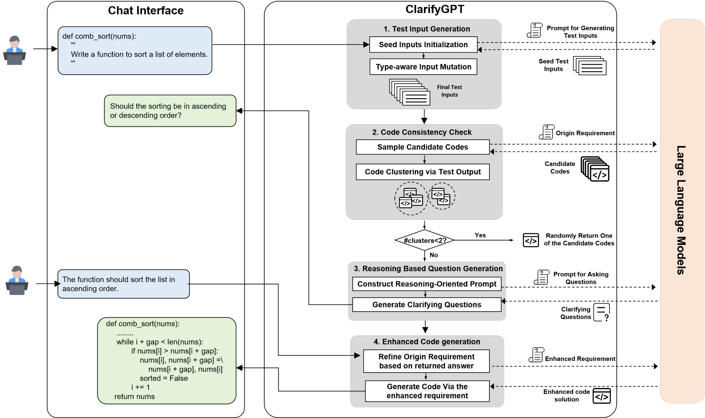
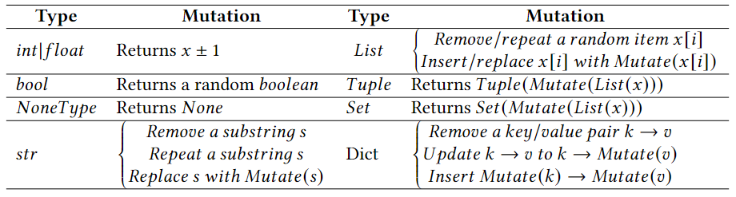
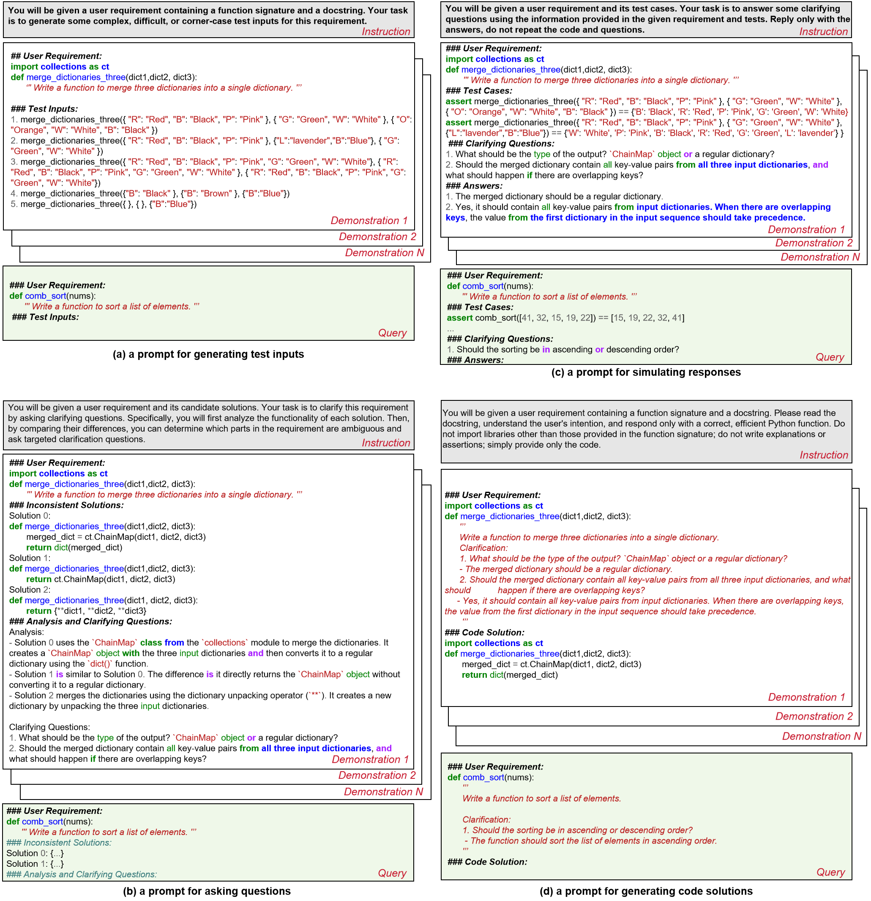
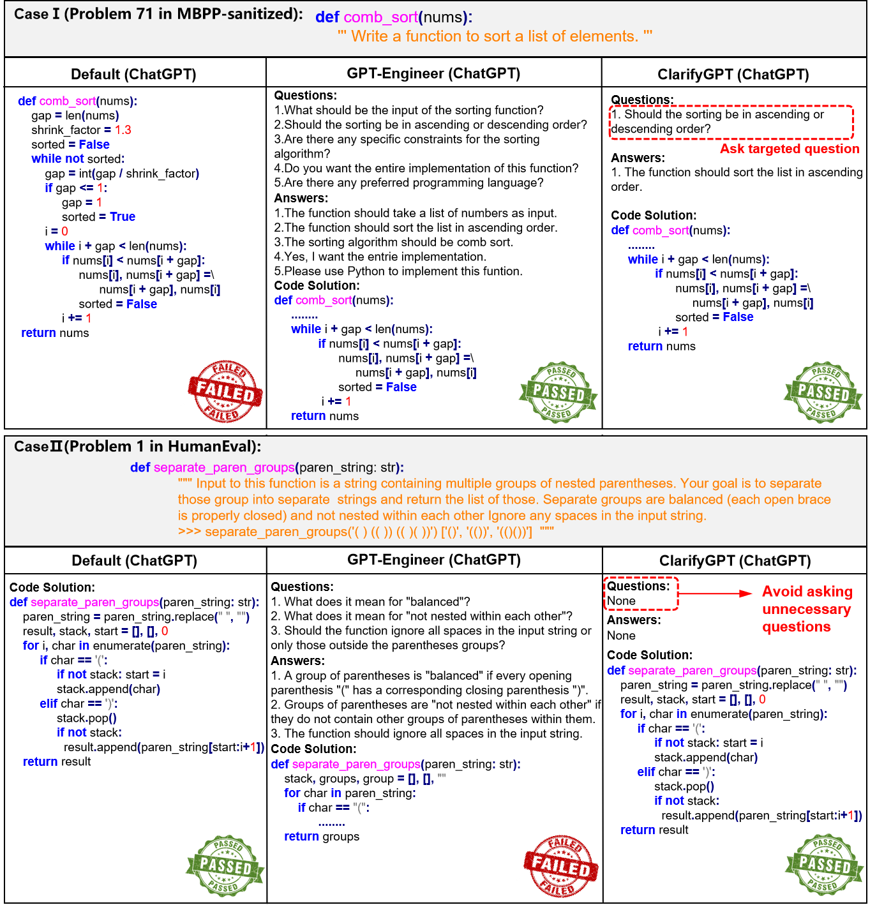

# ClarifyGPT: Empowering LLM-based Code Generation with Intention Clarification

Fangwen Mu
Note: Both authors contributed equally to this research
Affiliation: Institute of Software, Chinese Academy of Sciences, Beijing, China
email: [fangwen2020@iscas.ac.cn](mailto:fangwen2020@iscas.ac.cn)
,
Lin Shi
Affiliation: Beihang University, Beijing, China
email: [shilin@buaa.edu.cn](mailto:shilin@buaa.edu.cn)
,
Song Wang
Affiliation: York University, Toronto, Canada
email: [wangsong@yorku.ca](mailto:wangsong@yorku.ca)
,
Zhuohao Yu
Affiliation: Institute of Software, Chinese Academy of Sciences, Beijing, China
email: [yuzhuohao23@mails.ucas.edu.cn](mailto:yuzhuohao23@mails.ucas.edu.cn)
,
Binquan Zhang
Affiliation: Beihang University, Beijing, China
email: [binquan@buaa.edu.cn](mailto:binquan@buaa.edu.cn)
,
ChenXue Wang
Affiliation: Institute of Software, Chinese Academy of Sciences, Beijing, China
email: [chenxuew02@gmail.com](mailto:chenxuew02@gmail.com)
,
Shichao Liu
Affiliation: Software IDE innovation Lab, Huawei Central Software Institute, Beijing, China
email: [liushichao2@huawei.com](mailto:liushichao2@huawei.com)
 and
Qing Wang
Affiliation: Institute of Software, Chinese Academy of Sciences, Beijing, China
email: [wq@iscas.ac.cn](mailto:wq@iscas.ac.cn)

###### Abstract.

Large Language Models (LLMs), such as ChatGPT, have demonstrated impressive capabilities in automatically generating code from provided natural language requirements.
However, in real-world practice, it is inevitable that the requirements written by users might be ambiguous or insufficient.
Current LLMs will directly generate programs according to those unclear requirements regardless of interactive clarification, which will likely deviate from the origin user intents.
To bridge that gap, we introduce a novel framework named ClarifyGPT, which aims to enhance code generation by empowering LLMs with the ability to identify ambiguous requirements and ask targeted clarifying questions. In particular, ClarifyGPT first detects whether a given requirement is ambiguous by performing a code consistency check. If it is ambiguous, ClarifyGPT prompts an LLM to generate targeted clarifying questions. After receiving question responses, ClarifyGPT refines the ambiguous requirement and inputs it into the same LLM to generate a final code solution.
To evaluate our ClarifyGPT, we first conduct a human evaluation involving ten participants who use ClarifyGPT for code generation on two publicly available benchmarks: MBPP-sanitized and MBPP-ET. The results show that ClarifyGPT elevates the performance (Pass@1) of GPT-4 from 70.96% to 80.80% on MBPP-sanitized.
Furthermore, to perform large-scale automated evaluations of ClarifyGPT across different LLMs and benchmarks without requiring user participation, we introduce a high-fidelity simulation method to simulate user responses. The automated evaluation results also demonstrate that ClarifyGPT can significantly enhance code generation performance compared to the baselines. In particular, ClarifyGPT improves the average performance of GPT-4 and ChatGPT across four benchmarks from 68.02% to 75.75% and from 58.55% to 67.22%, respectively.
We believe that ClarifyGPT can effectively facilitate the practical application of LLMs in real-world development environments.

## 1. Introduction

Code generation aims to produce a code snippet that satisfies the user’s intent expressed in a natural language requirement. This task, which offers potential cost savings, accelerates programming activities, and facilitates software development, has consequently garnered attention across various domains, e.g., natural language processing, artificial intelligence, and software engineering. Recent efforts tackle this task by leveraging Large Language Models (LLMs) with billions of parameters, such as ChatGPT([OpenAI, 2022](https://arxiv.org/html/2310.10996v1#bib.bib35)) and CodeGen([Nijkamp et al., 2022](https://arxiv.org/html/2310.10996v1#bib.bib34)). The LLMs take the natural language requirements (i.e., prompts) as inputs and output the corresponding code snippets, achieving remarkable progress in code generation.

However, in real-world practice, due to the diversity of user experience and perspective, it is inevitable that the requirements written by users might be ambiguous or insufficient.
For example, the requirement "Write a function to sort a list of elements" does not specify whether the user intends for the list to be sorted in ascending or descending order.
Current LLMs do not handle such ambiguous requirements: they rarely ask users to clarify these requirements and instead directly generate programs that may deviate from the users’ needs ([Kuhn et al., 2023](https://arxiv.org/html/2310.10996v1#bib.bib22)).
Current LLMs-based code generation approaches lack the mechanism of clarifying unclear requirements ([Kuhn et al., 2023](https://arxiv.org/html/2310.10996v1#bib.bib22); [Krasheninnikov et al., 2022](https://arxiv.org/html/2310.10996v1#bib.bib21)), i.e., they directly generate programs according to those unclear requirements regardless of interactive clarification.
In contrast, when human developers encounter ambiguous requirements, they typically seek additional information by interactively asking clarifying questions to the users. For the above example, a simple clarifying question such as "Should the sorting be in ascending or descending order?" could help disambiguate the requirement.

In light of this observation, we argue that empowering LLMs with the ability to automatically ask clarifying questions for ambiguous requirements is necessary for improving the quality and efficiency of code generation. However, it is quite challenging to empower LLMs with this ability due to the following barriers.
(1) When to Ask Clarifying Questions? In practical development environments, numerous requirements exist, including both ambiguous and unambiguous ones. Failure to concentrate on questioning only the ambiguous requirements can lead to unnecessary interactions between LLMs and users regarding well-defined requirements. These unnecessary interactions, in turn, can diminish efficiency and compromise the user experience.
(2) What Clarifying Questions Should be Asked? The quality of clarifying questions also influences the efficiency and performance of code generation. Precisely and targeted questions aid users in expressing their intents clearly, ensuring that the obtained responses are directly relevant to the ambiguities present in the requirements. Vague or broad questions increase the risk of obtaining off-topic or irrelevant responses, potentially hindering LLMs from comprehending user intents.

In this paper, we propose a novel framework called ClarifyGPT that enhances LLM-based code generation via requirement clarification.
First, we employ a two-step code consistency check to decide when to ask clarifying questions. We are motivated by the observation that feeding a clear requirement to LLMs usually results in generating diverse code snippets that behave consistently, i.e., given the same test inputs, those different code snippets will likely return the same outputs. While feeding an unclear requirement, LLMs are likely to generate diverse code snippets that behave differently.
Specifically, in the first step, ClarifyGPT aims to generate numerous high-quality test inputs for a given requirement via type-aware mutation.
In the second step, ClarifyGPT inputs the given requirement into an LLM to sample $n$ code solutions and checks whether they produce identical outputs when tested with the generated input.
If the outputs are not identical, ClarifyGPT determines that the requirement requires further clarification; and vice versa.
Second, we employ the reasoning-based prompting for generating clarification questions. Initially, ClarifyGPT directs LLMs to analyze the factors contributing to the ambiguity of the given requirement by comparing code solutions with different functionalities.
Subsequently, it formulates targeted clarifying questions based on the results of this analysis.
By comparing these different code implementations, potential points of ambiguity in the requirements can be readily identified. After detecting the points of ambiguity in the requirements, the LLMs can generate targeted clarifying questions for them.
Finally, ClarifyGPT refines the original requirement based on the generated questions and their responses and generates the final code solution.

To assess the effectiveness of ClarifyGPT, we first integrate GPT-4 ([OpenAI, 2023](https://arxiv.org/html/2310.10996v1#bib.bib36)) into ClarifyGPT and recruit ten participants to evaluate its performance on two public benchmarks (MBPP-sanitized ([Austin et al., 2021](https://arxiv.org/html/2310.10996v1#bib.bib5)), and MBPP-ET ([Dong et al., 2023a](https://arxiv.org/html/2310.10996v1#bib.bib11))). The human evaluation results show that ClarifyGPT elevates the performance (Pass@1) of GPT-4 on MBPP-sanitized from 70.96% to 80.8%, improves the performance (Pass@1) of ChatGPT on MBPP-ET from 51.52% to 60.19%.
Besides, due to requiring the involvement of human participants, evaluating ClarifyGPT could be very expensive and hard to reproduce. To perform automated evaluations of ClarifyGPT across different LLMs and benchmarks without requiring user participation, we introduce a high-fidelity simulation method to simulate user feedback. We then conduct comprehensive experiments on four benchmarks (HumanEval ([Chen et al., 2021](https://arxiv.org/html/2310.10996v1#bib.bib9)), HumanEval-ET ([Dong et al., 2023a](https://arxiv.org/html/2310.10996v1#bib.bib11)), MBPP-sanitized, and MBPP-ET) using two state-of-the-art LLMs (i.e., GPT-4 and ChatGPT). The results demonstrate that, in comparison with the default GPT-4, ClarifyGPT achieves an average improvement of 11.52% across four benchmarks; in comparison with the default ChatGPT, ClarifyGPT achieves an average improvement of 15.07% on four benchmarks.
Our main contributions are outlined as follows:

- •

  Framework: We propose a novel framework, named ClarifyGPT, which enables LLMs to detect ambiguous requirements and formulate targeted clarifying questions. ClarifyGPT refines the ambiguous requirements based on the answers to clarifying questions and further generates code solutions.
- •

  User Simulation: We introduce a user simulation method for producing high-fidelity simulated answers to the clarifying questions, which facilitates automated evaluations of ClarifyGPT across different LLMs and benchmarks, eliminating the necessity for direct user participation.
- •

  Evaluation: We conduct extensive experiments on four widely-used benchmarks to show that, ClarifyGPT achieves substantial improvements across different models and benchmarks. A human evaluation further confirms the significant potential of applying ClarifyGPT in real-world practice.
- •

  Data: publicly accessible dataset and source code ([web, 2023](https://arxiv.org/html/2310.10996v1#bib.bib2)) to facilitate the replication of our study and its application in extensive contexts.

In the rest of this paper, Section [2](https://arxiv.org/html/2310.10996v1#S2) introduces the background and related work. Section [3](https://arxiv.org/html/2310.10996v1#S3) elaborates our proposed framework ClarifyGPT. Section [4](https://arxiv.org/html/2310.10996v1#S4) presents the experimental setup. Section [5](https://arxiv.org/html/2310.10996v1#S5) illustrates the results and analysis. Section [6](https://arxiv.org/html/2310.10996v1#S6) discusses the benefits and limitations of ClarifyGPT and threats to validity. Finally, Section [7](https://arxiv.org/html/2310.10996v1#S7) summarizes this work.

## 2. Background and Related Work

### 2.1. LLM-based Code Generation

Code generation is a hot research topic for software engineering and artificial intelligence communities.
Recently, many LLMs have been proposed for code generation. One class of models is the encoder-decoder models, e.g., PLBART ([Ahmad et al., 2021](https://arxiv.org/html/2310.10996v1#bib.bib3)), CodeT5 ([Wang et al., 2021](https://arxiv.org/html/2310.10996v1#bib.bib46)), and AlphaCode ([Li et al., 2022](https://arxiv.org/html/2310.10996v1#bib.bib28)), which generally encode an input text into a context embedding and decode the embedding to a code solution. Another class of models is the decoder-only models that are trained with the next token prediction objective and generate code from left to right. GPT series models ([Chen et al., 2021](https://arxiv.org/html/2310.10996v1#bib.bib9); [Black et al., 2022](https://arxiv.org/html/2310.10996v1#bib.bib6)), PolyCoder ([Xu et al., 2022](https://arxiv.org/html/2310.10996v1#bib.bib49)), and InCoder ([Fried et al., 2022](https://arxiv.org/html/2310.10996v1#bib.bib14)) are examples of such models. Among them, ChatGPT ([OpenAI, 2022](https://arxiv.org/html/2310.10996v1#bib.bib35)) and GPT-4 ([OpenAI, 2023](https://arxiv.org/html/2310.10996v1#bib.bib36)) are the state-of-the-art LLMs developed by OpenAI. They have demonstrated improved understanding and reasoning abilities, proficiency in comprehending the provided context, and the capacity to generate high-quality texts.

Since training or fine-tuning these LLMs is highly expensive, there has also been a lot of research focused on enhancing the performance of LLMs in code generation with minimal or no fine-tuning. Prompt Learning is one of the most important techniques for achieving this goal ([Liu et al., 2023a](https://arxiv.org/html/2310.10996v1#bib.bib29); [Wei et al., 2022](https://arxiv.org/html/2310.10996v1#bib.bib48); [Dong et al., 2023b](https://arxiv.org/html/2310.10996v1#bib.bib12); [Nashid et al., 2023](https://arxiv.org/html/2310.10996v1#bib.bib32); [Shrivastava et al., 2022](https://arxiv.org/html/2310.10996v1#bib.bib41)). The Chain-of-Thought (CoT) ([Wei et al., 2022](https://arxiv.org/html/2310.10996v1#bib.bib48)) is a novel prompting engineering technique, which can elicit LLMs to produce intermediate reasoning steps that lead to the final answer. It has shown impressive performance in complex reasoning tasks (e.g., arithmetic and symbolic reasoning) ([Wei et al., 2022](https://arxiv.org/html/2310.10996v1#bib.bib48); [Kojima et al., 2022](https://arxiv.org/html/2310.10996v1#bib.bib20)), and has therefore been applied to code generation ([Li et al., 2023a](https://arxiv.org/html/2310.10996v1#bib.bib27); [Jiang et al., 2023a](https://arxiv.org/html/2310.10996v1#bib.bib17)). Inspired by CoT, Li et al. ([Li et al., 2023a](https://arxiv.org/html/2310.10996v1#bib.bib27)) propose a new prompting method, named Structured CoT (SCoT). Different from CoT, SCoT explicitly introduces code structures and teaches LLMs to generate intermediate reasoning steps with program structures. Jiang et al. ([Jiang et al., 2023a](https://arxiv.org/html/2310.10996v1#bib.bib17)) propose a self-planning approach that can guide LLMs to understand code planning with few-shot demonstrations and write corresponding code planning for the given requirement. The aforementioned studies focus on leveraging and augmenting the reasoning capabilities of LLMs, that is, prompting LLMs to generate intermediate reasoning steps to enhance code generation performance. Nevertheless, they remain insufficient in addressing the ambiguous requirements provided by humans, as unclear user intent may mislead LLMs into producing incorrect reasoning steps, thereby yielding inaccurate results. Our ClarifyGPT recognizes the importance of clarifying ambiguous requirements and proposes a novel framework that enables LLMs to automatically detect ambiguous requirements and ask targeted clarifying questions. By clarifying user requirements, ClarifyGPT can generate code solutions that fulfill the user’s intentions. GPT-Engineer ([Osika, 2023](https://arxiv.org/html/2310.10996v1#bib.bib37)) is a recent open-source Github repository. It utilizes manual-designed instructions to prompt LLMs to ask clarifying questions for the input user requirements, and then generates code snippets based on user feedback. However, GPT-Engineer asks clarifying questions for both ambiguous and unambiguous requirements, which is detrimental to the user experience and may result in incorrect code solutions  (Footnote 1: https://github.com/AntonOsika/gpt-engineer/issues/708) . While ClarifyGPT can detect ambiguous requirements by checking whether the test outputs of sampled code solutions are identical. Furthermore, ClarifyGPT employs prompting techniques to direct LLMs to first analyze the factors contributing to requirement ambiguity and then formulate targeted questions.

### 2.2. Clarifying Question Generation

The task of generating clarifying questions for ambiguous queries or dialogues has received much attention in information retrieval and dialogue system fields ([Keyvan and Huang, 2022](https://arxiv.org/html/2310.10996v1#bib.bib19); [Trienes and Balog, 2019](https://arxiv.org/html/2310.10996v1#bib.bib42); [Dhole, 2020](https://arxiv.org/html/2310.10996v1#bib.bib10); [Rao and III, 2019](https://arxiv.org/html/2310.10996v1#bib.bib38); [Min et al., 2020](https://arxiv.org/html/2310.10996v1#bib.bib31); [Krasheninnikov et al., 2022](https://arxiv.org/html/2310.10996v1#bib.bib21)). In terms of information retrieval, many studies have pointed out that clarifying questions can help resolve ambiguous queries and improve user experience. For example, Wang and Li ([Wang and Li, 2021](https://arxiv.org/html/2310.10996v1#bib.bib44)) find that search queries are often short and the underlying user intents are often ambiguous. They propose an effective template-guided clarifying question generation model, which employs Transformer to select a question template from a list of template candidates and fill in the question slot from a slot vocabulary. Eberhart and McMillan ([Eberhart and McMillan, 2022](https://arxiv.org/html/2310.10996v1#bib.bib13)) propose a novel method to ask clarifying questions for query refinement, which utilizes a task extraction algorithm to identify query aspects and follows a rule-based procedure to generate questions.
In terms of the dialogue system domain, both rule-based and learning-based approaches have been proposed. Dhole ([Dhole, 2020](https://arxiv.org/html/2310.10996v1#bib.bib10)) proposes a novel method of generating discriminative questions by leveraging a simple rule-based system, which aims at seeking clarification from the user, thereby reducing the roboticity of the conversation and making the interaction considerably natural. Rao et al. ([Rao and III, 2019](https://arxiv.org/html/2310.10996v1#bib.bib38)) describe a method for generating clarifying questions, which uses a seq2seq model to generate a question given a context and utilizes another seq2seq model to generate an answer given the context and the question.

In code generation, dealing with ambiguous user requirements has received little attention so far. To the best of our knowledge, Li et al. ([Li et al., 2023b](https://arxiv.org/html/2310.10996v1#bib.bib26)) is the only research paper that addresses ambiguous requirements resolution for code generation. This work aims to clarify the ambiguous requirements missing key operations, e.g., API calls. It first collects a dataset named Code ClarQA containing natural language requirements, code, clarifying questions, and answers. Then, it proposes a code generation pipeline that can select relevant clarifying questions and their answers from the dataset for a given requirement for generating a code solution. However, the scope of applicability for this work is limited. Firstly, it primarily focuses on clarifying operational-level ambiguities, leaving other forms of ambiguity, such as semantic ambiguities in natural language requirements, less effectively addressed. Furthermore, it heavily relies on the constructed dataset, retrieving relevant questions for ambiguous requirements. If the dataset lacks similar requirements, the method’s performance may suffer. Differing from this work, ClarifyGPT is not limited to a specific type of ambiguous requirement clarification. And ClarifyGPT can generate precise and targeted questions for various requirements by leveraging the powerful understanding ability of LLMs.

## 3. Approach

Figure 1. The Overview of ClarifyGPT

In this section, we introduce ClarifyGPT, a code generation framework for LLMs. Figure [1](https://arxiv.org/html/2310.10996v1#S3.F1) illustrates the overview of ClarifyGPT, which consists of four main stages: (1) Test Input Generation (Section [3.1](https://arxiv.org/html/2310.10996v1#S3.SS1)), aiming at generating high-quality test inputs for a given requirement by using prompting techniques and heuristic mutations; (2) Code Consistency Check (Section [3.2](https://arxiv.org/html/2310.10996v1#S3.SS2)), for leveraging the generated test inputs to conduct a consistency evaluation, and then identifying the ambiguous requirements; (3) Reasoning based question generation (Section [3.3](https://arxiv.org/html/2310.10996v1#S3.SS3)), focused on generating targeted clarifying questions for the identified ambiguous requirements by prompting LLMs to engage in intermediate reasoning; (4) Enhanced Code Generation (Section [3.4](https://arxiv.org/html/2310.10996v1#S3.SS4)), which incorporates the clarifying questions and their feedback to refine the original requirement and generate the final code solution based on the refined prompt. Below, we provide details for each stage in ClarifyGPT.

### 3.1. Test Input Generation

In this step, ClarifyGPT aims to produce high-quality test inputs to effectively distinguish between code solutions with different functionalities.
There are many studies have attempted to employ LLMs for unit test case generation ([Lemieux et al., 2023](https://arxiv.org/html/2310.10996v1#bib.bib25); [Schäfer et al., 2023](https://arxiv.org/html/2310.10996v1#bib.bib39); [Vikram et al., 2023](https://arxiv.org/html/2310.10996v1#bib.bib43)) and have demonstrated impressive performance. Following prior work ([Liu et al., 2023b](https://arxiv.org/html/2310.10996v1#bib.bib30)), ClarifyGPT leverages LLMs as the test input generator and generates test inputs by adopting a two-step approach (i.e., seed input initialization and type-aware mutation). Specifically, ClarifyGPT begins by designing a prompt to instruct an LLM in creating a set of seed inputs. It then performs type-aware mutations to generate a large number of new inputs. Our insights are: (1) on the one hand, since LLMs possess powerful understanding and reasoning abilities, using them as test input generators can produce high-quality inputs that remain valid even under semantic constraints. Take the example shown in Figure [4](https://arxiv.org/html/2310.10996v1#S6.F4), the problem in HumanEval requires the input string must contain balanced parentheses. Traditional input generators often face challenges in ensuring compliance with such semantic constraints. (2) on the other hand, LLMs are unsuitable for large amounts of automated test generation due to undesired speed and cost of querying such large models ([Liu et al., 2023b](https://arxiv.org/html/2310.10996v1#bib.bib30)). Thus, we utilize a heuristic mutation-based method to accelerate the generation of numerous test cases, ensuring both stability and reliability.

#### 3.1.1. Seed Input Initialization

ClarifyGPT starts with designing a prompt for seed input initialization. As shown in Figure [3](https://arxiv.org/html/2310.10996v1#S3.F3) (a), the prompt consists of three parts: (1) an instruction, designed to elicit LLMs to generate complex, difficult, and corner-case test inputs; (2) few-shot manually-crafted demonstrations, including a user requirement and ground-truth test inputs, which can assist LLMs in better understanding the task described in the instruction; (3) a query, for which LLMs generate input tests for based on it.
Specifically, we first finalize the prompt with the instruction, demonstrations, and the given requirement. Then, ClarifyGPT utilizes the prompt to query LLMs to generate seed inputs. Finally, we collect these generated seed inputs to initialize a seed pool that will be used for mutation.

Figure 2. List of basic type-aware mutations over input $x$ ([Liu et al., 2023b](https://arxiv.org/html/2310.10996v1#bib.bib30))

#### 3.1.2. Type-Aware Input Mutation

After initializing a seed pool, ClarifyGPT employs a type-aware input mutation strategy([Liu et al., 2023b](https://arxiv.org/html/2310.10996v1#bib.bib30)) to generate higher-quality test inputs. Specifically, our approach follows the standard mutation-based fuzzing workflow ([Zhang et al., 2011](https://arxiv.org/html/2310.10996v1#bib.bib51); [Zalewski, 2018](https://arxiv.org/html/2310.10996v1#bib.bib50)): (1) At each iteration, an input is randomly selected from the seed pool. (2) For the selected input, we inspect its data types and perform a single mutation operation consistent with its type to create a new test case. The basic mutations used for different types of inputs are illustrated in Figure [2](https://arxiv.org/html/2310.10996v1#S3.F2). For simple data types, such as int and float, one mutation operation simply increases or decreases its value by 1. For compound types, we mutate the elements based on their internal types. (3) After completing a round of mutations, we add the newly generated inputs to the seed pool and repeat the aforementioned process until we attain the desired number of generated inputs.

### 3.2. Code Consistency Check

A clear user requirement should be easy to understand and leave no room for interpretation, while an ambiguous user requirement can lead to stakeholders interpreting it in different ways. Inspired by this, we make an assumption that, for a given requirement, if an LLM generates numerous code solutions with different functionalities, it signifies that the requirement can lead to the LLM interpreting it in different ways. Consequently, such a requirement necessitates further clarification and refinement.
In light of this assumption, we propose a simple yet efficient method to determine ambiguous requirements. First, we feed a given requirement into an LLM to sample $n$ code solutions. Then, these code solutions are executed with test inputs generated in the previous step. We obtain the test outputs of these programs and compare the test outputs to inspect whether they are identical. If the outputs are identical, ClarifyGPT considers these code solutions as interpreting the requirement in the same way, thus identifying the requirement as unambiguous. In this case, one of the sampled codes would be output as the final code solution. However, if the outputs are not identical, ClarifyGPT believes the LLM has different understandings of this requirement when it produces code solutions and identifies the requirement as ambiguous. For these ambiguous requirements, as shown in Figure [1](https://arxiv.org/html/2310.10996v1#S3.F1), we perform the code clustering to divide these code solutions into several groups based on their test outputs. Subsequently, ClarifyGPT randomly chooses one code solution from each group and feeds these inconsistent code solutions into the next component to synthesize the prompt used for asking questions.

Figure 3. The details of the prompts used in ClarifyGPT

### 3.3. Reasoning Based Question Generation

Targeted clarifying questions facilitate users in articulating their intentions with clarity, ensuring that the responses obtained are directly pertinent to the unclear parts within the requirements. Vague or broad questions increase the risk of getting off-topic or irrelevant responses, which may hurt the performance of code generation. Therefore, upon identifying ambiguous requirements, it becomes essential to empower LLMs with the capability to craft precise and targeted questions. To achieve this objective, we devise a reasoning-based prompt aimed at directing LLMs to initially scrutinize the factors contributing to the ambiguity of the requirement and subsequently formulate targeted questions grounded in the analysis. The designed prompt is depicted in Figure [3](https://arxiv.org/html/2310.10996v1#S3.F3) (b). It includes three parts: (1) an instruction, which describes the task (i.e., clarifying question generation) we want the LLMs to solve; (2) few-shot <requirement, inconsistent solutions, clarifying questions> triples as demonstrations, which help LLMs in understanding and solving the task; (3) a query, containing a user requirement and its code solutions, which is fed to LLMs for generating questions.

Specifically, ClarifyGPT constructs the prompt to direct LLMs to analyze the factors contributing to the unclear requirement by understanding the functionalities of these inconsistent code solutions and comparing their disparities. The motivation is that, in software development, code solutions represent the specific implementation of requirements. If a requirement is ambiguous, different developers may have different interpretations and consequently write different code. Some of these inconsistent code solutions are incorrect or not in line with the original intent. By comparing these different code implementations, potential points of ambiguity in the requirements can be easily identified. After detecting the points of ambiguity in the requirements, the LLMs continue to generate targeted clarification questions based on the detection results.

Our proposed prompting shares a similar idea with the Chain of Thought (CoT) ([Wei et al., 2022](https://arxiv.org/html/2310.10996v1#bib.bib48)) prompting, which elicits LLMs to generate intermediate reasoning steps (analysis of the factors contributing to ambiguity) first, and then produce final results (targeted clarifying questions) based on these intermediate reasoning steps. In this way, ClarifyGPT encourages LLMs to perform “far-ahead planning” ([Bubeck et al., 2023](https://arxiv.org/html/2310.10996v1#bib.bib7)), enabling them to better leverage their reasoning and comprehension abilities to enhance the quality of the generated questions.

### 3.4. Enhanced Code Generation

Once user responses are captured, ClarifyGPT combines them with the generated questions to refine the original requirement into a clear one. In particular, as shown in the query in Figure [3](https://arxiv.org/html/2310.10996v1#S3.F3) (d), we pair each question and its corresponding answer to create a clarification, which are then appended to the end of the docstring to form the refined requirement. By refining an ambiguous requirement in this way, we can preserve the structural integrity of the docstring in the original requirement while enhancing it with additional clarifying information. Subsequently, we use the refined requirement to construct a prompt to instruct LLMs in generating the final code solution. The constructed prompt also consists of three parts, i.e., an instruction, some demonstrations, and a query, as depicted in Figure [3](https://arxiv.org/html/2310.10996v1#S3.F3) (d).

## 4. Experimental Design

To evaluate the effectiveness of ClarifyGPT, we conduct comprehensive experiments. In this section, we illustrate our experimental design, including research questions, models, benchmarks, metrics, baselines, and implementation details.

### 4.1. Research Questions

We address the following three research questions to assess the performance of ClarifyGPT.

RQ1: How does the ClarifyGPT perform when receiving real user feedback in comparison to baseline approaches?
In real-world scenarios, our ClarifyGPT assists users in writing code by interacting with them, i.e., asking for clarification and receiving user feedback. Thus, in this RQ, we explore whether ClarifyGPT with human in the loop can achieve higher performance than existing code generation baselines. Since evaluating interactive code generation with human participants is costly, we only select GPT-4 as the base model, and hire ten participants (including academic researchers and industry developers) to manually answer the clarifying questions generated by ClarifyGPT. We compare ClarifyGPT to three baselines on two benchmarks (i.e., MBPP-sanitized and MBPP-ET).

RQ2: How does the ClarifyGPT perform when receiving simulated user feedback compared to the state-of-the-art baseline approaches?
This RQ performs large-scale automated evaluations of ClarifyGPT across different LLMs and benchmarks without requiring user participation, which aims to further verify whether ClarifyGPT can achieve higher performance than existing code generation baselines. We first propose a user simulation method that leverages LLMs to simulate user feedback. Then, we apply three baselines and ClarifyGPT to two representative LLMs (i.e., GPT-4 and ChatGPT), and evaluate their performance on four widely-used benchmarks (i.e., HumanEval, MBPP-sanitized, HumanEval-ET, and MBPP-ET).

RQ3: How does the number of demonstrations in a prompt impact the performance of ClarifyGPT?
Prompting techniques could be sensitive to the number of demonstrations ([Nie et al., 2022](https://arxiv.org/html/2310.10996v1#bib.bib33); [Gao et al., 2023](https://arxiv.org/html/2310.10996v1#bib.bib15)). In this research question, we measure the performance of ClarifyGPT with varying numbers of demonstrations to investigate the prompt robustness of ClarifyGPT.

### 4.2. Studied LLMs

There are many LLMs available for code generation. However, the specific context of this work necessitates that the LLMs possess a certain level of communicative competence, that is, the ability to comprehend human instructions and formulate clarifying questions. Thus, the LLMs without instruction tuning (e.g., InCoder ([Fried et al., 2022](https://arxiv.org/html/2310.10996v1#bib.bib14)) and CodeGen ([Nijkamp et al., 2022](https://arxiv.org/html/2310.10996v1#bib.bib34))) are not suitable as the base models applied to ClarifyGPT framework. In this work, we select two
representative chat-LLMs (i.e., ChatGPT and GPT4) as base models to evaluate ClarifyGPT framework.

- •

  ChatGPT
  ([OpenAI, 2022](https://arxiv.org/html/2310.10996v1#bib.bib35)) is one of the most powerful chat models empowered by OpenAI. It is trained using a novel approach called Reinforcement Learning from Human Feedback (RLHF), which seamlessly integrates reinforcement learning and human feedback. Specifically, ChatGPT is first trained with vast amounts of natural language text and code files. Then, it is fine-tuned through reinforcement learning, enabling it to adeptly comprehend and execute human instructions. In our experiments, We use OpenAI’s API to access the ChatGPT model, i.e., gpt-3.5-turbo.
- •

  GPT-4 ([OpenAI, 2023](https://arxiv.org/html/2310.10996v1#bib.bib36)) is OpenAI’s most advanced LLM, which can accept image and text inputs, emit text outputs. It is also trained with reinforcement learning and learns to follow human instructions. GPT-4 has demonstrated improved language understanding, allowing it to comprehend complex and nuanced contexts, making it highly effective on many downstream tasks, including text summarization, translation, and code generation ([Bubeck et al., 2023](https://arxiv.org/html/2310.10996v1#bib.bib7)). In our experiments, we use OpenAI’s API to access the GPT-4 model, i.e., gpt-4-turbo.

### 4.3. Benchmarks

Following the previous work ([Jiang et al., 2023b](https://arxiv.org/html/2310.10996v1#bib.bib18); [Chen et al., 2022](https://arxiv.org/html/2310.10996v1#bib.bib8); [Li et al., 2023a](https://arxiv.org/html/2310.10996v1#bib.bib27); [Dong et al., 2023b](https://arxiv.org/html/2310.10996v1#bib.bib12)), We conduct experiments on four public code generation benchmarks: HumanEval ([Chen et al., 2021](https://arxiv.org/html/2310.10996v1#bib.bib9)), MBPP-sanitized ([Austin et al., 2021](https://arxiv.org/html/2310.10996v1#bib.bib5)), along with their extended test case versions (i.e., HumanEval-ET and MBPP-ET ([Dong et al., 2023a](https://arxiv.org/html/2310.10996v1#bib.bib11))). The statistics of these benchmarks are shown in Table [1](https://arxiv.org/html/2310.10996v1#S4.T1).

- •

  HumanEval ([Chen et al., 2021](https://arxiv.org/html/2310.10996v1#bib.bib9)) is a hand-written problem-solving dataset crafted subsequent to the cut-off date of Codex’s training dataset, consisting of 164 Python programming problems. Programming problems in the HumanEval concern language comprehension, algorithms, and mathematics. Each problem includes a function signature, a natural language requirement, and several unit tests. A problem is considered solved by code-LLMs when all unit tests are passed.
- •

  MBPP-sanitized  ([Austin et al., 2021](https://arxiv.org/html/2310.10996v1#bib.bib5)) is a hand-verified subset of MBPP (Mostly Basic Programming Problems) dataset, which contains 427 crowd-sourced Python programming problems, involving numeric manipulations, standard libraries functionality, and more. Each problem contains a function signature, a user requirement, and three test cases.
- •

  HumanEval-ET and MBPP-ET ([Dong et al., 2023a](https://arxiv.org/html/2310.10996v1#bib.bib11)) are two extended versions of HumanEval and MBPP benchmarks with an average of 100+ additional test cases per problem. To improve the reliability of generated code evaluation, they collect many edge test cases that are not included in original benchmarks.

Table 1. Statistics of benchmarks: the total number of problems in the benchmark (Problem Nums), the average number of test cases per problem (AVG.Tests per Problem), and the average/maximum/minimum number of prompt words in the benchmark (AVG/MAX/MIN.Words in Prompt).

|  |  |  |  |  |
| --- | --- | --- | --- | --- |
| Benchmark | HumanEval | HumanEval-ET | MBPP-sanitized | MBPP-ET |
| Problem Nums | 164 | 164 | 427 | 427 |
| AVG.Tests per Problem | 7.8 | 107.5 | 3.1 | 101.7 |
| AVG.Words in Prompt | 67.7 | 67.7 | 14.5 | 14.5 |
| MAX.Words in Prompt | 249 | 249 | 47 | 47 |
| MIN.Words in Prompt | 17 | 17 | 7 | 7 |

### 4.4. Evaluation Metrics

We evaluate the accuracy of the generated code using the metric Pass@$k$ ([Kulal et al., 2019](https://arxiv.org/html/2310.10996v1#bib.bib23)). This metric serves as an estimator of the generational capabilities under a specific budget, which is widely used in previous LLM-related studies ([Chen et al., 2022](https://arxiv.org/html/2310.10996v1#bib.bib8); [Zhang et al., 2022](https://arxiv.org/html/2310.10996v1#bib.bib52); [Lahiri et al., 2022](https://arxiv.org/html/2310.10996v1#bib.bib24)).
For each problem in the benchmarks, we generate $k$ code solutions, and if any of the $k$ code solutions passes all tests, this problem is considered solved.
In real-world development scenarios, generating $k$ code will impose a burden on developers, that is, they need to read and understand $k$ different code and select one as the target code. Thus, in this paper, the $k$ is set to 1, which satisfies most scenarios where developers consider only single-generated code ([Dong et al., 2023b](https://arxiv.org/html/2310.10996v1#bib.bib12); [Jiang et al., 2023b](https://arxiv.org/html/2310.10996v1#bib.bib18)). To avoid high variance and randomness, we run each approach three times and report the average results as the final results.

### 4.5. Comparison Baselines

- •

  Default LLM: takes the original requirements directly from benchmarks as inputs to prompt LLMs for code generation.
- •

  CoT (Chain-of-Thought) ([Wei et al., 2022](https://arxiv.org/html/2310.10996v1#bib.bib48)): generates a series of reasoning steps for each requirement by using the CoT prompt and then generates the corresponding code. To ensure the fairness of comparison, the CoT baseline has the same number of demonstrations (i.e., three demonstrations) and demonstration seeds.
- •

  GPT-Engineer (Footnote 2: https://github.com/AntonOsika/gpt-engineer) : is a recent open-source Github repository. It utilizes manual-designed instructions to elicit LLMs to ask clarifying questions for the input user requirements and then generates code snippets based on user feedback.

### 4.6. Implementation Details

The implementation details of constructing prompts and configuring models in ClarifyGPT are as follows.

Prompt Construction. Since the four benchmarks do not have training sets, following previous work ([Wei et al., 2022](https://arxiv.org/html/2310.10996v1#bib.bib48); [Wang et al., 2022a](https://arxiv.org/html/2310.10996v1#bib.bib45)), we select the first three problems from each benchmark and extract the user requirements from these problems as demonstration seeds. Subsequently, we manually create distinct demonstrations for various prompts, as illustrated in Figure [3](https://arxiv.org/html/2310.10996v1#S3.F3). It should be noted that the reason we only create three demonstrations for each prompt is due to the input length limit of LLMs.

Model Configuration. We treat the two LLMs used in the experiments as black box generators and only set a few interface parameters they provide without accessing internal parameters. For all LLMs, we set the top p to 0.95, the frequency_penalty to 0. The max_tokens represents the maximum number of tokens to be generated, which is set to 800 for the prompt of asking clarifying questions and 300 for other prompts. In particular, we set the temperature to 0, except when sampling code solutions, for which the temperature is set to 0.8. We follow Chen et al. ([Chen et al., 2021](https://arxiv.org/html/2310.10996v1#bib.bib9)) to truncate the content generated in HumanEval and MBPP by five stop sequences: “\nclass”, “\ndef”, “\n#”, “\nif”, and “\nprint”.

## 5. Results and Analysis

### 5.1. RQ1: How does ClarifyGPT perform when receiving real user feedback in comparison to baseline approaches?

Setup.
In this RQ, we explore how ClarifyGPT performs in real-world scenarios, that is, whether ClarifyGPT can achieve higher performance than existing code generation baselines when receiving real user feedback. Specifically, we apply ClarifyGPT to the GPT-4 model. Since MBPP-ET benchmark shares the same user requirements as MBPP-sanitized, we only apply ClarifyGPT to the original versions of the benchmark (i.e., MBPP-sanitized) and report ClarifyGPT’s performance on these two benchmarks using their respective unit tests. ClarifyGPT first takes the user requirement of each problem in the benchmarks as input and determines them as ambiguous or unambiguous. Then, it generates clarifying questions for the ambiguous requirements (as shown in Figure [1](https://arxiv.org/html/2310.10996v1#S3.F1)). In total, we obtained 140 problems with ambiguous requirements from MBPP-sanitized benchmark. The average number of clarifying questions per problem is 2.85. We crafted three identical questionnaires for each problem, ensuring that each problem would be assessed by three different participants. Each questionnaire consists of three elements: (1) the (ambiguous) requirement of the problem, which describes the problem’s intent; (2) the unit test cases containing expected input-output examples, which assist participants in understanding the problem’s intent; (3) the generated clarifying questions, which participants are required to answer.

We recruited ten participants, including three Ph.D. students, two Master’s students, two senior researchers, and three industry developers. None of them are co-authors of this paper. All participants have at least three years of experience in Python development, with six of them having more than five years of experience. Participants were initially provided with task descriptions and example questionnaires that contained appropriate question answers. After completing a training exercise, we assigned 42 problems to each participant and asked them to respond to the clarifying questions based on the information provided in the questionnaires. Each problem will be solved by three participants.

We collected the answers provided by the participants and input them into ClarifyGPT to generate final code solutions. As mentioned earlier, we evaluated the correctness of the generated code on the two benchmarks using the unit test cases. Since each problem’s clarifying questions were answered by three participants, we report the average Pass@1 results.

Table 2. The Pass@1(%) of ClarifyGPT (Human Feedback) and baselines on two code generation benchmarks. Numbers in red denote ClarifyGPT’s relative improvements compared to the Default.

<table>
<tr>
<td rowspan="2">Methods</td>
<td colspan="3">GPT-4</td>
</tr>
<tr>
<td>MBPP-sanitized</td>
<td>MBPP-ET</td>
<td>Average</td>
</tr>
<tr>
<td>Default</td>
<td>70.96</td>
<td>51.52</td>
<td>61.24</td>
</tr>
<tr>
<td>CoT</td>
<td>72.68</td>
<td>53.79</td>
<td>63.24</td>
</tr>
<tr>
<td>GPT-Engineer</td>
<td>73.77</td>
<td>54.96</td>
<td>64.37</td>
</tr>
<tr>
<td>ClarifyGPT (Human Feedback)</td>
<td>80.80</td>
<td>60.19</td>
<td>70.50</td>
</tr>
<tr>
<td>Relative Improvement</td>
<td>13.87% ↑</td>
<td>16.83% ↑</td>
<td>15.35% ↑</td>
</tr>
</table>

Results. The comparison results between the performance of ClarifyGPT and other baselines are depicted in Table [2](https://arxiv.org/html/2310.10996v1#S5.T2). The values in red are ClarifyGPT’s relative improvements compared to the Default baseline.

We can see that ClarifyGPT (Human Feedback) achieves the highest performance on all four benchmarks. Compared with the Default, ClarifyGPT (Human Feedback) demonstrates superior performance with respect to the Pass@1 metric, achieving an increase of 13.87% on MBPP-sanitized and 16.83% on MBPP-ET. Furthermore, when compared to the best-performing baselines (i.e., CoT or GPT-Engineer), ClarifyGPT (Human Feedback) also improves the performance of Pass@1 by 9.53% on MBPP-sanitized and 9.52% on MBPP-ET. This is mainly because ClarifyGPT can proficiently identify ambiguous requirements and raise targeted clarification questions. Users easily clarify their intentions by responding to these questions, thus facilitating the generation of more correct code by LLMs. It indicates that ClarifyGPT, as an interactive code generation framework, can support developers in writing code within real-world development contexts.

Answering RQ1: In human evaluation,
ClarifyGPT elevates the performance (Pass@1) of GPT-4 on MBPP-sanitized from 70.96% to 80.8%; elevates its performance on MBPP-ET from 51.52% to 60.19%. The relative improvement is 15.35% on average, outperforming the baselines.

### 5.2. RQ2: How does the ClarifyGPT perform when receiving simulated user feedback compared to the state-of-the-art baseline approaches?

Setup. Due to the involvement of human participants, evaluating the interactive code generation framework ClarifyGPT is very expensive and hard to reproduce. A relatively simple solution is to conduct an offline evaluation ([Aliannejadi et al., 2019](https://arxiv.org/html/2310.10996v1#bib.bib4)). However, it limits the system to selecting clarifying questions from a set of pre-defined or labeled questions, which does not transfer well to the practical development environment. In this RQ, we apply the User Simulation for Evaluation ([Gordon, 1990](https://arxiv.org/html/2310.10996v1#bib.bib16); [Sekulić et al., 2022](https://arxiv.org/html/2310.10996v1#bib.bib40)) method to facilitate automated evaluations of ClarifyGPT across various LLMs and benchmarks, eliminating the necessity for direct user participation.

The most crucial aspect of simulating user feedback is to ensure that the created user feedback closely resembles the real feedback users would provide in the same environment. Low-fidelity simulations can result in ClarifyGPT receiving feedback that is challenging to encounter in actual practice, thereby yielding misleading outcomes and impacting our evaluation of ClarifyGPT’s performance. Hence, we propose a high-fidelity user simulation method that leverages LLMs to generate user responses by providing LLMs with clarifying questions and ground-truth test cases. Our key insight is that the ground-truth test cases contain expected input-output examples, reflecting the desired functionality sought by users. Endowing LLMs with this prior knowledge facilitates their understanding of user intent and enables the generation of high-fidelity simulated user feedback. To instruct LLMs to solve this task, we design a prompt (as shown in Figure [3](https://arxiv.org/html/2310.10996v1#S3.F3)), which also consists of three parts: (1) an instruction, which describes the task (i.e., simulating the user responses) we want the LLMs to solve; (2) few-shot <requirement, ground-truth tests, clarifying questions, answers> quadruples as demonstrations, which help LLMs in understanding and solving the task; (3) a query, containing a user requirement and its ground-truth tests, which is feeds to LLMs for generating simulated responses.

We apply three baselines (Section [4.5](https://arxiv.org/html/2310.10996v1#S4.SS5)) and our ClarifyGPT to two SOTA LLMs (Section [4.2](https://arxiv.org/html/2310.10996v1#S4.SS2)). We evaluate them on four benchmarks (Section [4.3](https://arxiv.org/html/2310.10996v1#S4.SS3)) and compare their performance by calculating the Pass@1 metric (Section [4.4](https://arxiv.org/html/2310.10996v1#S4.SS4)). For a fair comparison, all baselines adopted the same experimental setup as our ClarifyGPT.

Results.

Table 3. The Pass@1(%) of ClarifyGPT (Simulated Feedback) and baselines on four code generation benchmarks. Numbers in red denote ClarifyGPT (Simulated Feedback)’s relative improvements compared to the Default.

<table>
<tr>
<td colspan="2">Methods</td>
<td>HumanEval</td>
<td>HumanEval-ET</td>
<td>MBPP-sanitized</td>
<td>MBPP-ET</td>
<td>Average</td>
</tr>
<tr>
<td rowspan="5">ChatGPT</td>
<td>Default</td>
<td>64.63</td>
<td>57.32</td>
<td>65.57</td>
<td>46.68</td>
<td>58.55</td>
</tr>
<tr>
<td>CoT</td>
<td>68.70</td>
<td>60.37</td>
<td>66.59</td>
<td>49.18</td>
<td>61.21</td>
</tr>
<tr>
<td>GPT-Engineer</td>
<td>66.26</td>
<td>59.76</td>
<td>69.09</td>
<td>50.20</td>
<td>61.33</td>
</tr>
<tr>
<td>ClarifyGPT (Simulated Feedback)</td>
<td>74.39</td>
<td>64.84</td>
<td>74.08</td>
<td>55.58</td>
<td>67.22</td>
</tr>
<tr>
<td>Relative Improvement</td>
<td>15.10% ↑</td>
<td>13.12% ↑</td>
<td>12.98% ↑</td>
<td>19.07% ↑</td>
<td>15.07% ↑</td>
</tr>
<tr>
<td rowspan="6">GPT-4</td>
<td>Default</td>
<td>78.86</td>
<td>70.73</td>
<td>70.96</td>
<td>51.52</td>
<td>68.02</td>
</tr>
<tr>
<td>CoT</td>
<td>80.10</td>
<td>72.56</td>
<td>72.68</td>
<td>53.79</td>
<td>69.78</td>
</tr>
<tr>
<td>GPT-Engineer</td>
<td>79.27</td>
<td>71.75</td>
<td>73.77</td>
<td>54.96</td>
<td>69.94</td>
</tr>
<tr>
<td>ClarifyGPT (Human Feedback)</td>
<td>\</td>
<td>\</td>
<td>80.80</td>
<td>60.19</td>
<td>70.50</td>
</tr>
<tr>
<td>ClarifyGPT (Simulated Feedback)</td>
<td>87.80</td>
<td>78.05</td>
<td>78.69</td>
<td>58.47</td>
<td>75.75</td>
</tr>
<tr>
<td>Relative Improvement</td>
<td>11.34% ↑</td>
<td>10.35% ↑</td>
<td>10.89% ↑</td>
<td>13.49% ↑</td>
<td>11.52% ↑</td>
</tr>
</table>

Table [3](https://arxiv.org/html/2310.10996v1#S5.T3) presents the comparison results between the performance of ClarifyGPT (Simulated Feedback) and other baselines in terms of code generation. The values in red are ClarifyGPT (Simulated Feedback)’s relative improvements compared to the Default baseline.

Overall, ClarifyGPT (Simulated Feedback) can substantially improve the performance of code generation, achieving gains across different LLMs and datasets. For GPT-4 model, compared with the Default baseline, ClarifyGPT (Simulated Feedback) demonstrates notable improvements in Pass@1 performance, achieving an increase of 11.34% on the HumanEval dataset, 10.35% on HumanEval-ET, 10.89% on MBPP-sanitized, and 13.49% on MBPP-ET. For ChatGPT model, when compared to the Default baseline, ClarifyGPT (Simulated Feedback) improves the performance of Pass@1 by 15.10%, 13.12%, 12.98%, and 19.07% on four benchmarks, respectively. The results demonstrate that ClarifyGPT, which empowers LLMs to autonomously generate clarifying questions and refine user requirements based on user feedback, facilitates users in clarifying their intentions, thereby enhancing code generation performance by capturing user intentions.

We also note that, in comparison to the most related baseline (i.e., GPT-Engineer), exhibits superior performance with respect to the Pass@1 metric, achieving an average improvement of 11.45%, 8.65%, 6.95%, and 8.56% across the four benchmarks. We attribute the improvements to our novel techniques, i.e., ambiguous requirement identification and clarifying question generation. Posing clarifying questions for every user requirement results in needless LLM-Human interactions on unambiguous requirements, which places an additional burden on users and hurts the code generation performance when producing off-topic questions. While ClarifyGPT can effectively identify ambiguous requirements without any supervised training by conducting the code consistency check. The inconsistent code snippets are taken as input to help ClarifyGPT formulate targeted questions that guide users in clarifying ambiguity.

Besides, we observe that the performance of ClarifyGPT (Human Feedback) is slightly higher than that of ClarifyGPT (Simulated Feedback). This suggests that our user simulation method may generate user responses that do not fulfill the users’ intentions. However, both methods can significantly improve the performance of code generation and achieve consistent gains across different LLMs and benchmarks, demonstrating the reliability of our simulation method’s evaluation results.

Answering RQ2: ClarifyGPT (Simulated Feedback) improves the average performance (Pass@1) of GPT-4 across four benchmarks from 68.02% to 75.75%, improves the average performance of ChatGPT across four benchmarks from 58.55% to 67.22%.
Their relative improvements are 11.52% and 15.07% respectively, and the average improvement is 13.27%.

### 5.3. RQ3: How does the number of demonstrations in a prompt impact the performance of ClarifyGPT?

Setup.
In this RQ, we investigate whether the increase or decrease in the number of demonstrations will affect the performance of ClarifyGPT (Simulated Feedback) on the code generation task. Specifically, due to the limitation of the input length of LLMs, we vary the number of demonstrations in the prompt from zero to three. Then, we apply the two LLMs to ClarifyGPT and its variants, and assess their performance of four benchmarks. We run these methods three times and report the average Pass@1 results as the final reports.

Results.
Table [4](https://arxiv.org/html/2310.10996v1#S5.T4) presents a comparison of the performance between ClarifyGPT and its variants. Overall, ClarifyGPT demonstrates robustness to the number of demonstrations in the prompts. When varying the number of demonstrations from zero to three, ClarifyGPT consistently outperforms the Default baseline across two LLMs and four benchmarks.

We can observe that, as expected, the performance of ClarifyGPT increases with the number of demonstrations. In particular, as the number of demonstrations in the prompt is incremented from zero to three, concerning ChatGPT, ClarifyGPT achieves an average performance increase from 59.77% to 67.22% across four benchmarks. For the GPT-4 model, ClarifyGPT’s average performance increases from 68.59% to 75.75%. This is mainly because more demonstrations can provide a variety of situations and information to LLMs, enabling them to better comprehend the context of the problem and the required solution. Furthermore, LLMs can learn to generalize better through demonstrations, that is, to infer a solution to a new situation from a known demonstration. This allows LLMs to better adapt to different inputs and requirements.

Table 4. Experimental results of ClarifyGPT with different number of demonstrations. Numbers in red denote the relative improvement of ClarifyGPT with different number of demonstrations compared to the Default.

<table>
<tr>
<td colspan="2">Methods</td>
<td>HumanEval</td>
<td>HumanEval-ET</td>
<td>MBPP-sanitized</td>
<td>MBPP-ET</td>
<td>Average</td>
</tr>
<tr>
<td rowspan="5">ChatGPT</td>
<td>Default</td>
<td>64.63</td>
<td>57.32</td>
<td>65.57</td>
<td>46.68</td>
<td>58.55</td>
</tr>
<tr>
<td>ClarifyGPT (zero-shot)</td>
<td>65.85 1.9% ↑</td>
<td>58.13 1.4% ↑</td>
<td>67.07 2.3% ↑</td>
<td>48.01 2.8% ↑</td>
<td>59.77 2.1% ↑</td>
</tr>
<tr>
<td>ClarifyGPT (one-shot)</td>
<td>72.80 12.6% ↑</td>
<td>60.98 6.4% ↑</td>
<td>70.96 8.2% ↑</td>
<td>51.52 10.4% ↑</td>
<td>64.07 9.4% ↑</td>
</tr>
<tr>
<td>ClarifyGPT (two-shot)</td>
<td>73.92 14.4% ↑</td>
<td>63.21 10.3% ↑</td>
<td>72.60 10.7% ↑</td>
<td>53.63 14.9% ↑</td>
<td>65.84 12.6% ↑</td>
</tr>
<tr>
<td>ClarifyGPT (three-shot)</td>
<td>74.39 15.1% ↑</td>
<td>64.84 13.1% ↑</td>
<td>74.08 13.0% ↑</td>
<td>55.58 19.1% ↑</td>
<td>67.22 15.1% ↑</td>
</tr>
<tr>
<td rowspan="5">GPT-4</td>
<td>Default</td>
<td>78.86</td>
<td>70.73</td>
<td>70.96</td>
<td>51.52</td>
<td>68.02</td>
</tr>
<tr>
<td>ClarifyGPT (zero-shot)</td>
<td>79.26 0.5% ↑</td>
<td>70.73 0.0% -</td>
<td>72.13 1.6% ↑</td>
<td>52.22 1.4% ↑</td>
<td>68.59 0.8% ↑</td>
</tr>
<tr>
<td>ClarifyGPT (one-shot)</td>
<td>83.93 6.4% ↑</td>
<td>72.76 2.9% ↑</td>
<td>75.88 6.9% ↑</td>
<td>55.97 8.6% ↑</td>
<td>72.14 6.2% ↑</td>
</tr>
<tr>
<td>ClarifyGPT (two-shot)</td>
<td>85.15 8.0% ↑</td>
<td>75.61 6.9% ↑</td>
<td>77.75 9.6% ↑</td>
<td>56.67 10.0% ↑</td>
<td>73.80 8.6% ↑</td>
</tr>
<tr>
<td>ClarifyGPT (three-shot)</td>
<td>87.80 11.3% ↑</td>
<td>78.05 10.3% ↑</td>
<td>78.69 10.9% ↑</td>
<td>58.4713.5% ↑</td>
<td>75.75 11.5% ↑</td>
</tr>
</table>

We also find that ClarifyGPT’s performance in the zero-shot setting exhibits a marginal improvement over the Default baseline, while its performance in the one-shot setting is significantly enhanced compared to that of the Default baseline. We attribute this difference to the fact that in the zero-shot setting, ClarifyGPT is expected to generate meaningful responses without any demonstrations, which can be particularly challenging for complex tasks (e.g., requiring LLMs to generate targeted clarifying questions). What’s more, zero-shot prompting relies solely on LLMs’ pre-trained knowledge and the wording of the given prompts, which may not offer sufficient guidance or constraints for LLMs to produce accurate or contextually relevant responses. In contrast, the performance of ClarifyGPT with the one-shot setting is significantly higher than that in the zero-shot setting and is close to the performance of ClarifyGPT with the three-shot setting. This indicates that ClarifyGPT has strong generalization performance when only one demonstration is provided. We believe that in practical usage scenarios, utilizing ClarifyGPT in the one-shot setting can serve as a trade-off between effectiveness and efficiency.

Answering RQ3: Overall, ClarifyGPT demonstrates robustness to the number of demonstrations in the prompts. When varying the number of demonstrations from zero to three, ClarifyGPT consistently outperforms the Default baseline across two LLMs and four benchmarks.

## 6. Discussion

### 6.1. Case Study

Figure 4. Two real cases from HumanEval and MBPP generated by two baselines and our ClarifyGPT.

To further evaluate the effectiveness of our approach, we conduct a qualitative analysis. As shown in Fig. [4](https://arxiv.org/html/2310.10996v1#S6.F4), we select two representative examples from two popular code generation benchmarks (i.e., HumanEval and MBPP). Each input requirement consists of a function signature and an NL description. We take the ChatGPT ([OpenAI, 2022](https://arxiv.org/html/2310.10996v1#bib.bib35)) as the base model and utilize two baselines (i.e., Default and GPT-Engineer) and ClarifyGPT to generate a code solution for each input requirement.

For the first example taken from MBPP-sa, the description “write a function to sort a list of elements” does not specify whether this function should be sorted in ascending or descending order. The default ChatGPT directly generates a code solution that sorts the given list in descending order, which fails to pass the ground-truth test cases. GPT-Engineer poses five clarifying questions and generates a correct code solution based on the user responses. However, some of those questions are uninformative and can be answered by the information in the given requirement. For instance, the answer to the third question “Are there any specific constraints for the sorting algorithm?” can be inferred by the function name comb_sort mentioned in the function signature. The fifth question “Are there any preferred programming language?” also seems trivial, since we can easily know that the function should be implemented in Python based on the syntax of the function signature. Answering these questions cannot obtain additional information; instead, it generates superfluous dialogues that are detrimental to the user experience. Furthermore, it results in an increase in token counts for both the LLMs’ input and output, consequently escalating operational expenses. By contrast, ClarifyGPT can identify points of ambiguity in the requirements by comparing the different code implementations, thereby asking targeted clarifying questions. As a result, ClarifyGPT only asks one question “Should the sorting be in ascending or descending order?” and generates a correct code solution.

For the second example, the user requirement is well-defined. Default ChatGPT generates a correct solution, while GPT-Engineer produces an incorrect code solution. This discrepancy primarily arises from GPT-Engineer’s inability to determine whether a requirement is ambiguous or not. Consequently, even for this unambiguous requirement, GPT-Engineer still poses three questions, which turn out to be uninformative. Moreover, these questions contribute to making the refined prompt excessively lengthy, potentially causing confusion for the LLMs. In contrast, our ClarifyGPT can determine whether a requirement needs clarification by conducting a code consistency check. So we can see ClarifyGPT does not raise any questions for this requirement but instead directly produces a correct solution.

### 6.2. Benefits and Limitations

In this section, we discuss some potential benefits and limitations of our ClarifyGPT.

Benefits. (1) In contrast to prevailing LLM-based code generation methods ([Chen et al., 2022](https://arxiv.org/html/2310.10996v1#bib.bib8); [Li et al., 2022](https://arxiv.org/html/2310.10996v1#bib.bib28); [Lahiri et al., 2022](https://arxiv.org/html/2310.10996v1#bib.bib24)) that leverage post-processing techniques to sample a substantial pool of candidate codes and then select one, ClarifyGPT aims to directly clarify the input requirements by asking clarifying questions. Hence, our framework contributes to the augmentation of interpretability in the code generated by LLMs. By clarifying specific details within the requirements or adding supplementary knowledge to them, users can readily discern corresponding alterations in the resulting code. This contributes to providing users with guidance on how to formulate requirements to improve code generation, thereby facilitating a clearer understanding of the generated code. (2) Our ClarifyGPT improves the interactive skills of LLMs by empowering them with the ability to automatically ask clarifying questions for ambiguous requirements. In this way, it serves to facilitate users in identifying ambiguities within requirements and provides guidance in clarifying their intentions without requiring users to initially generate code and subsequently read and analyze code to refine requirements. Thus, ClarifyGPT enhances the user experience and production efficiency.

Limitations. (1) Ideally, our framework is applicable to all LLMs. However, ClarifyGPT necessitates that the LLMs possess a certain level of communicative competence, that is, the ability to comprehend human instructions and formulate clarifying questions. Thus, the LLMs applicable to our framework are limited, i.e., the LLMs without instruction tuning (e.g., InCoder ([Fried et al., 2022](https://arxiv.org/html/2310.10996v1#bib.bib14)) and CodeGen ([Nijkamp et al., 2022](https://arxiv.org/html/2310.10996v1#bib.bib34))) are not suitable as the base models applied to ClarifyGPT framework. (2) Due to the use of code consistency checking to determine whether a requirement needs clarification, ClarifyGPT is required to generate test inputs for the requirement and compare the test outputs of the sampled solutions. Therefore, ClarifyGPT is not suitable for generating code with complex input (e.g., image or file). In addition, for some code that does not return output values (e.g., deep learning programs), using ClarifyGPT may also be subject to some limitations.

### 6.3. Threats to Validity

The first threat to validity is the potential for data leakage. Since these LLMs are trained on open-source code repositories, it is possible that some public benchmarks were included in their training data. This could bias our assessment of the proposed approach, as some model outputs may be influenced by prior exposure to these benchmarks. To mitigate this threat, we carefully select HumanEval ([Chen et al., 2021](https://arxiv.org/html/2310.10996v1#bib.bib9)), MBPP-sanitized ([Austin et al., 2021](https://arxiv.org/html/2310.10996v1#bib.bib5)), and their respective extended versions for our evaluation. HumanEval is a manually crafted problem-solving dataset, introduced by OpenAI for assessing Codex’s performance. MBPP-sanitized, on the other hand, is a hand-verified subset of the MBPP dataset, comprising 427 Python problems that have undergone crowd-sourced verification. These datasets have undergone meticulous manual review and have been widely employed in previous research studies ([Chen et al., 2022](https://arxiv.org/html/2310.10996v1#bib.bib8); [Lahiri et al., 2022](https://arxiv.org/html/2310.10996v1#bib.bib24); [Wang et al., 2022b](https://arxiv.org/html/2310.10996v1#bib.bib47)).

The second threat to validity is the user simulation for evaluation. Due to the involvement of human participants, evaluating ClarifyGPT, an interactive code generation framework, is very expensive and hard to reproduce. Thus, we propose a user simulation method to facilitate automated evaluations of ClarifyGPT across various LLMs and benchmarks. However, low-fidelity simulations can result in ClarifyGPT receiving feedback that is challenging to encounter in actual practice, thereby yielding misleading outcomes and impacting our evaluation of ClarifyGPT’s performance. To mitigate this threat, we design a special prompt to provide LLMs with clarifying questions and ground-truth test cases. By endowing LLMs with this prior knowledge, ClarifyGPT facilitates LLMs’ understanding of user intent and enables the generation of high-fidelity simulated user feedback. The results show that the performance of ClarifyGPT (Simulated Feedback) is very close to that of ClarifyGPT (Human Feedback), proving that our proposed simulation method can serve as a good proxy for the automatic evaluation of ClarifyGPT, eliminating the necessity for direct user participation.

The third threat pertains to the generalizability of our experimental results. To address this issue, on one hand, we have taken care to select two representative chat LLMs (ChatGPT and GPT-4) as our base models and four popular datasets as the evaluation subjects. We apply the two LLMs to our ClarifyGPT and assess their performance on these four datasets. On the other hand, considering the inherent sensitivity of LLMs to prompts, we run baselines and ClarifyGPT three times to help mitigate high variance and randomness. We report the average results as the final results. The results show that our ClarifyGPT can substantially improve the performance of all LLMs, achieving consistent gains across different datasets. Therefore, we believe that ClarifyGPT has good generalizability, and can perform effectively in many related contexts.

## 7. Conclusion

In this paper, motivated by the observation that human developers typically ask clarifying questions when they are faced with ambiguous requirements, we argue that empowering LLMs with the ability to automatically clarify ambiguous requirements can improve code generation. To this end, we propose ClarifyGPT, a code generation framework that enables LLMs to identify ambiguous requirements and generate targeted clarifying questions.
Specifically, ClarifyGPT consists of four main stages, i.e., test input generation, code consistency check, reasoning-based question generation, and enhanced code generation. For a given requirement, ClarifyGPT first generates high-quality test inputs by using prompting techniques and heuristic mutations. Then, it utilizes the generated test inputs to conduct a consistency evaluation and identify the ambiguous requirements. Next, ClarifyGPT formulates targeted clarifying questions for the identified ambiguous requirements by prompting LLMs to engage in intermediate reasoning. Finally, it incorporates the clarifying questions and their feedback to refine the original requirement and generate the final code solution based on the refined prompt.
In the evaluation part, we first apply GPT-4 to ClarifyGPT and recruit ten participants to evaluate its performance on two public benchmarks. The human evaluation results show that ClarifyGPT achieves a relative improvement of up to 16.83% in Pass@1 compared to the Default baseline. Additionally, to automate the evaluation of ClarifyGPT, we introduce a high-fidelity simulation method to simulate user feedback. We conduct comprehensive experiments on four benchmarks (i.e., HumanEval, HumanEval-ET, MBPP-sanitized, and MBPP-ET) using two LLMs (i.e., GPT-4 and ChatGPT). The extensive results illustrate that ClarifyGPT improves the average performance of GPT-4 across four benchmarks from 68.02% to 75.75%, and improves the average performance of ChatGPT across four benchmarks from 58.55% to 67.22%. Thus, we believe that ClarifyGPT can significantly facilitate the practical application of LLMs in real-world development environments.

## References

- web (2023)

  2023.
  website.
  <https://github.com/ClarifyGPT/ClarifyGPT>.
- Ahmad et al. (2021)

  Wasi Uddin Ahmad, Saikat
  Chakraborty, Baishakhi Ray, and
  Kai-Wei Chang. 2021.
  Unified Pre-training for Program Understanding and
  Generation. In *Proceedings of the 2021 Conference
  of the North American Chapter of the Association for Computational
  Linguistics: Human Language Technologies, NAACL-HLT 2021, Online, June
  6-11, 2021*. 2655–2668.

  <https://doi.org/10.18653/v1/2021.naacl-main.211>
- Aliannejadi et al. (2019)

  Mohammad Aliannejadi,
  Hamed Zamani, Fabio Crestani, and
  W Bruce Croft. 2019.
  Asking clarifying questions in open-domain
  information-seeking conversations. In *Proceedings
  of the 42nd international acm sigir conference on research and development in
  information retrieval*. 475–484.
- Austin et al. (2021)

  Jacob Austin, Augustus
  Odena, Maxwell I. Nye, Maarten Bosma,
  Henryk Michalewski, David Dohan,
  Ellen Jiang, Carrie J. Cai,
  Michael Terry, Quoc V. Le, and
  Charles Sutton. 2021.
  Program Synthesis with Large Language Models.
  *CoRR* abs/2108.07732
  (2021).
  arXiv:2108.07732
  <https://arxiv.org/abs/2108.07732>
- Black et al. (2022)

  Sid Black, Stella
  Biderman, Eric Hallahan, Quentin
  Anthony, Leo Gao, Laurence Golding,
  Horace He, Connor Leahy,
  Kyle McDonell, Jason Phang,
  Michael Pieler, USVSN Sai Prashanth,
  Shivanshu Purohit, Laria Reynolds,
  Jonathan Tow, Ben Wang, and
  Samuel Weinbach. 2022.
  GPT-NeoX-20B: An Open-Source Autoregressive
  Language Model.
  *CoRR* abs/2204.06745
  (2022).

  <https://doi.org/10.48550/arXiv.2204.06745>
  arXiv:2204.06745
- Bubeck et al. (2023)

  Sébastien Bubeck,
  Varun Chandrasekaran, Ronen Eldan,
  Johannes Gehrke, Eric Horvitz,
  Ece Kamar, Peter Lee,
  Yin Tat Lee, Yuanzhi Li,
  Scott Lundberg, et al.
  2023.
  Sparks of artificial general intelligence: Early
  experiments with gpt-4.
  *arXiv preprint arXiv:2303.12712*
  (2023).
- Chen et al. (2022)

  Bei Chen, Fengji Zhang,
  Anh Nguyen, Daoguang Zan,
  Zeqi Lin, Jian-Guang Lou, and
  Weizhu Chen. 2022.
  CodeT: Code Generation with Generated Tests.
  *CoRR* abs/2207.10397
  (2022).

  <https://doi.org/10.48550/arXiv.2207.10397>
  arXiv:2207.10397
- Chen et al. (2021)

  Mark Chen, Jerry Tworek,
  Heewoo Jun, Qiming Yuan,
  Henrique Pondé de Oliveira Pinto,
  Jared Kaplan, Harrison Edwards,
  Yuri Burda, Nicholas Joseph,
  Greg Brockman, Alex Ray,
  Raul Puri, Gretchen Krueger,
  Michael Petrov, Heidy Khlaaf,
  Girish Sastry, Pamela Mishkin,
  Brooke Chan, Scott Gray,
  Nick Ryder, Mikhail Pavlov,
  Alethea Power, Lukasz Kaiser,
  Mohammad Bavarian, Clemens Winter,
  Philippe Tillet, Felipe Petroski Such,
  Dave Cummings, Matthias Plappert,
  Fotios Chantzis, Elizabeth Barnes,
  Ariel Herbert-Voss, William Hebgen
  Guss, Alex Nichol, Alex Paino,
  Nikolas Tezak, Jie Tang,
  Igor Babuschkin, Suchir Balaji,
  Shantanu Jain, William Saunders,
  Christopher Hesse, Andrew N. Carr,
  Jan Leike, Joshua Achiam,
  Vedant Misra, Evan Morikawa,
  Alec Radford, Matthew Knight,
  Miles Brundage, Mira Murati,
  Katie Mayer, Peter Welinder,
  Bob McGrew, Dario Amodei,
  Sam McCandlish, Ilya Sutskever, and
  Wojciech Zaremba. 2021.
  Evaluating Large Language Models Trained on Code.
  *CoRR* abs/2107.03374
  (2021).
  arXiv:2107.03374
  <https://arxiv.org/abs/2107.03374>
- Dhole (2020)

  Kaustubh D. Dhole.
  2020.
  Resolving Intent Ambiguities by Retrieving
  Discriminative Clarifying Questions.
  *CoRR* abs/2008.07559
  (2020).
  arXiv:2008.07559
  <https://arxiv.org/abs/2008.07559>
- Dong et al. (2023a)

  Yihong Dong, Jiazheng
  Ding, Xue Jiang, Zhuo Li,
  Ge Li, and Zhi Jin.
  2023a.
  CodeScore: Evaluating Code Generation by Learning
  Code Execution.
  *CoRR* abs/2301.09043
  (2023).

  <https://doi.org/10.48550/arXiv.2301.09043>
  arXiv:2301.09043
- Dong et al. (2023b)

  Yihong Dong, Xue Jiang,
  Zhi Jin, and Ge Li.
  2023b.
  Self-collaboration Code Generation via ChatGPT.
  *CoRR* abs/2304.07590
  (2023).

  <https://doi.org/10.48550/arXiv.2304.07590>
  arXiv:2304.07590
- Eberhart and McMillan (2022)

  Zachary Eberhart and
  Collin McMillan. 2022.
  Generating Clarifying Questions for Query
  Refinement in Source Code Search. In *IEEE
  International Conference on Software Analysis, Evolution and Reengineering,
  SANER 2022, Honolulu, HI, USA, March 15-18, 2022*.
  IEEE, 140–151.

  <https://doi.org/10.1109/SANER53432.2022.00028>
- Fried et al. (2022)

  Daniel Fried, Armen
  Aghajanyan, Jessy Lin, Sida Wang,
  Eric Wallace, Freda Shi,
  Ruiqi Zhong, Wen-tau Yih,
  Luke Zettlemoyer, and Mike Lewis.
  2022.
  InCoder: A Generative Model for Code Infilling
  and Synthesis.
  *CoRR* abs/2204.05999
  (2022).

  <https://doi.org/10.48550/arXiv.2204.05999>
  arXiv:2204.05999
- Gao et al. (2023)

  Shuzheng Gao, Xin-Cheng
  Wen, Cuiyun Gao, Wenxuan Wang, and
  Michael R Lyu. 2023.
  Constructing Effective In-Context Demonstration for
  Code Intelligence Tasks: An Empirical Study.
  *arXiv preprint arXiv:2304.07575*
  (2023).
- Gordon (1990)

  Michael D Gordon.
  1990.
  Evaluating the effectiveness of information
  retrieval systems using simulated queries.
  *Journal of the American Society for
  Information Science* 41, 5
  (1990), 313–323.
- Jiang et al. (2023a)

  Xue Jiang, Yihong Dong,
  Lecheng Wang, Qiwei Shang, and
  Ge Li. 2023a.
  Self-planning code generation with large language
  model.
  *arXiv preprint arXiv:2303.06689*
  (2023).
- Jiang et al. (2023b)

  Xue Jiang, Yihong Dong,
  Lecheng Wang, Qiwei Shang, and
  Ge Li. 2023b.
  Self-planning Code Generation with Large Language
  Model.
  *CoRR* abs/2303.06689
  (2023).

  <https://doi.org/10.48550/arXiv.2303.06689>
  arXiv:2303.06689
- Keyvan and Huang (2022)

  Kimiya Keyvan and
  Jimmy Xiangji Huang. 2022.
  How to approach ambiguous queries in conversational
  search: A survey of techniques, approaches, tools, and challenges.
  *Comput. Surveys* 55,
  6 (2022), 1–40.
- Kojima et al. (2022)

  Takeshi Kojima,
  Shixiang Shane Gu, Machel Reid,
  Yutaka Matsuo, and Yusuke Iwasawa.
  2022.
  Large Language Models are Zero-Shot Reasoners.
  *CoRR* abs/2205.11916
  (2022).

  <https://doi.org/10.48550/arXiv.2205.11916>
  arXiv:2205.11916
- Krasheninnikov et al. (2022)

  Dmitrii Krasheninnikov,
  Egor Krasheninnikov, and David
  Krueger. 2022.
  Assistance with large language models. In
  *NeurIPS ML Safety Workshop*.
- Kuhn et al. (2023)

  Lorenz Kuhn, Yarin Gal,
  and Sebastian Farquhar. 2023.
  CLAM: Selective Clarification for Ambiguous
  Questions with Generative Language Models.
  (2023).
- Kulal et al. (2019)

  Sumith Kulal, Panupong
  Pasupat, Kartik Chandra, Mina Lee,
  Oded Padon, Alex Aiken, and
  Percy Liang. 2019.
  SPoC: Search-based Pseudocode to Code. In
  *Advances in Neural Information Processing Systems
  32: Annual Conference on Neural Information Processing Systems 2019, NeurIPS
  2019, December 8-14, 2019, Vancouver, BC, Canada*.
  11883–11894.

  <https://proceedings.neurips.cc/paper/2019/hash/7298332f04ac004a0ca44cc69ecf6f6b-Abstract.html>
- Lahiri et al. (2022)

  Shuvendu K. Lahiri,
  Aaditya Naik, Georgios Sakkas,
  Piali Choudhury, Curtis von Veh,
  Madanlal Musuvathi, Jeevana Priya Inala,
  Chenglong Wang, and Jianfeng Gao.
  2022.
  Interactive Code Generation via Test-Driven
  User-Intent Formalization.
  *CoRR* abs/2208.05950
  (2022).

  <https://doi.org/10.48550/arXiv.2208.05950>
  arXiv:2208.05950
- Lemieux et al. (2023)

  Caroline Lemieux,
  Jeevana Priya Inala, Shuvendu K Lahiri,
  and Siddhartha Sen. 2023.
  CODAMOSA: Escaping coverage plateaus in test
  generation with pre-trained large language models. In
  *International conference on software engineering
  (ICSE)*.
- Li et al. (2023b)

  Haau-Sing Li, Mohsen
  Mesgar, André F. T. Martins, and
  Iryna Gurevych. 2023b.
  Python Code Generation by Asking Clarification
  Questions. In *Proceedings of the 61st Annual
  Meeting of the Association for Computational Linguistics (Volume 1: Long
  Papers), ACL 2023, Toronto, Canada, July 9-14, 2023*.
  Association for Computational Linguistics,
  14287–14306.

  <https://doi.org/10.18653/v1/2023.acl-long.799>
- Li et al. (2023a)

  Jia Li, Ge Li,
  Yongmin Li, and Zhi Jin.
  2023a.
  Enabling Programming Thinking in Large Language
  Models Toward Code Generation.
  *arXiv preprint arXiv:2305.06599*
  (2023).
- Li et al. (2022)

  Yujia Li, David H. Choi,
  Junyoung Chung, Nate Kushman,
  Julian Schrittwieser, Rémi Leblond,
  Tom Eccles, James Keeling,
  Felix Gimeno, Agustin Dal Lago,
  Thomas Hubert, Peter Choy,
  Cyprien de Masson d’Autume, Igor
  Babuschkin, Xinyun Chen, Po-Sen Huang,
  Johannes Welbl, Sven Gowal,
  Alexey Cherepanov, James Molloy,
  Daniel J. Mankowitz, Esme Sutherland
  Robson, Pushmeet Kohli, Nando de
  Freitas, Koray Kavukcuoglu, and Oriol
  Vinyals. 2022.
  Competition-Level Code Generation with AlphaCode.
  *CoRR* abs/2203.07814
  (2022).

  <https://doi.org/10.48550/arXiv.2203.07814>
  arXiv:2203.07814
- Liu et al. (2023a)

  Chao Liu, Xuanlin Bao,
  Hongyu Zhang, Neng Zhang,
  Haibo Hu, Xiaohong Zhang, and
  Meng Yan. 2023a.
  Improving ChatGPT Prompt for Code Generation.
  *arXiv preprint arXiv:2305.08360*
  (2023).
- Liu et al. (2023b)

  Jiawei Liu, Chunqiu Steven
  Xia, Yuyao Wang, and Lingming Zhang.
  2023b.
  Is Your Code Generated by ChatGPT Really Correct?
  Rigorous Evaluation of Large Language Models for Code Generation.
  *CoRR* abs/2305.01210
  (2023).

  <https://doi.org/10.48550/arXiv.2305.01210>
  arXiv:2305.01210
- Min et al. (2020)

  Sewon Min, Julian
  Michael, Hannaneh Hajishirzi, and Luke
  Zettlemoyer. 2020.
  AmbigQA: Answering ambiguous open-domain
  questions.
  *arXiv preprint arXiv:2004.10645*
  (2020).
- Nashid et al. (2023)

  Noor Nashid, Mifta
  Sintaha, and Ali Mesbah.
  2023.
  Retrieval-Based Prompt Selection for Code-Related
  Few-Shot Learning. In *Proceedings of the 45th
  International Conference on Software Engineering (ICSE’23)*.
- Nie et al. (2022)

  Feng Nie, Meixi Chen,
  Zhirui Zhang, and Xu Cheng.
  2022.
  Improving few-shot performance of language models
  via nearest neighbor calibration.
  *arXiv preprint arXiv:2212.02216*
  (2022).
- Nijkamp et al. (2022)

  Erik Nijkamp, Bo Pang,
  Hiroaki Hayashi, Lifu Tu,
  Huan Wang, Yingbo Zhou,
  Silvio Savarese, and Caiming Xiong.
  2022.
  Codegen: An open large language model for code with
  multi-turn program synthesis.
  *arXiv preprint arXiv:2203.13474*
  (2022).
- OpenAI (2022)

  OpenAI. 2022.
  ChatGPT.
  <https://openai.com/blog/chatgpt/>.
- OpenAI (2023)

  OpenAI. 2023.
  GPT-4 Technical Report.
  *CoRR* abs/2303.08774
  (2023).

  <https://doi.org/10.48550/arXiv.2303.08774>
  arXiv:2303.08774
- Osika (2023)

  Anton Osika.
  2023.
  GPT-Engineer.
  <https://github.com/AntonOsika/gpt-engineer/>.
- Rao and III (2019)

  Sudha Rao and
  Hal Daumé III. 2019.
  Answer-based Adversarial Training for Generating
  Clarification Questions. In *Proceedings of the
  2019 Conference of the North American Chapter of the Association for
  Computational Linguistics: Human Language Technologies, NAACL-HLT 2019,
  Minneapolis, MN, USA, June 2-7, 2019, Volume 1 (Long and Short Papers)*.
  Association for Computational Linguistics,
  143–155.

  <https://doi.org/10.18653/v1/n19-1013>
- Schäfer et al. (2023)

  Max Schäfer, Sarah
  Nadi, Aryaz Eghbali, and Frank Tip.
  2023.
  Adaptive test generation using a large language
  model.
  *arXiv preprint arXiv:2302.06527*
  (2023).
- Sekulić et al. (2022)

  Ivan Sekulić, Mohammad
  Aliannejadi, and Fabio Crestani.
  2022.
  Evaluating mixed-initiative conversational search
  systems via user simulation. In *Proceedings of the
  Fifteenth ACM International Conference on Web Search and Data Mining*.
  888–896.
- Shrivastava et al. (2022)

  Disha Shrivastava, Hugo
  Larochelle, and Daniel Tarlow.
  2022.
  Repository-Level Prompt Generation for Large
  Language Models of Code.
  *CoRR* abs/2206.12839
  (2022).

  <https://doi.org/10.48550/arXiv.2206.12839>
  arXiv:2206.12839
- Trienes and Balog (2019)

  Jan Trienes and
  Krisztian Balog. 2019.
  Identifying unclear questions in community question
  answering websites. In *Advances in Information
  Retrieval: 41st European Conference on IR Research, ECIR 2019, Cologne,
  Germany, April 14–18, 2019, Proceedings, Part I 41*. Springer,
  276–289.
- Vikram et al. (2023)

  Vasudev Vikram, Caroline
  Lemieux, and Rohan Padhye.
  2023.
  Can Large Language Models Write Good Property-Based
  Tests?
  *arXiv preprint arXiv:2307.04346*
  (2023).
- Wang and Li (2021)

  Jian Wang and Wenjie
  Li. 2021.
  Template-guided Clarifying Question Generation for
  Web Search Clarification. In *CIKM ’21: The 30th
  ACM International Conference on Information and Knowledge Management,
  Virtual Event, Queensland, Australia, November 1 - 5, 2021*.
  ACM, 3468–3472.

  <https://doi.org/10.1145/3459637.3482199>
- Wang et al. (2022a)

  Xuezhi Wang, Jason Wei,
  Dale Schuurmans, Quoc Le,
  Ed Chi, Sharan Narang,
  Aakanksha Chowdhery, and Denny Zhou.
  2022a.
  Self-consistency improves chain of thought
  reasoning in language models.
  *arXiv preprint arXiv:2203.11171*
  (2022).
- Wang et al. (2021)

  Yue Wang, Weishi Wang,
  Shafiq R. Joty, and Steven C. H. Hoi.
  2021.
  CodeT5: Identifier-aware Unified Pre-trained
  Encoder-Decoder Models for Code Understanding and Generation. In
  *Proceedings of the 2021 Conference on Empirical
  Methods in Natural Language Processing, EMNLP 2021, Virtual Event / Punta
  Cana, Dominican Republic, 7-11 November, 2021*.
  Association for Computational Linguistics,
  8696–8708.

  <https://doi.org/10.18653/v1/2021.emnlp-main.685>
- Wang et al. (2022b)

  Zhiruo Wang, Shuyan Zhou,
  Daniel Fried, and Graham Neubig.
  2022b.
  Execution-Based Evaluation for Open-Domain Code
  Generation.
  *CoRR* abs/2212.10481
  (2022).

  <https://doi.org/10.48550/arXiv.2212.10481>
  arXiv:2212.10481
- Wei et al. (2022)

  Jason Wei, Xuezhi Wang,
  Dale Schuurmans, Maarten Bosma,
  Ed H. Chi, Quoc Le, and
  Denny Zhou. 2022.
  Chain of Thought Prompting Elicits Reasoning in
  Large Language Models.
  *CoRR* abs/2201.11903
  (2022).
  arXiv:2201.11903
  <https://arxiv.org/abs/2201.11903>
- Xu et al. (2022)

  Frank F. Xu, Uri Alon,
  Graham Neubig, and Vincent Josua
  Hellendoorn. 2022.
  A systematic evaluation of large language models of
  code. In *MAPS@PLDI 2022: 6th ACM SIGPLAN
  International Symposium on Machine Programming, San Diego, CA, USA, 13 June
  2022*. ACM, 1–10.

  <https://doi.org/10.1145/3520312.3534862>
- Zalewski (2018)

  Michal Zalewski.
  2018.
  American fuzzing lop.
  <https://lcamtuf.coredump.cx/afl/>.
- Zhang et al. (2011)

  Lingming Zhang, Darko
  Marinov, Lu Zhang, and Sarfraz
  Khurshid. 2011.
  An Empirical Study of JUnit Test-Suite Reduction.
  In *IEEE 22nd International Symposium on Software
  Reliability Engineering, ISSRE 2011, Hiroshima, Japan, November 29 -
  December 2, 2011*, Tadashi Dohi and
  Bojan Cukic (Eds.). IEEE Computer
  Society, 170–179.

  <https://doi.org/10.1109/ISSRE.2011.26>
- Zhang et al. (2022)

  Tianyi Zhang, Tao Yu,
  Tatsunori B. Hashimoto, Mike Lewis,
  Wen-tau Yih, Daniel Fried, and
  Sida I. Wang. 2022.
  Coder Reviewer Reranking for Code Generation.
  *CoRR* abs/2211.16490
  (2022).

  <https://doi.org/10.48550/arXiv.2211.16490>
  arXiv:2211.16490
