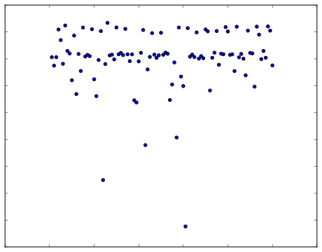
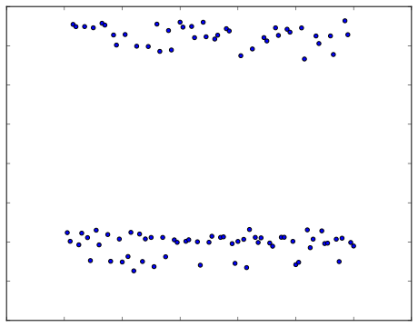
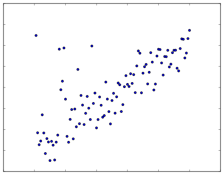
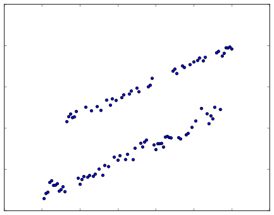
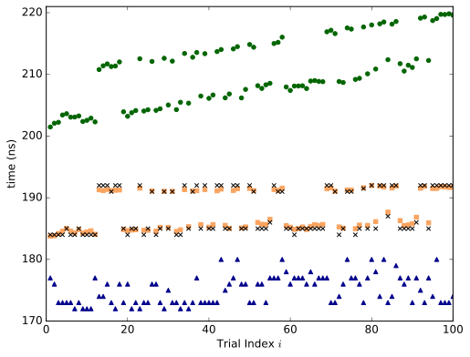
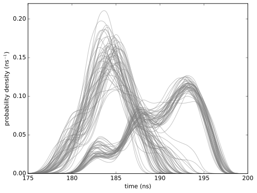
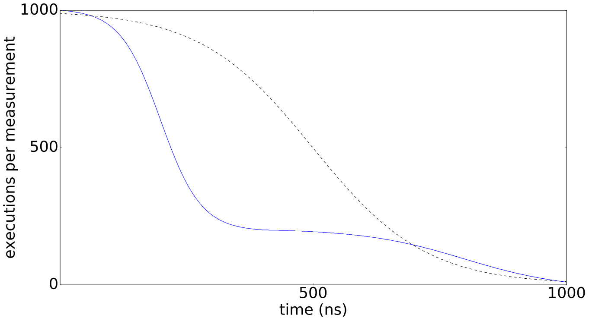

# Robust benchmarking in noisy environments

Jiahao Chen and Jarrett Revels
Affiliation: Computer Science and Artificial Intelligence Laboratory

Massachusetts Institute of Technology

Cambridge, Massachusetts 02139–4307

Email: {jiahao,jrevels}@csail.mit.edu

###### Abstract

We propose a benchmarking strategy that is robust in the presence of timer
error, OS jitter and other environmental fluctuations, and is insensitive to
the highly nonideal statistics produced by timing measurements.
We construct a model that explains how these strongly nonideal statistics can
arise from environmental fluctuations, and also justifies our proposed
strategy. We implement this strategy in the BenchmarkTools Julia package, where
it is used in production continuous integration (CI) pipelines for developing
the Julia language and its ecosystem.

## I Introduction

Authors of high performance applications rely on benchmark suites to detect and avoid
program regressions. However, many developers often run benchmarks and interpret their
results in an ad hoc manner with little statistical rigor. This ad hoc interpretation wastes
development time and can lead to misguided decisions that worsen performance.

In this paper, we consider the problem of designing a language- and
platform-agnostic benchmarking methodology that is suitable for continuous
integration (CI) pipelines and manual user workflows. Our methodology
especially focuses on the accommodation of benchmarks whose expected executions
times are short enough that timing measurements are vulnerable to error due to
insufficient system timer accuracy (generally on the order of microseconds or
shorter).

### I-A Accounting for performance variations

Modern hardware and operating systems introduce many confounding factors that complicate a
developer’s ability to reason about variations in user space application
performance [[1](https://arxiv.org/html/1608.04295v1#bib.bib1)]. (Footnote 1: A summary of these factors can be found in the BenchmarkTools documentation in the docs/linuxtips.md file.)  Consecutive timing measurements can fluctuate, possibly in a correlated
manner, in ways which depend on a myriad of factors such as environment
temperature, workload, power availability, and network traffic, and operating
system (OS) configuration.

There is a large body of research on system quiescence aiming to identify and
control for individual sources of variation in program run time measurements,
each of which must be ameliorated in its own way. Many factors stem from OS
behavior, including CPU frequency scaling [[2](https://arxiv.org/html/1608.04295v1#bib.bib2)], address space layout
randomization (ASLR) [[3](https://arxiv.org/html/1608.04295v1#bib.bib3)], virtual memory
management [[4](https://arxiv.org/html/1608.04295v1#bib.bib4), [5](https://arxiv.org/html/1608.04295v1#bib.bib5)], differences between CPU privilege
levels [[6](https://arxiv.org/html/1608.04295v1#bib.bib6)], context switches due to interrupt handling [[7](https://arxiv.org/html/1608.04295v1#bib.bib7)],
activity from system daemons and cluster managers [[8](https://arxiv.org/html/1608.04295v1#bib.bib8)], and suboptimal
process- and thread-level scheduling [[9](https://arxiv.org/html/1608.04295v1#bib.bib9)]. Even seemingly irrelevant
configuration parameters like the size of the OS environment can confound experimental
reproducibility by altering the alignment of data in memory [[10](https://arxiv.org/html/1608.04295v1#bib.bib10)]. Other
sources of variation come from specific language features or implementation details. For
example, linkers for many languages are free to choose the binary layout of the library or
executable arbitrarily, resulting in non-deterministic memory layouts [[11](https://arxiv.org/html/1608.04295v1#bib.bib11)].
This problem is exacerbated in languages like C++, whose compilers introduce arbitrary name
mangling of symbols [[12](https://arxiv.org/html/1608.04295v1#bib.bib12)]. Overzealous compiler optimizations can also
adversely affect the accuracy of hardware counters [[6](https://arxiv.org/html/1608.04295v1#bib.bib6)], or in extreme
cases eliminate key parts of the benchmark as dead code. Yet another example is garbage
collector performance, which is influenced from system parameters such as heap
size [[13](https://arxiv.org/html/1608.04295v1#bib.bib13)].

### I-B Statistics of timing measurements are not i.i.d.



(a) Benchmark 1: Unimodal with skew and large outliers



(b) Benchmark 2: Bimodal



(c) Benchmark 3: Drift



(d) Benchmark 4: Bimodal with drift

Fig. 1: Variability in the mean benchmark time across multiple trials, showing
that the mean has non-i.i.d., non-normal behavior in four different benchmarks.
Each point represents a mean time computed from trial of 10,000 measurements.
The horizontal axis is the index of the trial, while the vertical axis is time.

The existence of many sources of performance variation result in timing
measurements that are not necessarily independent and identically distributed
(i.i.d.). As a result, many textbook statistical approaches fail due to
reliance on the central limit theorem, which does not generally hold in the
non-i.i.d. regime. In particular, empirical program timing distributions are
also often heavy-tailed, and hence contain many outliers that distort measures
of central tendency like the mean, and are not captured in others like the
median.

The violation of the central limit theorem can be seen empirically in many Julia benchmarks.
For example, Figure [1](https://arxiv.org/html/1608.04295v1#S1.F1) shows that none of the four illustrative
benchmarks considered in this paper exhibit normality in the sample mean. Instead, we see
that the mean demonstrates skewed density and outliers in the first benchmark, bimodality in
the second and fourth benchmarks, and upward drift in the third and fourth benchmarks.

Many other authors have also noted the lack of textbook statistical behavior in timing
measurements [[14](https://arxiv.org/html/1608.04295v1#bib.bib14), [15](https://arxiv.org/html/1608.04295v1#bib.bib15), [16](https://arxiv.org/html/1608.04295v1#bib.bib16), [17](https://arxiv.org/html/1608.04295v1#bib.bib17)]. Authors have also noted the poor
stastistical power of standard techniques such as $F$-tests or Student t-tests for benchmark
timings [[18](https://arxiv.org/html/1608.04295v1#bib.bib18), [10](https://arxiv.org/html/1608.04295v1#bib.bib10), [19](https://arxiv.org/html/1608.04295v1#bib.bib19), [15](https://arxiv.org/html/1608.04295v1#bib.bib15), [17](https://arxiv.org/html/1608.04295v1#bib.bib17)]. Parametric outlier
detection techniques, such as the 3-sigma rule used in benchmarking software like
AndroBench[[20](https://arxiv.org/html/1608.04295v1#bib.bib20)], can also fail when applied to non-i.i.d. timing measurements.

There is a lack of consensus over how non-ideal timing measurements should be treated. Some
authors propose automated outlier removal and analyzing the remaining bulk
distribution [[20](https://arxiv.org/html/1608.04295v1#bib.bib20)]; however, these methods run the risk of fundamentally distorting
the true empirical distribution for the sake of normal analysis. Other authors have proposed
purposely introducing randomness in the form of custom OS kernels
[[21](https://arxiv.org/html/1608.04295v1#bib.bib21), [22](https://arxiv.org/html/1608.04295v1#bib.bib22)], custom compilers providing reproducible [[11](https://arxiv.org/html/1608.04295v1#bib.bib11)] or
consistently randomized [[23](https://arxiv.org/html/1608.04295v1#bib.bib23)] binary layouts, or low-variability garbage
collectors [[24](https://arxiv.org/html/1608.04295v1#bib.bib24)]. Unfortunately, these methods are specific to a single
programming language, implementation, and/or platform. Furthermore, these methods often
require administrative privileges and drastic modifications to the benchmarking environment,
which are impractical to demand from ordinary users.

### I-C Existing benchmarking methodologies

While it is impossible to eliminate performance variation
entirely [[25](https://arxiv.org/html/1608.04295v1#bib.bib25), [17](https://arxiv.org/html/1608.04295v1#bib.bib17)], benchmarking methodologies that attempt to account
for both measurement error and external sources of variation do exist. For example, the
Haskell microbenchmarking package criterion [[26](https://arxiv.org/html/1608.04295v1#bib.bib26)] attempts to thwart
error due to timer inaccuracy by growing the number of benchmark executions per timing
measurement as more timing measurements are obtained. After all measurements are taken, a
summary estimate of the benchmark run time is obtained by examining the derivative of the
ordinary least squares regression line at the point of a single evaluation point. There are
three disadvantages to this approach. First, the least squares fit is sensitive to
outliers [[27](https://arxiv.org/html/1608.04295v1#bib.bib27)] (though criterion does warn the user if outliers are
detected). Second, measurements made earlier in this experiment are highly vulnerable to
timer error, since few benchmark repetitions are used. These early measurements can skew the
regression, and hence also skew the final run time estimate. Third, measurements made later in
the experiment can repeat the benchmark more times than are necessary to overcome timer
error, constituting an inefficient use of experiment time.

Another approach focuses on eliminating “warm-up”, assuming that first few
runs of a benchmark are dominated by transient background events that
eventually vanish and the timing measurements eventually become
i.i.d. [[19](https://arxiv.org/html/1608.04295v1#bib.bib19)]. Their approach is largely platform-agnostic,
recognizes the pitfalls of inter-measurement correlations, and
acknowledges that merely increasing the number of benchmark repetitions is not always a
sufficient strategy to yield i.i.d. samples. However, the assumption (based on
common folklore) that benchmarks exhibit warm-up is often false, as is clear
from Fig. [1](https://arxiv.org/html/1608.04295v1#S1.F1) and elsewhere [[17](https://arxiv.org/html/1608.04295v1#bib.bib17)]:
even Ref. [[19](https://arxiv.org/html/1608.04295v1#bib.bib19)] itself resorts to ad hoc judgment to work
around the lack of a distinct warm-up phase. There is also no reason to believe that even if warm-up were observed, that the post-warm-up timings will be i.i.d.
Furthermore, the authors do not report if their statistical tools generate
correct confidence intervals. The moment-corrected formulae described are
accurate only for near-normal distributions, which is unlikely to hold for the
kinds of distributions we observed in real world statistics. Additionally, the
methodology requires a manual calibration experiment to be run for each
benchmark, compiler, and platform combination. As a result, this method is is
difficult to automate on the scale of Julia’s standard library benchmark suite,
which contains over 1300 benchmarks, and is frequently expanded to improve
performance test coverage.

Below, we describe our methodology to benchmarking for detecting performance regressions,
and how it is justified from a microscopic model for variations in timing measurements. To
the best of our knowledge, our work is the first benchmarking methodology that can be fully
automated, is robust in its assumption of non-i.i.d. timing measurement statistics, and
makes efficient use of a limited time budget.

## II Terms and definitions

- •

  $P_{0}$, $P$, $Q_{0}$, and $Q$ denote benchmarkable programs, each
  defined by a tape (sequence) of instructions.
- •

  $I^{[i]}_{P}$ is the $i^{\textrm{th}}$ instruction in the tape
  defining program $P$.
  Instructions are indexed in bracketed superscripts, $\cdot^{[i]}$.
- •

  $D^{[i]}_{P}$ is the delay instruction associated with $I^{[i]}_{P}$.
  Delay instructions are defined in Sec. [III](https://arxiv.org/html/1608.04295v1#S3).
- •

  $T_{i}$ is a timing measurement, namely the amount of time taken to
  perform $n_{i}$ executions of a benchmarkable program. This quantity
  is directly measurable in an experiment.
- •

  $t$ is a theoretical execution time.
  $t_{P_{0}}$ is the minimum time required to perform a single execution of
  $P_{0}$ on a given computer.
- •

  Estimated quantities are denoted with a hat, $\hat{\cdot}$.
  For example, $\hat{t}_{P_{0}}$ is an estimate of the theoretical execution
  time $t_{P_{0}}$.
- •

  A benchmark experiment is a recipe for obtaining multiple timing
  measurements for a benchmarkable program. Experiments can be executed to
  obtain trials. The
  $i^{\textrm{th}}$ trial of an experiment is a collection of timing measurements
  $T^{\{i\}}_{1},\dots T^{\{i\}}_{j},\dots T^{\{i\}}_{k}$. Trial indices are always
  written using embraced superscripts, $\cdot^{\{i\}}$.
- •

  $\tau$ denotes time quantities that are external to the benchmarkable program:

  - –

    $\tau_{\textrm{budget}}$ is the time budget for an experiment.
  - –

    $\tau_{\textrm{acc}}$ is the accuracy of the system timer, i.e. an upper bound on the maximal error in using the system timer to time an experiment.
  - –

    $\tau_{\textrm{prec}}$ is the precision of the system timer, namely the smallest nonzero time interval measurable by the timer.
- •

  $x_{P}^{(i)[j]}\tau^{(i)}$ is the time delay due to the
  $i^{\textrm{th}}$ delay factor for delay instruction $D^{[j]}$. Specifically,
  $\tau^{(i)}$ is the factor’s time scale and $x_{P}^{(i)[j]}$ is the factor’s
  trigger coefficient, as introduced Sec. [III](https://arxiv.org/html/1608.04295v1#S3). Delay factors are indexed with parenthesized
  superscripts, $\cdot^{(i)}$.
- •

  $\epsilon$ is the measurement error due to timer inaccuracy.
- •

  $E_{m}=\frac{T_{m}}{n_{m}}-t_{P_{0}}$ is the total contribution of all delay
  factors found in measurement $m$, plus the measurement error $\epsilon$.
- •

  $X^{(i)}_{P}$ is the total trigger count of the $i^{\textrm{th}}$
  delay factor during the execution of program $P$.
- •

  $\nu$ is an oracle function that, when evaluated at an execution
  time $t$, estimates an appropriate $n$ necessary to overcome measurement error
  due to
  $\tau_{\textrm{acc}}$ and $\tau_{\textrm{prec}}$. The oracle function is described in detail in Sec. [IV-C](https://arxiv.org/html/1608.04295v1#S4.SS3).

## III A model for benchmark timing distributions

We now present a statistical description of how benchmark programs behave
when they are run in serial. Our model deliberately avoids the problematic
assumption that timing measurments are i.i.d. We will use this model later to
justify the design of a new automated experimental procedure.

### III-A User benchmarks run with uncontrollable delays

Let $P_{0}$ be a deterministic benchmark program which consists of an instruction tape
consisting of $k$ instructions:

$$
P_{0}=\left[I^{[1]},I^{[2]},\dots I^{[k]}\right].
$$

(1)

Let $\tau^{[i]}$ be the run time of instruction $I^{[i]}$. Then, the total run
time of $P_{0}$ can be written $t_{P_{0}}=\sum_{i=1}^{N}\tau^{[i]}$.

While a computer may be directed to execute $P_{0}$, it may not necessarily run the program’s
instructions as they are originally provided, since the environment in which $P_{0}$
runs is vulnerable to the factors described earlier in Sec. [I-A](https://arxiv.org/html/1608.04295v1#S1.SS1). Crucially,
these factors only delay the completion of the original instructions, rather than
speed them up. (Footnote 2: While there are a very few external factors which might speed up program execution, such as frequency scaling [2], they can be easily accounted for by ensuring that power consumption profiles are always set for maximal performance. We therefore assume that these factors have been accounted for.)  Therefore, we call them
delay factors; they can be modeled as extra instructions which, when
interleaved with the original instructions, do not change the semantics of
$P_{0}$, but still add to the program’s total run time. Thus, we can define a new
program $P$ which consists of $P_{0}$’s original instructions interleaved with
additional delay instructions $D^{[i]}$:

$$
P=\left[I^{[1]},D^{[1]},I^{[2]},D^{[2]},\dots I^{[k]},D^{[k]}\right].
$$

(2)

The run time of $P$ can then be written

$$
t_{P}=t_{P_{0}}+\sum_{i}\tau^{[i]}_{D},
$$

(3)

where $\tau^{[i]}_{D}$ is the execution time of $D^{[i]}$. Since $\tau^{[i]}_{D}\geq 0$, it
follows that $t_{P}\geq t_{P_{0}}$.

The run time of each delay instruction, $\tau^{[i]}_{D}$, can be further decomposed
into the runtime contributions of individual delay factors. Let us imagine that
each delay factor $j$ can either contribute or not contribute to $D^{[i]}$.
Assuming that each delay factor triggers inside $D^{[i]}$ with constant
probability $p^{[i]{(j)}}$ of taking a fixed time $\tau^{(j)}$, we can then
write:

$$
\tau^{[i]}_{D}=\sum_{i}x_{P}^{[i]{(j)}}\tau^{(j)},
$$

(4)

where $x_{P}^{[i]{(j)}}$ is a Bernoulli random variable with success probability $p^{[i]{(j)}}$.
We denote the total number of times the $i^{\textrm{th}}$ delay factor was triggered during
the execution of $P$ as the trigger count $X_{P}^{(i)}=\sum_{j}x_{P}^{[i]{(j)}}$.
Since the trigger count is a sum of independent Bernoulli random variables with nonidentical
success probabilities, $X_{P}^{(j)}$ is itself a random variable that follows a Poisson
binomial distribution parameterized by the success probabilities $\left[p^{(1)[j]},\dots p^{(k)[j]}\right]$. Our final expression for $t_{P}$ in terms of these quantities is then:

$$
\displaystyle t_{P}
$$

$$
\displaystyle=t_{P_{0}}+\sum_{i=1}^{k}\tau^{[i]}_{D}
$$

$$
\displaystyle=t_{P_{0}}+\sum_{i=1}^{k}\sum_{j}x_{P}^{[i]{(j)}}\tau^{(j)}
$$

$$
\displaystyle=t_{P_{0}}+\sum_{j}X_{P}^{(j)}\tau^{(j)}.
$$

(5)

In summary, our model treats $t_{P}$ as a random variable whose distribution
depends on the trigger probabilities $p^{[i]{(j)}}$, which are determined by the
combined behavior of the delay factors and the initial benchmark program $P_{0}$.

### III-B Repeated benchmark execution is often necessary but not always sufficient

As mentioned in Sec. [I-C](https://arxiv.org/html/1608.04295v1#S1.SS3), experiments which measure program
performance usually incorporate multiple benchmark executions to obtain more
accurate measurements. We now apply our model to show that multiple executions
are necessary to eliminate error due to timer inaccuracy, but are insufficient
to obviate delay factors.

Represent $n$ executions of the program $P_{0}$ comprised of $k$ instructions as
a single execution of a program $Q_{0}$, which is the result of concatenating $n$
copies of $P_{0}$:

$$
\displaystyle Q_{0}
$$

$$
\displaystyle=\left[P_{0},P_{0},\dots P_{0}\right]
$$

$$
\displaystyle=\left[I_{P}^{[1]},\dots I_{P}^{[k]},I_{P}^{[1]},\dots I_{P}^{[k]},I_{P}^{[1]},\dots I_{P}^{[k]}\right]
$$

$$
\displaystyle=\left[I_{Q}^{[1]},I_{Q}^{[2]},\dots I_{Q}^{[nk]}\right],
$$

(6)

with $I_{P}^{[i]}=I_{Q}^{[i+ck]}$ for $c\in\{0,\dots n-1\}$. The
subscripts on $I$ denote the program which contains that instruction, with the
0 subsubscript dropped for brevity.

Now interleave delay instructions as before to obtain the program $Q$ that is
actually executed. $Q$ is not simply $n$ repetitions of $P$, since the
delay instructions in
$Q$ are not simply copies of the delay instructions in $P$. An observed timing measurement
$T$ of a single execution of $Q$ can be decomposed as:

$$
\displaystyle T
$$

$$
\displaystyle=t_{Q}+\epsilon
$$

$$
\displaystyle=t_{Q_{0}}+\sum_{j}X_{Q}^{(j)}\tau^{(j)}+\epsilon
$$

$$
\displaystyle=n\,t_{P_{0}}+\sum_{j}\sum_{i=1}^{nk}x_{Q}^{[i]{(j)}}\tau^{(j)}+\epsilon,
$$

(7)

where $\epsilon$ is the error due to timer inaccuracy (whose magnitude must by definition be smaller than $\tau_{\textrm{acc}}$).

We may try to determine $t_{P_{0}}$ from the experimental time as $T/n$, which is
also the gradient of a linear model for $T$ against $n$ when the intercept is
zero. However, our model gives instead:

$$
\frac{T}{n}=t_{P_{0}}+\frac{\sum_{j}\sum_{i=1}^{nk}x_{Q}^{[i]{(j)}}\tau^{(j)}+\epsilon}{n}.
$$

(8)

All the terms on the right hand side other than $t_{P_{0}}$ constitute the
error $E$ in our measurement. For large $n$, the term $\epsilon/n$ arising from
timer inaccuracy becomes negligible, but the behavior of the other term depends
on the specific structure of the delay factors. In the best case, each delay
factor triggers $o(n)$ times, so that $T/n\to t_{P_{0}}$ as desired. However, in
the worst case, every factor triggers on every instruction, $x_{Q}^{[i]{(j)}}=1$, and the large $n$ behavior of $T/n$ does not reduce to the true run time
$t_{P_{0}}$, but rather:

$$
\lim_{n\to\infty}\frac{T}{n}=t_{P_{0}}+k\sum_{j}\tau^{(j)}.
$$

(9)

([9](https://arxiv.org/html/1608.04295v1#S3.E9)) is a key result of our model: one cannot always reliably
eliminate bias due to external variations simply by executing the benchmark
many times. Whether or not increasing $n$ can render the delay factor term
negligible depends entirely on the distribution of trigger counts $X_{Q}^{(j)}$,
which are difficult or impossible to control (see Sec. [I-A](https://arxiv.org/html/1608.04295v1#S1.SS1)).
Therefore, we can only expect that $T/n$ at large $n$ gives us at best an
overestimate of the true run time $t_{P_{0}}$.

## IV An automated procedure for configuring performance experiments

In this section, we present an experimental procedure for automatically
selecting useful values of $n$ for a given benchmark program, which can be
justified from our model of serial benchmark execution above. Our procedure
estimates a value for $n$ which primarily minimizes error in timing
measurements and secondarily maximizes the number of measurements obtainable
within a given time budget.

### IV-A An algorithm for estimating the optimal $n$ value

Given $P_{0}$ and a total time budget $\tau_{\textrm{budget}}$, we use the automatable
procedure in Alg. [1](https://arxiv.org/html/1608.04295v1#algorithm1) for guessing the minimum value of $n$ required to
amortize measurement error due to timer inaccuracy. The algorithm makes use of
an oracle function $\nu$, which is discussed in greater detail below in
Sec. [IV-C](https://arxiv.org/html/1608.04295v1#S4.SS3).

Algorithm 1 Estimating $n$, the optimal number of benchmark repetitions required to
minimize timer error and maximize the number of data points obtainable within a
time budget.

````

Input: P_{0}, \tau_{\textrm{acc}}, \tau_{\textrm{prec}}, an oracle function \nu:t\to n

Output: n


            Let j=\tau_{\textrm{acc}}/\tau_{\textrm{prec}}.


            For i\in\{1,\dots j\}, measure the amount of time it takes to perform i
executions of P_{0}, resulting in a collection of timing measurements T_{1},\dots T_{j}.


            Estimate t_{P_{0}} as \hat{t}_{P_{0}}=\textrm{min}(\frac{T_{1}}{1},\dots\frac{T_{j}}{j}).


            Evaluate \nu(\hat{t}_{P_{0}}) to obtain n. Details of \nu are given in Sec. IV-C
````

The upper bound $j$ in Alg. [1](https://arxiv.org/html/1608.04295v1#algorithm1) is the ratio of timer accuracy to
timer precision. If each timing measurement consists of more than $j$
repetitions, then the contribution of timer inaccuracy to the total error is
less than $\tau_{\textrm{acc}}/j=\tau_{\textrm{prec}}$, and so is too small to
measure. Thus, there is no reason to pick $n>j$. In practice,
$\tau_{\textrm{acc}}$ need only be an overestimate for the timer accuracy, which
would raise the $n$ determined, but is still an acceptable result.

Alg. [1](https://arxiv.org/html/1608.04295v1#algorithm1) need only be applied once per benchmark, since the
estimated $n$ can be cached for use in subsequent experiments on the same
machine. Thus, we consider this algorithm an automated preprocessing step that
does not count against our time budget $\tau_{\textrm{budget}}$. In this
regard, our approach differs significantly from other approaches like
criterion, which re-determines $n$ every time a benchmark is run.

### IV-B Justifying the minimum estimator


Fig. 2: Plots of $T/n$ vs. $n$ produced by repeated experiments, each
consisting of running Alg. [1](https://arxiv.org/html/1608.04295v1#algorithm1) on the branchsum
benchmark. While each experiment can produce wildly oscillatory curves, the
minimum across all the curves at each $n$ is much smoother and asymptotically
tends toward the same constant value.

We will now justify Alg. [1](https://arxiv.org/html/1608.04295v1#algorithm1)’s use of the minimum to estimate $t_{P_{0}}$, as
opposed to the more common median or mean.
Consider the total error term for a given timing measurement $E_{m}=\left(\sum_{i}X_{Q}^{(i)}\tau^{(i)}+\epsilon\right)_{m}/n_{m}$, such that $T_{i}/n_{i}=t_{P_{0}}+E_{i}$. The minimum estimator applied to our timing measurements can then be
written as:

$$
\displaystyle\hat{t}_{P_{0}}
$$

$$
\displaystyle=\textrm{min}(\frac{T_{1}}{1},\dots\frac{T_{j}}{j})
$$

$$
\displaystyle=t_{P_{0}}+\textrm{min}(E_{1},\dots E_{j}).
$$

(10)

Thus, $\hat{t}_{P_{0}}$ is the estimate of $t_{P_{0}}$ which minimizes the error terms appearing
in our sample.

In the limit where the delay factor time scales are greater than $\tau_{\textrm{acc}}$, the
total error terms will always be positive, such that choosing the smallest timing
measurement will choose the sample with the smallest magnitude of error. If the delay factor
time scales are less than $\tau_{\textrm{acc}}$, choosing the smallest timing measurement
might choose a sample which underestimates $t_{P_{0}}$ due to negative timer error. In this
case, Alg. [1](https://arxiv.org/html/1608.04295v1#algorithm1) will simply pick a larger $n$ than is strictly necessary, which
is still acceptable.



Fig. 3: The behavior of different location parameters across multiple trials of
the sumindex benchmark: mean (green filled circles), trimmed mean of
the 5th—95th percentiles (brown filled squares), median (black crosses), and
minimum (blue filled triangles).

Figs. [3](https://arxiv.org/html/1608.04295v1#S4.F3) and [4](https://arxiv.org/html/1608.04295v1#S4.F4) provide further
justification for the minimum over other common estimators like the median,
mean, or trimmed mean. Recall from Section [III](https://arxiv.org/html/1608.04295v1#S3) that the error terms
$E_{i}$ are sampled from a sum of scaled random variables following nonidentical
Poisson binomial distributions. As such, these terms can and do exhibit
multimodal behavior. While estimators like the median and trimmed mean are
known to be robust to outliers [[27](https://arxiv.org/html/1608.04295v1#bib.bib27)],
Fig. [3](https://arxiv.org/html/1608.04295v1#S4.F3) demonstrates that they still capture bimodality
of the distributions plotted in Fig. [4](https://arxiv.org/html/1608.04295v1#S4.F4). Thus, these
estimators are undesirable for choosing $n$, since the result could vary
drastically between different executions of Alg. [1](https://arxiv.org/html/1608.04295v1#algorithm1), depending on
which of the estimator’s modes was captured in the sample, and hence affect
reproducibility. In contrast, the distribution of the minimum across all
experimental trials is unimodal in all cases we have observed. Thus for our
purposes, the minimum is a unimodal, robust estimator for the location
parameter of a given benchmark’s timing distribution.



Fig. 4: Kernel density estimates (KDEs) of the probability density functions
(pdfs) across 100 trials of the sumindex benchmark. Each curve is a
KDE formed from a trial of 10,000 consecutively gathered timing measurements.
Note that the data form two distinct clusters. A cursory investigation did not
reveal any inter-trial correlations that revealed a predictable preference for
which cluster would be observed.

### IV-C The oracle function

Our heuristic takes as input an oracle function $\nu(t)$ that maps expected
run times to an optimal number of executions per measurement. While
Alg. [1](https://arxiv.org/html/1608.04295v1#algorithm1) does not directly describe $\nu(t)$, appropriate choices
for this function should have the following properties:

- •

  $\nu(t)$ has a discrete range $\{1,\dots,j\}$.
- •

  $\nu(t)$ is monotonically decreasing, so that the longer the run time, the fewer repetitions per measurement.
- •

  $\frac{d\nu}{dt}|_{t\approx\tau_{\textrm{prec}}}\approx 0$,
  so that there is only weak dependence on the timer precision parameter,
  which may not be accurately known.
- •

  $\frac{d\nu}{dt}|_{t\approx\tau_{\textrm{acc}}}\approx 0$,
  so that there is only weak dependence on the timer accuracy parameter,
  which may not be accurately known.
- •

  $\nu(\tau_{\textrm{prec}})\approx j$, so that benchmarks that take a short time to run are not repeated more times than necessary to mitigate timer inaccuracy.
- •

  $\nu(t\geq\tau_{\textrm{acc}})\approx 1$, so that benchmarks that take a long time to run need not be repeated.

There are many functions that satisfy these criteria. One useful example takes
the form of the generalized logistic function:

$$
Y(t)=\left\lfloor 1+\frac{j-1}{1+e^{a(t-b\tau_{\textrm{acc}})}}\right\rfloor
$$

(11)

where reasonable values of $a$ and $b$ are approximately $0.005<a\tau_{\textrm{prec}}<0.02$ and $0.4<b<0.6$.

In practice, we have found that better results can be achieved by first
approximating $Y(t)$ with a lookup table, then modifying the lookup table based
on empirical observations. This was accomplished by examining many benchmarks
with a variety of known run times at different time scales, seeking for each
run time the smallest $n$ value at which the minimum estimate appears to
converge to a lower bound (e.g. around $n=250$ for the benchmark in
Fig. [2](https://arxiv.org/html/1608.04295v1#S4.F2)). Fig. [5](https://arxiv.org/html/1608.04295v1#S4.F5) plots both ([11](https://arxiv.org/html/1608.04295v1#S4.E11)) and an
empirically obtained lookup table as potential oracle functions.



Fig. 5: Two possible oracle functions for $\nu(t)$ at $\tau_{\textrm{acc}}\approx 1000\textrm{ns}$, $\tau_{\textrm{prec}}\approx 1\textrm{ns}$.
The solid blue curve is an example of an empirically tuned lookup table, while
the dotted black curve is $Y(t)$ from Eq [11](https://arxiv.org/html/1608.04295v1#S4.E11) with parameters $a=0.009/\tau_{\textrm{prec}}$ and $b=0.5$.

## V Implementation in Julia

The experimental methodology in this paper is implemented in the
BenchmarkTools Julia
package (Footnote 3: https://github.com/JuliaCI/BenchmarkTools.jl) . In
addition to the
BaseBenchmarks (Footnote 4: https://github.com/JuliaCI/BaseBenchmarks.jl)
and
Nanosoldier (Footnote 5: https://github.com/JuliaCI/Nanosoldier.jl)
packages, the BenchmarkTools package implements the on-demand CI
benchmarking service used by core Julia developers to compare the performance
of proposed language changes with respect to over 1300 benchmarks. Since this
CI benchmarking service began in early 2016, it has caught and prevented the
introduction of dozens of serious performance regressions into Julia’s standard
library (defining a serious regression as a $30\%$ or greater increase in a
benchmark’s minimum execution time).

The benchmarks referenced in this paper are Julia benchmarks written and
executed using BenchmarkTools. A brief description of each
benchmark is offered below:

- •

  The sumindex(a, inds) benchmark sums over all
  a[i] for all i in inds. This test stresses
  memory layout via element retrieval.
- •

  The pushall!(a, b) benchmark pushes elements from b into
  a one by one, additionally generating a random number at each iteration (the
  random number does not affect the output). This test stresses both random number
  generation and periodic reallocation that occurs as part of Julia’s dynamic array
  resizing algorithm.
- •

  The branchsum(n) benchmark loops from 1 to n.
  If the loop variable is even, a counter is decremented. Otherwise, an inner loop is
  triggered which runs from 1 to n, in which another parity test
  is performed on the inner loop variable to determine whether to increment or decrement
  the counter. This test stresses periodically costly branching within loop iterations.
- •

  The manyallocs(n) allocates an array of n elements, where
  each element is itself an array. The inner array length is determined by a random number
  from 1 to n, which is regenerated when each new array is
  constructed. However, the random number generator is reseeded before each generation so
  that the program is deterministic. This test stresses random number generation and
  the frequent allocation of arrays of differing length.

The mock benchmark suite referenced in this paper is hosted on GitHub at
<https://github.com/jiahao/paper-benchmark>.

## VI Conclusion

The complexities of modern hardware and software environments produce
variations in benchmark timings, with highly nonideal statistics that
complicate the detection of performance regressions. Timing measurements taken
from real Julia benchmarks confirm the observations of many other authors
showing highly nonideal, even multimodal behavior, exhibited by even the
simplest benchmark codes.

Virtually all timing variations are delays caused by flushing cache lines, task
switching to background OS processes, or similar events. The simple
observation that variations never reduce the run time led us to consider a
straightforward analysis based on a simple model for delays in a serial
instruction pipeline. Our results suggest that using the minimum estimator for
the true run time of a benchmark, rather than the mean or median, is robust to
nonideal statistics and also provides the smallest error. Our model also
revealed some behaviors that challenge conventional wisdom: simply
running a benchmark for longer, or repeating its execution many times, can
render the effects of external variation negligible, even as the error due to
timer inaccuracy is amortized.

Alg. [1](https://arxiv.org/html/1608.04295v1#algorithm1) presents an automatable heuristic for selecting the
minimum number of executions of a benchmark per measurement required to defeat
timer error. This strategy has been implemented in the
BenchmarkTools Julia package, which is employed daily and on demand
as part Julia’s continuous integration (CI) pipeline to evaluate the
performance effects of proposed changes to Julia’s standard library in a fully
automatic fashion. BenchmarkTools can also be used to test the
performance of user-authored Julia packages.

## Acknowledgment

We thank the many Julia developers, in particular Andreas Noack (MIT), Steven
G. Johnson (MIT) and John M. White (Facebook), for many insightful
discussions.

This research was supported in part by the U.S. Army Research Office under
contract W911NF-13-D-0001, the Intel Science and Technology Center for Big
Data, and DARPA XDATA.

## References

- [1]

  J. L. Hennessy and D. A. Patterson, *Computer Architecture: A Quantitative
  Approach*, 5th ed., ser. The Morgan Kaufmann Series in Computer Architecture
  and Design. San Francisco, CA: Morgan
  Kaufmann, 2011.
- [2]

  *Red Hat Enterprise Linux 6 Performance
  Tuning Guide*, Red Hat, Inc, 2016.
- [3]

  H. Shacham, M. Page, B. Pfaff, E.-J. Goh, N. Modadugu, and D. Boneh, “On the
  effectiveness of address-space randomization,” in *CCS ’04 Proceedings
  of the 11th ACM Conference on Computer and Communications Security*. New York: ACM, 2004, pp. 298–307.
- [4]

  Y. Oyama, S. Ishiguro, J. Murakami, S. Sasaki, R. Matsumiya, and O. Tatabe,
  “Reduction of operating system jitter caused by page reclaim,” in
  *ROSS ’14 Proceedings of the 4th International Workshop on Runtime and
  Operating Systems for Supercomputers*, no. 9. New York: ACM, 2014.
- [5]

  ——, “Experimental analysis of operating system jitter caused by page
  reclaim,” *The Journal of Supercomputing*, vol. 72, no. 5, pp.
  1946–1972, may 2016.
- [6]

  D. Zaparanuks, M. Jovic, and M. Hauswirth, “Accuracy of performance counter
  measurements,” in *ISPASS 2009. IEEE International Symposium on
  Performance Analysis of Systems and Software*, 2009, pp. 23–32.
- [7]

  D. Tsafrir, “The context-switch overhead inflicted by hardware interrupts (and
  the enigma of do-nothing loops),” in *ExpCS ’07 Proceedings of the 2007
  Workshop on Experimental Computer Science*, no. 4. New York: ACM, 2007.
- [8]

  F. Petrini, D. J. Kerbyson, and S. Pakin, “The case of the missing
  supercomputer performance: Achieving optimal performance on the 8,192
  processors of ASCI Q,” in *SC’03 Proceedings of the ACM/IEEE
  Conference on Supercomputing*. IEEE,
  2003, pp. 55–71.
- [9]

  J.-P. Lozi, B. Lepers, J. Funston, F. Gaud, V. Quéma, and A. Fedorova.,
  “The Linux scheduler: a decade of wasted cores,” in *To appear in
  EuroSys ’16 Proceedings of the Eleventh European Conference on Computer
  Systems*. New York: ACM, 2016.
- [10]

  T. Mytkowicz, A. Diwan, M. Hauswirth, and P. F. Sweeney, “Producing wrong data
  without doing anything obviously wrong!” in *ASPLOS XIV Proceedings of
  the 14th international conference on Architectural support for programming
  languages and operating systems*. New
  York: ACM, 2009, pp. 265–276.
- [11]

  A. Georges, L. Eeckhout, and D. Buytaert, “Java performance evaluation through
  rigorous replay compilation,” in *OOPSLA ’08 Proceedings of the 23rd
  ACM SIGPLAN conference on Object-oriented programming systems languages and
  applications*. New York: ACM, sep
  2008, pp. 367–384.
- [12]

  T. Kalibera, L. Bulej, and P. Tůma, “Benchmark precision and random
  initial stat,” in *SPECTS 2005 Proceedings of the 2005 International
  Symposium on Performance Evaluation of Computer and Telecommunications
  Systems*. SCS, 2005, pp. 853–862.
- [13]

  S. M. Blackburn, P. Cheng, and K. S. McKinley, “Myths and realities: The
  performance impact of garbage collection,” in *SIGMETRICS
  ’04/Performance ’04 - Proceedings of the Joint International Conference on
  Measurement and Modeling of Computer Systems*. New York: ACM, 2004, pp. 25–36.
- [14]

  J. Y. Gil, K. Lenz, and Y. Shimron, “A microbenchmark case study and lessons
  learned,” in *Proceedings of the Compilation of the Co-located
  Workshops on DSM’11, TMC’11, AGERE! 2011, AOOPES’11, NEAT’11, & VMIL’11*,
  ser. SPLASH ’11 Workshops. New York:
  ACM, 2011, pp. 297–308.
- [15]

  T. Chen, Q. Guo, O. Temam, Y. Wu, Y. Bao, Z. Xu, and Y. Chen, “Statistical
  performance comparisons of computers,” *IEEE Transactions on
  Computers*, vol. 64, no. 5, pp. 1442–1455, may 2015.
- [16]

  A. Rehn, J. Holdsworth, and I. Lee, “Automated outlier removal for mobile
  microbenchmarking datasets,” in *ISKE 2015 - 10th International
  Conference on Intelligent Systems and Knowledge Engineering*. IEEE, 2015, pp. 578–585.
- [17]

  E. Barrett, C. F. Bolz, R. Killick, V. Knight, S. Mount, and L. Tratt,
  “Virtual machine warmup blows hot and cold,” *arXiv:1602.00602
  [cs.PL]*, 2016. [Online]. Available:
  <http://soft-dev.org/pubs/files/warmup/>
- [18]

  S. J. Lilja, *Measuring computer performance: a practitioner’s
  guide*. Cambridge, UK: Cambridge
  University Press, 2000.
- [19]

  T. Kalibera and R. Jones, “Rigorous benchmarking in reasonable time,” in
  *ISMM ’13 Proceedings of the 2013 international symposium on memory
  management*, 2013, pp. 63–74.
- [20]

  J.-M. Kim and J.-S. Kim, “Androbench: Benchmarking the storage performance of
  android-based mobile devices,” in *Frontiers in Computer
  Education*. Springer, 2012, pp.
  667–674.
- [21]

  R. Liu, K. Klues, S. Bird, S. Hofmeyr, K. Asanović, and J. Kubiatowicz,
  “Tessellation: Space-time partitioning in a manycore client OS,” in
  *HotPar ’09 First USENIX Workshop on Hot Topics in Parallelism*, 2009.
- [22]

  H. Akkan, M. Lang, and L. M. Liebrock, “Stepping towards noiseless Linux
  environment,” in *ROSS ’12 Proceedings of the 2nd International
  Workshop on Runtime and Operating Systems for Supercomputers*, no. 7. New York: ACM, 2012.
- [23]

  C. Curtsinger and E. D. Berger, “Stabilizer: Statistically sound
  performance evaluation,” in *ASPLOS ’13 Proceedings of the eighteenth
  international conference on Architectural support for programming languages
  and operating systems*. New York: ACM,
  mar 2013, pp. 219–228. [Online]. Available:
  <http://plasma.cs.umass.edu/emery/stabilizer.html>
- [24]

  X. Huang, S. M. Blackburn, K. S. McKinley, J. E. B. Moss, Z. Wang, and
  P. Cheng, “The garbage collection advantage: improving program locality,”
  in *OOPSLA ’04 Proceedings of the 19th annual ACM SIGPLAN conference on
  Object-oriented programming, systems, languages, and applications*. New York: ACM, 2004, pp. 69–80.
- [25]

  J. P. S. Alcocer and A. Bergel, “Tracking down performance variation against
  source code evolution,” in *DLS 2015 Proceedings of the 11th Symposium
  on Dynamic Languages*. New York: ACM,
  2015, pp. 129–139.
- [26]

  B. O’Sullivan. Haskell Hackage: The criterion package. [Online]. Available:
  <http://hackage.haskell.org/package/criterion>
- [27]

  R. Maronna, D. Martin, and V. Yohai, *Robust Statistics: Theory and
  Methods*. John Wiley & Sons,
  Chichester. ISBN, 2006.
